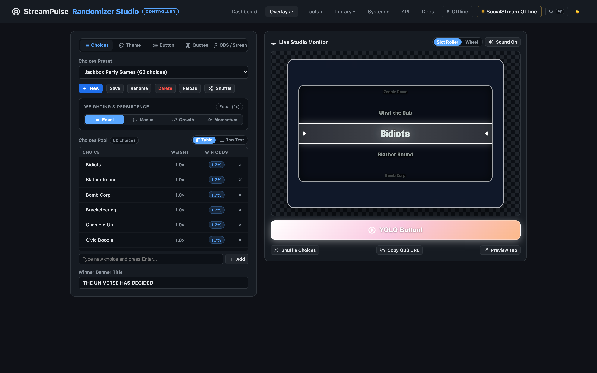
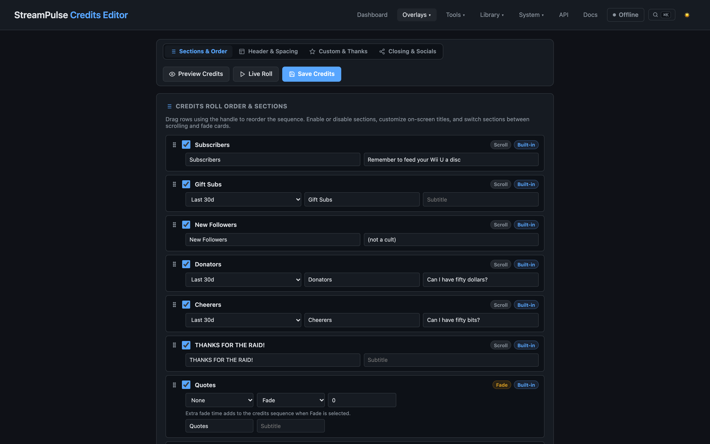
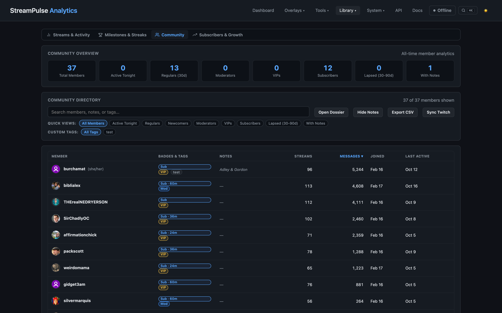
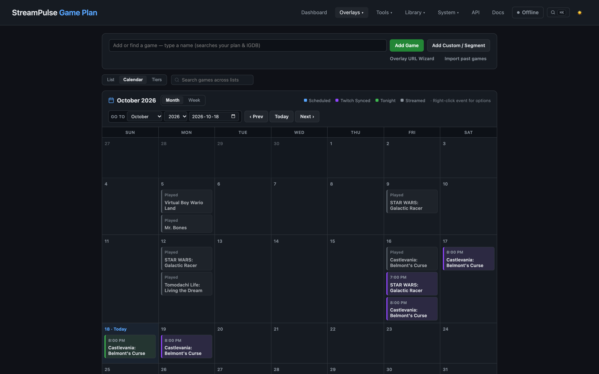
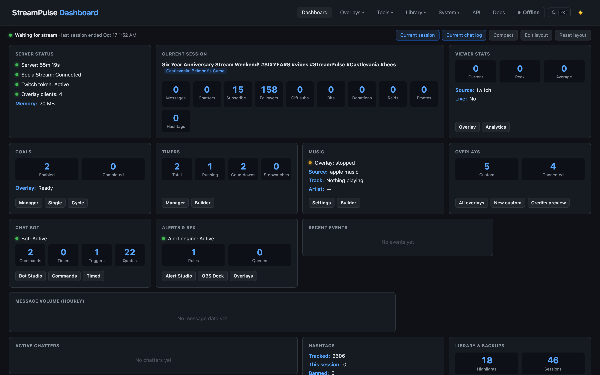

[](https://ko-fi.com/Z8Z11UEY5Q)
[](https://jarbochov.github.io/StreamPulse/)
[](LICENSE)

# StreamPulse

**The ultimate self-hosted broadcast companion and overlay suite for [SocialStream Ninja](https://socialstream.ninja/) and Twitch.**

StreamPulse turns your live broadcast data into cinematic OBS browser overlays, actionable community analytics, and hands-on production tools. Built from the ground up for low CPU overhead and zero cloud lock-in, StreamPulse bridges multi-platform chat, subscriptions, cheers, raids, and follower milestones directly into your broadcast.

---

## Visual Feature Showcase

### Custom Overlay Studio
A full drag-and-drop canvas designer with transparent WebKit punchouts, WebGL retro display shaders (CRT scanlines, aperture grille, TV static snow, LCD response-time smear), GPU media filters, animated sweep borders, and unified HTML5/YouTube video playback.


### Choice Randomizer Studio
Decoupled studio controller and transparent OBS overlay featuring spinning wheels, continuous vertical slot machine rollers, and card flip reveals with sound effects, choice weighting, winner elimination, and Twitch live chatter auto-population.



### Cinematic Credits Studio
Dedicated credits configuration studio with instant live-roll testing, static card previews, customizable Special Thanks and custom fade sections, and timing synchronization for music outros.



### Community Directory & Viewer Dossiers
Streamer-focused community management with high-level analytics cards, private streamer notes, pronouns, and smart roster segments (Moderators, VIPs, Regulars active in 3+ streams over 90 days, Lapsed viewers, and Newcomers) with 1-click CSV roster export.



### Game Plan Broadcast Scheduler
Full month and week calendar views, 14-day quick calendar strips, IGDB game catalog integration with cover art, and 1-click scheduling with Play Now (auto-syncing your Twitch category), Next Up, and schedule strips.



### Live Dashboard & Alert Queue Dock
Real-time message volume charts, session stream timers, Twitch connection status, and a low-density Alert Queue dock with background chat filtering ("Hide unmatched") and one-click event replay.



---

## Quick Start Guide

### 1. Prerequisites
- **Node.js**: Install the LTS version (v22.12 or newer) from [nodejs.org](https://nodejs.org/).
- **SocialStream Ninja**: Install the free browser extension from [socialstream.ninja](https://socialstream.ninja/).
- **OBS Studio**: For displaying browser source overlays on stream.

### 2. Download and Run StreamPulse
1. Clone the repository or download the source ZIP:
   ```bash
   git clone https://github.com/jarbochov/StreamPulse.git
   cd StreamPulse
   ```
2. Install dependencies:
   ```bash
   npm install
   ```
3. Start StreamPulse:
   - **Mac / Linux**: Run `./start-streampulse.sh` or `npm start`
   - **Windows**: Double-click `start-streampulse.bat` or run `npm start`
4. Open `http://localhost:3000` in your browser.

### 3. Connect to SocialStream Ninja
1. Open SocialStream Ninja in your browser and verify the local API server is active on port `8080`.
2. In StreamPulse, go to **System -> Config Editor** (`/config-editor.html`) -> **Connection & Security**.
3. Verify your SSN WebSocket URL (default: `ws://127.0.0.1:8080`) and save.
4. For step-by-step instructions, see the **[SocialStream Ninja Setup Guide](docs/socialstream-setup.md)**.

### 4. Add Overlays to OBS
1. In OBS Studio, add a new **Browser** source to your scene.
2. Set the **URL** to the desired overlay:
   - **Credits Roll**: `http://localhost:3000/overlays/credits.html`
   - **Choice Randomizer**: `http://localhost:3000/overlays/randomizer.html`
   - **Game Plan Ticker**: `http://localhost:3000/overlays/game-plan.html`
   - **Community Goals**: `http://localhost:3000/overlays/goal.html`
   - **Now Playing Music**: `http://localhost:3000/overlays/music.html`
   - **Custom Overlays**: `http://localhost:3000/overlays/custom-overlay.html?id=<overlay-id>`
3. Set the dimensions (typically `1920` width and `1080` height).
4. Check **Shutdown source when not visible** and click **OK**.

---

## Documentation Hub

Comprehensive technical guides, API documentation, and hardware configuration are maintained in the `docs/` directory and published on our **[Documentation Site](https://jarbochov.github.io/StreamPulse/)**:

| Guide | Description |
| --- | --- |
| **[SocialStream Ninja Setup](docs/socialstream-setup.md)** | Step-by-step guide for installing, configuring, and verifying SocialStream Ninja. |
| **[Custom Overlays Studio](docs/custom-overlays.md)** | Layer types, WebKit punchout masks, retro WebGL shaders, GPU media filters, and presets. |
| **[Bitfocus Companion & Stream Deck](docs/companion.md)** | Hardware button actions, live stream feedbacks, dynamic variables, and setup instructions. |
| **[HTTP API & WebSocket Reference](docs/api-reference.md)** | Complete REST API endpoints for session control, randomizer, timers, and WebSocket events. |
| **[Architecture & Technical Overview](docs/architecture.md)** | Cascading static routing, modular services architecture, and atomic persistence. |
| **[Developer & Contributor Guide](docs/developer-guide.md)** | Environment setup, running the test pipeline (`npm test`), and UI/UX design standards. |
| **[Clips Detection (Beta)](docs/clips-beta.md)** | Configuring chat velocity spike detection and automated stream marker creation. |
| **[Server Management & Backups](docs/server-management.md)** | Atomic ZIP backups, item sharing, headless execution, and process supervision. |

---

## License

StreamPulse is open-source software licensed under the [MIT License](LICENSE).
