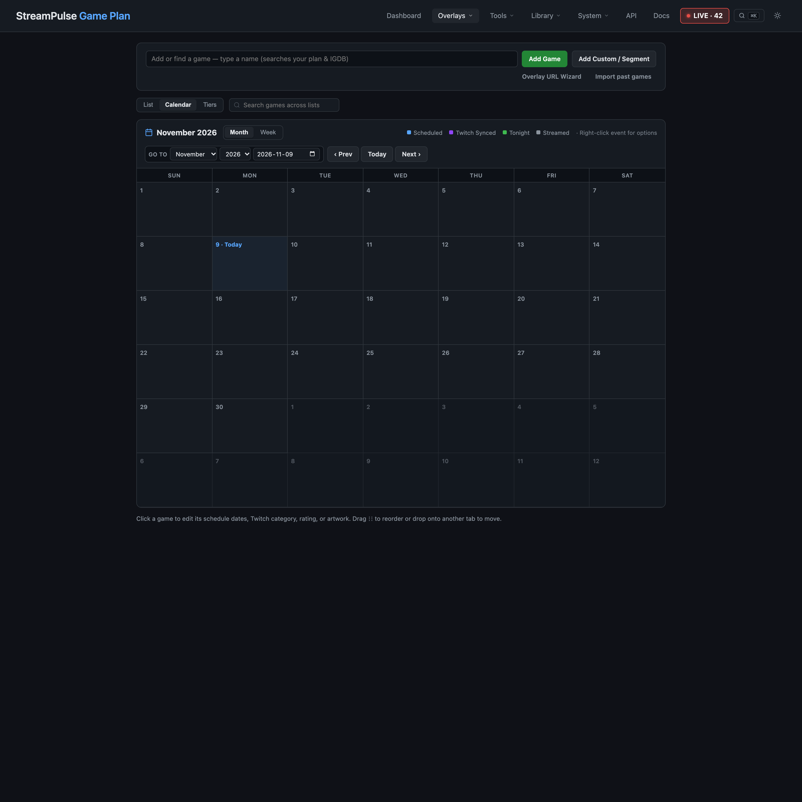
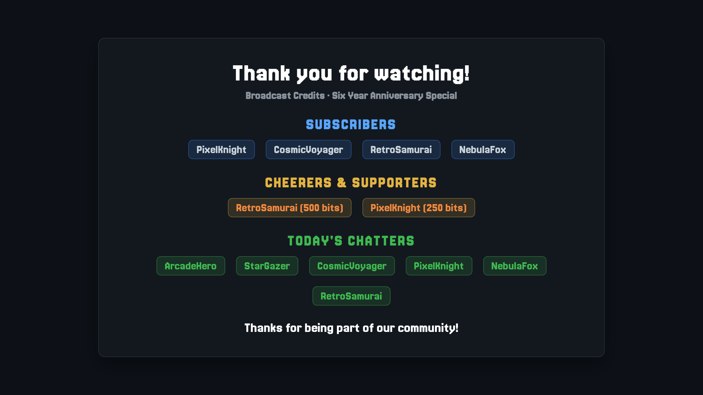
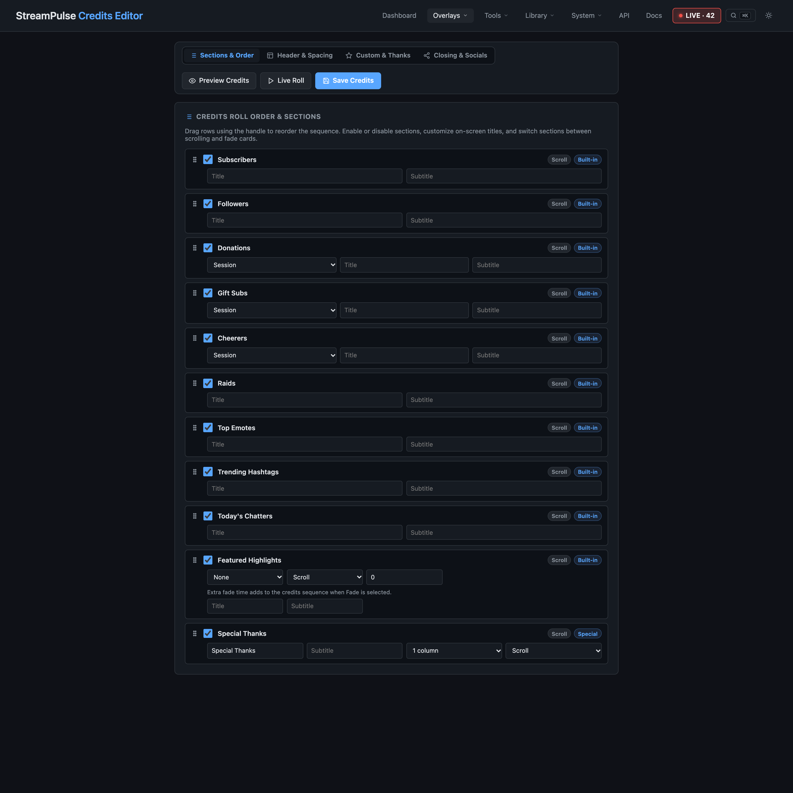
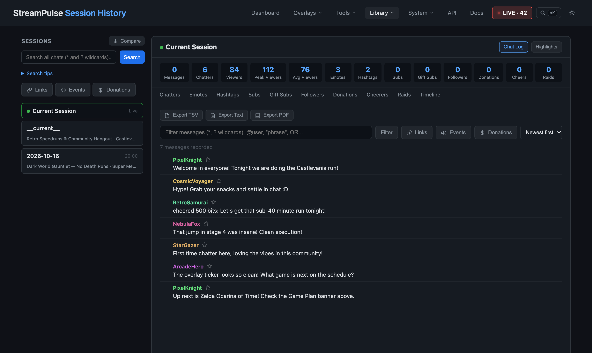
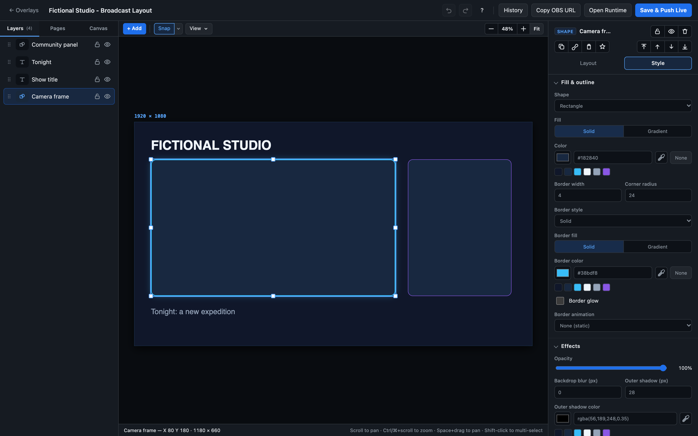
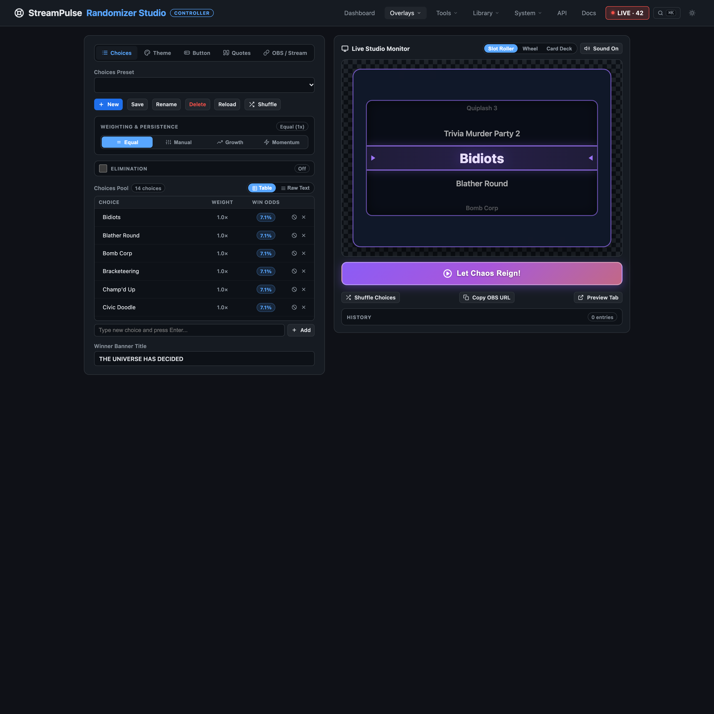
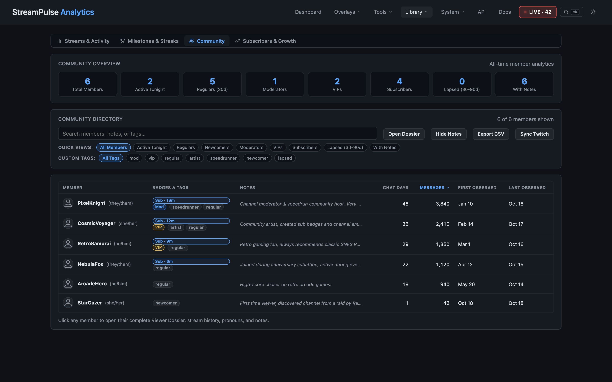
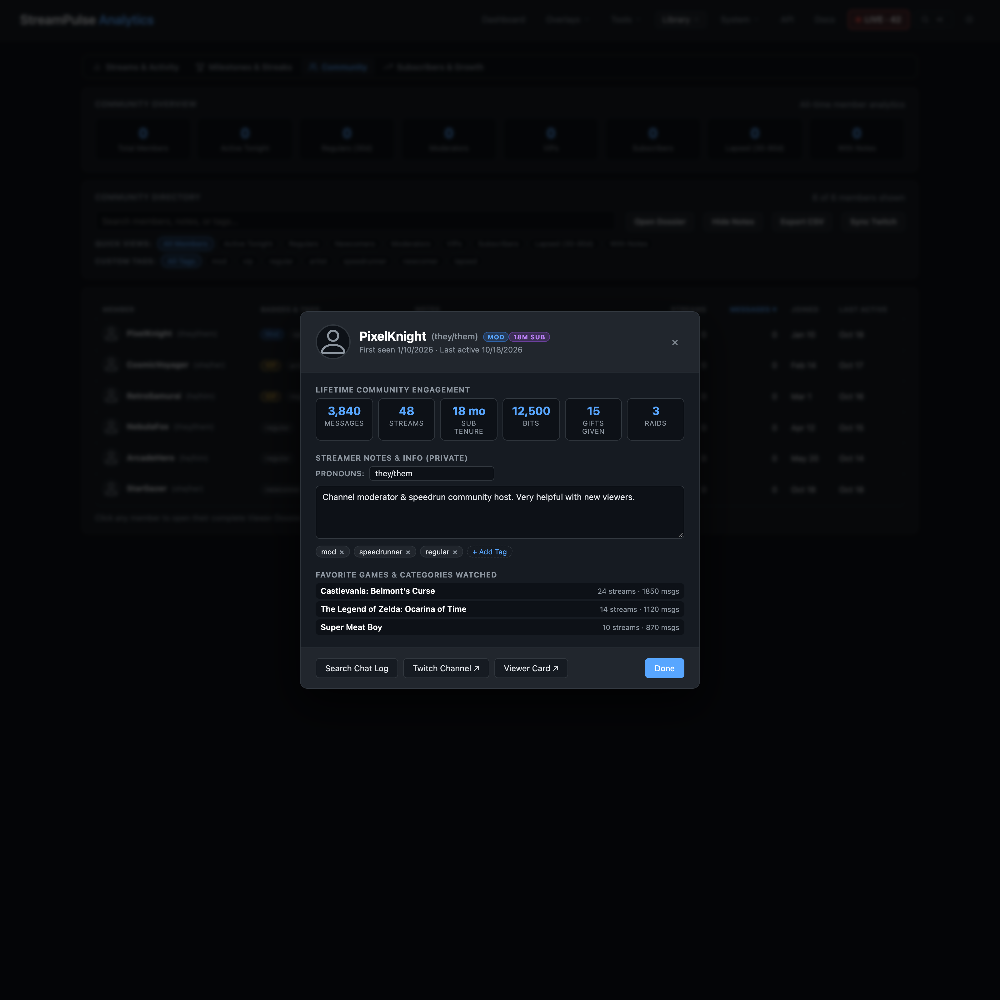
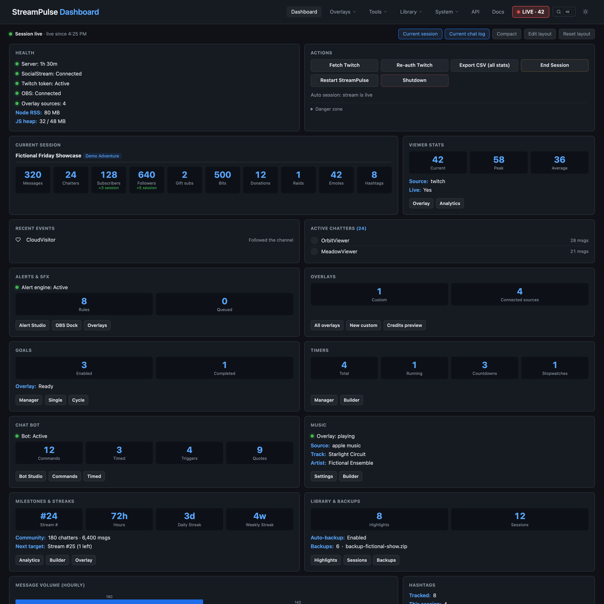
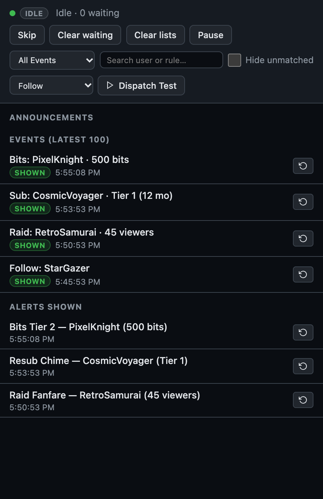

[](https://ko-fi.com/Z8Z11UEY5Q)
[](https://jarbochov.github.io/StreamPulse/)
[](LICENSE)
[](https://github.com/jarbochov/StreamPulse/releases)

# StreamPulse

**A self-hosted broadcast companion and overlay suite for Twitch, working alongside [SocialStream Ninja](https://socialstream.ninja/).**

StreamPulse turns your live broadcast data into OBS browser overlays, community analytics, and hands-on production tools. It runs locally, using SocialStream Ninja for chat and supported events, and Twitch account connections for Twitch-specific data and actions.

---

## What is StreamPulse?

StreamPulse is currently focused on Twitch streamers who want to plan their show, run live production tools, and keep a useful record of each broadcast.

**StreamPulse is different.** It is a free, self-hosted companion that runs quietly on your computer while you stream:

- **Free & Locally Stored**: No StreamPulse subscription fees. Session archives, community notes, and configuration stay in files on your computer; enabled integrations still communicate with their services, including Twitch and your chosen SSN endpoint.
- **SocialStream Ninja Integration**: Reuses SSN's chat capture and supported events. SSN supports multiple platforms; StreamPulse's current product focus and account integrations are Twitch.
- **Cinematic Broadcast Overlays**: Instant OBS browser sources for movie-style scrolling end credits, spinning choice randomizers, game plan broadcast schedules, community goal meters, and retro CRT animated borders. Custom overlays also include a compact native Twitch poll display with adaptive 2–5-choice bars, vote totals, and a countdown; voting remains in Twitch.
- **Resource-Aware Rendering**: Limits inactive overlay work and avoids unnecessary refreshes. Resource use still depends on your scenes, media, effects, and hardware.
- **Prioritized Automatic Pages**: Alerts take priority over featured messages, polls, and commands. Interrupted polls resume while still valid; expired messages and commands are discarded instead of replaying late.
- **Promo Creator**: Open **Tools > Promo Creator** to build announcements from shared Text, Image, and QR elements with independent square, landscape, and portrait layouts. Reuse themes, 23 animated patterns, and IGDB artwork; export PNGs in one ZIP or a seamless MP4. The studio reopens your last saved design.

Whether you're looking for a simple, automated credits roll to thank your community at the end of each stream, or a complete production suite with Stream Deck hardware controls, StreamPulse has you covered.

### What StreamPulse adds to SocialStream Ninja

**SocialStream Ninja** already provides unified chat, chat overlays, featured messages, and chat capture across its supported platforms. Keep using those tools; StreamPulse is a companion, not a replacement.

**StreamPulse** adds a broadcast-production and review workspace: custom overlay layouts, Game Plan scheduling, timers and goals, wheel/roller/card randomizers, alert rules and queue controls, automated closing credits, session history, community notes, and Twitch subscriber/follower analytics. OBS docks and Bitfocus Companion controls bring those actions closer to your live workflow.

Some features overlap, such as alerts and bot messages. Use whichever fits your show, and avoid enabling duplicate responses in both apps. SSN's multi-platform support does not mean StreamPulse has equivalent account integrations or feature coverage outside Twitch.

---

## Visual Showcase & Overlays

### Game Plan Broadcast Scheduler & Dedicated OBS Overlays
Plan your upcoming broadcasts with full month and week calendar views, 14-day quick scheduling strips, and integrated game catalog cover art. Display your lineup directly in OBS using dedicated ticker bars, vertical countdown schedules, and game checklist overlays.



#### Live OBS Broadcast Overlays with Authentic Box Art
Display your active playthrough and upcoming lineup with responsive box art scaling, countdown clocks, and custom tags:


---

### Cinematic Credits Studio & Outro Roll
Celebrate every single supporter by name with a cinematic, Hollywood-style end credits roll. Includes customizable Special Thanks cards, music outro timing synchronization, and instant live-roll testing.





---

### Live Stream Chat History & Searchable Archive
Full session chat logging and viewer activity metrics stored locally in high-performance JSONL archives. Filter messages by wildcards, links, donations, or bit amounts, and export clean transcripts to TSV or PDF.



---

### Custom Overlay Studio & Retro WebGL Shaders
A full drag-and-drop canvas designer featuring transparent WebKit punchout masks, animated sweep borders, GPU media filters, and hardware-accelerated WebGL retro display shaders (CRT scanlines, shadow mask, TV static snow, LCD ghost smear).



---

### Choice Randomizer Studio
Decoupled studio controller and transparent OBS overlay featuring spinning wheels, continuous vertical slot machine rollers, 3D card-deck draws, and winner celebration cards with sound effects, choice weighting, and active live chatter auto-population. Companion buttons can trigger all three modes with configurable duration; overlay scale is controlled through the browser-source URL.



---

### Community Directory & Viewer Dossiers
Streamer-focused community management with analytics, private notes, roster segments, and CSV export. Optional Community insights add observed hashtag and emote history, approximate stream attendance, Twitch follow dates, and opt-in Chat Bot welcome-back and milestone messages.





---

### Live Dashboard & Alert Queue Dock
Real-time message volume charts, session stream timers, Twitch connection status, and a low-density Alert Queue dock with background chat filtering ("Hide unmatched") and one-click event replay.





---

## Under the Hood: Technical Architecture

For developers, technical directors, and power users, StreamPulse is engineered with clean, modular primitives:

- **Local Engine**: HTTP and WebSocket broadcast engine running on Node.js or embedded directly inside the Electron main process for desktop builds.
- **SocialStream Ninja Ingest**: Native WebSocket client listening to local or remote SSN sessions, extracting chat messages, cheers, subscriptions, gift subs, and raid events in real time.
- **Cascading Static File Routing**: Built-in static router in `server/static-router.js` with cascading path resolution (`public/overlays/`, `public/editors/`, `public/wizards/`, `public/tools/`, `public/library/`, `public/system/`) providing 100% backward compatibility for flat root paths with zero redirect latency.
- **Atomic Local Persistence**: Pure filesystem storage (`data/*.json`, `data/chat-log.jsonl`) with automated hourly backups and ZIP share packages. Zero database server (PostgreSQL/MySQL/MongoDB) required.
- **Resource-Aware Rendering**: The editor mounts active/common layers only; Game Plan avoids unchanged DOM rebuilds and redundant polling. Historical metrics and dossiers share compact, metadata-validated archive summaries.
- **Bounded Backup Processing**: Full-backup compression and restore archive processing run in a short-lived worker, with bounded queuing and explicit failures. ZIP buffers still consume memory; share-package processing remains separate.
- **Shared Randomizer Runtime**: Studio and OBS use the same wheel, roller, and deck animation modules. The wheel reuses a cached face during rotation, trading one additional canvas buffer for fewer repeated drawing operations.
- **Hardware-Accelerated WebGL Shaders**: GPU-rendered CRT scanline emulation, phosphor bloom, curvature distortion, and LCD pixel response smearing. Active effects still incur rendering and CPU coordination costs.
- **Bitfocus Companion Integration**: Official Companion module (`companion-module-streampulse`) exposing dynamic stream variables, button feedbacks, and hardware execution for Elgato Stream Deck and web remotes.

---

## Quick Start Guide

### Option A: Standalone Desktop App (macOS & Windows)
1. Download the latest installer from the **[Releases Page](https://github.com/jarbochov/StreamPulse/releases)**:
   - **macOS**: Download `StreamPulse.dmg` or `StreamPulse.zip` (supports Apple Silicon and Intel).
   - **Windows**: Download `StreamPulse-Setup.exe` or portable `.exe`.
2. Launch StreamPulse. The application runs quietly in your system tray or menu bar with one-click access to all studio controllers and OBS overlay links.
3. Open `http://localhost:3000` or use the menu bar icon to access the studio.

**Updating the desktop app:** use the latest desktop installer, fully quit StreamPulse, then replace or reinstall the app. Configuration and data are stored separately. Source ZIPs and Git/nightly updates are not desktop upgrades. Open **Docs** in the app for installation details.

### Option B: Self-Hosted Node.js (CLI)
1. Ensure **Node.js** (v22.12 or newer) is installed.
2. Clone and install dependencies:
   ```bash
   git clone https://github.com/jarbochov/StreamPulse.git
   cd StreamPulse
   npm run setup
   # (Select option 1 for fast server-only mode, or run: npm install --omit=dev)
   ```
3. Start the server:
   - **macOS / Linux**: `./start-streampulse.sh` or `npm start`
   - **Windows**: Double-click `start-streampulse.bat` or run `npm start`
4. Open `http://localhost:3000` in your browser.

### Connect to SocialStream Ninja
1. Open SocialStream Ninja in your browser and verify the local API server is active on port `8080`.
2. In StreamPulse, navigate to **System -> Config Editor** (`/config-editor.html`) -> **Connection & Security**.
3. Enter your actual **SocialStream session ID**, save, and restart StreamPulse. The example `YOUR_SSN_SESSION_ID` is not a working configuration; leaving the ID blank disables chat collection. Check that `ssn.server` in `config.json` matches your SSN endpoint.
4. For connection instructions, open **Docs** in the app.

### Add Overlays to OBS Studio
1. In OBS Studio, add a new **Browser** source to your scene.
2. Set the **URL** to the desired overlay:
   - **Credits Roll**: `http://localhost:3000/overlays/credits.html`
   - **Choice Randomizer**: `http://localhost:3000/overlays/randomizer.html`
   - **Game Plan Ticker**: `http://localhost:3000/overlays/game-plan.html?view=ticker`
   - **Game Plan Schedule**: `http://localhost:3000/overlays/game-plan.html?mode=schedule`
   - **Community Goals**: `http://localhost:3000/overlays/goal.html`
   - **Now Playing Music**: `http://localhost:3000/overlays/music.html`
   - **Custom Overlays**: `http://localhost:3000/overlays/custom-overlay.html?id=<overlay-id>`
3. Set the dimensions (typically `1920` width and `1080` height).
4. Check **Shutdown source when not visible** and click **OK**.

---

## Inspiration & Acknowledgements

StreamPulse is built on the shoulders of giants and inspired by the open streaming ecosystem:

- **Steve Seguin & [SocialStream Ninja](https://socialstream.ninja/)**: Steve Seguin's visionary work on SocialStream Ninja proved that live stream tooling can be decentralized, community-driven, and completely independent of proprietary cloud platforms. StreamPulse exists because SocialStream Ninja made open, multi-platform chat ingestion accessible to everyone.
- **The Cinematic End-Credits Tradition**: Inspired by the movie and television tradition of scrolling end credits, where every person who contributed to the experience is honored by name before the lights come up.
- **[OBS Studio](https://obsproject.com/)**: The undisputed cornerstone of open-source video production and broadcasting.
- **[Bitfocus Companion](https://bitfocus.io/companion)**: The incredible open-source tactile control ecosystem powering broadcast studios and Stream Decks worldwide.
- **[Twitch Developer Platform](https://dev.twitch.tv/) & [IGDB](https://www.igdb.com/)**: For developer APIs and video game catalog metadata.

---

## Explore StreamPulse

Visit the **[StreamPulse website](https://jarbochov.github.io/StreamPulse/)** for features, sample scenes, downloads, and project support. Setup instructions and automation references are included in the app under **Docs** and **API Reference**.

| Website page | What's there |
| --- | --- |
| **[Features](docs/features.md)** | Find the tools that fit your show. |
| **[Showcase](docs/showcase.md)** | Sample scenes, audience moments, and promos using fictional data. |
| **[Download](docs/quickstart.md)** | Desktop releases for macOS and Windows. |
| **[Support](docs/support.md)** | Questions, issue reporting, and ways to help the project. |

Older technical pages remain available for existing links, but may not match your installed version. Contributors can still find source setup in the [developer reference](docs/developer-guide.md).

---

## License

StreamPulse is open-source software licensed under the [MIT License](LICENSE).
