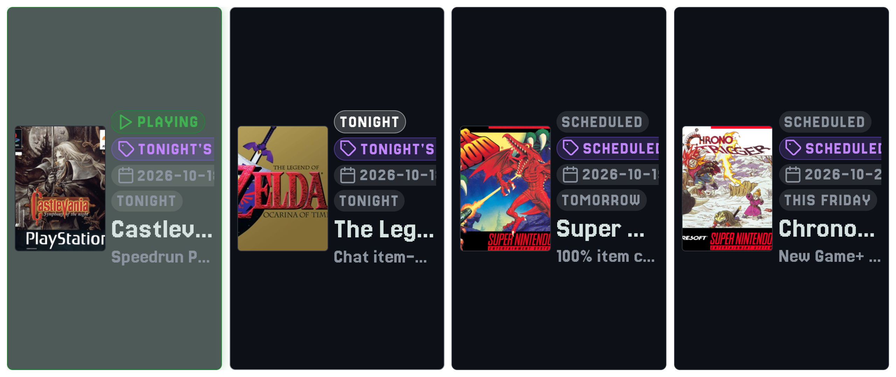
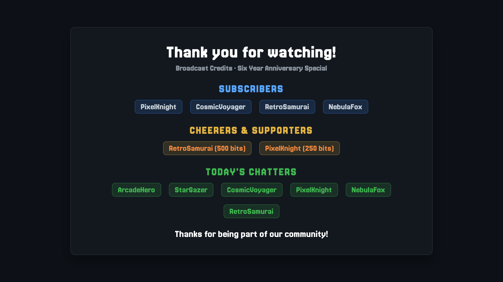
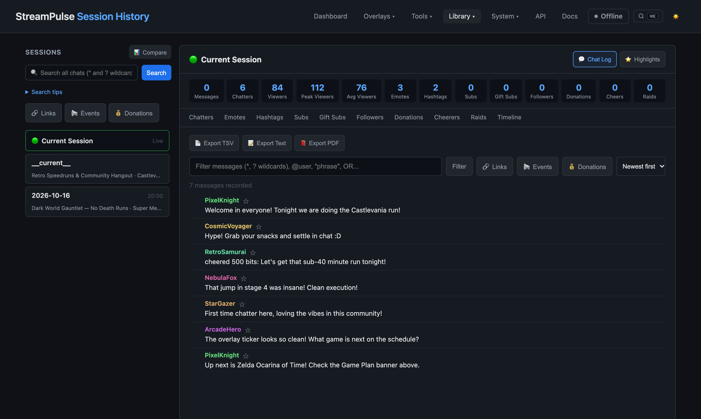
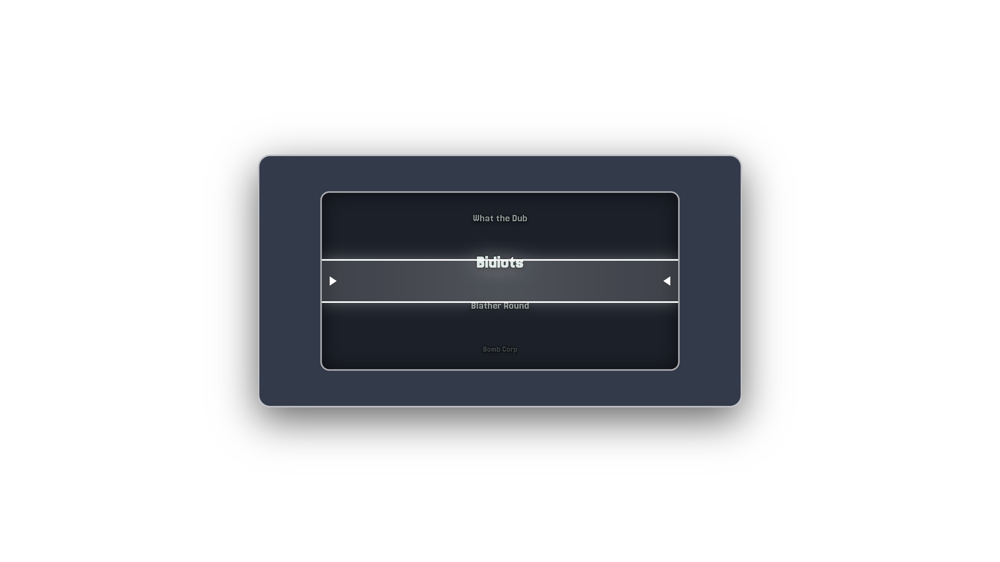
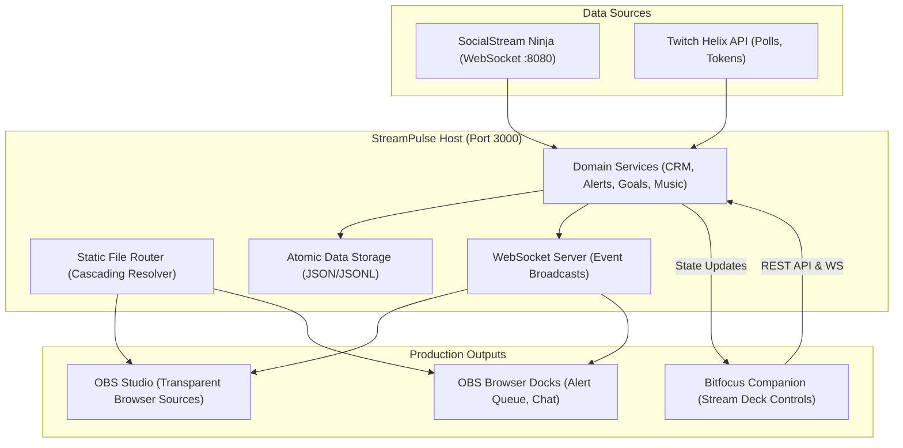

# StreamPulse Documentation

Welcome to the official documentation for **StreamPulse**, the ultimate self-hosted broadcast companion and overlay suite for [SocialStream Ninja](https://socialstream.ninja/) and Twitch.

StreamPulse turns your live broadcast data into cinematic OBS browser overlays, actionable community analytics, and hands-on production tools with low CPU overhead and zero cloud lock-in.

---

## What is StreamPulse?

StreamPulse is a lightweight, self-hosted companion that runs quietly on your computer while you stream:

- **100% Free & Private**: No monthly subscription fees, no third-party tracking, and no cloud servers holding your stream data. Everything lives locally in simple files on your computer.
- **Decentralized Multi-Platform Power**: Pairs natively with SocialStream Ninja to ingest Twitch, YouTube, Kick, and Discord chat into one unified stream engine.
- **Cinematic Broadcast Overlays**: Instant OBS browser sources for movie-style scrolling end credits, spinning choice randomizers, game plan broadcast schedules, community goal meters, and retro CRT animated borders.
- **Obsessively Low Overhead**: Uses negligible CPU and RAM so your computer can focus all its power on gaming and video encoding without dropped frames.

> [!NOTE]
> **100% Self-Made & Independently Funded**
> StreamPulse is completely self-made, open-source, and privately maintained without corporate sponsors, subscriptions, or telemetry. If StreamPulse enhances your live stream production, consider supporting ongoing development on [Ko-fi](https://ko-fi.com/jarbochov).

---

## Production Studios & Overlays

  <a class="feature-card" href="#/custom-overlays">
    <h4>Custom Overlay Studio</h4>
    
Visual drag-and-drop layer builder, transparent WebKit punchout masks, WebGL retro display shaders (CRT, scanlines, TV static), GPU media filters, and animated sweep borders.

  </a>
  <a class="feature-card" href="#/credits-guide">
    <h4>Cinematic Credits Studio</h4>
    
Post-stream scrolling credits with customizable sections, static fade cards, Special Thanks spotlights, and synchronized outro music timing.

  </a>
  <a class="feature-card" href="#/randomizer-guide">
    <h4>Choice Randomizer Studio</h4>
    
Decoupled studio controller and transparent OBS overlay with spinning wheels, continuous slot rollers, winner celebration cards, audio cues, and active chatter auto-population.

  </a>
  <a class="feature-card" href="#/game-plan-guide">
    <h4>Game Plan Broadcast Scheduler</h4>
    
Interactive calendar views, 14-day schedule strips, IGDB game catalog integration with cover art, and dedicated OBS overlays.

  </a>
  <a class="feature-card" href="#/community-guide">
    <h4>Community Directory & Dossiers</h4>
    
Streamer-focused CRM with smart segments (Regulars, VIPs, Lapsed, Newcomers), private streamer notes, pronouns, chatter dossiers, and CSV roster exports.

  </a>
  <a class="feature-card" href="#/alerts-guide">
    <h4>Alerts & Alert Queue Dock</h4>
    
Event rules engine, audio synthesis, media uploads, and the low-density OBS dock with unmatched event filtering and one-click replay.

  </a>
  <a class="feature-card" href="#/chatbot-guide">
    <h4>Integrated Chat Bot</h4>
    
Automated chat commands, aliases, user cooldowns, timed periodic messages, quotes database, dynamic variables, and silent webhooks.

  </a>
  <a class="feature-card" href="#/companion">
    <h4>Bitfocus Companion & Stream Deck</h4>
    
Pre-configured 32-key page layout, hardware button actions, live stream feedbacks, dynamic variables, and tactile control.

  </a>
  <a class="feature-card" href="#/desktop-app">
    <h4>Desktop App (Electron) & Roadmap</h4>
    
Standalone native application for macOS and Windows with system tray controls, background service management, and zero terminal setup.

  </a>

---

## OBS Browser Source Quick Reference

All StreamPulse overlays run as transparent, GPU-accelerated OBS browser sources connected to your local server:

| Overlay Name | Local OBS Source URL | Default Resolution | Recommended Settings |
| --- | --- | --- | --- |
| **Credits Roll** | `http://localhost:3000/overlays/credits.html` | 1920 x 1080 | Shutdown source when not visible; Control audio via OBS |
| **Choice Randomizer** | `http://localhost:3000/overlays/randomizer.html` | 1920 x 1080 | Refresh browser when scene becomes active |
| **Custom Overlays** | `http://localhost:3000/overlays/custom-overlay.html?id=<id>` | 1920 x 1080 | Enable transparent punchouts; Hardware acceleration on |
| **Game Plan Ticker** | `http://localhost:3000/overlays/game-plan.html?view=ticker` | 1920 x 180 | Transparent background; CSS container queries enabled |
| **Game Plan Schedule** | `http://localhost:3000/overlays/game-plan.html?mode=schedule` | 1280 x 540 | Responsive card layout; Auto-scroll upcoming games |
| **Game Plan Checklist** | `http://localhost:3000/overlays/game-plan.html?mode=checklist` | 480 x 680 | Compact sidebar checklist; Live playing indicator |
| **Community Goals** | `http://localhost:3000/overlays/goal.html` | 600 x 140 | Custom styling via overlay URL query parameters |
| **Now Playing Music** | `http://localhost:3000/overlays/music.html` | 500 x 100 | Syncs with Snip, Spotify local, Apple Music, or VLC |
| **Alert Queue Dock** | `http://localhost:3000/tools/alert-queue.html` | 380 x 600 | Custom OBS Browser Dock; Persistent login |

---

## Visual Feature Showcase

### Game Plan Broadcast Scheduler & Overlays
Interactive broadcast scheduler with IGDB game catalog metadata, 14-day schedule strips, and calendar views:

#### Dedicated OBS Broadcast Overlays
Display your active playthrough and upcoming lineup with responsive box art scaling, countdown clocks, and custom tags:

---

### Cinematic Credits Studio & Outro Roll
Celebrate every single supporter by name with a cinematic, Hollywood-style end credits roll:

---

### Live Stream Chat History & Searchable Archive
Full session chat logging and viewer activity metrics stored locally in high-performance JSONL archives:

---

### Custom Overlay Studio
Transparent WebKit punchout masks, WebGL retro display shaders (CRT scanlines, aperture grille, TV static snow), GPU filters, and animated sweep borders:

---

### Choice Randomizer Studio & Overlay
Decoupled studio controller with choice weighting, winner elimination, and sound synthesis—paired with a glassmorphic OBS transparent stage:

---

### Community Directory & Viewer Dossiers
Streamer-focused community management with high-level analytics cards, private streamer notes, pronouns, and smart roster segments with 1-click CSV export:

---

### Live Stream Command Center & Alert Queue Dock
Real-time message volume charts, session stream timers, Twitch connection status, and low-density OBS browser dock:

---

## System Architecture

StreamPulse runs as a local-first service connecting stream data sources to your broadcast software and hardware controllers:

---

## Inspiration & Acknowledgements

StreamPulse is built on the shoulders of giants and inspired by the open streaming ecosystem:

- **Steve Seguin & [SocialStream Ninja](https://socialstream.ninja/)**: Steve Seguin's visionary work on SocialStream Ninja proved that live stream tooling can be decentralized, community-driven, and completely independent of proprietary cloud platforms. StreamPulse exists because SocialStream Ninja made open, multi-platform chat ingestion accessible to everyone.
- **The Cinematic End-Credits Tradition**: Inspired by the movie and television tradition of scrolling end credits, where every person who contributed to the experience is honored by name before the lights come up.
- **[OBS Studio](https://obsproject.com/)**: The undisputed cornerstone of open-source video production and broadcasting.
- **[Bitfocus Companion](https://bitfocus.io/companion)**: The incredible open-source tactile control ecosystem powering broadcast studios and Stream Decks worldwide.
- **[Twitch Developer Platform](https://dev.twitch.tv/) & [IGDB](https://www.igdb.com/)**: For developer APIs and video game catalog metadata.

---

## Getting Started Guides

- **[Quick Start Guide](quickstart.md)**: Set up Node.js, clone the repository, and connect your first OBS browser source in under 5 minutes.
- **[SocialStream Ninja Setup Guide](socialstream-setup.md)**: Step-by-step walkthrough for installing the free SocialStream desktop app or browser extension, configuring the WebSocket API on port 8080, and verifying message flow.
- **[Bitfocus Companion & Stream Deck](companion.md)**: Import the StreamPulse Companion profile for instant tactile control over randomizer spins, credits rolls, alerts, and timers.

---

## Technical & Architecture Documentation

- **[Desktop App & Roadmap](desktop-app.md)**: Deep dive into the Electron desktop architecture, process supervision, system tray menus, and GitHub Actions multi-platform packaging.
- **[Architecture & Routing](architecture.md)**: Technical breakdown of the cascading static router, modular service architecture, WebSocket broadcast pipeline, and atomic data persistence.
- **[HTTP API & WebSocket Reference](api-reference.md)**: Complete developer documentation for all REST endpoints, WebSocket message protocols, and payload schemas.
- **[Developer & Contributor Guide](developer-guide.md)**: Codebase setup, running the test pipeline (`npm test`), ESLint configuration, and strict No-Emoji design system guidelines.
- **[Server Management & Backups](server-management.md)**: Service supervisor configuration, atomic data directory backups, and headless deployment on Linux servers.
- **[Troubleshooting & FAQ](troubleshooting.md)**: Practical solutions for port conflicts, OBS browser source audio autoplay policies, background tab throttling, and PDF report exports.

---

## Community Support & Funding

StreamPulse is 100% self-made, open-source, and privately self-funded. There are no corporate sponsors, paywalled features, investor boards, or monetization subscriptions.

If StreamPulse brings value to your stream, helps celebrate your community, or saves you subscription costs from commercial alert tools, you can support continuous development, hosting, and hardware testing on Ko-fi:

---

## License

StreamPulse is open-source software licensed under the [MIT License](https://github.com/jarbochov/StreamPulse/blob/main/LICENSE).
