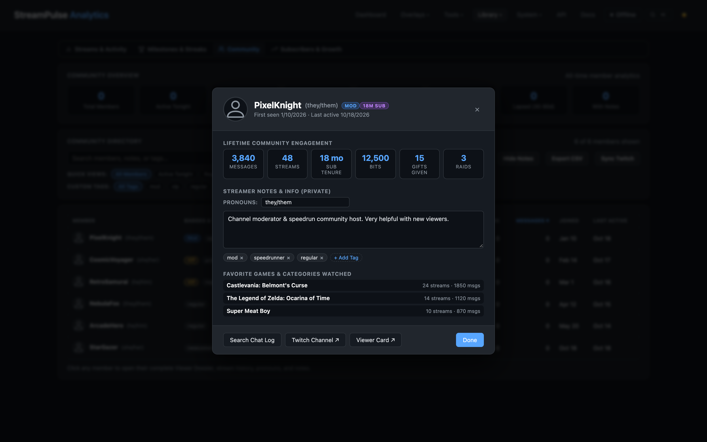

# StreamPulse Documentation

Welcome to the official documentation for **StreamPulse**, the ultimate self-hosted broadcast companion and overlay suite for [SocialStream Ninja](https://socialstream.ninja/) and Twitch.

StreamPulse turns your live broadcast data into cinematic OBS browser overlays, actionable community analytics, and hands-on production tools with low CPU overhead and zero cloud lock-in.

---

## Production Studios & Overlays

  <a class="feature-card" href="#/custom-overlays">
    <h4>Custom Overlay Studio</h4>
    
Visual drag-and-drop layer builder, transparent WebKit punchout masks, WebGL retro display shaders (CRT, scanlines, TV static), GPU media filters, and animated sweep borders.

  </a>
  <a class="feature-card" href="#/credits-guide">
    <h4>Cinematic Credits Studio</h4>
    
Post-stream scrolling credits with customizable sections, static fade cards, Special Thanks spotlights, and synchronized outro music timing.

  </a>
  <a class="feature-card" href="#/randomizer-guide">
    <h4>Choice Randomizer Studio</h4>
    
Decoupled studio controller and transparent OBS overlay with spinning wheels, continuous slot machines, card flip reveals, audio cues, and active chatter auto-population.

  </a>
  <a class="feature-card" href="#/game-plan-guide">
    <h4>Game Plan Broadcast Scheduler</h4>
    
Interactive calendar views, 14-day schedule strips, IGDB game catalog integration with cover art, and 1-click Twitch category updates.

  </a>
  <a class="feature-card" href="#/community-guide">
    <h4>Community Directory & Dossiers</h4>
    
Streamer-focused CRM with smart segments (Regulars, VIPs, Lapsed, Newcomers), private streamer notes, pronouns, chatter dossiers, and CSV roster exports.

  </a>
  <a class="feature-card" href="#/alerts-guide">
    <h4>Alerts & Alert Queue Dock</h4>
    
Event rules engine, audio synthesis, media uploads, and the low-density OBS dock with unmatched event filtering and one-click replay.

  </a>
  <a class="feature-card" href="#/chatbot-guide">
    <h4>Integrated Chat Bot</h4>
    
Automated chat commands, aliases, user cooldowns, timed periodic messages, quotes database, dynamic variables, and silent webhooks.

  </a>
  <a class="feature-card" href="#/companion">
    <h4>Bitfocus Companion & Stream Deck</h4>
    
Pre-configured 32-key page layout, hardware button actions, live stream feedbacks, dynamic variables, and tactile control.

  </a>
  <a class="feature-card" href="#/desktop-app">
    <h4>Desktop App (Electron) & 1.0 Roadmap</h4>
    
Standalone native application for macOS and Windows with system tray controls, background service management, and zero terminal setup.

  </a>

---

## OBS Browser Source Quick Reference

All StreamPulse overlays run as transparent, GPU-accelerated OBS browser sources connected to your local server:

| Overlay Name | Local OBS Source URL | Default Resolution | Recommended Settings |
| --- | --- | --- | --- |
| **Credits Roll** | `http://localhost:3000/overlays/credits.html` | 1920 x 1080 | Shutdown source when not visible; Control audio via OBS |
| **Choice Randomizer** | `http://localhost:3000/overlays/randomizer.html` | 1920 x 1080 | Refresh browser when scene becomes active |
| **Custom Overlays** | `http://localhost:3000/overlays/custom-overlay.html?id=<id>` | 1920 x 1080 | Enable transparent punchouts; Hardware acceleration on |
| **Game Plan Ticker** | `http://localhost:3000/overlays/game-plan.html` | 1920 x 120 | Transparent background; CSS container queries enabled |
| **Community Goals** | `http://localhost:3000/overlays/goal.html` | 600 x 140 | Custom styling via overlay URL query parameters |
| **Now Playing Music** | `http://localhost:3000/overlays/music.html` | 500 x 100 | Syncs with Snip, Spotify local, or manual track title |
| **Alert Queue Dock** | `http://localhost:3000/tools/alert-queue.html` | 380 x 600 | Custom OBS Browser Dock; Persistent login |

---

## Getting Started Guides

- **[Quick Start Guide](quickstart.md)**: Set up Node.js, clone the repository, and connect your first OBS browser source in under 5 minutes.
- **[SocialStream Ninja Setup Guide](socialstream-setup.md)**: Step-by-step walkthrough for installing the free SocialStream extension, configuring the WebSocket API on port 8080, and verifying message flow.
- **[Bitfocus Companion & Stream Deck](companion.md)**: Import the StreamPulse Companion profile for instant tactile control over randomizer spins, credits rolls, alerts, and timers.

---

## Technical & Architecture Documentation

- **[Desktop App & 1.0 Roadmap](desktop-app.md)**: Deep dive into the Electron desktop architecture, process supervision, system tray menus, and GitHub Actions multi-platform packaging.
- **[Architecture & Routing](architecture.md)**: Technical breakdown of the cascading static router, modular service architecture, WebSocket broadcast pipeline, and atomic data persistence.
- **[HTTP API & WebSocket Reference](api-reference.md)**: Complete developer documentation for all REST endpoints, WebSocket message protocols, and payload schemas.
- **[Developer & Contributor Guide](developer-guide.md)**: Codebase setup, running the test pipeline (`npm test`), ESLint configuration, and strict No-Emoji design system guidelines.
- **[Server Management & Backups](server-management.md)**: Service supervisor configuration, atomic data directory backups, and headless deployment on Linux servers.
- **[Troubleshooting & FAQ](troubleshooting.md)**: Practical solutions for port conflicts, OBS browser source audio autoplay policies, background tab throttling, and PDF report exports.

---

## Visual Feature Showcase

### Custom Overlay Studio
Transparent WebKit punchout masks, WebGL retro display shaders (CRT scanlines, aperture grille, TV static snow), GPU filters, and animated sweep borders.

### Choice Randomizer Studio
Spinning wheels, continuous vertical slot machine rollers, and card flip reveals with sound synthesis and active chatter auto-population.

### Cinematic Credits Studio
Dedicated credits configuration studio with instant live-roll testing, static card previews, and music outro synchronization.

### Community Directory & Viewer Dossiers
Streamer-focused community management with high-level analytics cards, private streamer notes, pronouns, and smart roster segments with 1-click CSV export.

Detailed viewer dossier displaying attendance metrics, first seen date, cheered bits, and streamer notes with fictitious dummy data.

### Game Plan Broadcast Scheduler
Full month and week calendar views, 14-day schedule strips, IGDB game catalog integration, and one-click Twitch category updates.

### Alert Queue Dock
Real-time alert inspection dock with "Hide unmatched" background event filtering and one-click event replay.

### Live Stream Dashboard
Real-time message volume charts, session stream timers, Twitch connection status, and active tool launchers.

