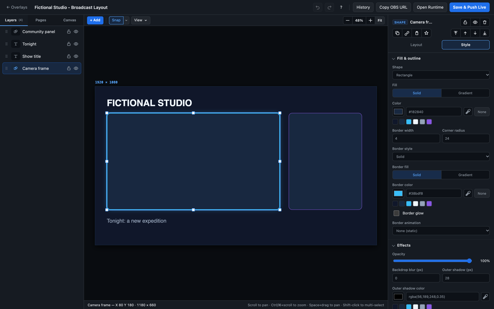
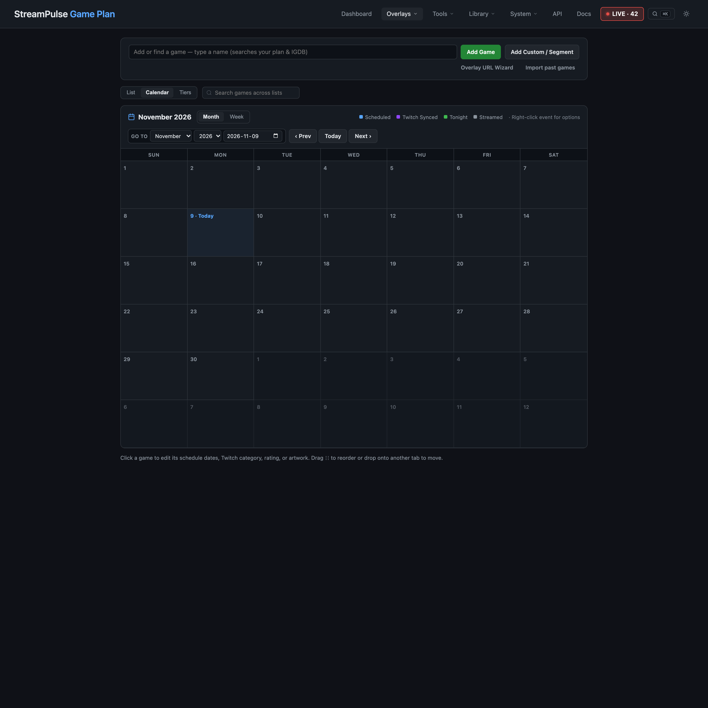

  
Your stream. Your community. Your show.

  <h1>Make your stream feel  like your show.</h1>
  
Give your game nights a lineup, your audience a say, and your outro a proper thank-you. StreamPulse brings creative overlays and live show tools together in a free, open-source desktop app.

  

    <a class="docs-button" href="#/quickstart">Download StreamPulse</a>
    <a class="docs-button" href="#/showcase">See it in action</a>
  

  
For macOS and Windows · Made for OBS · Works alongside SocialStream Ninja

## Less window juggling. More time for your audience.

Build a starting screen, run a community vote, or roll the credits at the end of a great night. Keep your presentation and the controls behind it in one workspace, instead of piecing together a different tool for every moment.

  <a class="guide-card" href="#/custom-overlays">
    <h3>A look that's yours</h3>
    
Mix artwork, text, video, and live information into layouts that match your channel.

  </a>
  <a class="guide-card" href="#/polls-guide">
    <h3>A show they can join</h3>
    
Let chat choose what comes next, reveal a random pick, or turn game night into a tournament.

  </a>
  <a class="guide-card" href="#/credits-guide">
    <h3>An ending worth staying for</h3>
    
Celebrate your supporters and regulars with a closing credits roll and your own special thanks.

  </a>

## Give viewers something to look forward to

Organize tonight's games, save ideas for later, and put the lineup on screen with **Game Plan**. Make an announcement in **Promo Creator** so the look carries through from your social posts to your broadcast.

[Explore the features](features.md) or [browse the showcase](showcase.md).

## Your workspace stays on your computer

StreamPulse runs locally, with your designs, settings, and session records stored on your machine. There is no StreamPulse subscription or hosted account to sign up for. Online integrations still need their own connections.

**Built alongside SocialStream Ninja, with Twitch as our current focus.** Keep SSN for unified chat and featured messages; StreamPulse adds show planning, overlay design, audience moments, and community review. OBS displays your finished overlays, and optional Bitfocus Companion controls put live actions on your Stream Deck.

## Start with one thing

You don't have to use every studio. Try a countdown, a custom layout, or a closing roll first. The desktop app includes **Docs** and **API Reference** when you're ready for setup instructions or automation.

[Get StreamPulse](quickstart.md) · [Questions and support](support.md)

StreamPulse is independently maintained and [open source under the MIT License](https://github.com/jarbochov/StreamPulse/blob/main/LICENSE). If it makes your stream better, [help support the project](https://ko-fi.com/jarbochov).
