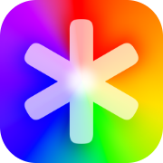
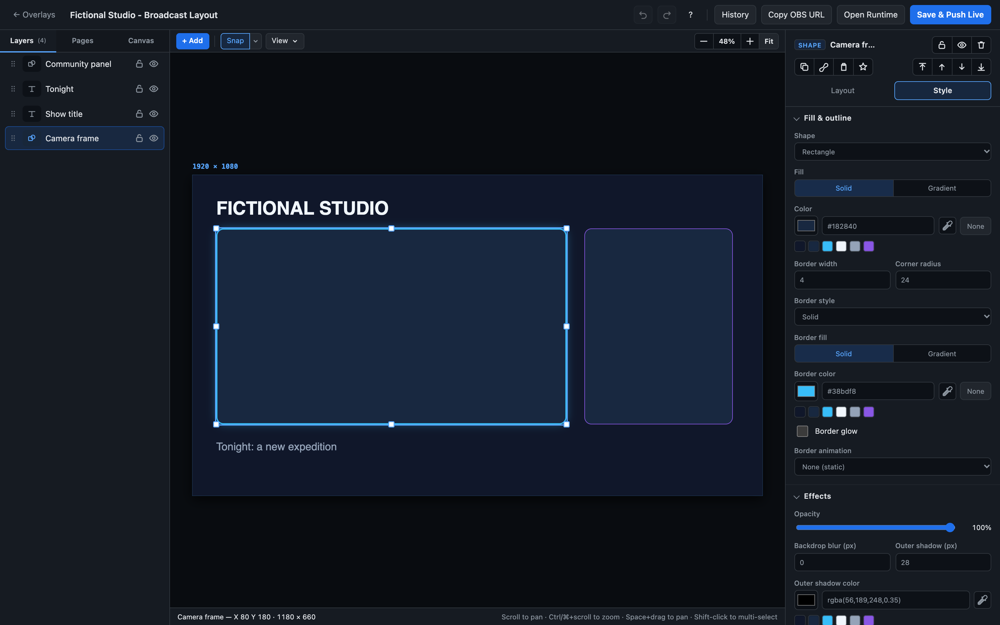

  
Free &amp; open source · macOS &amp; Windows · Made for OBS

  

    
  

  # StreamPulse

  
Make your stream feel like your show. Create OBS overlays, plan game nights, give your audience a say, and close with a proper thank-you—all from your own computer.

  

    <a href="#/quickstart" class="cover-btn cover-btn-primary">Download StreamPulse</a>
    <a href="#/showcase" class="cover-btn cover-btn-secondary">See it in action</a>
    <a href="#/changelog" class="cover-btn cover-btn-ghost">Changelog</a>
    <a href="https://github.com/jarbochov/StreamPulse" class="cover-btn cover-btn-ghost">GitHub</a>
    <a href="https://ko-fi.com/jarbochov" class="cover-btn cover-btn-sponsor">Support on Ko-fi</a>
  

  

    
    
Build a look that's yours in Custom Overlay Studio.

  

  

    <a href="#/custom-overlays" class="cover-feature-pill">
      
Your look, your layout

      
Bring artwork, video, and live information into your OBS scenes.

    </a>
    <a href="#/polls-guide" class="cover-feature-pill">
      
Let chat join in

      
Turn audience votes and tournament brackets into game-night moments.

    </a>
    <a href="#/credits-guide" class="cover-feature-pill">
      
End with a thank-you

      
Celebrate supporters and regulars with your own closing credits.

    </a>
    <a href="#/companion" class="cover-feature-pill">
      
Keep controls close

      
Use OBS docks or optional Bitfocus Companion buttons on a Stream Deck.

    </a>
  

