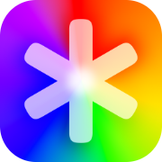
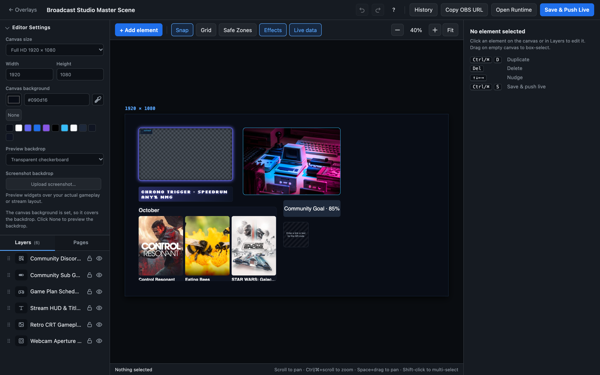

<!-- _coverpage.md -->

  
Self-Hosted Broadcast Suite · 100% Local-First · OBS Ready

  

    
  

  # StreamPulse

  
The broadcast companion and overlay suite that puts streamers in total control. Cinematic OBS overlays, interactive choice randomizers, automated credits roll, and community CRM—100% self-hosted on your machine with zero cloud fees.

  

    <a href="#/quickstart" class="cover-btn cover-btn-primary">Get Started</a>
    <a href="#/custom-overlays" class="cover-btn cover-btn-secondary">Explore Studios</a>
    <a href="#/desktop-app" class="cover-btn cover-btn-ghost">Desktop App (1.0)</a>
    <a href="#/changelog" class="cover-btn cover-btn-ghost">Changelog</a>
    <a href="https://github.com/jarbochov/StreamPulse" target="_blank" rel="noopener noreferrer" class="cover-btn cover-btn-ghost">GitHub</a>
    <a href="https://ko-fi.com/jarbochov" target="_blank" rel="noopener noreferrer" class="cover-btn cover-btn-sponsor">
      <svg viewBox="0 0 24 24" width="14" height="14" fill="currentColor" style="vertical-align:middle;margin-right:6px;"><path d="M23.881 8.948c-.773-4.085-4.859-4.593-4.859-4.593H.723c-.604 0-.679.798-.679.798s-.082 7.324-.022 11.822c.164 2.424 2.586 2.672 2.586 2.672s8.267-.023 11.966-.049c2.438-.426 2.683-2.566 2.658-3.734 4.352.24 7.422-2.831 6.649-6.916zm-11.062 3.511c-1.246 1.453-4.047 3.974-4.047 3.974s-2.8-2.521-4.047-3.974c-1.332-1.554-1.218-3.83.255-5.176 1.472-1.346 3.792-.98 3.792-.98s2.32-.366 3.792.98c1.473 1.346 1.587 3.622.255 5.176zm6.326-1.545c-.495 1.579-2.072 1.639-2.072 1.639v-4.143s1.577.06 2.072 1.639c.334 1.07.135 1.956 0 2.504z"/></svg>
      Support on Ko-fi
    </a>
  

  

    
    
Custom Overlay Studio · Transparent WebKit Punchouts, WebGL Retro Shaders & GPU Media Filters

  

  

    

      
100% Self-Made & Funded

      
Independently built and carefully crafted and no cloud fees

    

    

      
Zero Cloud Lock-in

      
Runs entirely on your local machine with total data ownership

    

    

      
OBS GPU Accelerated

      
Transparent browser sources with responsive renders

    

    <a href="#/companion" class="cover-feature-pill" style="text-decoration:none;">
      
Bitfocus Companion Integration

      
Pre-configured 32-key Bitfocus Companion profile for Stream Deck with our Companion Module

    </a>
  

