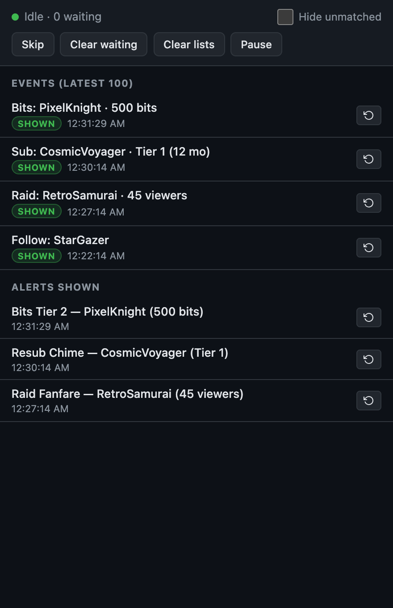
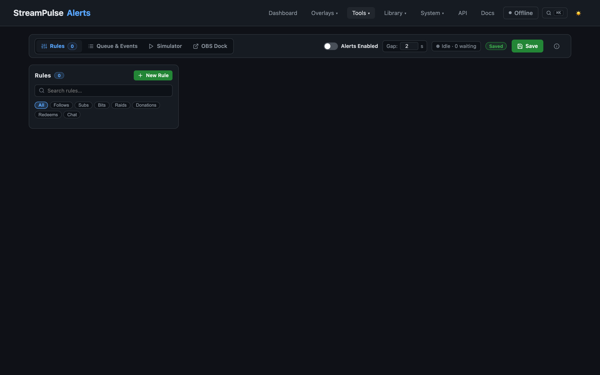

# Alerts & Alert Queue Dock Guide

StreamPulse includes an advanced, rule-based stream alert system and an OBS-ready **Alert Queue Dock** for reviewing and replaying live events.

---

## 1. Alert Rules & Triggers

Configure alerts under **Tools -> Alerts** (`/alerts.html`):

- **Event Types**: Follows, subscriptions, resubs, gift subs, bits/cheers, donations/tips, raids, channel point redeems, finished timers, reached goals, poll completed / winner (`poll_end`), and chat keywords.
- **Replacement Tokens**: Standard alert tokens plus poll-specific tokens: `{{winner}}`, `{{poll_title}}`, `{{votes}}`, `{{percent}}`, and `{{total_votes}}`.
- **Tiered Thresholds**: Configure escalating visual alerts based on amount (e.g. Tier 1 at 100 bits, Tier 2 at 1,000 bits, Tier 3 at 10,000 bits).
- **Media Uploads**: Upload custom images, animated GIFs, WebM/MP4 videos, and audio sounds to the Asset Library.
- **Synthesized Audio**: Use built-in Web Audio synthesized sound presets (Ding, Chime, Coin, Fanfare, Level Up, Pop, Whoosh) without needing external audio files.

---

## 2. Low-Density Alert Queue Dock

Open **Tools -> Alert Queue** (`/alert-queue.html`) or dock it inside OBS Studio:

### Adding to OBS Studio as a Custom Dock:
1. In OBS Studio, navigate to **Docks -> Custom Browser Docks...**
2. Dock Name: `StreamPulse Queue`
3. URL: `http://localhost:3000/tools/alert-queue.html`
4. Click **Apply**. You can now dock the queue alongside your chat or audio mixer!

### Dock Features:
- **Hide Unmatched Filtering**: Toggle "Hide unmatched" to filter out regular background chat messages and focus strictly on triggered alerts and engagement events.
- **Event Replay**: Click **Replay** next to any past event to trigger the on-screen alert again (useful if you missed an alert during a tense game moment).
- **Skip & Pause**: Skip the currently playing alert or pause the queue when starting a high-focus gameplay section.
