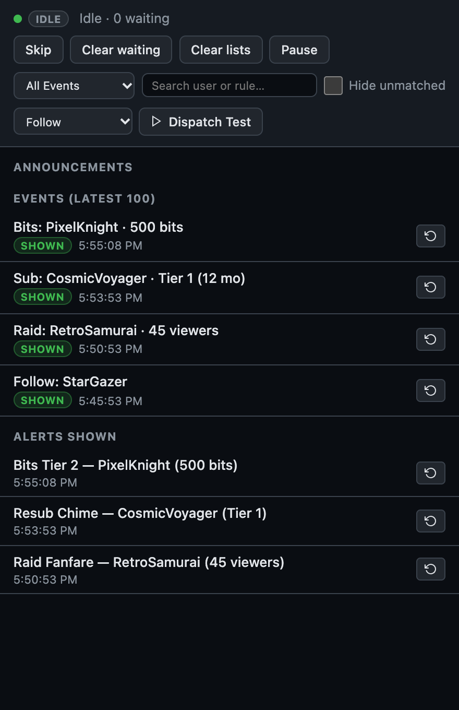

# Make room for the moments worth celebrating

Alerts help important stream events feel seen without making every moment compete for attention. Shape how follows, subscriptions, cheers, raids, and other events appear, then keep an eye on what’s coming through the queue.

Give different kinds of support their own look and sound, and preview the result before it becomes part of your show. The queue helps you review recent events, revisit a missed moment, or pause the flow when you need to focus. A filter for unmatched activity makes it easier to focus on alerts that actually triggered.

Amount-based rules can fire at **At least**, **Between** or **Equal to** an amount. An equal-to rule (matched to the cent) wins over overlapping ranges, so a $69.69 donation can get its own alert. Milestone variants offer the same choice. Donation rules can also be limited to one source: SocialStream, or any source an embedded host registers (see [API reference](api-reference.md#9-embedded-mode-nodecg)), and `{{alert.source}}` and `{{alert.currency}}` are available in alert text.

### Reordering Alerts
Drag the grip handle on an alert in the left-hand list to reorder it (a line shows the drop position), or focus a row and press **Alt+Up / Alt+Down**. Reordering is available while no search or filter is active, and the order is saved with **Save**. Your last selected alert is remembered between visits.

Order does not decide which rule fires: when several rules match, the most specific one wins (exact amount, then highest minimum, then specific source or tier). List order only breaks exact ties, where the earlier rule wins.

### Emote Celebrations & Effects
Emote-driven alerts can celebrate with 60fps broadcast animations:
- **Showcase**: High-DPI hero emote centered prominently in the alert card (replaces tiny icon sizing with responsive 40%–250% scaling).
- **Emote Rain**: Streaming cascade of emotes falling across the card.
- **Emote Party**: Confetti-style explosion burst radiating outward from the center.
- **Emote Fountain**: Upward fireworks geyser spray arcing down.
- **Floating & Bouncing**: Joyful floating and dancing emotes.

Adjust **Particle Density** (10 to 75 particles) and **Emote Size (%)** to fine-tune the celebration for your layout.

### Official Twitch Bits Cheermotes & Special Cheermotes

**Emote source:** each bits variant has an *Emote* setting. *Viewer's cheermote* (default) shows the family from the viewer's message with the tier from the summed bits (no cheermote: Cheer at the total). Ladders still pick sound, title and message by total bits. *Custom* uses your own emote and emote ladder. The Test amount drives the live preview and test alerts.
Bits alerts feature comprehensive out-of-the-box integration with official Twitch animated Cheermotes across both classic and special editions:
- **Classic Diamond Tiers**: Cheer1 (Gray), Cheer100 (Purple), Cheer500 (Cyan), Cheer1000 (Blue), Cheer5000 (Magenta), Cheer10000 (Red-Pink), and Cheer100000 (Red).
- **Special Global Cheermote Families**: Full support for Twitch's 20 iconic animated Cheermotes across all tiers: **Kappa**, **Party**, **TriHard**, **FrankerZ**, **Kreygasm**, **ShowLove**, **Pride / Rainbow**, **SwiftRage**, **4Head**, **PJSalt**, **VoHiYo**, **HeyGuys**, **DansGame**, **FailFish**, **NotLikeThis**, **MrDestructoid**, **Cheerwhal**, **Shamrock**, and **Anon**.
- **Auto-Detect From Viewer's Cheer**: When set to *Auto-match viewer's cheer* (default), StreamPulse automatically extracts the exact cheermote used in the cheer message (e.g., `Kappa5000`, `Party100`, `ShowLove1000`) and displays that specific animated GIF on stream.
- **Cheermote Style Theme Selector**: Lock any variant to a preferred family (e.g. force Kappa or Party) or auto-detect from chat.
- **Ladder Preset & Dynamic Chips**: Click **Use Cheermotes Ladder** to instantly populate the variant's ladder with animated GIFs from the selected family (e.g., Kappa 1 to 10,000). Quick-pick chips update dynamically to allow one-click insertion of individual tiers.
- **Channel Custom Cheermotes**: When connected to the Twitch API, Affiliate and Partner custom channel Cheermotes are automatically discovered and made available in the selector.

### Emote Ladder vs. Milestone Variants for Bits
When designing bits or subscription alerts, decide between an Emote Ladder or Milestone Variants:
- **Use an Emote Ladder when**: You want to keep the **same alert look and sound**, but want the emote to change (e.g. cheer badges) or trigger a heavier emote rain/party as bits increase (e.g. 100 bits drops Cheer100; 1,000 bits drops a heavy Cheer1000 party). Configure this in the **Visuals** tab under Emote Ladder.
- **Use a Milestone Variant when**: You want a **completely different alert experience** — such as an epic sound effect, custom message template, custom video/GIF, or longer on-screen duration (e.g. 100+ bits plays a hype horn sound and video; 5,000+ bits triggers a full takeover). Configure this in the **Activation & Tier Rules** section.

### Webhooks & External Automation (Bitfocus Companion)
Alert rules can trigger external automation via HTTP POST or GET webhooks:
- **Bitfocus Companion Integration**: Trigger buttons on your Stream Deck or surface by setting the URL to `http://<companion-ip>:8000/api/location/<page>/<row>/<column>/press` and choosing **POST** as the HTTP Method.
- **Webhook Delay**: Set a delay in seconds (0 to 300s) before firing the HTTP request to synchronize hardware cues, lighting changes, or soundboard triggers with broadcast alert timings or video animations.
- **Webhook Only (Silent Background Automation)**: Toggle **Webhook Only** on any rule to execute external automation and timer adjustments silently in the background without enqueuing an on-screen alert box, playing alert audio, or triggering page rotators/takeovers in custom overlays. Silent rules are recorded in the Alert Queue with a distinct cyan `Webhook` badge.
- **Direct Webhook Testing**: Use the **Test Webhook** button directly inside the Actions card to verify connectivity and receive instant HTTP status feedback (`✓ 200 OK` or diagnostic advice) without needing a live stream event.
- **Preview & Test Integration**: Clicking **Test Rule** or **Preview** runs configured actions so you can preview both on-screen overlays and external hardware triggers in tandem.

- **Mute display**: `POST /api/alerts/mute` with `{ "muted": true }` holds alerts in the queue (for panic buttons such as NodeCG's `muteAlerts`); `{ "muted": false }` releases them. `GET /api/alerts` reports `queue.muted`. A Companion action, variable and feedback are included.

- **Priority**: each rule has Low/Normal/High/Critical priority (higher plays first, FIFO within a level). Critical can interrupt the alert on screen. Expire after N seconds drops stale queued alerts; the queue cap setting (default 200) drops lowest priority/oldest first. Drops show as `dropped` in history.
- **Manual trigger**: `POST /api/alerts/trigger` with `{ "rule": "<id or name>", "message": "...", "user": "...", "amount": 0 }`; `GET /api/alerts/rules` lists rules.
- **Announcements**: rules with the Announcement trigger fire only manually, from the Announcements tab, the OBS Dock tab or `/tools/announcements-dock.html`. Tokens: message, user, title.
- **Chat message action**: sends a templated message through SocialStream (400 char cap, per-rule cooldown).
- **Companion button action**: presses `page/row/column` on the Companion address in settings (default `http://127.0.0.1:8000`); only that host is contacted. Companion's HTTP API has no verified page/button listing, so numeric fields are used.

## Editing rules

- **Layout:** each rule reads top-down as **When** (rule name, trigger, conditions, cooldown, with a sentence summary such as "When someone cheers 100+ bits" and an Edit toggle; open by default), **Show** (variants grouped under the Base alert and each milestone tier, with threshold label and odds pill; one variant open at a time; clickable ladder strip), then **Then** (webhook and timer actions).
- **Controls:** options with four or fewer choices are pill groups; long lists (trigger, animations, sounds) stay dropdowns. Animation in/out is one row with a Replay button, and video audio options sit in a collapsed Advanced section per variant.
- **Sounds:** the sound dropdown lists built-in synthesized presets (including a Synth group) and bundled CC0 file sounds grouped by mood (Celebration, Hype, Impact, Chime/Bell, Retro) plus layered synthesized presets (fanfares, air horn, bass drop, applause, gong), stored as `builtin:<name>` or `sfx:<group>/<id>`. Custom URLs and uploads still work. Credits in `public/sounds/LICENSES.txt`.
- **Live preview:** the open variant shows its alert card as you type. **Play sound** uses the variant's saved Alert/Video volume (there is no separate preview volume).
- **Warnings:** missing base alert, duplicate thresholds, unreachable variants, missing sound/media and bits cheermote notes appear inline.
- **Find rules:** search by name, trigger, title or message; filter by trigger type or Active/Inactive. Toggle media thumbnails on or off.
- **Copy style / Paste style:** copy text, animation, media and optionally sound settings between variants.
- **Import / Export:** export all or the selected rule as JSON (webhook URLs are included), import with Merge (new ids) or Replace; nothing is saved until you Save, and Revert discards it.
- **Shortcuts:** Cmd/Ctrl+S save, Cmd/Ctrl+Enter test, Cmd/Ctrl+D duplicate, `/` search, Alt+Up/Down reorder, Esc closes menus.

Whether you prefer a quiet acknowledgement or a more theatrical reveal, the goal is to make the moment feel like yours—and keep the show in your hands.

Browse [StreamPulse features](features.md) or [get started](quickstart.md). Already installed? **Docs** and **API Reference** are available through the app navigation.
