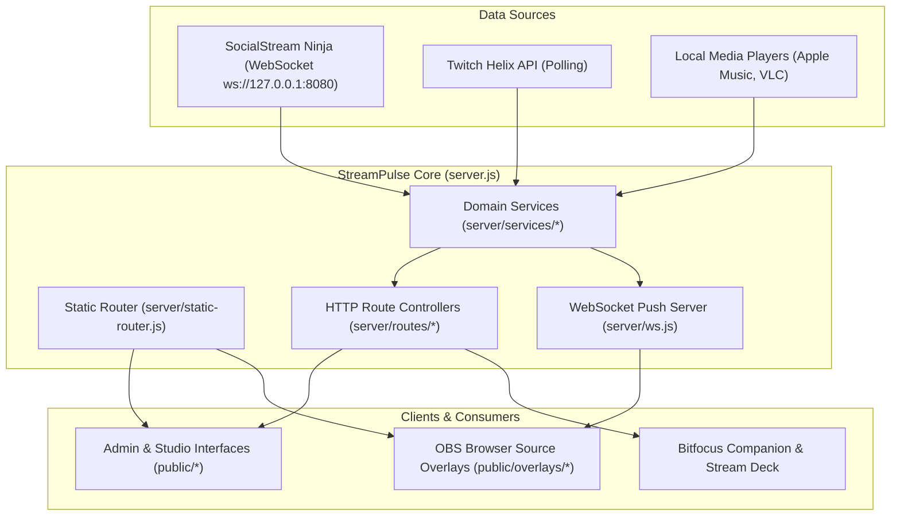

# StreamPulse Architecture & Technical Overview

This document provides a deep dive into StreamPulse's backend design, static routing infrastructure, modular services architecture, and data persistence models.

---

## 1. High-Level Architecture

StreamPulse is a lightweight, high-performance Node.js application built around native Node HTTP/WebSocket primitives and zero-cloud local data persistence.



---

## 2. Directory Structure

StreamPulse organizes frontend views into clean domain categories while maintaining zero-breakage backwards compatibility for OBS browser sources:

```text
stream-credits/
├── config.json                 # Core system configuration
├── server.js                   # Server bootstrapper and process lifecycle
├── server/
│   ├── routes/                 # Native HTTP route controllers
│   │   ├── crm.js              # Community CRM endpoints
│   │   ├── game-plan.js        # Schedule and game catalog routes
│   │   ├── overlays.js         # Custom overlays & assets endpoints
│   │   ├── session.js          # Stream session lifecycle & chat history
│   │   ├── timers.js           # Stopwatches and countdown timers
│   │   ├── twitch.js           # Twitch auth, polls, and stream status
│   │   └── ...
│   ├── services/               # Core business logic and hardware pollers
│   │   ├── alerts.js           # Rule engine and alert queue
│   │   ├── chatbot.js          # Chat commands, timers, and triggers
│   │   ├── crm.js              # Chatter dossier and roster tracking
│   │   ├── game-plan.js        # IGDB game queue & broadcast scheduling
│   │   ├── music.js            # Apple Music and VLC poller
│   │   ├── ssn.js              # SocialStream Ninja WebSocket listener
│   │   ├── session-archives.js # Shared metadata-validated archive summaries
│   │   ├── twitch.js           # Twitch Helix API & token auto-refresher
│   │   └── ...
│   ├── static-router.js        # Cascading filesystem router
│   └── ws.js                   # WebSocket broadcast manager
├── public/
│   ├── overlays/               # Raw OBS browser source overlays
│   ├── editors/                # Studio editors (Overlay Studio, Credits, Randomizer, Game Plan)
│   ├── tools/                  # Broadcaster tools (Chat Bot, Alert Queue, Placeholders)
│   ├── library/                # Historical data (Analytics, Sessions, Highlights)
│   ├── system/                 # System administration (Dashboard, Config Editor, Backups)
│   ├── wizards/                # Interactive OBS URL generators
│   ├── css/                    # Shared stylesheets and editor themes
│   └── js/                     # Client scripts, modules, and visual filters
├── data/                       # Local JSON databases, session logs, and uploaded media
└── docs/                       # Project documentation, guides, and screenshot assets
```

---

## 3. Cascading Static Routing

To ensure that streamers' existing OBS browser sources and Bitfocus Companion configurations never break, `server/static-router.js` implements a cascading filesystem lookup:

1. **Explicit Canonical Path**: Checks if the requested path directly exists (e.g. `/overlays/credits.html`).
2. **Flat Root Fallback**: If requested via legacy flat URL (e.g. `/credits.html`), the router automatically resolves:
   - `public/overlays/<file>`
   - `public/editors/<file>`
   - `public/tools/<file>`
   - `public/library/<file>`
   - `public/system/<file>`
   - `public/wizards/<file>`
3. **Transparent Serving**: Files are served directly with proper MIME types, `ETag` caching, and range requests—without issuing HTTP 301/302 redirects that could cause latency in OBS browser sources.

---

## 4. Data Persistence & Integrity

- **Zero External Database**: All state is persisted locally inside the `data/` directory using human-readable JSON files and JSON Lines (`.jsonl`) chat archives.
- **Atomic File Writes**: Critical state updates (such as `data/stats.json`, root-level `config.json`, and `data/chatter-notes.json`) use temporary-write and rename patterns to reduce the risk of partially written JSON.
- **Graceful Shutdown**: The server traps both `SIGINT` and `SIGTERM` signals, flushing active chat buffers, persisting live viewer tallies, and closing WebSocket connections cleanly before termination.

### Historical Aggregation Cache

Category totals, milestones, and chatter dossiers share compact in-memory session summaries through `server/services/session-archives.js`. Each archive is parsed once, then reused until its size, modification/change time, or file identity changes. The cache retains aggregation inputs, not full archive payloads such as avatars, emotes, or message HTML.

Metadata checks are throttled to once every ten seconds. Archives created/updated by StreamPulse, deleted through the session API, or restored from a backup invalidate the relevant cache immediately. External file edits are picked up at the next metadata check. Malformed archives are logged and skipped until changed; filesystem failures remain visible.

Cold archive reads and metadata scans are still synchronous. This cache removes repeated archive reads/parsing, not cold loading. Full-backup ZIP creation and restore processing use a separate bounded worker service; share bundles and other exports still have their existing processing paths.

### Live-State Memory Bounds

Chat/statistics change detection keeps SHA-256 fingerprints instead of retaining another full serialized copy of each snapshot. Unchanged saves still skip disk writes and preserve the chat update timestamp; changed data and failed-write retries retain their existing persistence behavior. Serialization and hashing are still synchronous, and the live/session/lifetime data itself is not truncated by this optimization.

WebSocket broadcasts serialize once for connected, writable clients and skip serialization without subscribers. At each live broadcast or heartbeat, a client with more than 4 MiB of queued outgoing data is disconnected rather than accumulating every live update. One outgoing message can cross that high-water mark; the finite initial snapshot sequence is allowed to finish enqueueing so large snapshots do not cause immediate reconnect loops on healthy clients. Reconnecting receives the current snapshot, not a replay of transient alerts or control commands. Server ping/pong checks run every 30 seconds while clients exist and remove unresponsive connections on the next check. Shutdown clears this timer and connection-owned state.

Incoming WebSocket reports are limited to 64 KiB per message; this does not limit outgoing tournament/chat snapshots. A connection can retain at most 256 distinct slideshow-report keys, with existing keys still updateable at the limit. Closing an older reporter does not erase a newer connection's report for the same slideshow.

Alert deduplication retains at most 10,000 recent event keys, evicting the least recently accepted key at capacity and pruning records older than ten minutes during activity. Under an unusually large burst, eviction can let an old duplicate through. Removed rules release their cooldown/variant-selection state; engine shutdown clears those maps. These bounds cover transport and transient caches, not total process RSS or intentionally retained lifetime statistics.

### Browser Idle and Page Lifecycle

Tournament overlays retain bracket DOM for unchanged state and retain connector SVG paths for unchanged geometry. Connector work is coalesced into one pending animation frame. Poll countdown updates do not regenerate Poll Manager choice nodes, rewrite overlay URL preferences, or refetch an unchanged bracket. Actual vote, match, layout, and resize changes continue to update the relevant display.

Tournament initial/reconnect fetches have a ten-second deadline; a newer WebSocket update wins over an older HTTP response. Tournament and shared visibility sockets close on `pagehide`, cancel pending reconnects, and reconnect on `pageshow` without duplicating old connections. Tournament teardown also aborts pending fetches and cancels connector/confetti work. This is navigation cleanup, not a blanket `document.hidden` pause for production tournament overlays: OBS sources can report hidden while still needing live votes.

Custom-overlay runtime/editor rerenders reconcile source and selection caches against the entire current overlay model. Removed source paths and retired selections are evicted; sources on inactive pages remain cached for page switching. Late responses from retired requests cannot repopulate those caches. This bounds retention to current model references rather than clearing useful live-page caches or truncating saved designs.

The automated idle regression (`scripts/test-browser-idle.cjs`) uses isolated HTTP/WebSocket fixtures to test repeated unchanged updates, bounded redraw work, page lifecycle restoration, and Poll Manager countdown handling. Native Safari 27.2 checks of fictional fixtures also retained bracket cards and SVG paths through 60 countdown pushes and 20 resize events with no redraws or extra GETs; changed votes still updated a hidden tournament source. These are bounded behavioral checks, not an overnight Safari heap/GPU profile or proof of production memory savings.

### Backup Worker

Manual and automatic full backups and restore parsing/decompression use `server/services/backup.js` and `backup-worker.js`, keeping that ZIP work off the Node/Electron main thread. The service permits one active and two waiting operations; excess work fails explicitly rather than spawning unbounded workers. Session end/shutdown and importer flows await the required backup before resetting or replacing source data.

ZIP buffers still consume memory. Restore writes are atomic per file, not a whole-backup transaction. Off-thread processing improves main-loop availability but does not eliminate filesystem load or guarantee a fixed CPU/memory cost; see [server management](server-management.md) for operational behavior.

### Twitch Network Deadlines

OAuth/device-auth and Helix requests in `server/services/twitch.js` have a 15-second absolute deadline, including response-body consumption. Prematurely closed response streams reject instead of leaving callers pending. Existing error paths report failures; transient network failures do not clear stored refresh credentials, and a later refresh can retry. Token refresh remains single-flight.

This is a per-request limit, not a timeout for a whole paginated sync. It does not cancel every background operation on server shutdown or introduce automatic retries for mutating Twitch actions.
