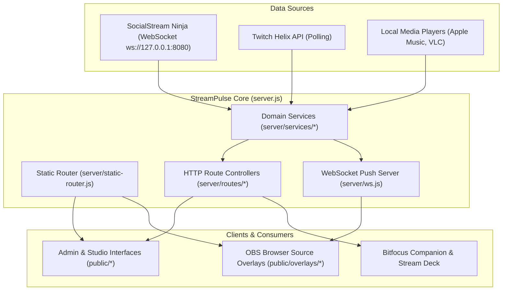

# StreamPulse Architecture & Technical Overview

This document provides a deep dive into StreamPulse's backend design, static routing infrastructure, modular services architecture, and data persistence models.

---

## 1. High-Level Architecture

StreamPulse is a lightweight, high-performance Node.js application built around native Node HTTP/WebSocket primitives and zero-cloud local data persistence.



---

## 2. Directory Structure

StreamPulse organizes frontend views into clean domain categories while maintaining zero-breakage backwards compatibility for OBS browser sources:

```text
stream-credits/
├── config.json                 # Core system configuration
├── server.js                   # Server bootstrapper and process lifecycle
├── server/
│   ├── routes/                 # Native HTTP route controllers
│   │   ├── crm.js              # Community CRM endpoints
│   │   ├── game-plan.js        # Schedule and game catalog routes
│   │   ├── overlays.js         # Custom overlays & assets endpoints
│   │   ├── session.js          # Stream session lifecycle & chat history
│   │   ├── timers.js           # Stopwatches and countdown timers
│   │   ├── twitch.js           # Twitch auth, polls, and stream status
│   │   └── ...
│   ├── services/               # Core business logic and hardware pollers
│   │   ├── alerts.js           # Rule engine and alert queue
│   │   ├── chatbot.js          # Chat commands, timers, and triggers
│   │   ├── crm.js              # Chatter dossier and roster tracking
│   │   ├── game-plan.js        # IGDB game queue & broadcast scheduling
│   │   ├── music.js            # Apple Music and VLC poller
│   │   ├── ssn.js              # SocialStream Ninja WebSocket listener
│   │   ├── session-archives.js # Shared metadata-validated archive summaries
│   │   ├── twitch.js           # Twitch Helix API & token auto-refresher
│   │   └── ...
│   ├── static-router.js        # Cascading filesystem router
│   └── ws.js                   # WebSocket broadcast manager
├── public/
│   ├── overlays/               # Raw OBS browser source overlays
│   ├── editors/                # Studio editors (Overlay Studio, Credits, Randomizer, Game Plan)
│   ├── tools/                  # Broadcaster tools (Chat Bot, Alert Queue, Placeholders)
│   ├── library/                # Historical data (Analytics, Sessions, Highlights)
│   ├── system/                 # System administration (Dashboard, Config Editor, Backups)
│   ├── wizards/                # Interactive OBS URL generators
│   ├── css/                    # Shared stylesheets and editor themes
│   └── js/                     # Client scripts, modules, and visual filters
├── data/                       # Local JSON databases, session logs, and uploaded media
└── docs/                       # Project documentation, guides, and screenshot assets
```

---

## 3. Cascading Static Routing

To ensure that streamers' existing OBS browser sources and Bitfocus Companion configurations never break, `server/static-router.js` implements a cascading filesystem lookup:

1. **Explicit Canonical Path**: Checks if the requested path directly exists (e.g. `/overlays/credits.html`).
2. **Flat Root Fallback**: If requested via legacy flat URL (e.g. `/credits.html`), the router automatically resolves:
   - `public/overlays/<file>`
   - `public/editors/<file>`
   - `public/tools/<file>`
   - `public/library/<file>`
   - `public/system/<file>`
   - `public/wizards/<file>`
3. **Transparent Serving**: Files are served directly with proper MIME types, `ETag` caching, and range requests—without issuing HTTP 301/302 redirects that could cause latency in OBS browser sources.

---

## 4. Data Persistence & Integrity

- **Zero External Database**: All state is persisted locally inside the `data/` directory using human-readable JSON files and JSON Lines (`.jsonl`) chat archives.
- **Atomic File Writes**: Critical state updates (such as `data/stats.json`, root-level `config.json`, and `data/chatter-notes.json`) use temporary-write and rename patterns to reduce the risk of partially written JSON.
- **Graceful Shutdown**: The server traps both `SIGINT` and `SIGTERM` signals, flushing active chat buffers, persisting live viewer tallies, and closing WebSocket connections cleanly before termination.

### Historical Aggregation Cache

Category totals, milestones, and chatter dossiers share compact in-memory session summaries through `server/services/session-archives.js`. Each archive is parsed once, then reused until its size, modification/change time, or file identity changes. The cache retains aggregation inputs, not full archive payloads such as avatars, emotes, or message HTML.

Metadata checks are throttled to once every ten seconds. Archives created/updated by StreamPulse, deleted through the session API, or restored from a backup invalidate the relevant cache immediately. External file edits are picked up at the next metadata check. Malformed archives are logged and skipped until changed; filesystem failures remain visible.

Cold reads and metadata scans are still synchronous. This cache removes repeated archive reads/parsing; it does not move backups, exports, or cold archive loading off the server event loop.
