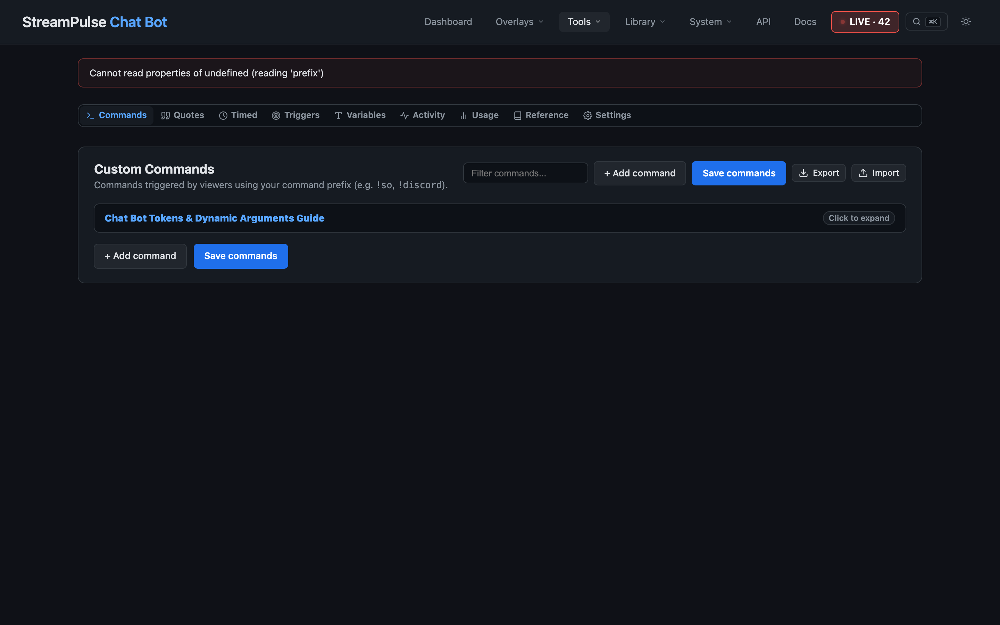

# Let chat automation handle the familiar replies

The StreamPulse Chat Bot can take care of repeatable chat moments while you stay focused on the conversation. Set up commands for useful links and recurring answers, or use word triggers for timely responses.

Shape replies in your own voice, choose who can use particular commands, and add cooldowns to keep busy chat readable. Commands can also trigger quiet behind-the-scenes actions, such as a randomizer draw, without adding another message to the conversation.

The bot can support poll, tournament, trivia, and community tier list announcements, so viewers can follow what’s happening and how to join in. For tier lists, the bot announces when item voting opens with available tiers, commands, and countdowns, and posts the final winning tier consensus with agreement percentages. For interactive trivia, the bot posts new questions with choice lists and vote commands (`!a`, `!b`, `!true`, `!false`), and reveals correct answers with vote percentages and fun facts. It works alongside SocialStream Ninja, which brings chat into StreamPulse; StreamPulse’s current focus is Twitch.

The **Settings** tab organizes bot options into collapsible sections, including Community Messages, with an **Expand all / Collapse all** toggle and open/closed state preserved across sessions.

Community Messages are off by default. Once Community insights are enabled in Config Editor, you can separately opt into welcome-back greetings and personal milestone messages, adjust their thresholds and templates, and set a shared message spacing and expiry. Messages are sent only while live and the bot is on.

Donation announcements thank donors in chat when a donation meets a minimum amount (default $50). Choose the source (any by default, SocialStream, or a source an embedded host registers), and write the message with `{user}`, `{amount}` (formatted as $1,234.00) and `{message}`. When an embedded host shares data, `{total}` and `{goal}` can point at any of its numeric placeholders. A donation reported by two sources is announced once. Any numeric placeholder can be shown as currency with the `money` format, for example `{{placeholder|money}}`.

Start with the [feature overview](features.md) or [get started](quickstart.md). Already installed? Open **Docs** and **API Reference** from the app navigation.
