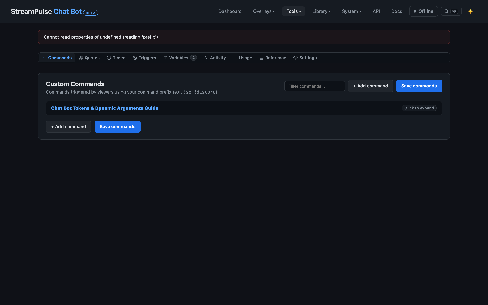

# Integrated Chat Bot Guide

StreamPulse includes a built-in chat automation bot designed to handle commands, quotes, timers, auto-replies, and external webhooks without depending on cloud bot services.

Replies are sent back directly through SocialStream Ninja into your broadcast chat.

---

## 1. Commands, Aliases & Permissions

Configure bot rules in **Tools -> Chat Bot** (`/chatbot.html`):

- **Commands & Aliases**: Define primary commands (e.g., `!socials`) with comma-separated aliases (`!discord`, `!twitter`, `!links`).
- **Cooldowns**: Set global command cooldowns, mod cooldowns, and per-user cooldowns (`userCooldown`) to prevent chat spam.
- **Permissions**: Restrict sensitive commands to Broadcaster, Moderators, VIPs, or Subscribers.
- **Target User Parsing**: Commands can accept target arguments (e.g. `!hug @viewer` renders `Streamer gives @viewer a warm hug!`).
- **Import & Export**: Backup and restore custom command suites as structured JSON files via toolbar buttons or `/api/chatbot/commands/export` and `/api/chatbot/commands/import`.

---

## 2. Word Triggers & Matching Modes

Word triggers listen to all incoming chat messages and execute replies or webhook actions automatically when matching words or phrases occur:

- **Matching Modes**:
  - `contains`: Fires when any keyword is present inside the chat message.
  - `exact`: Fires only when the message matches the keyword exactly.
  - `starts_with`: Fires when the message begins with the keyword.
  - `ends_with`: Fires when the message concludes with the keyword.
  - `regex`: Evaluates the keyword as a regular expression pattern.
- **Whole Words Only**: Optional boundary enforcement preventing false positives on substring matches.
- **Import & Export**: Word triggers can be backed up and restored via JSON export (`/api/chatbot/triggers/export` and `/api/chatbot/triggers/import`).

---

## 2. Dynamic Variables & Tokens

StreamPulse chat commands support rich dynamic placeholders:

| Variable | Description |
| --- | --- |
| `{{user}}` | Username of the person who typed the command. |
| `{{target}}` | Target username provided after the command (e.g. `!so @friend`). |
| `{{game}}` | Currently active game title from Game Plan or Twitch. |
| `{{uptime}}` | Formatted stream uptime (HH:MM:SS). |
| `{{count:name}}` | Increments a persistent counter (e.g. `!death` counts up deaths). |
| `{{random:item1,item2}}` | Randomly picks an item from a list. |
| `{{weather.temp}}` | Current local temperature from Open-Meteo. |
| `{{song.title}}` | Currently playing music title. |

---

## 3. Silent Commands & Webhook Actions

StreamPulse supports **Silent Commands** that execute background logic without posting a visible message into chat:

- **Silent Execution**: Useful for moderator tools (e.g. `!spin` triggers the Choice Randomizer without cluttering chat).
- **HTTP Webhook Actions**: Send automatic `POST` or `GET` webhooks to external services (such as Home Assistant, Discord webhooks, or local automation scripts) whenever a command is typed or an alert fires.
- **API Runner**: Trigger bot commands programmatically via `POST /api/chatbot/run` or `GET /api/chatbot/run?command=!game`.

---

## 4. Poll & Tournament Bracket Announcements

StreamPulse connects the Chat Bot directly to the Poll Manager and audience tournament brackets:

- **Poll & Match Start**: Announces when a poll opens with choices clearly formatted one per line with what to use to vote, prefaced with the configured bot setting (e.g. `!vote 1: Option A`).
- **Poll & Match Finish**: Announces the winning choice with vote counts and percentage (or reports a tie).
- **Tournament Champion**: Announces the crowned winner when the Grand Finals or Round Robin tournament concludes.
- **Configuration & Templates**: Under **Settings -> Poll & Bracket Chat Announcements**, configure:
  - Master toggle and individual start/finish toggles.
  - Start template (tokens: `{title}`, `{choices}` [one per line with voting command], `{commands}`, `{duration}`, `{prefix}`, `{tag}`).
  - End template (tokens: `{title}`, `{winner}`, `{votes}`, `{percent}`, `{totalVotes}`).
  - Tie template (tokens: `{title}`, `{choices}`).
  - Champion template (tokens: `{title}`, `{champion}`).
  - **Send test announcement** button to verify chat formatting and SocialStream connectivity.
- **Safety**: Chat announcements are non-blocking. If the bot is inactive, paused, or disconnected, polls run seamlessly without errors.
