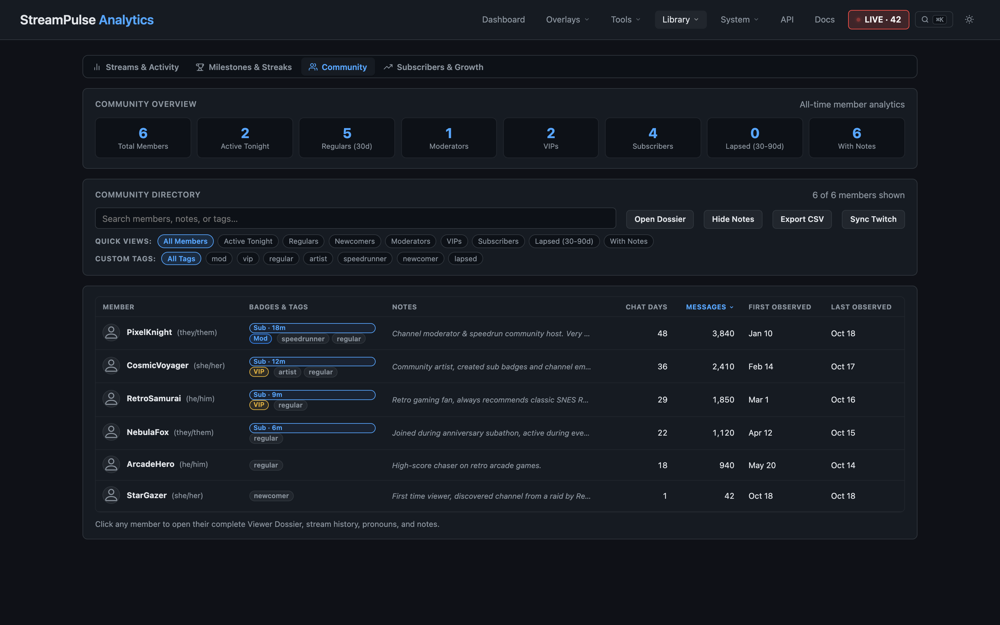

# Remember the people behind the chat

Community Directory brings a little more context to the names you see in chat. Review activity across your sessions, find familiar regulars, and keep lightweight notes that help you pick up the conversation next time.

Browse your community by activity, search for a familiar name, or open a profile to see recorded participation over time. Tags and pronouns can make a roster easier to scan, while optional notes help you remember details you choose to record.

This is a personal organizer, not a public directory. Community details and notes are stored with your local StreamPulse data and are not encrypted, so protect your device and backups. Be thoughtful about what you record, and keep private information away from captured scenes.

Explore [StreamPulse features](features.md) or [get started](quickstart.md). Already installed? Find **Docs** and **API Reference** in the app navigation.
