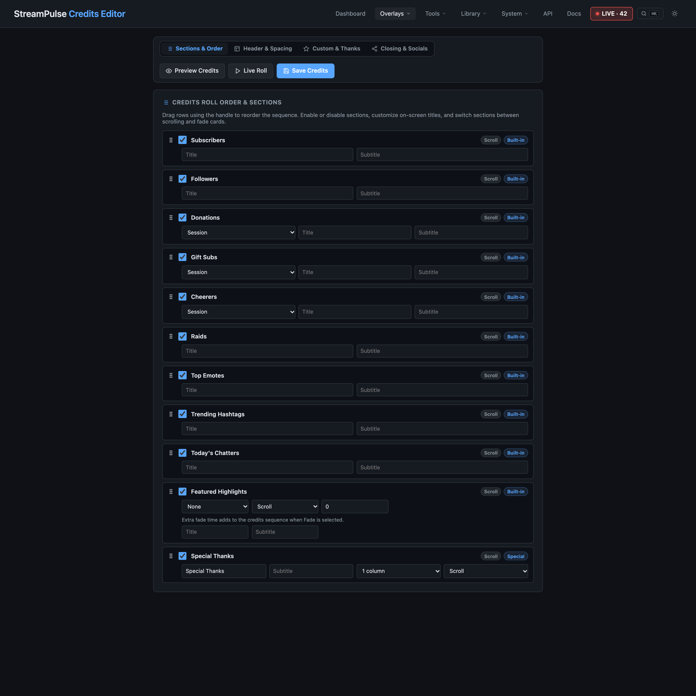

# Give your stream a memorable send-off

Credits Studio turns the end of a broadcast into a moment to recognize the people who made it special. Bring supporter names and stream highlights together in a closing roll, then add a personal thank-you before the show ends.

Choose which kinds of community activity to celebrate, arrange the sections to suit your outro, and add custom acknowledgements where you want them. Special thanks and closing messages give you room to recognize collaborators, moderators, guests, or a moment from the stream in your own words.

Preview the roll and set its pace to fit the ending you have planned. When it feels right, bring the credits into your OBS scene and let the broadcast close with a little more intention than a quick sign-off.

See [StreamPulse features](features.md) or [get started](quickstart.md). Already installed? **Docs** and **API Reference** are available through the app navigation.
