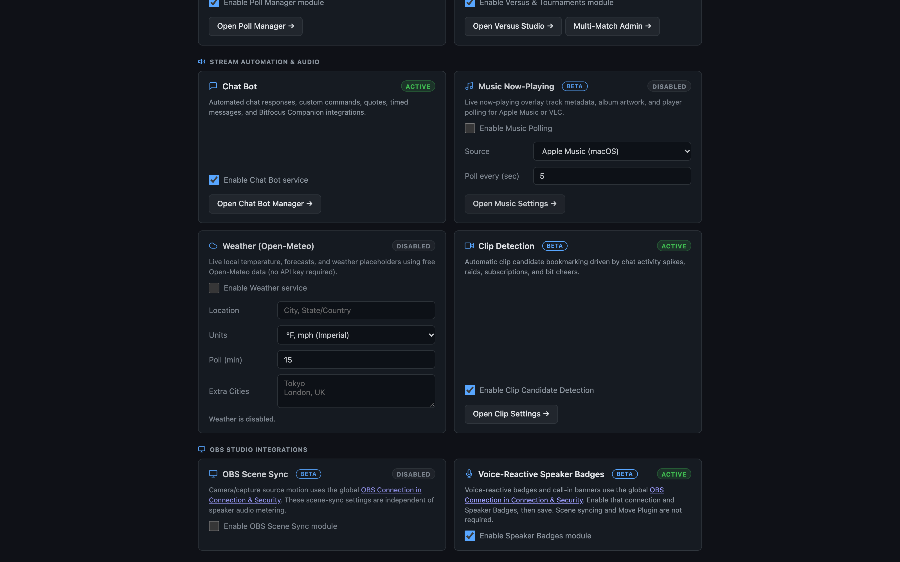
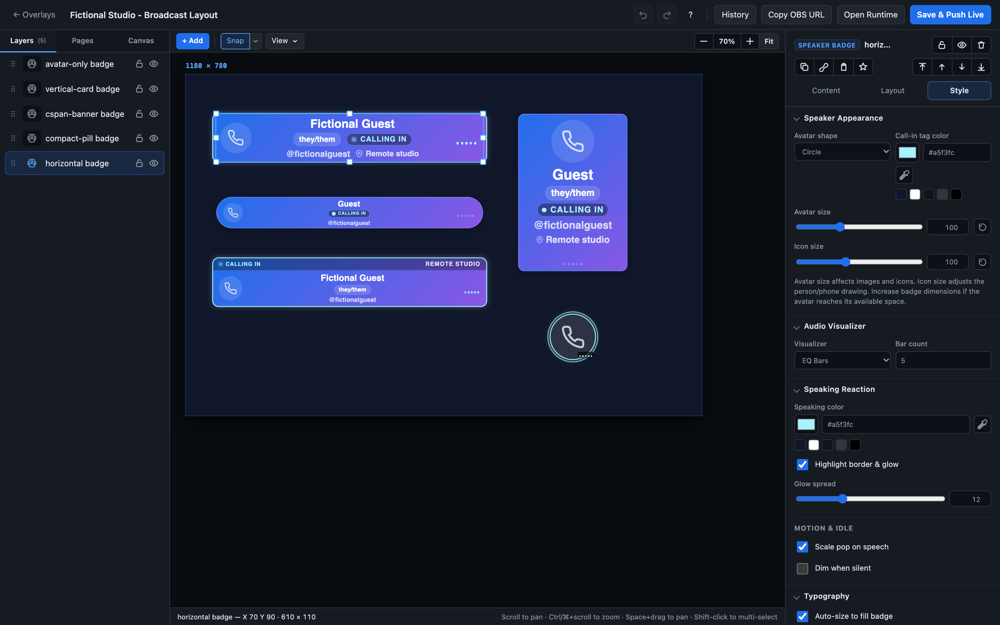

# Make your stream look like yours

Custom Overlay Studio gives you a visual place to shape the scenes and on-screen details that make a broadcast feel personal. Combine text, images, video, shapes, and live stream information into a layout that fits your style, then see the composition as you build it.

Start with a clean canvas or adapt a saved design. Use simple, independent Pages for different moments, or Scene States for animated layout changes and optional OBS source motion. Converting states to pages keeps each look as its own editable layout. Live details can keep an overlay feeling connected to the show, while custom artwork and typography make it distinctly yours.

In the overlay controller's **Playback** tab, switches beside each page enable or disable it immediately and persist the change. Disabled pages are skipped by navigation and automatic playback; switching off the current page moves to an enabled page. At least one page must stay enabled.

Stay focused as you build: the inspector separates content, layout, and style, with controls tailored to each kind of layer. The **+ Add** element picker organizes 20 layer types into six balanced sections across three columns (Text & Copy, Media & Artwork, Framing & Cutouts, Graphics & Patterns, Stream Widgets, and Interactive & Web) with instant keyword search and keyboard navigation. Your preferred inspector tab is remembered, so moving between text, artwork, and live widgets feels familiar rather than starting over.

When your design is ready, use it as an OBS browser source. StreamPulse also includes focused tools for specific jobs—like schedules, timers, polls, and credits—if you want a ready-made starting point instead of a whole scene.

For more coordinated scene changes, optional OBS source frames let a saved state move real sources alongside the browser overlay. Connection and synchronization feedback helps you check a change before taking it on air. The bridge is optional; ordinary browser-source layouts do not need it.

**OBS Scene Sync is an independent module.** Turn it off in **System Config → Modules & Services → OBS Scene Sync** to hide source-link inspectors, OBS source-frame additions, layer link badges, setup and manual-sync controls, and the Scene States (Morph) enable/advanced controls in the Pages panel. Regular Pages remain available; existing saved state layouts are preserved. It stops automatic and manual source motion and cancels pending animations, while preserving saved links/settings and the global OBS connection for speaker meters or other features. **Auto-sync** only controls automatic save/state synchronization when the module is enabled. Existing configurations default the module to enabled for compatibility (`obs_scene_sync_enabled: true`).

Frame borders can sit inside, centered on, or outside a shape. Linked OBS frames start with an outside border, keeping the decoration clear of the camera or video without changing its layout.

## Custom Overlay Elements (20 Built-In Layers)

Custom Overlay Studio includes 20 specialized layer types organized into six intuitive sections across three balanced columns in the **+ Add** element picker:

### 1. Text & Copy
- **Text (`type: "text"`)**: Displays static labels, titles, lower-thirds, subtitles, and dynamic copy. Supports real-time `{{placeholder}}` token evaluation (e.g. `{{stream.title}}`, `{{viewers.current}}`, `{{now}}`), Google fonts and uploaded typography, automatic font fitting (`textFit`) to keep text within layer bounds, alignment, line height, letter spacing, text color, and drop shadows.
- **Random Text (`type: "random-text"`)**: Cycles through a rotating pool of phrases, quotes, chat rules, tips, or stream reminders. Configure one entry per line in Content, set the shuffle interval in seconds, choose the transition style (fade, slide, cut), and include live placeholders evaluated on every rotation.
- **Markdown (`type: "markdown"`)**: Renders rich formatted text using sanitized CommonMark. Supports `#` through `###` headings, `**bold**`, `*italics*`, `[links](url)`, blockquotes (`>`), code spans, and ordered or unordered bullet lists, while adopting your configured typography and color styling.

### 2. Media & Artwork
- **Image (`type: "image"`)**: Renders static or animated graphics supporting PNG, JPG, SVG, WebP, and GIF formats from the local Asset Library or URLs. Offers object-fit modes (`contain`, `cover`, `fill`), interactive focus-point positioning (`object-position`), corner radiuses, and non-destructive media filters (blur, brightness, contrast, grayscale, duotone, color tint).
- **Video (`type: "video"`)**: Plays local HTML5 video files (MP4, WebM) or embedded YouTube videos. Shares uniform playback capabilities across both formats: autoplay on load, looping, volume scaling (0–100%), mute toggles, and unified remote control (`play`, `pause`, `toggle`, `restart`, `stop`, `mute`, `unmute`, `toggle-mute`) via `/api/videos/control` or Bitfocus Companion. WebKit/Safari autoplay policies are handled with zero floating on-screen audio prompts during live production.
- **Slideshow (`type: "slideshow"`)**: Automated image carousel cycling through chosen images from the Asset Library. Features customizable display duration per slide, smooth crossfade or slide transitions, loop toggles, and companion manual advance triggers (`/api/custom-overlays/:id/slideshow`).
- **Game Artwork (`type: "igdb-artwork"`)**: Searches the Internet Game Database (IGDB) directly from the overlay editor to import official video game box art covers, hero banners, screenshots, and logos into your layout and Asset Library with a single click.

### 3. Framing & Cutouts
- **Camera Cutout (`type: "cutout"`)**: Punches a transparent aperture hole through underlayers and backgrounds so webcam feeds, gameplay captures, or chat windows placed underneath the browser source show through. Supports customizable shapes (rectangle, rounded rectangle, squircle, circle), border outlines, and smooth edge feathering (`cutoutFeather`) rendered with cross-browser SVG masking.
- **OBS Source Frame (`type: "obs-frame"`)**: Layout proxy for an OBS Studio source (webcam, capture card, or media source). When using Scene States, moving or resizing the frame synchronizes the real OBS source transform and visibility via OBS WebSocket v5, matching overlay transition easing and Move-plugin timing. Frame borders default to Outside placement so real camera video is not obscured.
- **Shape & Container (`type: "shape"`)**: Vector geometry for cards, sidebars, headers, panels, dividers, and pill containers. Supports solid fills, linear and radial gradients, customizable borders with Inside/Center/Outside placement, independent corner radiuses, and drop shadows.

### 4. Graphics & Patterns
- **Icon (`type: "icon"`)**: Scalable vector iconography from built-in symbol libraries (FontAwesome solids and brands) and custom SVGs. Customize fill color, sizing, opacity, rotation, and alignment within layer bounds.
- **Pattern Tile (`type: "pattern"`)**: Seamless repeating wallpaper grids and motion-graphic mosaics created from **1 to 4 independent images or icons**. Supports 5 grid arrangement layouts (*Grid*, *Brick*, *Stagger*, *Alternating Flip/Tilt*, *Checkerboard*), dedicated **Tile Symmetry / Kaleidoscope** (*None*, *4-Way Mirror Medallion*, *Radial Mandala* with 4–16 wedges and independent morphing), non-square rectangular or mixed aspect ratios (*1:1*, *16:9*, *4:3*, *3:2*, *2:1*, *3:4*, *9:16*, *Natural* with automatic area-balanced visual weight across mixed aspect ratios), per-slot relative scaling (`25%–200%`), and 5 multi-tile sequence modes (*Diagonal Checkerboard*, *Row Sequence*, *Column Sequence*, *2×2 Grid Block*, *Random Scatter*). Includes 10 motion graphic styles (*Scroll*, *Alternating Rows/Cols*, *Weave*, *Sway*, *Spin*, *Scroll & Spin*, *Wave*, *Organic Float*), live **Color & Hue Variation** (rainbow color cycle, horizontal/vertical rainbow waves, deterministic hue jitter, saturation/brightness jitter, and asynchronous twinkle pulse) on both uploaded images and icons using pre-baked 16-slot per-tile color matrix stamps alongside **Organic Scatter & Jitter** (position scatter, rotation jitter, scale jitter, and continuous float/drift) to create varied, non-repetitive organic backdrops at 60fps. Inspector settings are modularized (`public/js/editor/editor-patterns.js`) across Content (1–4 tile slot cards, distribution mode, focal positioning, and quick crop), Layout (layer box geometry), and Style (pattern grid & spacing, tile symmetry / kaleidoscope, organic scatter & jitter, tile appearance & blend mode, color & hue variation, and motion graphics).
- **Background Pattern (`type: "procedural-pattern"`)**: Generative animated procedural backdrops built with HTML5 canvas. Choose from multiple generative algorithms (geometric waves, retro grid lines, particle fields, neon stripes) with live controls for animation speed, line density, wave amplitude, stroke width, and dual-color palettes. Automatically respects reduced-motion preferences.

### 5. Stream Widgets
- **Alert Box (`type: "alert"`)**: Live broadcast alert popups triggered by Twitch follows, subscriptions, gift subs, cheers/bits, raids, and tips. Supports per-box event type filtering, customizable visual looks, media effects targeting (`alert.effectsTarget: "media"`), focus points, celebration particle animations, and audio volume controls. See [Page Triggers & Alert Event Reactions](#page-triggers--alert-event-reactions) below.
- **Speaker Badge (`type: "speaker-badge"`)**: Voice-reactive active speaker cards and broadcast call-in banners powered by live OBS Studio audio mixer inputs. Features 5 layout presets (*Horizontal Lower-Third*, *Broadcast Call-In C-SPAN Banner*, *Compact Pill*, *Vertical Sidebar Card*, *Avatar Only Floating Halo*), customizable dB speech gates, release hold times, speaking border/glow highlights, animated EQ visualizer bars, proportional typography scaling, and live broadcast guest editing via the Speakers controller. See [Voice-Reactive Speaker Badges & Call-In Banners](#voice-reactive-speaker-badges--call-in-banners) below.
- **Twitch Poll (`type: "poll"`)**: Live interactive audience voting display synced with active Twitch channel polls. Automatically displays the poll title, countdown timer, vote bars with percentages and counts, blind voting mode, and winner celebration highlights.
- **Game Plan (`type: "game-list"`)**: Broadcast schedule and lineup widget showing tonight's stream lineup, upcoming scheduled titles, or backlog picks with official cover art, titles, and tags. Supports list, grid, and ticker layout modes with responsive cover scaling.

### 6. Interactive & Web
- **Progress Goal (`type: "progress"`)**: Visual progress tracking bars and radial countdown rings for community tip goals, follower milestones, subathons, and manual counters with custom currency or unit prefixes/suffixes.
- **QR Code (`type: "qr"`)**: Dynamic vector QR codes for tip jars, Discord invites, social links, or websites with custom colors, corner radiuses, and optional center logo cutouts.
- **Web Embed (`type: "embed"`)**: Sandboxed browser iframe container for embedding external web pages, live dashboards, interactive web apps, or chat widgets directly into the overlay.

## Page Triggers & Alert Event Reactions

Pages and Scene States can automatically take over the screen when broadcast events happen, and return smoothly when the event completes:
- **Alert Reactions**: Configure a page or scene state to trigger on "All alerts" or "Only selected alerts" (with quick All and None rule selection buttons). If "Only selected alerts" is active with no rules chosen, takeovers are safely prevented from triggering empty pages.
- **Alert Box Elements**: Alert box layers support explicit "All alerts" or "Only selected alert types" filtering, allowing you to route specific alert categories (like raids or gifts) to dedicated boxes or show every alert uniformly.
- **Alert Box Media Effects**: Media effects (blur, color, duotone, tint, grain) normally affect the whole alert box. Set **Effects apply to** to "Media" (`alert.effectsTarget: "media"`) to filter just the image, video or emote while the title and message stay crisp. Works with cutout masks and the editor preview.
- **Alert Box Focus & Padding**: With **Media fit** set to Cover, a click-or-drag focus-point picker sets `alert.mediaFocusX`/`mediaFocusY` (0-100, default 50/50) choose which part of the image or video stays visible (`object-position`). `alert.padding` (0-200 px) overrides the box's inner padding; unset keeps the style padding.
- **Alert Box Looks**: in **Style → Looks**, choose Inherited or a named look, assign its rules, and edit all presentation settings with the regular Style controls. The canvas previews the selected look; **Preview** plays its animation locally without firing a live alert. Each look owns its layout, typography, colors, background, borders, shadows, spacing and media effects. Box position and size, event filters and sound permissions stay shared. Existing looks and inherited styling are preserved.
- **Alert Box Inspector**: Content contains Preview, When, Sound & motion and Advanced. Style contains Looks, Show/Text/Card, Typography, fills and effects. Pages split into Rotation, Event pages and Playback, with a Triggers summary that flags duplicate triggers.
- **Transition Buffering**: Incoming alert payloads are automatically buffered during live WebSocket page switches, ensuring newly mounted alert elements play immediately without dropped animations or race conditions.
- **Chat, Poll & Featured Reactions**: Trigger pages for featured chat highlights, bot chat commands, and active/completed Twitch audience polls.

## Voice-Reactive Speaker Badges & Call-In Banners

StreamPulse includes an audio-reactive **Speaker Badge** layer (`type: "speaker-badge"`) in Custom Overlay Studio. Speaker badges highlight active speakers in real time based on live OBS audio inputs (microphones, Discord/guest call tracks, or VDO.ninja browser sources).

- **Opt-in audio metering**: Speaker badges are disabled by default (`"speaker_badges_enabled": false` in `config.json` or System Config). When disabled, OBS WebSocket audio volume metering is omitted and the element is hidden from the studio toolbar. When enabled, StreamPulse subscribes to OBS volume meters (`InputVolumeMeters`) at a throttled 20Hz update rate.
- **Clean Inspector Separation**:
  - **Content**: Speaker identity (Display Name, Handle, Pronouns, Avatar Asset), Call-In metadata (Status tag, Caller location), and OBS Audio Input selection with a connection-status badge, dB sensitivity gate threshold, and release hold time. The setup link opens **System Config → Connection & Security → OBS Connection**. This global connection serves all OBS-enabled features, including speaker audio meters and scene syncing. Enable the connection, enter the OBS host/port/password, and enable Speaker Badges under **Modules & Services**, then save. Scene-sync controls remain separate under **Modules & Services → OBS Scene Sync**; Move Plugin and automatic scene syncing are not required for badges. Existing global `obs` configuration is retained without migration.
  - **Live mic preview**: Enable the editor's live-data preview to see badge reactions to real OBS audio, or use **Simulate Speaking** to check the styling independently. The audio inspector and Speakers controller show smoothed, whole-number dB levels against the saved gate, updating at most once every 300 ms; speech detection still uses immediate unsmoothed audio. If normal speech is below the gate, lower it (for example, −48 dB will not open a −20 dB gate). Use the exact active OBS mixer source; an audio-capable source can appear in discovery without sending active meters. Release hold returns the badge to idle if meters stop.
  - **Layout**: Switch layout presets with one click; dimensions auto-adapt to recommended aspect ratios with an optional "Apply Recommended Size" button.
  - **Style**: Visual appearance (Avatar shape: Circle, Squircle, Square; Call-In tag color), separate **Audio Visualizer** and **Speaking Reaction** sections, proportional typography, background fills, borders, and box shadows. Sliders occupy full-width rows with their values beside them; bar count, glow spread and idle opacity appear only when their related effect is enabled.
  - **Avatar scaling**: **Speaker Appearance → Avatar size** scales the whole avatar (50–200%); **Icon size** independently scales the fallback person/phone drawing (50–180%). Images use Avatar size only. Auto-size gives avatars more of the available space without letting them displace the name; text fitting no longer shrinks the avatar along with its font. Avatar Only can grow outside the layer box.
  - **Sizing & fonts**: **Typography → Auto-size to fill badge** automatically grows or shrinks text to fill the fixed badge dimensions, overriding manual font size. Turn it off to choose a maximum name size while retaining overflow protection. Name, subtitle and pill fonts have separate selectors, including uploaded fonts; secondary fonts inherit the name font by default.
  - **Padding**: **Layout → Horizontal/Vertical padding** sets the content inset. Vertical cards default to 14 px above and below the content. Padding remains fixed when automatic sizing changes text or effects.
- **Quick speaker changes**: Use **Control** in either overlay list, then choose **Speakers** (`/overlay-control.html?id=<overlay-id>`). Speaker badges expose this button even without pages or other controllable layers. Each badge has a compact form for name, handle/subtitle, pronouns, avatar image, call-in status/location and OBS audio source. The avatar field previews the chosen image. Use **Library...** to choose an asset or **No image**, **Upload...** to choose a file, or **Paste image** to read a copied image from your clipboard. You can also focus the avatar area and press Ctrl+V/Cmd+V, or paste a URL into its input. Browser permissions may block the clipboard button; keyboard paste remains available. Uploaded/pasted images are saved in the Asset Library, but the badge selection remains a draft until **Save badge**. Saving updates connected overlays immediately; layout, styling, gate settings and other layers are preserved. Audio sources come from OBS, with manual source names supported while disconnected. Use **Refresh badges & audio sources** to rediscover inputs. The controller remembers its active tab and preserves unsaved speaker drafts during live page changes.
- **Per-field visibility**: **Show** switches beside handle/subtitle, pronouns, avatar, call-in status and caller location retain each field's content when hidden. Changes remain drafts until **Save badge**; they persist per badge and update connected overlays. Call-in status enables/disables call-in mode; caller location still follows the selected layout and call-in settings.
- **Audio Reactions & Visualizers**:
  - **Border & Glow Highlighting**: Active border color and custom glow spread that illuminate when the speaker talks.
  - **Motion Pop**: Subtle scale pop animation triggered by speech onset.
  - **Idle Dimming**: Soften inactive speakers with a configurable idle opacity (e.g., 50%) so active speakers stand out immediately.
  - **Presentation**: The speaker name gets its own row; pronoun/status pills and secondary details sit below it and wrap when necessary. The badge keeps its configured height, fitting typography while preserving minimum row spacing and limiting EQ/spacing growth. Metadata cannot shrink into the avatar or visualizer; fitting leaves saved settings, avatar size and padding intact. Names wrap rather than being displaced by pills. Speaking growth and glow extend beyond the layer box without clipping; justification and typography remain effective. Reduced-motion preferences suppress decorative movement while preserving highlighting. Keep badges away from the actual canvas boundary, which still clips the broadcast frame.
  - **EQ-style Visualizer**: Built-in 3 to 8 decorative bars animate while speech is detected; these are not frequency-band measurements. A speaker returns to idle after the release hold even if meter delivery stops, and changing the input resets the previous source's speaking state.
- **Layout Styles**:
  - `horizontal`: Classic podcaster/streamer lower-third badge with avatar, name, handle, and pronouns.
  - `cspan-banner`: Broadcast call-in news banner featuring an uppercase status header (e.g. `LIVE CALLER`, `ON THE LINE`), animated live status dot, caller name, and location tag (e.g. `CHICAGO, IL`).
  - `compact-pill`: Streamlined minimal badge for multi-speaker panels.
  - `vertical-card`: Tall portrait card format for sidebar and side-by-side stream layouts.
  - `avatar-only`: Audio-reactive floating avatar with glowing halo ring, ideal for placing on top of guest webcam feeds.
- **Multi-Guest Audio Routing**: When using tools like VDO.ninja or Discord with multiple guests, route each guest's audio to an individual OBS Browser Source (with "Control audio via OBS" enabled) or Audio Input Capture. StreamPulse detects each source in the audio input picker and lights up only the badge belonging to that guest.

Explore the [StreamPulse features](features.md) or [get started](quickstart.md). Already installed? **Docs** and **API Reference** are available from the app navigation.

## Asset Library & In-Editor Image Cropper

StreamPulse provides built-in media and artwork management through the Asset Library (`Overlays ▾ → Asset Library` at `/assets.html`) and inside Custom Overlay Studio:
- **Studio Filter Bar & Backdrop Switcher**: Browse by category pills with live counts (*All*, *Images*, *Videos*, *Audio*, *Fonts*, *Text*), toggle thumbnail backdrops (*Checkerboard*, *Dark*, *Light*) to inspect transparent white or dark assets, and view automatic pixel dimension badges (`width × height`) on image cards.
- **Drag-and-Drop, Clipboard Paste & Inspection Modal**: Drop files anywhere on the page or press `⌘V` / `Ctrl+V` to upload copied clipboard images directly. Click any thumbnail to open the asset inspection modal with full-size preview, dimensions, consumer ("Used By") badges, tag management, and quick actions.
- **Direct Asset Downloads & Floating Bulk Bar**: 1-click **Copy**, **Crop**, and **Download** actions on asset cards, plus a floating bulk selection bar for batch tagging, untagging, and deletion.
- **In-Editor Image Cropper**: Interactive modal cropper accessible from the Asset Library ("Crop") and the overlay inspector for Image and Pattern Tile layers ("Crop & Edit Image…").
  - **Aspect Ratio Presets**: Freeform, 1:1 square, 16:9 widescreen, 4:3 standard, 3:2 photo, 2:1 ultrawide, 3:4 portrait, and 9:16 vertical video framing.
  - **Transformations**: 90° clockwise/counter-clockwise rotation and horizontal flipping.
  - **Interactive Crop Box**: 8-point drag handles with rule-of-thirds grid lines and live rendered pixel dimensions.
  - **Save & Overwrite Options**: Save as a new asset (`POST /api/custom-overlays/assets`), overwrite the existing asset in-place (`PUT /api/custom-overlays/assets/:name`) to update all referencing layers immediately without breaking layout paths, or download the cropped image directly to your local computer.

## NodeCG replicants

When StreamPulse runs inside NodeCG through the [nodecg-streampulse](https://github.com/jarbochov/nodecg-streampulse) bundle, replicants listed in `cfg/streampulse.json` appear in the variable picker under **NodeCG** and resolve as `{{rep.<bundle>.<name>.<path>}}`, for example `{{rep.nodecg-tiltify.total.amount}}`. Array items use their index (`.0.name`). Values update live.
