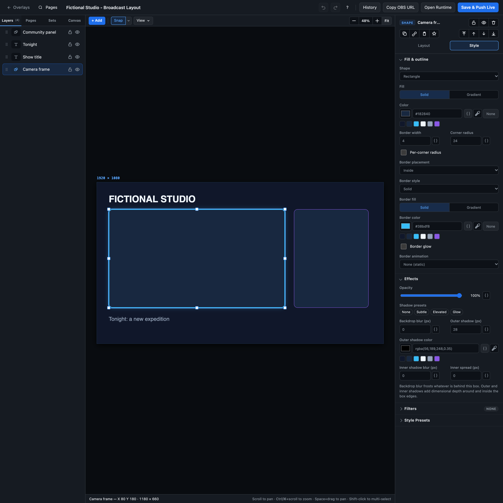
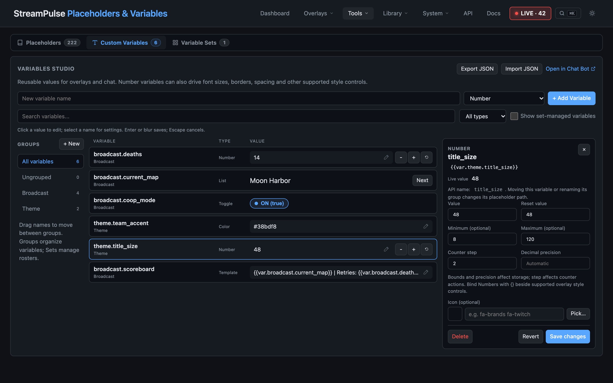
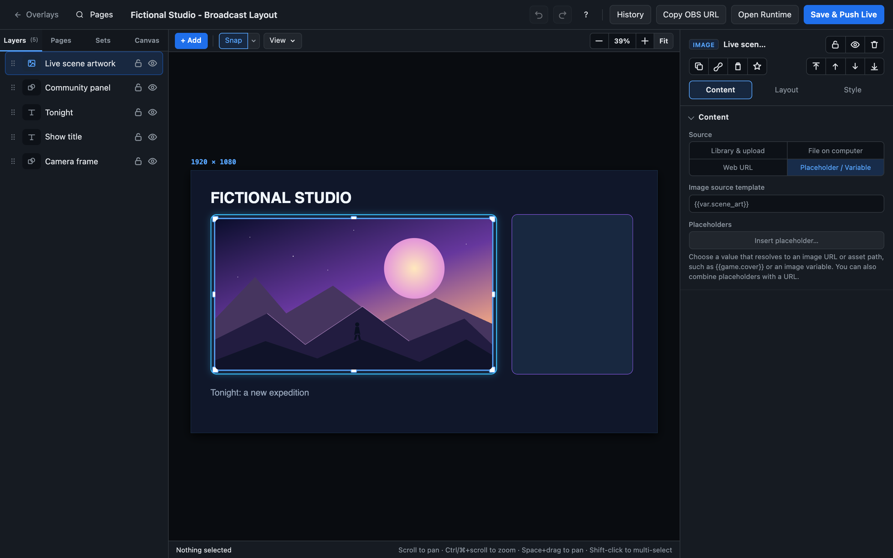
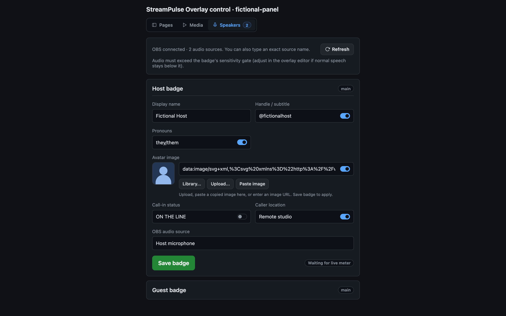
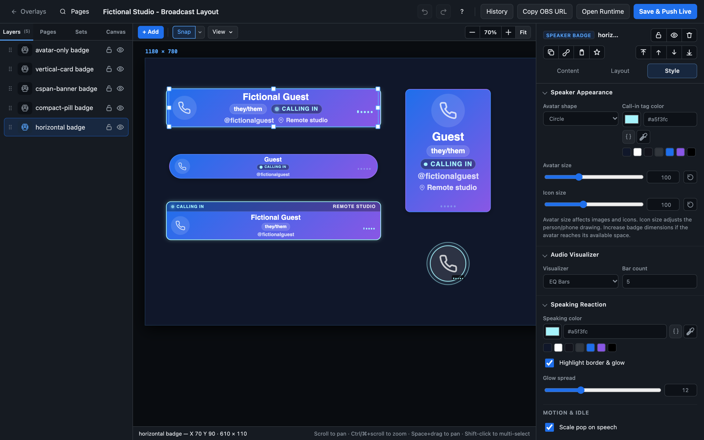
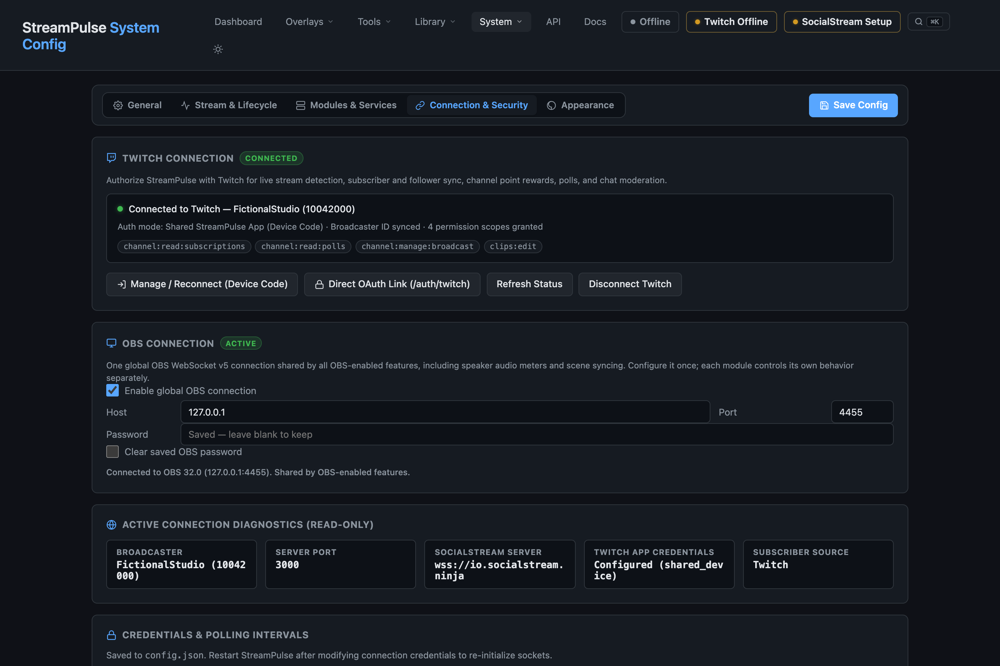
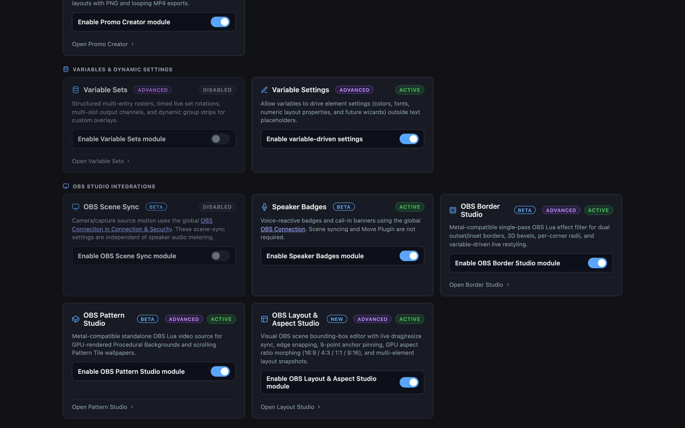
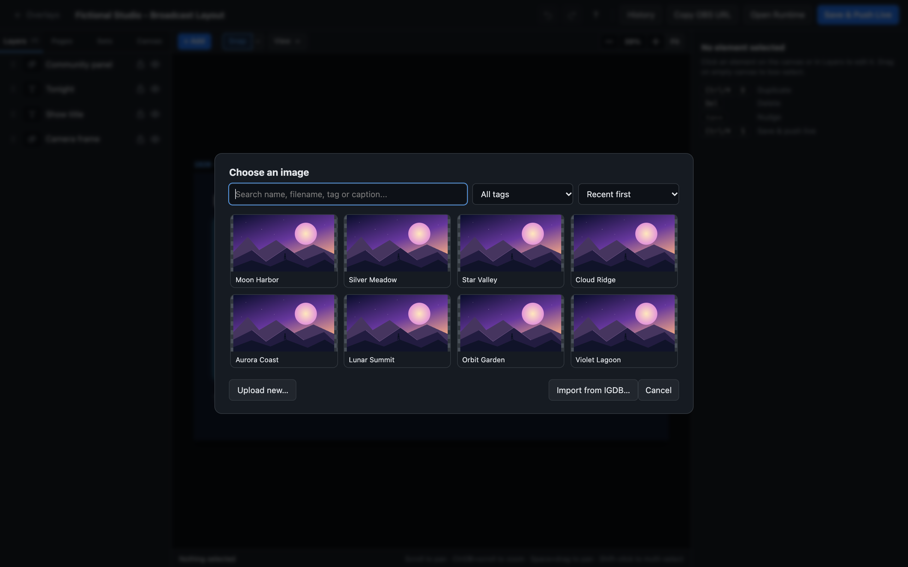

# Make your stream look like yours

Custom Overlay Studio gives you a visual place to shape the scenes and on-screen details that make a broadcast feel personal. Combine text, images, video, shapes, and live stream information into a layout that fits your style, then see the composition as you build it.

Start with a clean canvas or adapt a saved design. Use simple, independent Pages for different moments, or Scene States for animated layout changes and optional OBS source motion. Converting states to pages keeps each look as its own editable layout. Live details can keep an overlay feeling connected to the show, while custom artwork and typography make it distinctly yours.

In the overlay controller's **Playback** tab, switches beside each page enable or disable it immediately and persist the change. Disabled pages are skipped by navigation and automatic playback; switching off the current page moves to an enabled page. At least one page must stay enabled.

Stay focused as you build: the inspector separates content, layout, and style, with controls tailored to each kind of layer. The **+ Add** element picker organizes layers into six sections across three columns (Text & Copy, Media & Artwork, Framing & Cutouts, Graphics & Patterns, Stream Widgets, and Interactive & Web) with instant keyword search and keyboard navigation. Your preferred inspector tab is remembered, so moving between text, artwork, and live widgets feels familiar rather than starting over.

When your design is ready, use it as an OBS browser source. StreamPulse also includes focused tools for specific jobs—like schedules, timers, polls, and credits—if you want a ready-made starting point instead of a whole scene.

For more coordinated scene changes, optional OBS source frames let a saved state move real sources alongside the browser overlay. Connection and synchronization feedback helps you check a change before taking it on air. The bridge is optional; ordinary browser-source layouts do not need it.

**OBS Scene Sync is an independent module.** Turn it off in **System → Config → Modules & Services → OBS Scene Sync** to hide source-link controls and scene-motion features while keeping normal overlay Pages and OBS speaker meters available. **Auto-sync** only controls automatic save/state synchronization when the module is enabled.

Frame borders can sit inside, centered on, or outside a shape. Linked OBS frames start with an outside border, keeping the decoration clear of the camera or video without changing its layout.

Magnetic snapping guides include group bounding boxes and centers alongside individual layers, and **View → Edge Distances (T/R/B/L)** displays pixel measurements from the selected layer or group to the top, right, bottom, and left canvas edges.

Keep a coordinated look without crowding the editor: organize reusable colors and fonts into Variable Groups, then choose font variables from the existing typography dropdowns. Group Strip fields retain their individual overrides while inheriting shared role and base fonts. Text-only stacks need no primary image; image controls appear only when that image is enabled.

Badge and strip design now lives in **Library → Display Library → Badge**, including fields, images, typography, spacing and overall arrangement. Use **+ Add → Saved Display** to place a finished design; Badge Designer is not a separate Add element option. Existing badge/strip layers migrate to Saved Displays. The overlay inspector chooses the design and live source instead of opening a second designer. Library previews preserve the design dimensions and update without reloading an iframe.

Number variables can coordinate font sizes, borders, opacity and spacing as well as display scores in Text layers. The Variables Studio combines compact editable rows, group navigation and a single settings inspector, with a wider laptop-friendly workspace and consistent controls. The inspector only takes space when a variable is selected. Existing typography, animation and font bindings remain available; Style Presets stays last in each applicable Style panel.

## Custom Overlay Elements

Custom Overlay Studio organizes its specialized layer types into six sections across three columns in the **+ Add** element picker:

### 1. Text & Copy
- **Text**: Displays static labels, titles, lower-thirds, subtitles, and dynamic copy. Supports live placeholders (such as `{{stream.title}}`, `{{viewers.current}}`, `{{now}}`, `{{trivia.question}}`, `{{tier_list.item}}`), Google fonts and uploaded typography, automatic font fitting, alignment, line height, letter spacing, text color, and drop shadows.
- **Random Text**: Cycles through a rotating pool of phrases, quotes, chat rules, tips, or stream reminders with shuffle intervals, transitions (fade, slide, cut), and live placeholder support.
- **Markdown**: Renders formatted copy with headings, bold, italics, links, blockquotes, and lists while adopting your chosen typography and colors.

### 2. Media & Artwork
- **Image**: Renders PNG, JPG, SVG, WebP, and GIF graphics from your Asset Library or URLs, with cover/contain framing, interactive focus points, corner radiuses, and non-destructive filters (blur, brightness, contrast, grayscale, duotone, color tint).

  For live artwork, select the image and open **Content → Source → Placeholder / Variable**, then **Insert placeholder…** to pick any live image source (game covers, music artwork, Tier List item images, weather icons, or **Image** variables). Use an OBS browser source URL once and live image updates happen automatically without reloading.

  

- **Video**: Plays local video files (MP4, WebM) or embedded YouTube videos with uniform autoplay, looping, volume scaling, mute controls, and Bitfocus Companion remote playback triggers (`play`, `pause`, `toggle`, `restart`, `stop`, `mute`). Live OBS URLs stay completely free of floating preview prompts.
- **Slideshow**: Automated image carousel cycling through chosen Asset Library images with adjustable slide timing, smooth crossfade or slide transitions, loop toggles, and Companion triggers.
- **Game Artwork**: Search the Internet Game Database (IGDB) right inside the editor to import official box art, banners, screenshots, and logos with one click.

### 3. Framing & Cutouts
- **Camera Cutout**: Punches a transparent aperture hole through underlayers so webcam feeds, gameplay captures, or chat windows underneath the browser source show through cleanly — with shapes (rectangle, rounded, squircle, circle), outlines, and smooth edge feathering.
- **OBS Source Frame**: Layout proxy for an OBS Studio camera or capture source. With Scene States enabled, moving or resizing the frame moves the real OBS source in sync. Borders default to Outside placement so your video is never covered.
- **Shape & Container**: Vector frames for cards, sidebars, headers, panels, dividers, and pills with solid or gradient fills, Inside/Center/Outside borders, independent corner radii, and drop shadows.

### 4. Graphics & Patterns
- **Icon**: Scalable vector iconography from built-in FontAwesome libraries and custom SVGs.
- **Pattern Tile**: Seamless repeating wallpaper grids and motion-graphic mosaics built from **1 to 4 images or icons**, with Grid/Brick/Stagger/Checkerboard layouts, 4-Way Mirror & Radial Kaleidoscope symmetry, color/hue waves, organic scatter, and 10 motion styles.
- **Background Pattern**: 28 procedural, geometric, particle, and seasonal animated backgrounds (leaves, pumpkins, snowflakes, hearts, stars, fireworks) with 22 palettes, vignette, grain, and automatic pausing in hidden browser tabs.

### 5. Stream Widgets
- **Saved Display**: Reusable inventories, ordered data tables, or member badge cards built in **Display Library**. Each placement follows its own live set, slot, linked role, or tracker while sharing one central design. See [Display Library](variable-displays.md).
- **Alert Box**: Live broadcast alert popups for follows, subs, cheers, raids, and tips with event-type filters, visual looks, media-only filters, focus points, particle celebrations, and volume controls.
- **Speaker Badge**: Voice-reactive active speaker cards and broadcast call-in banners powered by live OBS audio inputs.
- **Poll**: Displays live native StreamPulse polls or latest Twitch polls with vote bars, countdowns, blind-vote support, and winner highlights.
- **Game Plan**: Broadcast schedule and lineup widget showing tonight's stream lineup, upcoming scheduled games, or backlog picks with artwork and tags.

### 6. Interactive & Web
- **Progress Goal**: Progress bars and radial rings for tips, followers, subathons, and manual counters.
- **QR Code**: Dynamic vector QR codes for links, Discord invites, or tip pages with optional center logo cutouts.
- **Web Embed**: Sandboxed browser frame for embedding web widgets or live tools directly into a scene.

## Page Triggers & Alert Event Reactions

Pages and Scene States can automatically take over the screen when broadcast events happen, and return smoothly when the event completes:
- **Alert Reactions**: Configure a page or scene state to trigger on "All alerts" or "Only selected alerts" (with quick All and None rule selection buttons). If "Only selected alerts" is active with no rules chosen, takeovers are safely prevented from triggering empty pages.
- **Alert Box Elements**: Alert box layers support explicit "All alerts" or "Only selected alert types" filtering, allowing you to route specific alert categories (like raids or gifts) to dedicated boxes or show every alert uniformly.
- **Alert Box Media Effects**: Set **Effects apply to** to **Media** so blur, tint, duotone, or grain filter only the alert image, video, or emote while titles and messages stay crisp.
- **Alert Box Focus & Padding**: With **Media fit** set to Cover, use the interactive focus-point picker to keep faces or subjects framed properly, and override box inner padding right inside the Style tab.
- **Alert Box Looks**: in **Style → Looks**, choose Inherited or a named look, assign its rules, and edit all presentation settings with the regular Style controls. The canvas previews the selected look; **Preview** plays its animation locally without firing a live alert. Each look owns its layout, typography, colors, background, borders, shadows, spacing and media effects. Box position and size, event filters and sound permissions stay shared. Existing looks and inherited styling are preserved.
- **Alert Box Inspector**: Content contains Preview, When, Sound & motion and Advanced. Style contains Looks, Show/Text/Card, Typography, fills and effects. Pages split into Rotation, Event pages and Playback, with a Triggers summary that flags duplicate triggers.
- **Transition Buffering**: Incoming alert payloads are automatically buffered during live WebSocket page switches, ensuring newly mounted alert elements play immediately without dropped animations or race conditions.
- **Chat, Poll & Featured Reactions**: Trigger pages for featured chat highlights, bot chat commands, and active/completed Twitch audience polls.

## Voice-Reactive Speaker Badges & Call-In Banners

StreamPulse includes an audio-reactive **Speaker Badge** widget in Custom Overlay Studio that lights up automatically based on live OBS Studio audio inputs (microphones, Discord/guest call tracks, or VDO.ninja browser sources).

- **Opt-in audio metering**: Speaker badges are off by default. Enable **Speaker Badges** in **System → Config → Modules & Services** and connect OBS WebSocket under **Connection & Security → OBS Connection** to start live audio reaction. Move Plugin and OBS Scene Sync are not required for speaker badges.
- **Clean Inspector Separation**:
  - **Content**: Speaker identity (Display Name, Handle, Pronouns, Avatar Asset), Call-In metadata (Status tag, Caller location), and OBS Audio Input selection with a connection-status badge, dB sensitivity gate threshold, and release hold time. The setup link opens **System Config → Connection & Security → OBS Connection**. This global connection serves all OBS-enabled features, including speaker audio meters and scene syncing. Enable the connection, enter the OBS host/port/password, and enable Speaker Badges under **Modules & Services**, then save. Scene-sync controls remain separate under **Modules & Services → OBS Scene Sync**; Move Plugin and automatic scene syncing are not required for badges. Existing global `obs` configuration is retained without migration.
  - **Live mic preview**: Enable the editor's live-data preview to see badge reactions to real OBS audio, or use **Simulate Speaking** to check the styling independently. The audio inspector and Speakers controller show smoothed, whole-number dB levels against the saved gate, updating at most once every 300 ms; speech detection still uses immediate unsmoothed audio. If normal speech is below the gate, lower it (for example, −48 dB will not open a −20 dB gate). Use the exact active OBS mixer source; an audio-capable source can appear in discovery without sending active meters. Release hold returns the badge to idle if meters stop.
  - **Layout**: Switch layout presets with one click; dimensions auto-adapt to recommended aspect ratios with an optional "Apply Recommended Size" button.
  - **Style**: Visual appearance (Avatar shape: Circle, Squircle, Square; Call-In tag color), separate **Audio Visualizer** and **Speaking Reaction** sections, proportional typography, background fills, borders, and box shadows. Sliders occupy full-width rows with their values beside them; bar count, glow spread and idle opacity appear only when their related effect is enabled.
  - **Avatar scaling**: **Speaker Appearance → Avatar size** scales the whole avatar (50–200%); **Icon size** independently scales the fallback person/phone drawing (50–180%). Images use Avatar size only. Auto-size gives avatars more of the available space without letting them displace the name; text fitting no longer shrinks the avatar along with its font. Avatar Only can grow outside the layer box.
  - **Sizing & fonts**: **Typography → Auto-size to fill badge** automatically grows or shrinks text to fill the fixed badge dimensions, overriding manual font size. Turn it off to choose a maximum name size while retaining overflow protection. Name, subtitle and pill fonts have separate selectors, including uploaded fonts; secondary fonts inherit the name font by default.
  - **Padding**: **Layout → Horizontal/Vertical padding** sets the content inset. Vertical cards default to 14 px above and below the content. Padding remains fixed when automatic sizing changes text or effects.
- **Quick speaker changes**: Use **Control** in either overlay list, then choose **Speakers** (`/overlay-control.html?id=<overlay-id>`). Speaker badges expose this button even without pages or other controllable layers. Each badge has a compact form for name, handle/subtitle, pronouns, avatar image, call-in status/location and OBS audio source. The avatar field previews the chosen image. Use **Library...** to choose an asset or **No image**, **Upload...** to choose a file, or **Paste image** to read a copied image from your clipboard. You can also focus the avatar area and press Ctrl+V/Cmd+V, or paste a URL into its input. Browser permissions may block the clipboard button; keyboard paste remains available. Uploaded/pasted images are saved in the Asset Library, but the badge selection remains a draft until **Save badge**. Saving updates connected overlays immediately; layout, styling, gate settings and other layers are preserved. Audio sources come from OBS, with manual source names supported while disconnected. Use **Refresh badges & audio sources** to rediscover inputs. The controller remembers its active tab and preserves unsaved speaker drafts during live page changes.
- **Per-field visibility**: **Show** switches beside handle/subtitle, pronouns, avatar, call-in status and caller location retain each field's content when hidden. Changes remain drafts until **Save badge**; they persist per badge and update connected overlays. Call-in status enables/disables call-in mode; caller location still follows the selected layout and call-in settings.
- **Audio Reactions & Visualizers**:
  - **Border & Glow Highlighting**: Active border color and custom glow spread that illuminate when the speaker talks.
  - **Motion Pop**: Subtle scale pop animation triggered by speech onset.
  - **Idle Dimming**: Soften inactive speakers with a configurable idle opacity (e.g., 50%) so active speakers stand out immediately.
  - **Presentation**: The speaker name gets its own row; pronoun/status pills and secondary details sit below it and wrap when necessary. The badge keeps its configured height, fitting typography while preserving minimum row spacing and limiting EQ/spacing growth. Metadata cannot shrink into the avatar or visualizer; fitting leaves saved settings, avatar size and padding intact. Names wrap rather than being displaced by pills. Speaking growth and glow extend beyond the layer box without clipping; justification and typography remain effective. Reduced-motion preferences suppress decorative movement while preserving highlighting. Keep badges away from the actual canvas boundary, which still clips the broadcast frame.
  - **EQ-style Visualizer**: Built-in 3 to 8 decorative bars animate while speech is detected; these are not frequency-band measurements. A speaker returns to idle after the release hold even if meter delivery stops, and changing the input resets the previous source's speaking state.
- **Layout Styles**:
  - `horizontal`: Classic podcaster/streamer lower-third badge with avatar, name, handle, and pronouns.
  - `cspan-banner`: Broadcast call-in news banner featuring an uppercase status header (e.g. `LIVE CALLER`, `ON THE LINE`), animated live status dot, caller name, and location tag (e.g. `CHICAGO, IL`).
  - `compact-pill`: Streamlined minimal badge for multi-speaker panels.
  - `vertical-card`: Tall portrait card format for sidebar and side-by-side stream layouts.
  - `avatar-only`: Audio-reactive floating avatar with glowing halo ring, ideal for placing on top of guest webcam feeds.
- **Multi-Guest Audio Routing**: When using tools like VDO.ninja or Discord with multiple guests, route each guest's audio to an individual OBS Browser Source (with "Control audio via OBS" enabled) or Audio Input Capture. StreamPulse detects each source in the audio input picker and lights up only the badge belonging to that guest.

  <figure>
    
    <figcaption><strong>Live Speakers Controller</strong>Update guest names, pronouns, avatars, and call-in tags mid-stream.</figcaption>
  </figure>
  <figure>
    
    <figcaption><strong>Speaker Badge Styles</strong>Five presets from lower-third bars to floating halo avatars.</figcaption>
  </figure>
  <figure>
    
    <figcaption><strong>Shared OBS Connection</strong>Configure OBS WebSocket once for speaker meters and scene controls.</figcaption>
  </figure>
  <figure>
    
    <figcaption><strong>Independent Modules</strong>Toggle OBS Scene Sync or Speaker Badges separately anytime.</figcaption>
  </figure>

Explore the [StreamPulse features](features.md) or [get started](quickstart.md). Already installed? **Docs** and **API Reference** are available from the app navigation.

## Asset Library & In-Editor Image Cropper

StreamPulse provides built-in media and artwork management through the Asset Library (`Overlays > Asset Library` at `/assets.html`) and inside Custom Overlay Studio:
- **Consistent pickers**: Library selectors for images, overlay media/text, slideshows, Alerts, timer sounds, Game Plan covers, Tier List items, display badges, promos and uploaded Poll/Versus fonts include search, tag filtering, and **Recent first**, **Oldest first** or **Name A-Z** sorting. Search matches every space-separated term across names, filenames, font families, tags and captions, ignoring case. Tags include **All tags** and **Untagged**; manage tags and captions in the Asset Library. Recent sorts by the file's last modification time, including uploads and overwrites, not when it was last selected. Search, tag and sort choices are remembered per picker in this browser. Filtering never removes existing selections; Tier List's **Select shown** adds only visible matches.

To find a tagged logo, add a `brand` tag to it in the Asset Library, open an image field's **Library** chooser, select `brand`, and search part of its name or caption. Clear the search and select **All tags** to see everything again. Choose **Recent first** to find the image you just uploaded or cropped; selecting it retains the existing asset URL and overlay/OBS workflow. OS-native file dialogs and external IGDB search remain separate from library browsing.

- **Studio Filter Bar & Backdrop Switcher**: Browse by category pills with live counts (*All*, *Images*, *Videos*, *Audio*, *Fonts*, *Text*), toggle thumbnail backdrops (*Checkerboard*, *Dark*, *Light*) to inspect transparent white or dark assets, and view automatic pixel dimension badges (`width × height`) on image cards.
- **Drag-and-Drop, Clipboard Paste & Inspection Modal**: Drop files anywhere on the page or press `⌘V` / `Ctrl+V` to upload copied clipboard images directly. Click any thumbnail to open the asset inspection modal with full-size preview, dimensions, consumer ("Used By") badges, tag management, and quick actions.
- **Direct Asset Downloads & Floating Bulk Bar**: 1-click **Copy**, **Crop**, and **Download** actions on asset cards, plus a floating bulk selection bar for batch tagging, untagging, and deletion.
- **In-Editor Image Cropper**: Interactive modal cropper accessible from the Asset Library ("Crop") and the overlay inspector for Image and Pattern Tile layers ("Crop & Edit Image…").
  - **Aspect Ratio Presets**: Freeform, 1:1 square, 16:9 widescreen, 4:3 standard, 3:2 photo, 2:1 ultrawide, 3:4 portrait, and 9:16 vertical video framing.
  - **Transformations**: 90° clockwise/counter-clockwise rotation and horizontal flipping.
  - **Interactive Crop Box**: 8-point drag handles with rule-of-thirds grid lines and live rendered pixel dimensions.
  - **Save & Overwrite Options**: Save as a new asset, overwrite the existing asset in-place so all layers update immediately without breaking paths, or download the cropped image to your computer.

## Variable Sets (Advanced Module) & Group Roster Mode

**Variable Sets is an opt-in Advanced module.** Enable or disable it in **System → Config → Modules & Services → Variable Sets**. When turned off, Variable Sets tabs and pickers stay tucked away so your workspace stays streamlined, while keeping any previously saved rosters intact on disk.

See the **[Custom Variables & Variable Sets Guide](variables-guide.md)** for full setup walkthroughs, Member Badges, and Group Rosters. *(Developers and Bitfocus Companion power users can find HTTP triggers and schema contracts in the [API Reference](api-reference.md) under **The Project → Technical**.)*

## Element Style Presets, Extended Borders & Text Animations

The **Style** tab in Custom Overlay Studio places each layer's element-specific styling controls at the top, followed by Typography, Fill/Border, and one-click presets:

- **Element Style Presets**: Start from built-in looks (*Glass Card*, *Neon Tube*, *Esports Chamfer*, *Mecha Tech HUD*, *Royal Filigree*, *Broadcast Pill*, *Gold Plaque*, *Hazard Caution*, *Cyber Brackets*, *Metallic Wave*) or save your own custom presets right from the **Style** inspector.
- **Shadow Quick-Chips, 3-Stop Gradients & Per-Corner Radii**: Clean 2-stop gradients with an optional middle stop, instant Shadow preset chips (*None*, *Subtle*, *Elevated*, *Glow*), and independent per-corner radiuses on cards and frames.
- **Composable Standout Borders & Text Animations**: Combine 21 border styles with gradients and 10 border animations, plus pure-motion text animations (Whole Block, Per Word, or Per Character including Typewriter and Cipher Decode).

## Embedded Host & Developer Tools

Running StreamPulse inside an embedded host bundle or automating layers via HTTP? See **[Technical Reference](technical-reference.md)** and **[API Reference](api-reference.md)** under **The Project → Technical**.
