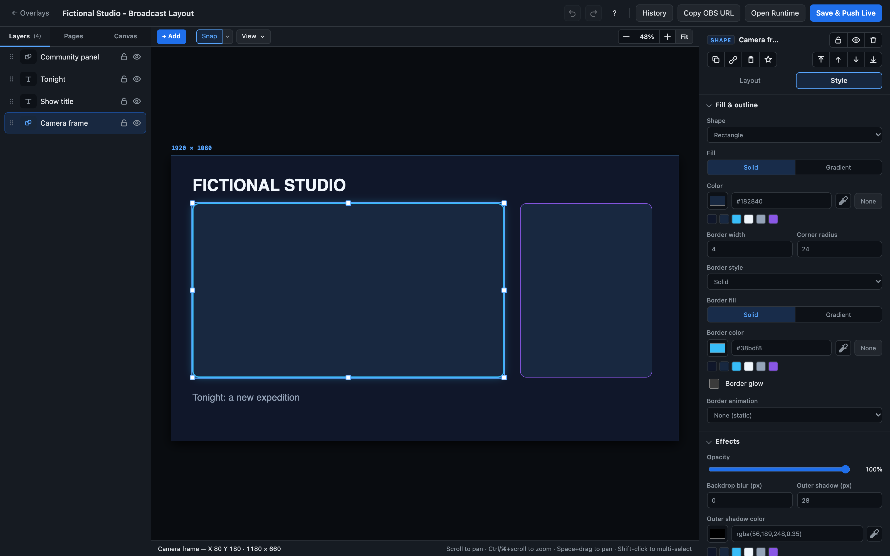
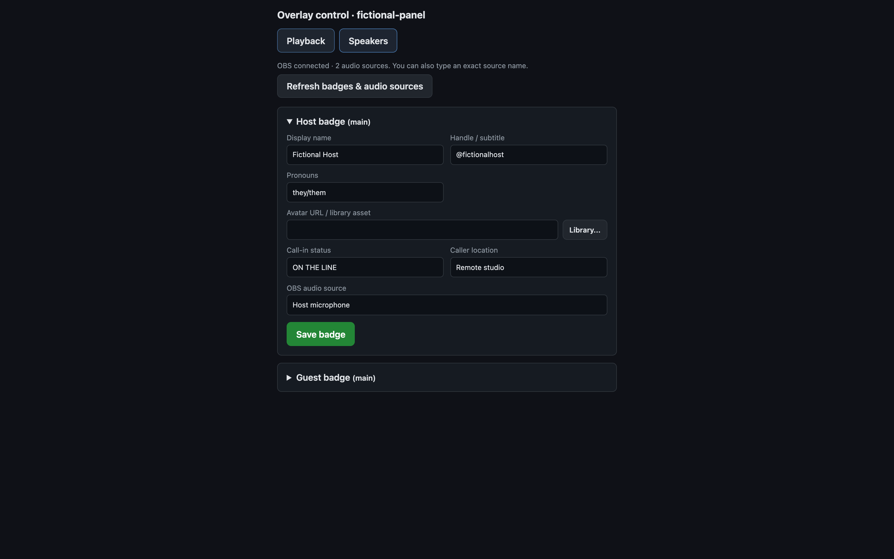
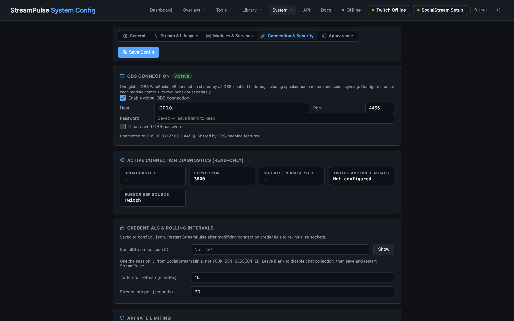

# Make your stream look like yours

Custom Overlay Studio gives you a visual place to shape the scenes and on-screen details that make a broadcast feel personal. Combine text, images, video, shapes, and live stream information into a layout that fits your style, then see the composition as you build it.

Start with a clean canvas or adapt a saved design. Use simple, independent Pages for different moments, or Scene States for animated layout changes and optional OBS source motion. Converting states to pages keeps each look as its own editable layout. Live details can keep an overlay feeling connected to the show, while custom artwork and typography make it distinctly yours.

Stay focused as you build: the inspector separates content, layout, and style, with controls tailored to each kind of layer. The **+ Add** element picker organizes layers into intuitive categories (Text & Copy, Media & Artwork, Shapes & Graphics, Framing & Cutouts, and Stream Widgets) with instant keyword search and keyboard navigation. Your preferred inspector tab is remembered, so moving between text, artwork, and live widgets feels familiar rather than starting over.

When your design is ready, use it as an OBS browser source. StreamPulse also includes focused tools for specific jobs—like schedules, timers, polls, and credits—if you want a ready-made starting point instead of a whole scene.

For more coordinated scene changes, optional OBS source frames let a saved state move real sources alongside the browser overlay. Connection and synchronization feedback helps you check a change before taking it on air. The bridge is optional; ordinary browser-source layouts do not need it.

Frame borders can sit inside, centered on, or outside a shape. Linked OBS frames start with an outside border, keeping the decoration clear of the camera or video without changing its layout.

## Page Triggers & Alert Event Reactions

Pages and Scene States can automatically take over the screen when broadcast events happen, and return smoothly when the event completes:
- **Alert Reactions**: Configure a page or scene state to trigger on "All alerts" or "Only selected alerts" (with quick All and None rule selection buttons). If "Only selected alerts" is active with no rules chosen, takeovers are safely prevented from triggering empty pages.
- **Alert Box Elements**: Alert box layers support explicit "All alerts" or "Only selected alert types" filtering, allowing you to route specific alert categories (like raids or gifts) to dedicated boxes or show every alert uniformly.
- **Alert Box Media Effects**: Media effects (blur, color, duotone, tint, grain) normally affect the whole alert box. Set **Effects apply to** to "Media" (`alert.effectsTarget: "media"`) to filter just the image, video or emote while the title and message stay crisp. Works with cutout masks and the editor preview.
- **Alert Box Focus & Padding**: With **Media fit** set to Cover, a click-or-drag focus-point picker sets `alert.mediaFocusX`/`mediaFocusY` (0-100, default 50/50) choose which part of the image or video stays visible (`object-position`). `alert.padding` (0-200 px) overrides the box's inner padding; unset keeps the style padding.
- **Alert Box Looks**: in **Style → Looks**, choose Inherited or a named look, assign its rules, and edit all presentation settings with the regular Style controls. The canvas previews the selected look; **Preview** plays its animation locally without firing a live alert. Each look owns its layout, typography, colors, background, borders, shadows, spacing and media effects. Box position and size, event filters and sound permissions stay shared. Existing looks and inherited styling are preserved.
- **Alert Box Inspector**: Content contains Preview, When, Sound & motion and Advanced. Style contains Looks, Show/Text/Card, Typography, fills and effects. Pages split into Rotation, Event pages and Playback, with a Triggers summary that flags duplicate triggers.
- **Transition Buffering**: Incoming alert payloads are automatically buffered during live WebSocket page switches, ensuring newly mounted alert elements play immediately without dropped animations or race conditions.
- **Chat, Poll & Featured Reactions**: Trigger pages for featured chat highlights, bot chat commands, and active/completed Twitch audience polls.

## Voice-Reactive Speaker Badges & Call-In Banners

StreamPulse includes an audio-reactive **Speaker Badge** layer (`type: "speaker-badge"`) in Custom Overlay Studio. Speaker badges highlight active speakers in real time based on live OBS audio inputs (microphones, Discord/guest call tracks, or VDO.ninja browser sources).

- **Opt-in audio metering**: Speaker badges are disabled by default (`"speaker_badges_enabled": false` in `config.json` or System Config). When disabled, OBS WebSocket audio volume metering is omitted and the element is hidden from the studio toolbar. When enabled, StreamPulse subscribes to OBS volume meters (`InputVolumeMeters`) at a throttled 20Hz update rate.
- **Clean Inspector Separation**:
  - **Content**: Speaker identity (Display Name, Handle, Pronouns, Avatar Asset), Call-In metadata (Status tag, Caller location), and OBS Audio Input selection with a connection-status badge, dB sensitivity gate threshold, and release hold time. The setup link opens **System Config → Connection & Security → OBS Connection**. This global connection serves all OBS-enabled features, including speaker audio meters and scene syncing. Enable the connection, enter the OBS host/port/password, and enable Speaker Badges under **Modules & Services**, then save. Scene-sync controls remain separate under **Modules & Services → OBS Scene Sync**; Move Plugin and automatic scene syncing are not required for badges. Existing global `obs` configuration is retained without migration.
  - **Layout**: Switch layout presets with one click; dimensions auto-adapt to recommended aspect ratios with an optional "Apply Recommended Size" button.
  - **Style**: Visual appearance (Avatar shape: Circle, Squircle, Square; Call-In tag color), Speaking reactions & visualizers, Proportional typography (adjusting font size harmoniously scales display name, handle, pronouns, and call-in tags), Background fills (including true transparency, solid colors, and animated gradients), borders, and box shadows.
- **Quick speaker changes**: Open the overlay's controller (`/overlay-control.html?id=<overlay-id>`) and choose **Speakers**. Each badge has a compact form for name, handle/subtitle, pronouns, avatar URL/library asset, call-in status/location and OBS audio source. Use **Library...** beside the avatar to search image assets, upload from your computer, or choose **No image**; you can still paste a URL/path. Selection remains a draft until you save the badge. Save each badge to persist its data and update connected overlays immediately; layout, styling, gate settings and other layers are preserved. Audio sources come from OBS, with manual source names supported while disconnected. Use **Refresh badges & audio sources** to rediscover inputs. Call-in fields display only when enabled in the editor. The controller remembers its active tab and preserves unsaved speaker drafts during live page changes.
- **Audio Reactions & Visualizers**:
  - **Border & Glow Highlighting**: Active border color and custom glow spread that illuminate when the speaker talks.
  - **Motion Pop**: Subtle scale pop animation triggered by speech onset.
  - **Idle Dimming**: Soften inactive speakers with a configurable idle opacity (e.g., 50%) so active speakers stand out immediately.
  - **EQ-style Visualizer**: Built-in 3 to 8 decorative bars animate while speech is detected; these are not frequency-band measurements. A speaker returns to idle after the release hold even if meter delivery stops, and changing the input resets the previous source's speaking state.
- **Layout Styles**:
  - `horizontal`: Classic podcaster/streamer lower-third badge with avatar, name, handle, and pronouns.
  - `cspan-banner`: Broadcast call-in news banner featuring an uppercase status header (e.g. `LIVE CALLER`, `ON THE LINE`), animated live status dot, caller name, and location tag (e.g. `CHICAGO, IL`).
  - `compact-pill`: Streamlined minimal badge for multi-speaker panels.
  - `vertical-card`: Tall portrait card format for sidebar and side-by-side stream layouts.
  - `avatar-only`: Audio-reactive floating avatar with glowing halo ring, ideal for placing on top of guest webcam feeds.
- **Multi-Guest Audio Routing**: When using tools like VDO.ninja or Discord with multiple guests, route each guest's audio to an individual OBS Browser Source (with "Control audio via OBS" enabled) or Audio Input Capture. StreamPulse detects each source in the audio input picker and lights up only the badge belonging to that guest.

Explore the [StreamPulse features](features.md) or [get started](quickstart.md). Already installed? **Docs** and **API Reference** are available from the app navigation.

## NodeCG replicants

When StreamPulse runs inside NodeCG through the [nodecg-streampulse](https://github.com/jarbochov/nodecg-streampulse) bundle, replicants listed in `cfg/streampulse.json` appear in the variable picker under **NodeCG** and resolve as `{{rep.<bundle>.<name>.<path>}}`, for example `{{rep.nodecg-tiltify.total.amount}}`. Array items use their index (`.0.name`). Values update live.
