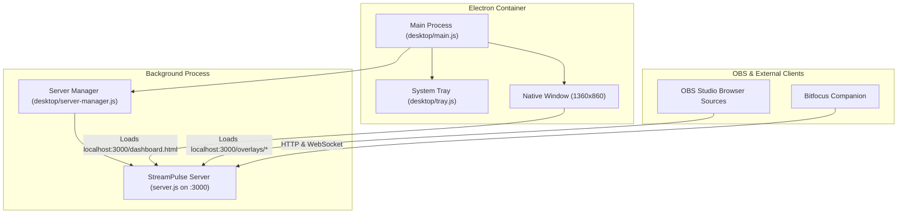

# Desktop Application (Electron) & 1.0 Roadmap

StreamPulse is transitioning toward **1.0** with an embedded, native desktop application for macOS and Windows.

The desktop app bundles the StreamPulse server, an embedded Chromium runtime, and a native system tray icon—allowing broadcasters to run StreamPulse as a standalone desktop program without opening terminals or installing Node.js separately.

---

## 1. Architecture Overview

The desktop wrapper lives directly within the StreamPulse repository inside the `desktop/` directory:

### Key Technical Advantages:
- **Zero Monorepo / Submodule Overhead**: Lives directly in `desktop/`. Backend improvements and UI updates immediately reflect in the desktop application.
- **OBS Browser Source Continuity**: Even when running as a desktop app, the embedded server serves `http://localhost:3000/overlays/...` to OBS Studio just like before.
- **Background Tray Minimization**: When you close the main dashboard window during a stream, StreamPulse continues running quietly in your macOS menu bar or Windows notification tray.
- **Isolated Child Process**: The Node.js server runs in its own process, ensuring heavy visual rendering in the desktop UI never blocks chat ingestion or WebSocket broadcasts.

---

## 2. System Tray Controls

The native tray provides quick, one-click access:
- **Dashboard**: Opens the main production overview.
- **Direct Studio Launchers**: Custom Overlay Studio, Credits Studio, Choice Randomizer, Game Plan, and Alert Queue.
- **Copy OBS Overlay URLs**: Submenu allowing instant copying of overlay URLs to the clipboard.
- **Open Data Directory**: Opens your local OS file manager directly to the `data/` directory.
- **Restart Server & Quit**: Safely flushes chat logs, persists stats, and shuts down gracefully.

---

## 3. Automated Packaging via GitHub Actions

The workflow at `.github/workflows/desktop.yml` automates multi-platform packaging:
- **macOS Runner**: Generates `.dmg` and `.zip` installers.
- **Windows Runner**: Generates NSIS `.exe` installers and portable executables.
- **Release Integration**: Built installers are automatically attached to GitHub Releases for one-click downloading.
