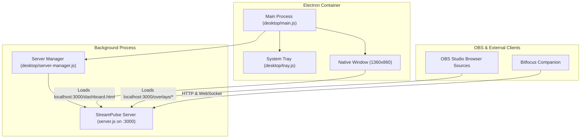
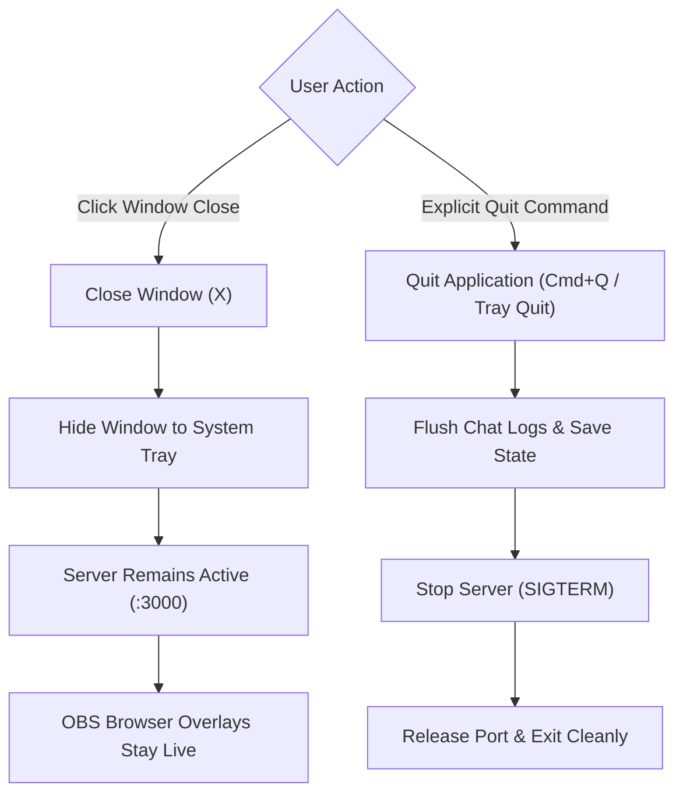

# Desktop Application (Electron) & 1.0 Roadmap

StreamPulse is transitioning toward **1.0** with an embedded, native desktop application for macOS and Windows.

The desktop app bundles the StreamPulse server, an embedded Chromium runtime, and a native system tray icon—allowing broadcasters to run StreamPulse as a standalone desktop program without opening terminals or installing Node.js separately.

---

## 1. Architecture Overview

The desktop wrapper lives directly within the StreamPulse repository inside the `desktop/` directory:



### Key Technical Advantages:
- **Zero Monorepo / Submodule Overhead**: Lives directly in `desktop/`. Backend improvements and UI updates immediately reflect in the desktop application.
- **OBS Browser Source Continuity**: Even when running as a desktop app, the embedded server serves `http://localhost:3000/overlays/...` to OBS Studio just like before.
- **Background Tray Minimization**: When you close the main dashboard window during a stream, StreamPulse continues running quietly in your macOS menu bar or Windows notification tray.
- **Isolated Child Process**: The Node.js server runs in its own process, ensuring heavy visual rendering in the desktop UI never blocks chat ingestion or WebSocket broadcasts.

---

## 2. Where Does Data Live? (Backups, Assets & Chat Data)

In a packaged desktop application, the application binary and code assets are bundled inside a read-only archive (`app.asar`). Writing persistent user data inside the app folder would fail or get erased whenever you update the app.

To guarantee that your data is safe and persists across upgrades, StreamPulse automatically stores all persistent files in your operating system's standard user data directory:

| Operating System | Persistent Data Location |
| :--- | :--- |
| **macOS** | `~/Library/Application Support/StreamPulse/data/` |
| **Windows** | `%APPDATA%\StreamPulse\data\` (`C:\Users\<You>\AppData\Roaming\StreamPulse\data\`) |
| **Linux** | `~/.config/StreamPulse/data/` |
| **Developer / CLI** | `./data/` relative to repository root |

### Contents of the Data Directory:
- **`backups/`**: Automated and manual ZIP/JSON archives generated from the Backup & Restore studio.
- **`assets/`**: Uploaded custom overlay images, transparent WebM/MP4 videos, custom fonts, and audio sound effects.
- **`sessions/`**: Historical stream session summaries, chat archives, and viewer dossiers.
- **`chat.json` & `chat-log.jsonl`**: Live stream chat messages ingested from SocialStream Ninja and Twitch.
- **`crm.json` & `stats.json`**: Viewer community CRM profiles, notes, watch time, and session statistics.
- **`custom-overlays.json` & `overlay-presets.json`**: Saved custom overlay layouts, layer stacks, and shader presets.
- **`game-plan.json`**: Game rundown catalog, scheduled games, and queue lineups.
- **`config.json`**: Broadcaster credentials, Twitch tokens, and port configurations (stored at the root of `userData`).

### Quick Folder Access:
You can open this directory at any time without navigating hidden system paths:
- **System Tray**: Right-click the StreamPulse tray icon and select **Open Data Folder**.
- **Desktop Application Menu**: Click **Help** -> **Open Data Directory**.
- **First Launch Seeding**: When StreamPulse runs for the first time, it automatically creates this folder and seeds standard templates (presets, sample goals, and overlay layouts).

---

## 3. Window Closing vs. Server Termination (OBS Stream Protection)

A common danger with broadcast software is accidentally closing a window during a live show and crashing stream overlays. StreamPulse implements an intentional two-tier lifecycle:



### 1. Closing the Window (Minimizes to System Tray)
- When you click the window's close button (the red circle on macOS or the top-right `X` on Windows), **the StreamPulse server does NOT terminate**.
- The main window hides to the background, and StreamPulse continues running quietly in your macOS menu bar or Windows system tray.
- **Why this matters**: Your OBS browser sources (`credits.html`, `game-plan.html`, `randomizer.html`, custom overlays) remain connected, interactive, and live.
- On the first window close, a native system notification informs you: *"StreamPulse is still running in your system tray to keep OBS overlays live. Right-click the tray icon to quit."*

### 2. Quitting the Application (Graceful Shutdown)
- When you explicitly quit via:
  - **macOS Menu**: `StreamPulse` -> **Quit StreamPulse** (`Cmd+Q`)
  - **System Tray**: Right-click tray icon -> **Quit StreamPulse**
  - **Windows Menu**: `File` -> **Quit** (`Alt+F4`)
- StreamPulse initiates a graceful shutdown sequence:
  1. Triggers `app.on('before-quit')`.
  2. Issues `SIGTERM` to the background Node.js server child process.
  3. Flushes in-memory chat buffers and session stats to disk.
  4. Releases port `3000` so other applications can bind to it.
  5. Destroys the system tray icon and cleanly exits the application.

---

## 4. Hardware Control via Bitfocus Companion

StreamPulse pairs seamlessly with **Bitfocus Companion** and the **Elgato Stream Deck** for tactile broadcast control.

The desktop app exposes the same local HTTP and WebSocket APIs as the CLI version:
- **Module Repository**: [`companion-module-streampulse`](https://github.com/jarbochov/companion-module-streampulse)
- **Detailed Setup Guide**: See the [Bitfocus Companion & Stream Deck Guide](companion.md)
- **Direct Access**: Launch Companion setup directly from the desktop application menu under **Help** -> **Bitfocus Companion Setup Guide** or from the system tray menu.

---

## 5. System Tray Controls

The native tray provides quick, one-click access:
- **Dashboard**: Opens the main production overview.
- **Direct Studio Launchers**: Custom Overlay Studio, Credits Studio, Choice Randomizer, Game Plan, and Alert Queue.
- **Copy OBS Overlay URLs**: Submenu allowing instant copying of overlay URLs to the clipboard.
- **Open Data Folder**: Opens your OS file manager directly to the persistent user data directory.
- **Bitfocus Companion**: One-click link to the hardware integration module.
- **Restart Server & Quit**: Safely flushes chat logs, persists stats, and shuts down gracefully.

---

## 6. Automated Packaging & Pre-Release Builds via GitHub Actions

StreamPulse uses GitHub Actions to automate multi-platform builds without requiring local toolchain installations.

The workflow at `.github/workflows/desktop.yml` builds installers for both platforms:
- **macOS Runner**: Generates `.dmg` and `.zip` installers.
- **Windows Runner**: Generates NSIS `.exe` setup installers and portable executables.

### Generating a Pre-Release Build for Testing:
1. Go to the [StreamPulse Actions Tab](https://github.com/jarbochov/StreamPulse/actions) on GitHub.
2. Under **Workflows** in the left sidebar, select **Build Desktop App**.
3. Click the **Run workflow** dropdown button:
   - Check **Publish installers to GitHub Pre-Release?** to attach the resulting `.dmg` and `.exe` files directly to a GitHub release.
   - Specify a tag (e.g., `v0.12.0-preview`).
4. Click **Run workflow**.
### macOS First-Launch & Gatekeeper Verification

StreamPulse is a self-hosted, open-source broadcast suite. Pre-release builds are not signed with a paid Apple Developer Program identity ($99/year), which causes macOS Gatekeeper to flag web-downloaded binaries with:

> `“StreamPulse.app” is damaged and can’t be opened. You should move it to the Trash.`

This is standard macOS behavior for unsigned or ad-hoc signed open-source applications downloaded through web browsers.

**To open StreamPulse on macOS:**
1. Open the downloaded `.dmg` and drag **StreamPulse.app** into your `/Applications` folder.
2. Open **Terminal** (press `Cmd` + `Space`, type `Terminal`, and press `Enter`).
3. Run the following command to clear Gatekeeper's quarantine attribute:
   ```bash
   xattr -cr /Applications/StreamPulse.app
   ```
4. Launch **StreamPulse** from Applications or Spotlight. It will open immediately with full system tray and OBS server capabilities!

Alternatively, Control-click (or right-click) `StreamPulse.app` in Finder, select **Open**, and when prompted, click **Open Anyway** in **System Settings** -> **Privacy & Security**.

---

### Local Development Commands:
```bash
# Launch the desktop app locally in development mode
npm run desktop

# Compile native desktop packages locally into dist/
npm run desktop:dist
```
