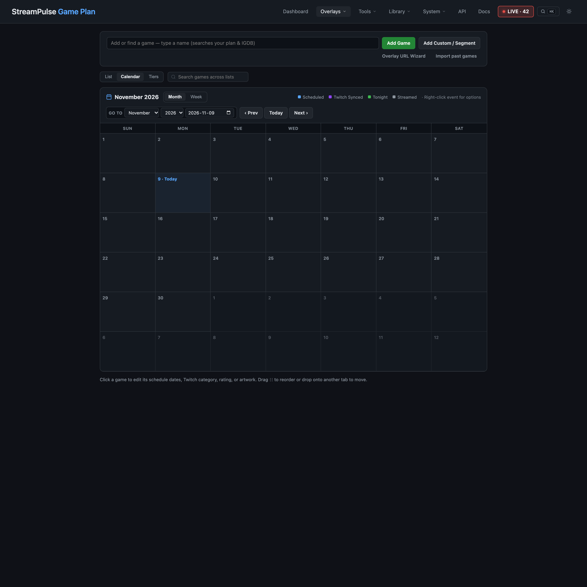

# Keep the next chapter of your stream in view

Game Plan gives your broadcasts a flexible rundown. Keep tonight’s lineup close, save future ideas for later, and see how a game moves from “maybe” to “playing now.”

Use the calendar to plan upcoming streams, pin games to **Tonight's Lineup** without removing them from their home list (`Schedule`, `Up Next`, or custom collections), group titles into flexible horizon blocks (like `Next Week`, `October`, or `Future`), and keep a backlog ready for the next time you need inspiration. Multi-select rows for bulk moves, sync unsynced schedule slots to Twitch in one pass, or export/import your plan as JSON.

When you want viewers in on the plan, bring a schedule, checklist, or featured game into an OBS scene. Game artwork helps make the display recognizable at a glance, and the same plan can support both your own show notes and an on-screen update.

Start with the [StreamPulse feature overview](features.md) or [get started](quickstart.md). Already installed? **Docs** and **API Reference** are available from the app navigation.
