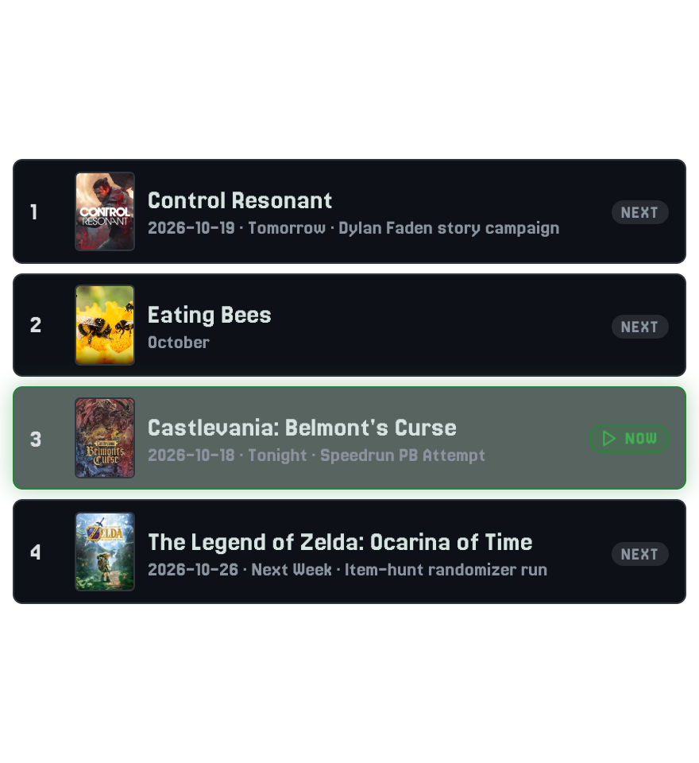

# Game Plan Broadcast Scheduler Guide

**Game Plan** is an integrated stream rundown manager and broadcast schedule overlay with IGDB catalog integration, box art fetching, and full calendar planning.

---

## Calendar Planning & Broadcast Lineups

Manage your entire gaming broadcast schedule from a single visual dashboard:
- **Full Month & Week Views**: View all past streamed titles and upcoming scheduled games in a full calendar grid.
- **14-Day Quick Calendar Strip**: One-click scheduling directly from the game detail dialog.
- **Schedule Stages**:
  - `Tonight's Lineup`: Games queued for the current broadcast.
  - `Schedule`: Confirmed upcoming dates and future streams.
  - `Up Next`: High-priority games on deck.
  - `Backlog`: Saved games to play in the future.
  - `Played`: Completed campaigns and one-offs with total play hours recorded.
- **Custom Collections**: Group titles by franchise, genre, community vote, or system backlog (e.g. Virtual Boy, Retro JRPGs, Horror Month).

---

## One-Click Broadcaster Actions

Control your broadcast rundown in real time with quick action buttons:
- **Play Now**: Marks a game as currently active, switches the overlay to "Now Playing", and **automatically updates your Twitch broadcast category**.
- **Stop**: Pauses the current game timer and stops stream time tracking.
- **Finish & Next**: Marks the current game as played and automatically advances to the next title in tonight's lineup.
- **Move to Schedule**: Reassigns dates with a single click.

---

## Dedicated OBS Overlays & Box Art Display

Use the visual [Game Plan URL Wizard](overlay-wizards.md#3-game-plan-schedule--checklist-wizard) (`/game-plan-url-wizard.html`) to configure and generate customized browser source overlays for your stream scenes.

### Ticker Mode (Lower-Third Banner)
A sleek broadcast lower-third displaying your active game with box art, title, and an "Up Next" preview for incoming titles:

- **OBS URL**: `http://localhost:3000/overlays/game-plan.html?mode=ticker&theme=dark`
- **Recommended OBS Source Size**: 1280 x 160 px
- Displays active "Playing Now" title with IGDB box art, live stream timer, and upcoming game teasers.

---

### Schedule Strip (Multi-Card Lineup)
A horizontal card strip displaying your upcoming schedule and broadcast lineup for viewers:

- **OBS URL**: `http://localhost:3000/overlays/game-plan.html?mode=schedule&theme=dark&max=4`
- **Recommended OBS Source Size**: 1200 x 260 px
- Displays game box art, schedule status badges, dates, and custom collection tags.

---

### Checklist Mode (Vertical Rundown)
A vertical stream rundown checklist that checks off games as you complete them during your stream:

- **OBS URL**: `http://localhost:3000/overlays/game-plan.html?mode=checklist&theme=dark&max=4`
- **Recommended OBS Source Size**: 440 x 480 px
- Automatically checks off completed games as you click "Finish & Next" in the broadcaster controller.

---

## Responsive Cover Art Controls

Every Game Plan overlay provides granular responsive scaling and cover fit controls:
- **`coverScale`**: Multiplier for artwork sizing (e.g. `?coverScale=1.2` or `?coverScale=0.8`).
- **`coverFit`**: Aspect ratio behavior:
  - `cover`: Fills and crops to the standard 3:4 box art ratio.
  - `contain`: Letterboxes artwork to preserve full uncropped box art.
  - `natural`: Unconstrained aspect ratio for custom flyer or cartridge images.
- **CSS Container Queries**: Uses `@container (max-width: ...)` and clamp scaling so overlays scale seamlessly from 720p to 4K resolutions in OBS browser sources.
