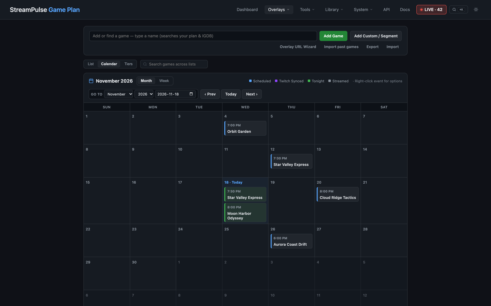
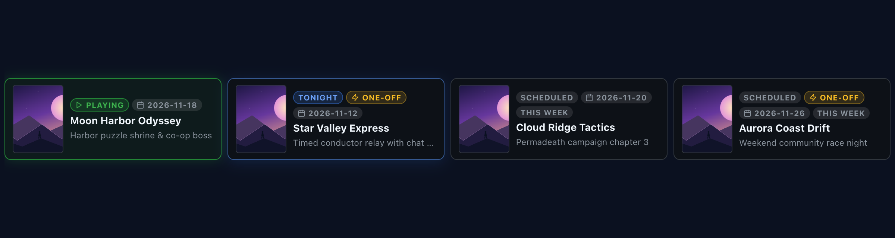
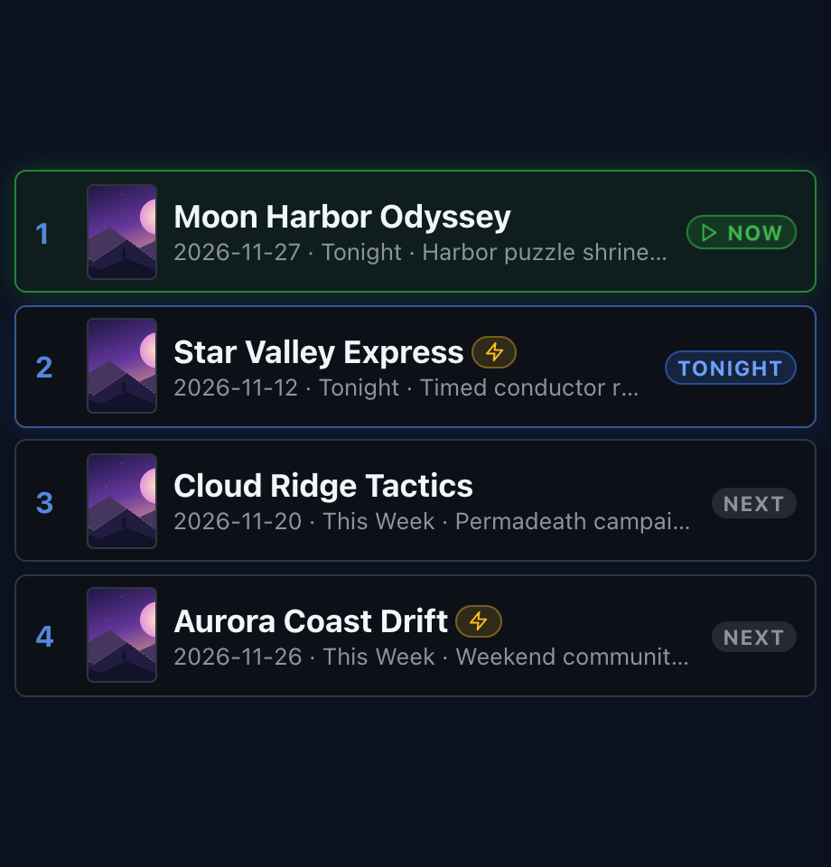

# Keep the next chapter of your stream in view

Game Plan gives your broadcasts a flexible rundown. Keep tonight’s lineup close, save future ideas for later, and see how a game moves from “maybe” to “playing now.”

Use the calendar to plan upcoming streams, pin games to **Tonight's Lineup** without removing them from their home list (`Schedule`, `Up Next`, or custom collections), group titles into flexible horizon blocks (like `Next Week` or `This Month`), and keep a backlog ready for the next time you need inspiration. Multi-select rows for bulk moves, sync unsynced schedule slots to Twitch in one pass, or export and import your plan anytime.

## Share the lineup on stream

When you want viewers in on the plan, add a live Game Plan overlay to your OBS scene. Switch between a full **Schedule**, a bottom **Ticker Bar**, or a compact **Checklist** view — artwork helps make every title recognizable at a glance.

  <figure>
    
    <figcaption><strong>Schedule Cards</strong>Display what's playing now alongside upcoming planned stream nights.</figcaption>
  </figure>
  <figure class="is-portrait">
    
    <figcaption><strong>Checklist Sidebar</strong>Keep tonight's order and progress pinned neatly in a corner or vertical dock.</figcaption>
  </figure>

  <figure>
    
    <figcaption><strong>Ticker Bar</strong>A compact lower-third bar highlighting Playing Now and Up Next.</figcaption>
  </figure>

Start with the [StreamPulse feature overview](features.md) or [get started](quickstart.md). Already installed? **Docs** and **API Reference** are available from the app navigation.
