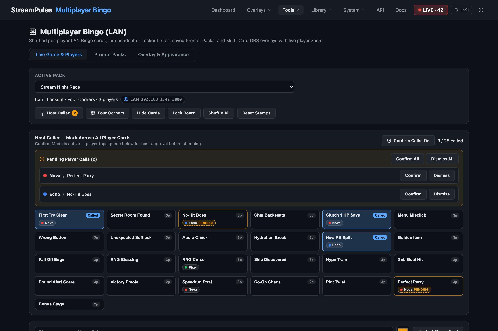
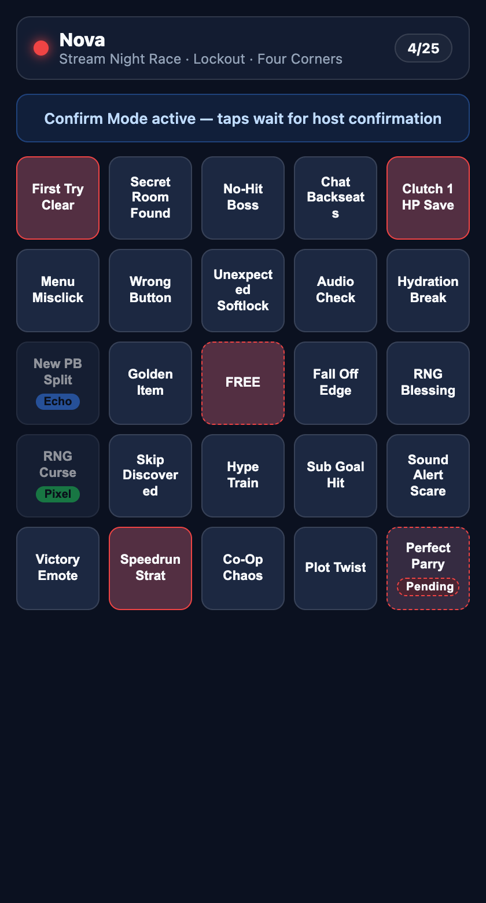
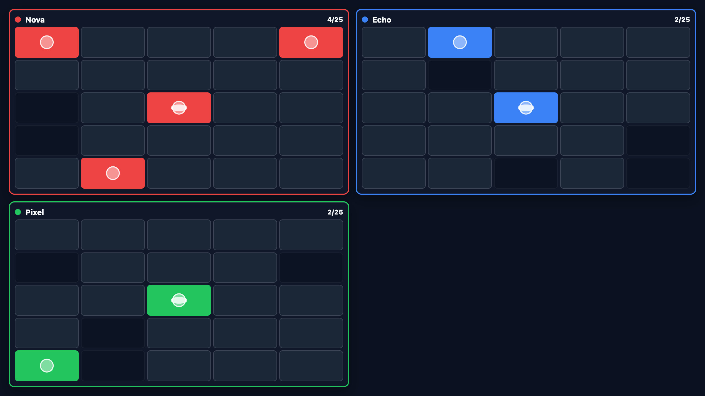

# Multiplayer Bingo (LAN)

**Multiplayer Bingo (LAN)** turns co-op streams, couch races, and community game nights into live multi-player Bingo matches right over your local network. Each player gets a private, uniquely shuffled card on their own phone, tablet, or second PC while StreamPulse tracks claims, winning lines, and standings for your OBS broadcast overlay.

> [!NOTE]
> **Opt-In Module**: Multiplayer Bingo (LAN) is disabled by default. Enable **Multiplayer Bingo (LAN)** under **System → Config → Modules & Services → Overlays & Interactive Games** (`multiplayer_bingo_enabled: true`), then open **Tools → Audience & Interactive → Multiplayer Bingo (LAN)** (`/tools/bingo.html`).

  <figure>
    
    <figcaption><strong>Host Studio &amp; Host Caller</strong>Share LAN IP player links, toggle Four Corners, and confirm or dismiss incoming player calls.</figcaption>
  </figure>
  <figure class="is-portrait">
    
    <figcaption><strong>LAN Player Card</strong>Scoped token-only card on phones or tablets with live stamped and pending states.</figcaption>
  </figure>
  <figure>
    
    <figcaption><strong>OBS Broadcast Overlay</strong>Show all player cards in a Multi-Card Grid, Lockout Master Board, Standings Strip, or Single Card.</figcaption>
  </figure>

---

## 1. Prompt Packs & Game Modes

Create and save reusable **Prompt Packs** for different games, speedruns, or recurring events:

- **Board Sizes**: Choose **3×3**, **4×4**, or **5×5** grids with optional center **Free Space** and customizable header text (such as `BINGO` or your event title).
- **Independent Mode**: Every player receives an independently shuffled board and stamps squares on their own card without blocking other players.
- **Lockout Mode**: Players race on a shared pool of prompts — the first player to claim a square locks it in their player color so no one else can claim it.
- **Four Corners Toggle**: Enable **Four Corners** (`fourCorners`) to count stamping all four corner squares as a valid winning BINGO line alongside standard horizontal rows, vertical columns, and diagonals.

---

## 2. Host LAN IP Share URLs (Player Join Links)

When you add players to a session, StreamPulse generates a scoped, token-only play link for each player (`/bingo-play.html?t=<token>`) so guests can stamp only their own card without ever accessing your StreamPulse admin controls.

- **Auto-Detected LAN Address**: StreamPulse automatically detects your computer's local network IPv4 address (`network.lanOrigin`, preferring private LAN ranges like `192.168.x.x` and `10.x.x.x`) and builds shareable `http://<lan-ip>:<port>/bingo-play.html?t=...` links instead of `localhost`, so phones, tablets, and other computers on the same Wi-Fi or Ethernet network can open them directly.
- **Multiple Network Interfaces**: If your machine has more than one active LAN adapter, pick the interface you want from the detected `lanIps` list, or regenerate a player's token (`/api/multiplayer-bingo/players/regen`) at any time to invalidate an old link.

---

## 3. Host Caller, Confirm Mode & Live Controls

Run the match from the Host Studio (`/tools/bingo.html`) with full oversight and anti-misclick controls:

- **Host Caller**: Trigger any prompt from the Host Caller list to mark it across player boards automatically, and see at a glance which players have already called or stamped each prompt.
- **Confirm Mode**: Turn on **Confirm Mode** (`confirmCalls`) when you want host verification before player taps count on screen. Player taps enter a pending approval queue so you can **Confirm** (`/api/multiplayer-bingo/confirm`) valid claims or **Dismiss** (`/api/multiplayer-bingo/dismiss`) mistakes individually, by prompt, by player, or all at once.
- **Showrunner Controls**: Hide or reveal the broadcast overlay (`hidden`), lock or unlock player stamping (`locked`), manually override any player square (`players/toggle`), spotlight/zoom a single player card (`focus`), shuffle fresh cards (`shuffle`), or clear all stamps (`reset`).

---

## 4. OBS Broadcast Overlays (`/overlays/multiplayer-bingo.html`)

Add `/overlays/multiplayer-bingo.html` as an OBS Browser Source and tailor the view to each scene using URL query parameters:

| Parameter | Options | Purpose |
| :--- | :--- | :--- |
| `view` | `multi`, `lockout`, `standings`, `single` | Choose **Multi-Card Grid** (with live player zoom when a card is focused), **Lockout Master Board**, **Standings Strip**, or **Single Card** |
| `card` | `<card-id>` | Pin a specific player card when using `view=single` |
| `theme` | `modern`, `esports`, `sports`, `arcade`, `minimal`, `cozy`, `synthwave` | Override the saved broadcast theme per scene |
| `stamp` | `dauber`, `check`, `x`, `star`, `fill` | Choose how stamped squares render |

---

## 5. Bitfocus Companion Triggers

Bind Stream Deck buttons to `/api/multiplayer-bingo/*` for hands-free live showrunning:

- Switch active Prompt Packs (`/api/multiplayer-bingo/packs/select?id=<pack-id>`).
- Toggle overlay visibility, player lock, **Four Corners**, or **Confirm Mode** (`/api/multiplayer-bingo/flags?locked=1`, `?hidden=1`, `?fourCorners=1`, `?confirmCalls=1`).
- Call prompts from the Host Caller (`/api/multiplayer-bingo/call?prompt=0`), approve or dismiss pending player calls (`/api/multiplayer-bingo/confirm?all=1`, `/api/multiplayer-bingo/dismiss?all=1`), focus/unfocus a player card (`/api/multiplayer-bingo/focus?card=<card-id>&toggle=1`), shuffle cards, or reset the board.

For single-board Stream Bingo cards embedded inside Custom Overlays, see [Display Library](variable-displays.md#bingo-card-displays). Explore more [StreamPulse features](features.md) or [Bitfocus Companion controls](companion.md).
