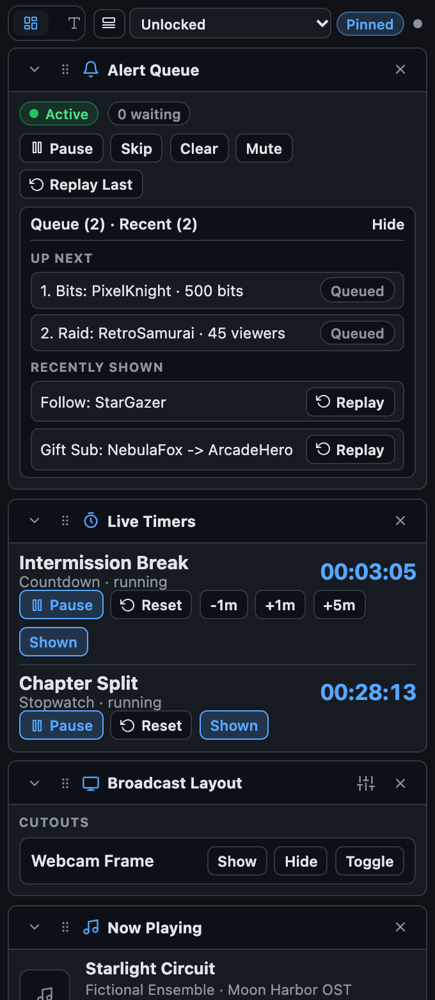

# Operator Mode (`/operator.html`)

StreamPulse **Operator Mode** is your unified live-show control console, built for quick showrunning on a desktop monitor, tablet, or embedded OBS Studio Custom Browser Dock.

  <figure>
    
    <figcaption><strong>Desktop Live Board</strong>Mix live alerts, timers, custom overlays, and music controls in a multi-column board.</figcaption>
  </figure>
  <figure class="is-portrait">
    
    <figcaption><strong>OBS Custom Browser Dock</strong>Compact layout fits comfortably in narrow OBS docks with collapsible drawers.</figcaption>
  </figure>

---

## 1. Live Board & Domain Tabs

Operator Mode brings two complementary views together:

1. **Live Board**: A customizable multi-column pinboard (`1–4` columns). Pin only the widgets your show needs — like **Alert Queue**, **Live Timers**, **Broadcast Layout**, **Variable Set** switchers, or **Music Now Playing** — drag to reorder, and collapse panels or switch on **Focus** to keep only one panel expanded at a time.
2. **Domain Tabs**: Dedicated tabs for deeper adjustments mid-show:
   - **Variables**: Inline table editing, Trackers, Single Variable cards, and Variable Groups.
   - **Overlays**: Add just the Custom Overlays used in your broadcast to switch pages, control Videos/YouTube & Slideshows, toggle Cutouts, or update Speaker Badges.
   - **Timers**: Start, pause, reset, and adjust (`-1m`, `+1m`, `+5m`) live timers and toggle overlay visibility (including Subathon controls when enabled).
   - **Alerts**: Pause or resume the alert queue, skip current alerts, mute SFX, inspect waiting & recent alerts, replay past alerts, and trigger manual announcements.
   - **Music**: Monitor current track metadata and show or hide the Music Overlay.

> **Focused Creation Studios Stay Separate**: Multi-step setup studios (**Polls**, **Trivia**, **Versus**, and **Tier Lists**) stay on their dedicated pages so Operator Mode remains fast and focused during live shows.

---

## 2. Smart Module Visibility

Operator Mode adapts automatically to your StreamPulse settings. Any feature turned off in **System → Config** stays hidden from tabs and Live Board cards, keeping the workspace streamlined.

---

## 3. Presets, Docks & Lock Modes

Save multiple board setups as named **Presets** so you can switch layouts for different show formats (like Talk Show, Speedrun, or Intermission):

- **Customize Tabs**: Choose which tabs stay visible in the top bar for each preset.
- **Import & Export**: Back up your presets or share setups as a file using **Presets → Export / Import**.
- **OBS Custom Browser Dock**: Open **Presets** to copy a pre-built Dock URL (`?profile=default&dock=1`). Dock mode switches automatically to compact spacing and a slim single-row header — add `&bare=1` to hide the top tab strip completely, or `&focus=1` to start in single-panel accordion focus mode.
- **Two-Level Safety Locks**:
  - **Lock Layout**: Prevents accidentally dragging, renaming, or removing cards while keeping all live buttons editable.
  - **Show Mode (Read-Only)**: Locks your layout and prevents accidental text/variable edits while keeping live broadcast actions active (page switches, video/timer/alert controls).
- **Live Preset Sync**: Switching presets in an unpinned window updates other normal Operator tabs automatically, while windows pinned via a specific preset link stay locked to their assigned preset.

---

## Automation & Companion

Need Stream Deck triggers or HTTP control to switch Operator presets automatically? See the **[API Reference](api-reference.md)** and **[Bitfocus Companion Guide](companion.md)** under **The Project → Technical**.
