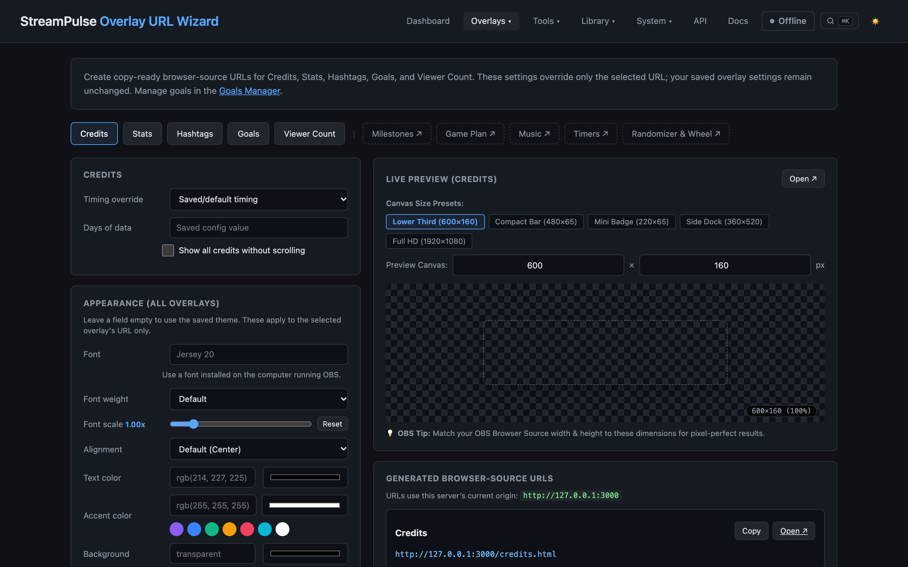
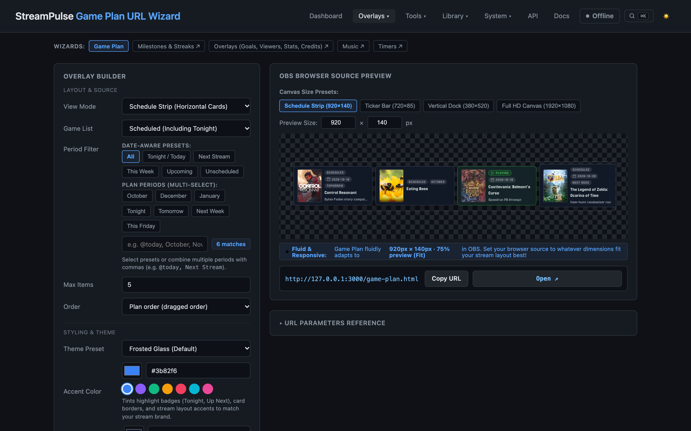
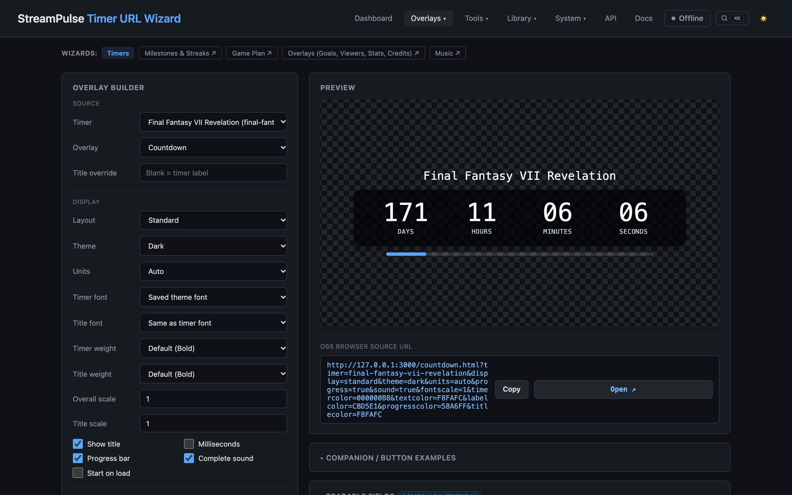
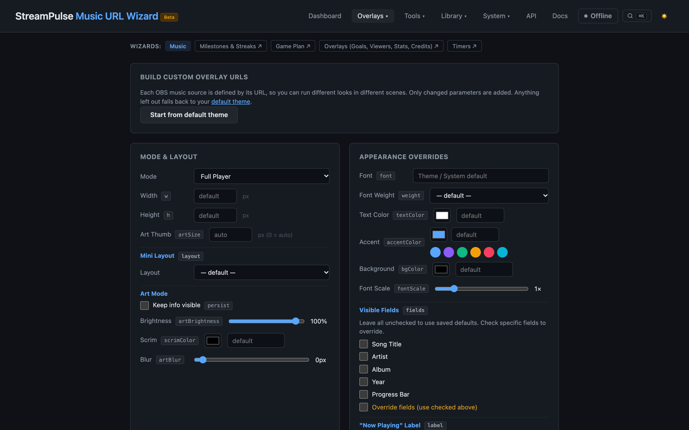
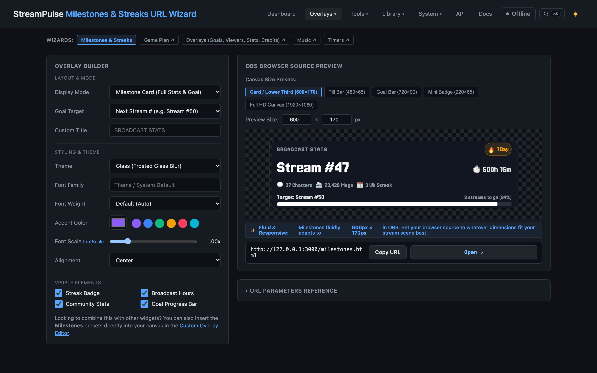

# Overlay URL Wizards

StreamPulse provides a family of interactive, visual **Overlay URL Wizards** to configure and generate customized OBS Studio browser source overlays in seconds—without memorizing query parameters or writing code.

Each wizard features a side-by-side **live interactive preview**, instant one-click **Copy OBS URL**, and recommended **canvas dimensions** (width, height, and refresh settings) tailored to that overlay type.

---

## 1. Quick Access in StreamPulse

All wizards are accessible directly from the top navigation bar:
- **Overlays ▾ → URL Wizards**:
  - **Credits, Goals & Stats**: `/overlay-url-wizard.html`
  - **Game Plan**: `/game-plan-url-wizard.html`
  - **Timers & Stopwatches**: `/timer-url-wizard.html`
  - **Now Playing Music**: `/music-url-wizard.html`
  - **Milestones & Goals**: `/milestone-url-wizard.html`
- Or trigger them via the **Command Palette** (`Ctrl+K` / `Cmd+K`) by typing "Wizard".

---

## 2. Credits, Goals & Stats Wizard

The **Credits & Overlay URL Wizard** builds URLs for broadcast closing sequences, community recognition rolls, and live stat tickers:

- **Overlay Types**:
  - **End Credits Roll**: Scrolling cinematic credits with subscribers, cheerers, gifters, raid hosts, active chatters, and custom text sections.
  - **Live Chatters Ticker**: Continuous horizontal ticker or badge grid displaying active viewers.
  - **Recent Events Bar**: Dynamic stream feed showing recent follows, subscriptions, and cheers.
  - **Hashtag Tracker**: On-screen badge showing active community hashtag counts.
- **Customization Options**:
  - **Theme Presets**: `Dark`, `Neon`, `Retro`, `Pastel`, or `Minimal`.
  - **Scroll Speed & Timing**: Set duration in seconds or automatic speed multiplier based on credit list length.
  - **Looping & Autostart**: Seamless infinite loop or play-once and auto-hide on finish.
  - **Custom Typography**: Pick any uploaded font from the Asset Library or standard web fonts.
- **OBS Recommended Dimensions**: `1920 × 1080` (Full screen) or `1280 × 720`.

---

## 3. Game Plan Schedule & Checklist Wizard

The **Game Plan URL Wizard** generates customized overlays displaying your streaming schedule, tonight's gaming lineup, or backlog progression:

- **Display Modes**:
  - **Schedule Carousel / Row**: Horizontal showcase of scheduled games with cover artwork, stream dates, and custom notes.
  - **Checklist / Vertical List**: Compact dock showing games with completed badges and current active title.
  - **Single Featured Game**: Hero card spotlighting the game currently being played or next up.
  - **Marquee Ticker**: Slim horizontal marquee cycling through upcoming titles.
- **Collection & Period Filters**:
  - Built-in lists (`Tonight`, `Up Next`, `Backlog`, `Played`).
  - Custom collections (e.g. `JRPGs`, `Retro Sunday`, `Community Games`).
  - Smart time periods (`@today`, `@tomorrow`, `@this-week`, `@upcoming`, `@unscheduled`).
- **Cover Artwork & Layout Controls**:
  - **Cover Fit**: `cover` (fill & crop), `contain` (letterbox preserve), or `natural`.
  - **Aspect Ratio**: `3/4` (standard box art), `2/3`, `1/1`, or `16/9` widescreen.
  - **Cover Scaling**: Adjust multiplier (50% to 200%) for 720p through 4K canvas densities.
  - **Metadata Chips**: Toggle genres, release year, platform badges, and estimated playthrough hours.
- **OBS Recommended Dimensions**:
  - Schedule Carousel: `1200 × 260`
  - Checklist: `440 × 480`
  - Marquee Ticker: `1280 × 160`

---

## 4. Countdown & Stopwatch Timer Wizard

The **Timer URL Wizard** builds transparent timer displays for stream starting screens, BRB breaks, speedrun splits, and subathons:

- **Timer Modes**:
  - **Countdown**: Count down from hours/minutes/seconds to zero.
  - **Stopwatch**: Count up from zero or an offset timestamp.
  - **Named Timers**: Connect to persistent timers managed in the Timers Studio (e.g. `brb`, `starting`, `break`).
- **Visual Styles**:
  - **Split-Flap Mechanical**: Authentic airport/train mechanical split-flap digit flip animation with tactile audio clicks.
  - **Modern Digital**: Clean sans-serif or monospace digital readout.
  - **Minimal Pill**: Compact translucent badge ideal for corner placement.
- **Completion Behaviors**:
  - **Audio Chime**: Synthesized alert sound or custom asset chime when time reaches 00:00.
  - **Flash on Finish**: Pulsing visual highlight on completion.
  - **Post-Timer Action**: Hold zero, display custom message (e.g. "STREAM STARTING NOW"), or auto-hide after a delay.
- **OBS Recommended Dimensions**: `400 × 140` (Horizontal badge) or `600 × 200` (Split-flap display).

---

## 5. Now Playing Music Wizard

The **Music URL Wizard** connects your broadcast to Apple Music, Spotify, VLC, or local media players:

- **Layout Styles**:
  - **Floating Card**: Elegant glassmorphic card with album cover art, song title, artist, and track progress bar.
  - **Compact Pill**: Slim, unobtrusive badge showing artist and track with scrolling marquee for long titles.
  - **Spinning Vinyl**: Retro turntable record disc that spins when audio is playing and pauses when music stops.
  - **Equalizer Visualizer**: Animated multi-bar sound visualizer that dances to music playback.
- **Smart Theme & Artwork Colors**:
  - **Adaptive Color**: Automatically extracts dominant vibrant colors from the live album cover and tints the card border and glow.
  - **Static Themes**: `Neon`, `Cyberpunk`, `Dark Slate`, `Retro Pastel`.
- **Media Controls**:
  - Auto-hide when music is paused for more than 5 seconds.
  - Custom font family, font size, and text outline for maximum legibility over high-motion game video.
- **OBS Recommended Dimensions**: `460 × 140` (Floating Card) or `360 × 60` (Compact Pill).

---

## 6. Milestones, Streaks & Stats Wizard

The **Milestones & Streaks URL Wizard** generates broadcast progress cards, community lifetime milestones, and streak badges to celebrate channel consistency:

- **Display Modes**:
  - **Milestone Card**: Full featured glassmorphic lower-third card displaying broadcast stream number, active stream streak, chatter count, and total message counts with target progress bar.
  - **Pill Bar**: Slim horizontal progress bar (`480 × 65`) displaying current stream count and milestone completion percentage.
  - **Goal Bar**: Wide progress tracker (`720 × 90`) with milestone labels.
  - **Mini Badge**: Ultra-compact corner badge (`220 × 65`) highlighting active daily/weekly broadcast streaks.
- **Customizable Elements**:
  - Toggle **Streak Badge**, **Broadcast Hours**, **Community Stats**, and **Goal Progress Bar**.
  - Custom target selection (e.g. Next Stream Milestone, 100th Stream, 500 Broadcast Hours).
  - Custom title header (e.g. `BROADCAST STATS`, `STREAM MILESTONES`).
- **Themes & Glassmorphism**:
  - `Frosted Glass Blur`: Modern translucent blur with crisp border glow.
  - Accent color picker with real-time gradient fill previews.
- **OBS Recommended Dimensions**:
  - Full Card / Lower Third: `600 × 170`
  - Pill Bar: `480 × 65`
  - Goal Bar: `720 × 90`
  - Mini Badge: `220 × 65`

---

## 7. Adding Generated Overlays to OBS Studio

Once you configure your overlay in any wizard, adding it to OBS Studio takes three clicks:

1. Click **Copy OBS URL** in the wizard.
2. In OBS Studio, click **+** under the **Sources** dock and choose **Browser**.
3. Name your source, paste the copied URL into the **URL** field, and enter the recommended **Width** and **Height** provided by the wizard.
4. **Recommended OBS Browser Source Settings**:
   - Check **Shutdown source when not visible** (saves GPU/CPU cycles when switching scenes).
   - Check **Refresh browser when scene becomes active** (ensures smooth animation restarts).
   - Leave **Custom CSS** empty unless you wish to inject extra styling (StreamPulse renders complete transparent backgrounds natively).
