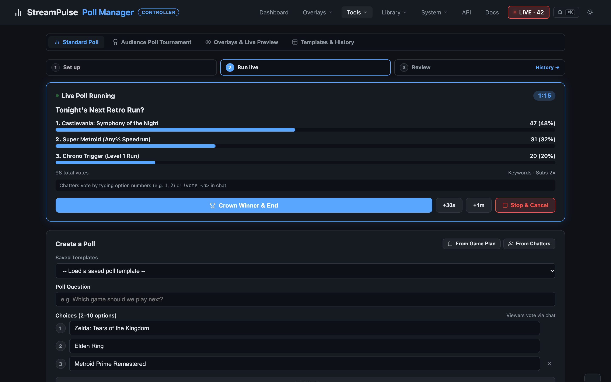

# Turn a decision into a shared moment

Polls and tournament brackets bring audience participation into the show. Put a choice to chat, follow the vote as it develops, and reveal the result in a broadcast-ready display.

Use a poll for a quick decision—what to play, which challenge to try, or what happens next. When you want a longer event, create a bracket and let matches build toward a champion. Poll Manager keeps the event and its broadcast presentation together, while chat announcements can help viewers understand how to take part.

For head-to-head matches that don’t need an audience vote, Versus gives you a dedicated scoreboard for competitors and match progress. These tools can make a casual community choice or a full tournament feel like part of the same production.

Find more [StreamPulse features](features.md) or [get started](quickstart.md). Already installed? Open **Docs** and **API Reference** from the app navigation.
