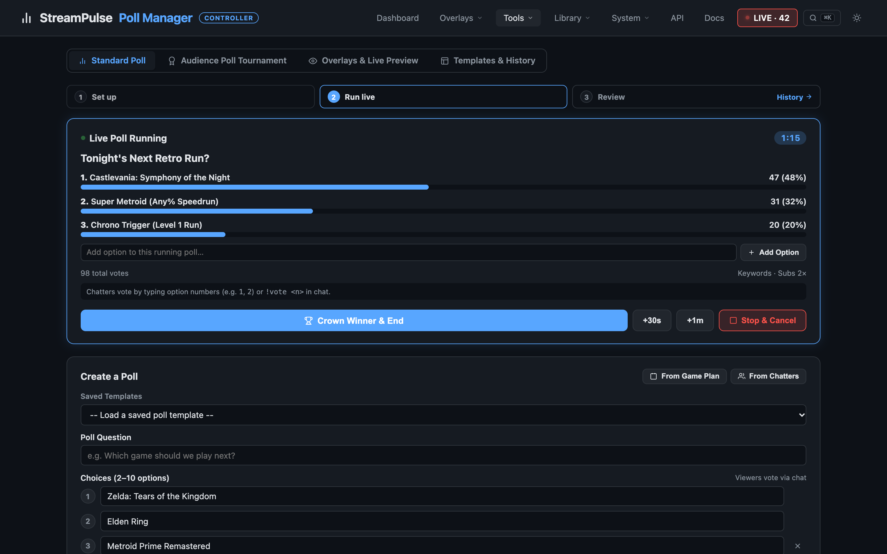
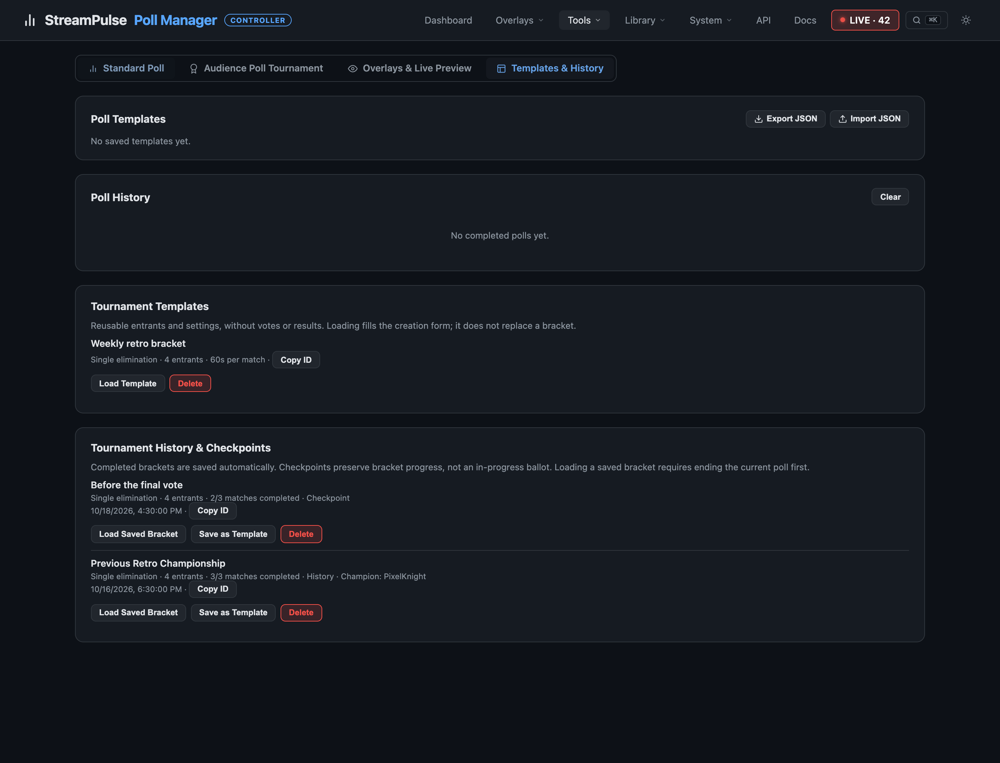
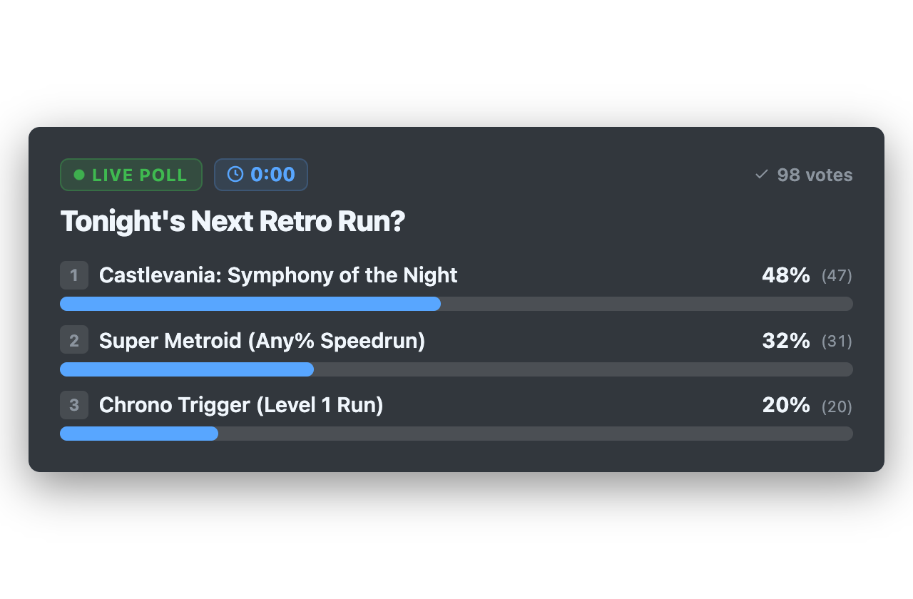
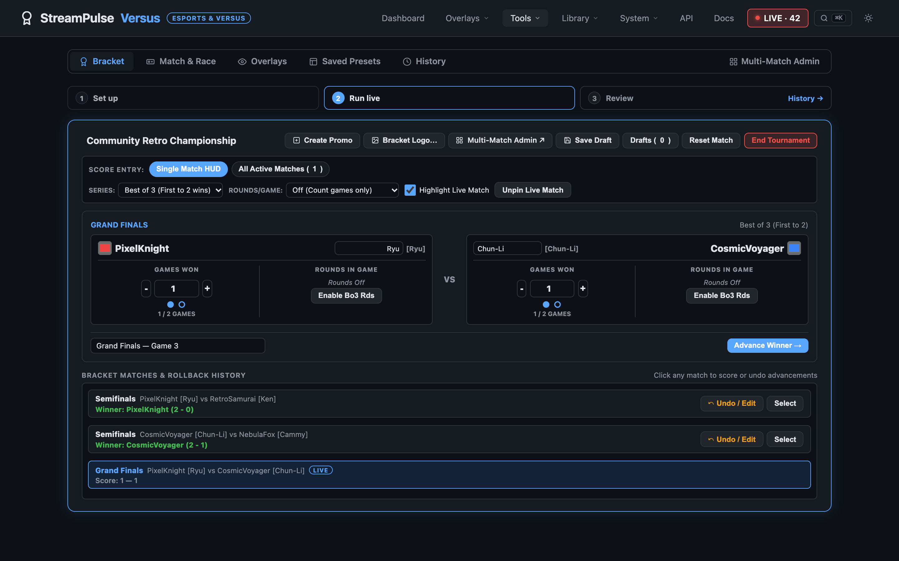
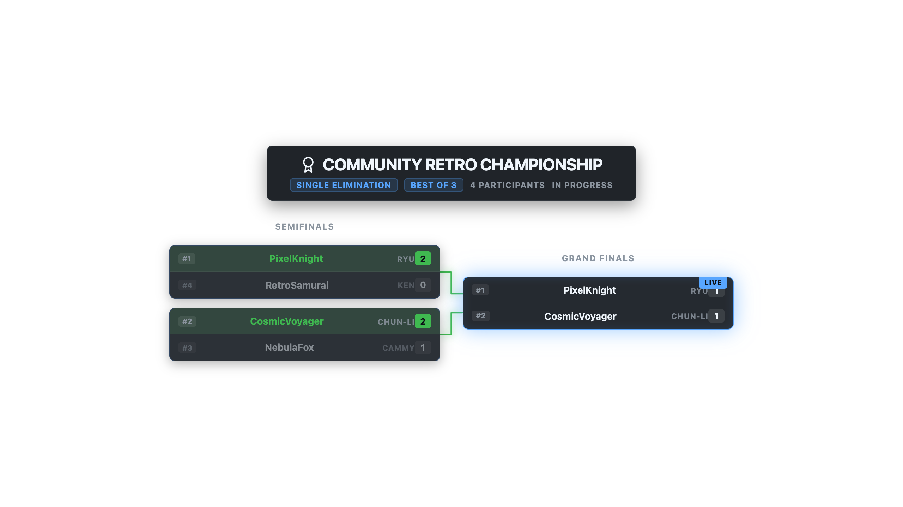
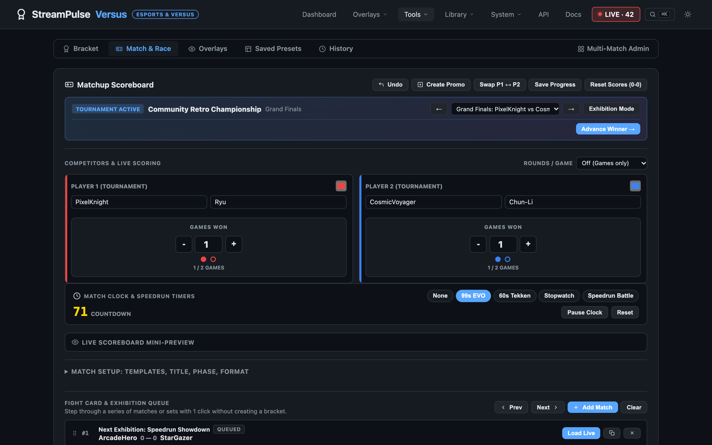

# Turn a decision into a shared moment

Polls, tournament brackets, and head-to-head match scoreboards bring audience participation straight into the show. Put a choice to chat, follow the vote as it develops, and reveal the result in a broadcast-ready display.

## Audience Polls

Use a poll for a quick decision — what to play, which challenge to try, or what happens next. Save reusable prompt packs in the Poll Library and preview the live OBS bar graphic before opening voting in chat.

  <figure>
    
    <figcaption><strong>Poll Studio</strong>Launch live votes, set durations, and monitor tallies.</figcaption>
  </figure>
  <figure>
    
    <figcaption><strong>Poll Library</strong>Store recurring vote prompts for fast reuse on stream.</figcaption>
  </figure>
  <figure>
    
    <figcaption><strong>Poll Broadcast Overlay</strong>Animated real-time bars ready for your OBS scene.</figcaption>
  </figure>

## Brackets &amp; Versus Scoreboards

When you want a multi-round event, create a tournament bracket and let matches build toward a champion — or use **Versus** when you need a dedicated head-to-head scoreboard with match timers, rounds, and queued challengers.

  <figure>
    
    <figcaption><strong>Tournament Studio</strong>Run seeded brackets, voting rounds, checkpoints, and double-elimination resets.</figcaption>
  </figure>
  <figure>
    
    <figcaption><strong>Tournament Overlay</strong>Display live bracket progress and highlighted finals on stream.</figcaption>
  </figure>
  <figure>
    
    <figcaption><strong>Versus Studio</strong>Track scores, rounds, split clocks, and upcoming match queues.</figcaption>
  </figure>
  <figure>
    
    <figcaption><strong>Matchup Overlay</strong>Crisp exhibition scoreboard built for OBS scenes.</figcaption>
  </figure>

Keep a bracket ready for another night with reusable templates, or save a checkpoint to return to its progress later. Blind votes save the surprise for the end of a match, double elimination supports full Grand Finals resets, and round-robin standings adjust cleanly when match results are updated.

Find more [StreamPulse features](features.md) or [get started](quickstart.md). Already installed? Open **Docs** and **API Reference** from the app navigation.
