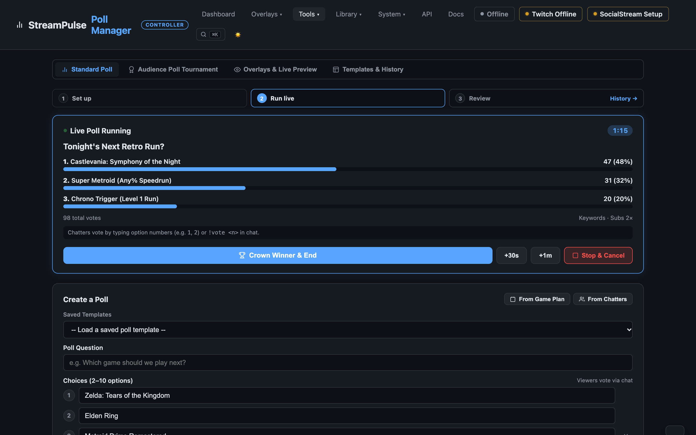
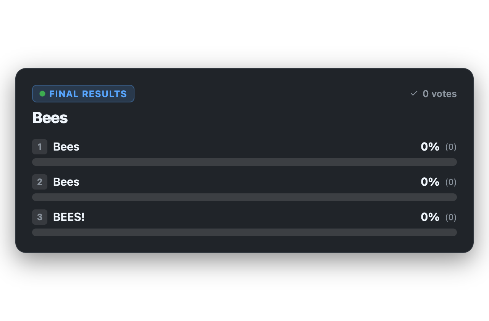
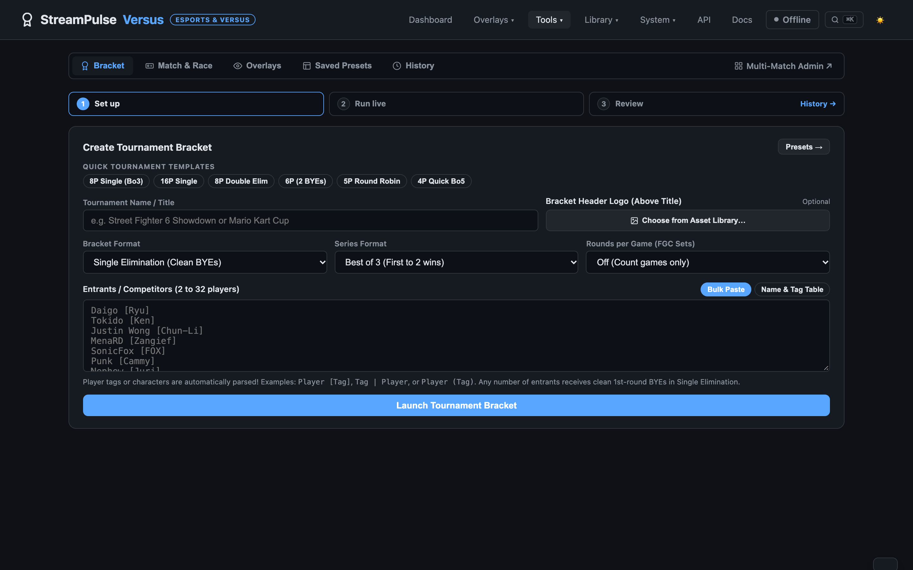
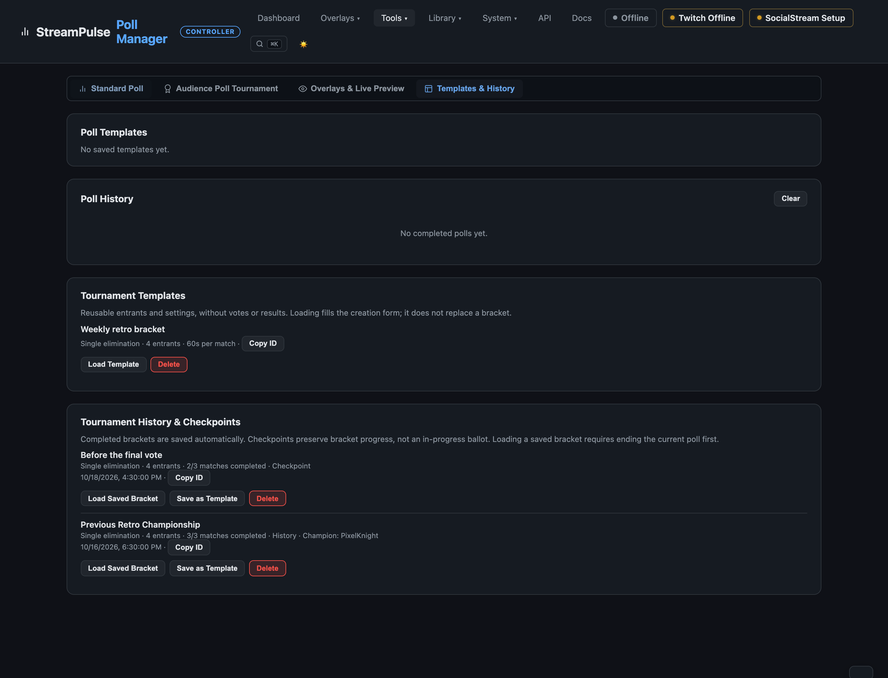
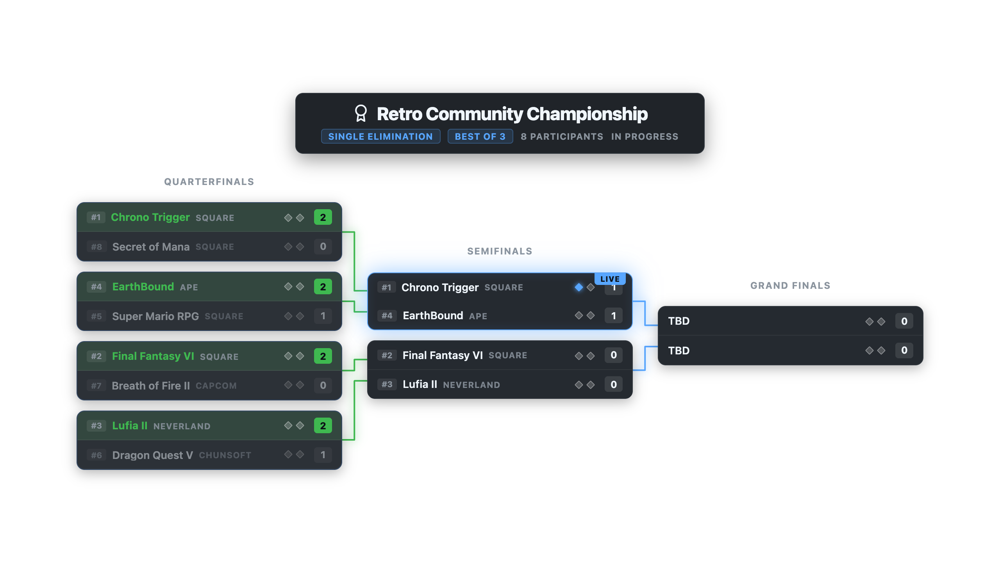
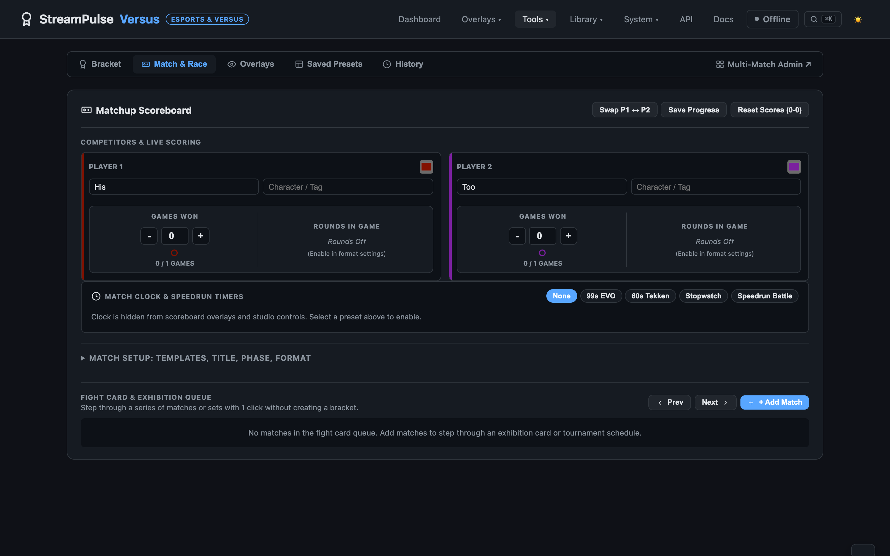

# Live Polls, Tournaments & Matchups

StreamPulse provides first-class audience participation and competitive scoring tools for your stream:
1. **Poll Manager** — Real-time audience voting with chat commands (`1`–`10`, `!vote`), Blind Mode ("Fog of War"), subscriber vote multipliers, and celebratory fanfare.
2. **Tournament Brackets** — Elimination and round robin brackets with automatic BYEs for any number of entrants (2 to 32), supporting audience chat votes or manual match scoring.
3. **Versus & Matchup Scoreboard** — Dedicated HUD for fighting game sets (EVO style), speedrun battles (GDQ race mode with synchronized start and split deltas), 1v1 duels, and 4-player free-for-alls.

---

## 1. Live Audience Polls

Run real-time audience decisions without third-party web services or affiliate requirements. Native polls accept votes directly from your stream chat across Twitch, YouTube, and Kick.

### What It Does
- **Multi-Platform Chat Voting**: Viewers participate directly in chat. Works for all broadcasters without requiring Twitch Affiliate or Partner status.
- **Dynamic Choice Limits**: Support between 2 and 10 choices.
- **Fast Lineup Ingestion**: Click **Pull from Game Plan** to load games from your tonight or backlog list, or **From Chatters** to pick from active viewers.
- **Blind Voting ("Fog of War")**: Conceals live percentages on the stream overlay (displaying mystery `??` badges) to build suspense until voting concludes.
- **Subscriber Multiplier**: Reward community members by allowing channel subscribers' votes to count double (2×).
- **Keyword Voting**: Viewers can vote by typing words from the option title (e.g., typing "zelda" or "metroid") in addition to option numbers.
- **Automated Chat Announcements**: The integrated Chat Bot announces poll openings, duration, formatted choices, and winner reveals directly in stream chat.
- **Celebration Fanfare & Alerts**: Concluding a poll crowns the winner, triggers audio fanfare and particle confetti, and fires a `poll_end` alert.

### How to Run a Poll
1. Open **Tools -> Poll Manager** (`http://localhost:3000/polls.html`).
2. Enter your question and 2 to 10 choices (or select a saved template).
3. Select a duration preset (**30s**, **60s**, **90s**, **2m**, **5m**, **10m**, or **Manual**).
4. Click **Launch Poll Live**.
5. While voting is open, click **+30s** or **+1m** to extend voting if the race is tight.
6. Click **Crown Winner & End** to calculate percentages, reveal the winner on stream, and fire celebratory confetti. (Click **Stop & Cancel** to abort without declaring a winner).

### How Viewers Vote
Viewers can vote through any connected chat platform:
- **Option Number**: Typing `1`, `2`, `3` ... up to `10`.
- **Command Syntax**: Typing `!vote 1`, `!vote 2`, or `!vote <title>`.
- **Title Keywords**: Typing natural words from the choice title when keyword voting is enabled.
- **Vote Changing**: Viewers can change their vote before the poll ends; previous votes are automatically subtracted and transferred.

### Broadcast Overlay (`/overlays/poll.html`)
The Live Poll overlay renders active votes with real-time percentage fill bars, countdown clocks, and winner celebrations. It automatically hides when no poll is active.

- **OBS URL**: `http://localhost:3000/overlays/poll.html`
- **Recommended Browser Source Size**: `640×420` (or `1920×1080` with canvas alignment).
- **Themes & Styling**: Choose from 18 built-in themes (`card`, `championship`, `cyber`, `fgc-evo`, `glass`, `solid`, `transparent`, `clean-light`, `minimal-dark`, `pill`, `border`, `retro`, `ember`, `aurora`, `ocean`, `sunset`, `violet`, `forest`) or create and save custom themes directly in Poll Manager.
- **Custom Typography**: Pick fonts from the local Asset Library or Google Fonts (`?font=`), font weights (`?weight=300-900`), text transformations (`?transform=none|uppercase`), font scale (`?scale=0.5-3.0`), corner radius (`?radius=`), and text outlines (`?outline=none|subtle|strong`).
- **Full Palette Customization**: Granular color overrides for card background (`?cardbg=`), borders (`?border=`), text (`?text=`), muted subtitles (`?muted=`), vote bar accent (`?accent=`), winner highlight (`?winner=`), and badge/track background (`?track=`).
- **Footer Instructions**: Add `?howtovote=1` to display an on-screen chat voting banner (`Vote in chat: type 1–N or !vote <number>`).

---

## 2. Tournament Bracket Engine

StreamPulse includes an advanced bracket controller designed for community game nights, viewer tournaments, and esports competitions. Brackets can be run as **Audience Chat Tournaments** (where viewers vote in chat to advance winners) or **Manual Scored Brackets** (where the broadcaster or admin inputs match scores).

### What It Does
- **Flexible Entrant Scaling (2 to 32 Entrants)**: Enter any number of competitors, including non-power-of-2 numbers (e.g. 3, 5, 6, 7, 9, 11, 13).
- **Single Elimination with Clean BYEs**: Top seeds automatically receive 1st Round **BYEs** that cleanly advance directly to the subsequent round slot without ghost matches or fake scores.
- **Double Elimination with Loser Progression**: Competitors defeated in the Winners Bracket drop into their assigned Losers Bracket slots. Poll tournaments support exactly 2, 4, 8, or 16 participants; BYEs and 32-participant double-elimination brackets are not supported. In a poll tournament, if the losers' finalist wins Grand Finals, a reset match decides the champion.
- **Mid-Tournament Match Time & Timer Controls**: Adjust match voting durations mid-tournament on the fly (`30s`, `60s`, `90s`, `120s`, `3m`, or custom) directly from the live bracket controller. When a match vote is live, one-click `+30s` and `+60s` extension buttons instantly add time to the running vote without interrupting the bracket.
- **Round Robin League**: All-play-all schedule (Single or Double legs) with customizable league scoring (Standard 3-1-0, Win-Only 1-0-0, or Traditional 2-1-0) and automatic standings calculations (wins, draws, losses, points, and score differential).
- **Series & Round Rules**: Best of 1, 3, 5, or 7 series. Supports rounds-within-a-game (e.g. Best of 3 rounds per game). Scoring the target rounds automatically increments the series game win and resets round scores.
- **Entrant Bulk Import**: Toggle between bulk paste and an interactive name & character/clan tag table. Formats like `Daigo [Ryu]`, `SonicFox [Fox]`, or `Tokido (Ken)` are parsed automatically.
- **Custom Competitor Colors**: Assign distinct hex colors to competitors. Colors persist across the entire bracket tree and highlight match cards on screen.
- **Match Advancement Undo & Rollback**: Made a mistake or scored the wrong winner? Click **Undo / Edit** on any completed match (`/api/tournament/rollback`). The winner is cleared, scores reset, and all downstream dependent matches are recursively reverted back to pending.
- **Draft Checkpoints**: Snapshot in-progress tournaments at any time (**Save Draft**) to switch games or pause your stream, then resume later via **Checkpoints**.

### Saving Poll Tournaments: Templates, Checkpoints & History

In **Poll Manager -> Tournament**, use **Save Template** or **Save Checkpoint** below the active bracket. Before creating a bracket, **Save as Template** saves the creation form instead. Open **Templates & History** to browse the separate poll and tournament libraries.

- **Templates** save reusable entrants, tags, colors, format, title/logo, voting duration, blind mode, subscriber multiplier, announcements, and round-robin settings, without winners or votes. **Load Template** fills the creation form; review it and click **Create Tournament & Go Live** to create a fresh bracket. Merely loading the form leaves the existing bracket untouched.
- **Checkpoints** save the current bracket's progress under a name. Saving a checkpoint or template during a running vote does not stop voting or change its votes. A checkpoint is not a saved ballot: loading it preserves completed matches, but returns any saved live match to pending with its vote counts cleared. Start a new match vote when ready.
- **History** includes completed brackets and started brackets automatically archived when replaced, including before loading an older checkpoint of the same bracket. **Load Saved Bracket** asks for confirmation before replacing the current bracket. Finish or cancel any active poll first; the API also blocks loading while voting is active. Completed history keeps its champion and remains completed.
- **Save Template** on a history/checkpoint row extracts a clean reusable setup from that saved bracket. **Delete** asks for confirmation and removes only that library item, not the live bracket.

Poll tournament templates and history are separate from Versus templates/drafts and individual poll templates/history. The library is persisted in `data/polls.json`, retaining up to **100 tournament templates** and the **30 newest history/checkpoint entries combined**. Use the normal data backup workflow for long-term archives.

Each row has **Copy ID** for Companion's save-template, save-checkpoint, restore-saved-bracket, and create-from-template actions. Creating or restoring through Companion requires its replacement confirmation option. Saved tournament voting durations are 10–3600 seconds; templates do not add manual/open-ended match voting.

### Broadcast Overlays (`/overlays/poll-tournament.html`)
The audience poll tournament overlay provides two primary broadcast views:

1. **Full Bracket Tree (`?layout=tree`)**: Displays the entire tournament tree across all rounds with orthogonal connector lines. Ideal for pre-game intro scenes, intermission screens, and post-tournament breakdowns.
   - **Responsive Horizontal Scaling**: Overlays automatically utilize wide horizontal screen space (1080p, 1440p, 4K) so competitor names and titles have room to display without truncation.
   - **Wide Layout & Custom Width (`?wide=1` or `?cardwidth=480`)**: Expand match cards horizontally to fit long game or player titles with clan tags.
   - **Fit to Viewport (`?fit=1`)**: Auto-scales and centers the entire bracket within your OBS browser source so all rounds fit on-screen without scrollbars.
   - **Line Styles (`?lines=glow|solid|minimal`)**: Choose luminous glowing connectors, crisp high-contrast lines, or minimal borders.
   - **Dual Typography (Heading & Content Fonts)**: Configure a dedicated **Heading Font** (`?headingfont=`) for tournament titles, round headers, and bracket section badges, alongside a dedicated **Content Font** (`?font=`) for competitor names, seeds, scores, and vote counts with full Asset Library and Google Fonts support.
   - **Theme & Typography Customization**: Choose from 18 built-in themes or custom saved presets, select Asset Library and Google Fonts with the in-studio font picker, adjust bracket scale (`?scale=0.5-2.0`), corner radius (`?radius=`), text outlines (`?outline=none|subtle|strong`), and full color overrides (`?cardbg=`, `?border=`, `?accent=`, `?winner=`, `?text=`, `?muted=`).
   - **Bracket Section (`?bracket=all|winners|losers|finals`)**: Show the whole double-elimination bracket or only the winners, losers, or Grand Finals section. Set this in the Poll Manager or Versus overlay options, or use separate OBS browser sources, such as `/overlays/poll-tournament.html?bracket=losers&fit=1`. This affects the bracket tree, not the active-match HUD; single-elimination and round-robin views are unchanged.
2. **Dynamic Focus / Zoomed View (`?layout=focus`)**: Displays the bracket tree at large, fully readable proportions (ideal for 16-to-32 entrant brackets) with a smart camera that automatically pans and zooms into the **round and match currently in progress** or upcoming. As matches conclude and advance, the camera smoothly glides with broadcast ease to the next match and automatically tracks across Winners, Losers, and Grand Finals. Includes a live status indicator badge (`?focusbadge=1`).
3. **Esports Lower-Third Match HUD (`?layout=hud`)**: A compact broadcast lower-third displaying the currently active matchup, round name, competitor names, live vote counts, and percentages. Designed to overlay gameplay without obstructing action.

For a double-elimination poll tournament, **Bracket Matches** includes Winners, Losers, and Grand Finals jump buttons. The losers' matches are present immediately with TBD slots; they become playable as results fill both slots. Finish the current poll before starting another poll or match, resetting bracket matches, or replacing its tournament. Advancing a participant in the live match manually overrides its vote. A running poll resumes with its saved votes after a server restart; if its time expired while offline, its saved result is resolved on startup. A tie or a poll with no votes leaves the match pending for another vote or manual resolution.

If an older double-elimination poll tournament contains only winners' matches, use **Review bracket repair** in Bracket Matches. The preview reconstructs the missing losers' bracket and Grand Finals from completed winners' results without resetting the tournament or interrupting its current vote. Confirm the preview to save a backup in the data folder and apply the repair. If results are inconsistent or change while you review them, the repair is rejected rather than guessing.

---

## 3. Versus & Matchup Scoreboard

For broadcasts featuring fighting games (Street Fighter, Tekken, Smash), speedrun races, Mario Kart showdowns, or casual head-to-head sets, StreamPulse provides a standalone **Matchup Scoreboard** in **Tools -> Versus** (`/versus.html`). It operates independently without requiring an elimination bracket.

### What It Does
- **2, 3, or 4 Competitors / Teams**: Seamlessly switch between 1v1 duel, 3-way triple threat, or 4-player free-for-all / squads.
- **Series Formats & Win Pips**: Best of 1, 3, 5, 7, 9, First to 10, or Free Points. Series win pips (`● ● ○`) and round pips (`◆ ◇`) update automatically.
- **Speedrun Battle (GDQ Race Mode)**:
  - **Synchronized Master Clock**: One-click **Sync Start All Runners** launches the master race clock and all runner split timers simultaneously.
  - **Reveal on Finish (+Delta)**: By default, only the master clock ticks on stream during the race. When a runner finishes (`Finish / Split`), their individual finish time is revealed (`1st · 41:52.80`), and subsequent finishers reveal their final time plus their exact delta behind 1st place (`2nd · +00:12.65`).
  - **Estimated Target Time**: Display target time estimates (`Target EST: 45:00`).
- **Authentic Match Clocks**:
  - **Round Countdown Timer**: 99s EVO / 60s Tekken clock with amber LED digits that pulse red with high-urgency glow under 10 seconds.
  - **Speedrun Stopwatch**: Elapsed runtime clock (`MM:SS` or `HH:MM:SS`) broadcasting updates every 250ms with millisecond precision.
- **Side Swapping (`P1 ⇄ P2`)**: Instantly swaps Player 1 and Player 2 names, character tags, custom team colors, and current scores with 1 click.
- **Fight Card & Exhibition Queue**: Schedule a sequential roster of matches. Step forward (`Next Match`) or backward (`Prev Match`), duplicate queued matches, or clear the entire lineup with 1 click or Bitfocus Companion.
- **Auto Set Winner Detection**: Reaching the series target score crowns the set winner, triggers optional victory audio fanfare, and fires celebratory particle confetti.

### Broadcast Overlay (`/overlays/matchup.html`)
The Matchup overlay self-sizes to whatever OBS browser source dimensions you configure using CSS container queries:

- **Layout Styles (`?layout=`)**:
  - `fgc` — Modern FGC / EVO style with angular polygon cuts and LED score counters.
  - `top` — Classic fighting game top bar with P1/P2 on opposing sides and center match badge.
  - `split` — Dual corner split with a **100% open clear center** (ideal when webcams or in-game meters sit in the top center).
  - `race` — Speedrun battle layout featuring synchronized master clock, runner tags, and finish/delta split badges.
  - `pillar` — Compact vertical stack for camera sidebars or vertical 9:16 streams.
  - `minimal` — Center-less score strip where player names and score numbers touch directly.
  - `bottom` — Esports lower-third HUD docked at the bottom of the screen.
  - `versus` — Full-screen matchup intro card with prominent VS emblem.
  - `pod` — Floating independent single-player score pod for webcam framing in 4-player games.
- **Competitor Clocks & Splits (`?playerclocks=auto|always|off`)**: Display individual player timer chips, runner split times, and finish delta badges across all layouts (Top Bar, FGC, Split, Pillar, Bottom, Compact, and Versus), not just the dedicated race layout.
- **Wide Stage Layout (`?wide=1`)**: Expands matchup card geometry and container clamps up to 2400px for ultrawide and spacious broadcast scenes.
- **Tournament Auto-Binding (`?source=auto`)**: By default, `/overlays/matchup.html` automatically mirrors the active tournament match when a bracket is running, and seamlessly falls back to your exhibition matchup queue when idle.
- **Custom Typography & Styling**: Custom fonts from the local Asset Library or Google Fonts (`?font=`), font weights (`?weight=300-900`), text transformations (`?transform=none|uppercase`), proportional bracket/matchup scaling (`?scale=`), corner radius (`?radius=`), and text outlines (`?outline=`). Versus Studio provides an Asset Library font picker modal with live typography preview cards.
- **Granular Color Customization**: Full palette control over card background (`?cardbg=`), backdrop (`?bg=`), borders (`?border=`), primary text (`?text=`), muted subtitles (`?muted=`), accents (`?accent=`), winner highlights (`?winner=`), badge tint (`?badgecolor=`), and competitor slot colors (`?p1color=`, `?p2color=`).
- **Reusable Custom Themes**: Save your customized typography and color palette into reusable custom themes directly from Versus Studio with one-click application across scoreboard HUDs and tournament brackets.

---

## 4. Chat Bot Announcements

StreamPulse connects live poll and tournament lifecycles to the built-in **Chat Bot**:
- **Automatic Match & Poll Start**: When a poll or bracket match begins, the bot posts the poll title, duration, and choices clearly formatted one per line with voting instructions (e.g. `!vote 1: Option A`).
- **Automatic Winner Reveal**: When voting ends or a match advances, the bot posts the winning choice, vote count, and percentage.
- **Champion Crowning**: When the final tournament match concludes, the bot announces the champion.
- **Non-Blocking Reliability**: If the chat bot is disabled, inactive, or disconnected, polls and tournament brackets proceed normally with zero interruptions.

---

## 5. OBS Browser Source Setup

To add any poll, tournament, or matchup display to OBS Studio:

1. In OBS Studio, click **+** under **Sources** and select **Browser**.
2. Enter the URL:
   - **Live Poll**: `http://localhost:3000/overlays/poll.html` (Width: `640`, Height: `420`)
   - **Poll Tournament Tree**: `http://localhost:3000/overlays/poll-tournament.html?fit=1` (Width: `1280`, Height: `720`)
   - **Versus Tournament Tree**: `http://localhost:3000/overlays/tournament.html?fit=1` (Width: `1280`, Height: `720`)
   - **Match HUD**: `http://localhost:3000/overlays/matchup.html?layout=fgc` (Width: `1280`, Height: `180`)
3. Check **Shutdown source when not visible** to free resources when the scene is hidden.
4. Use the **Overlays** tab inside the studio controllers for live interactive previews and one-click URL generation with custom themes, colors, and layouts.

---

## 6. Remote Controls & APIs

- **Stream Deck & Companion**: Control polls, match scoring, side swaps, clocks, and runner finishes with 1 click. See the [Companion & Stream Deck Guide](companion.md).
- **HTTP REST & WebSocket API**: Programmatic endpoints for launching polls, advancing tournament matches, rolling back brackets, and updating scores. See the [HTTP API Reference](api-reference.md) or open the interactive API Explorer at `http://localhost:3000/api.html`.
