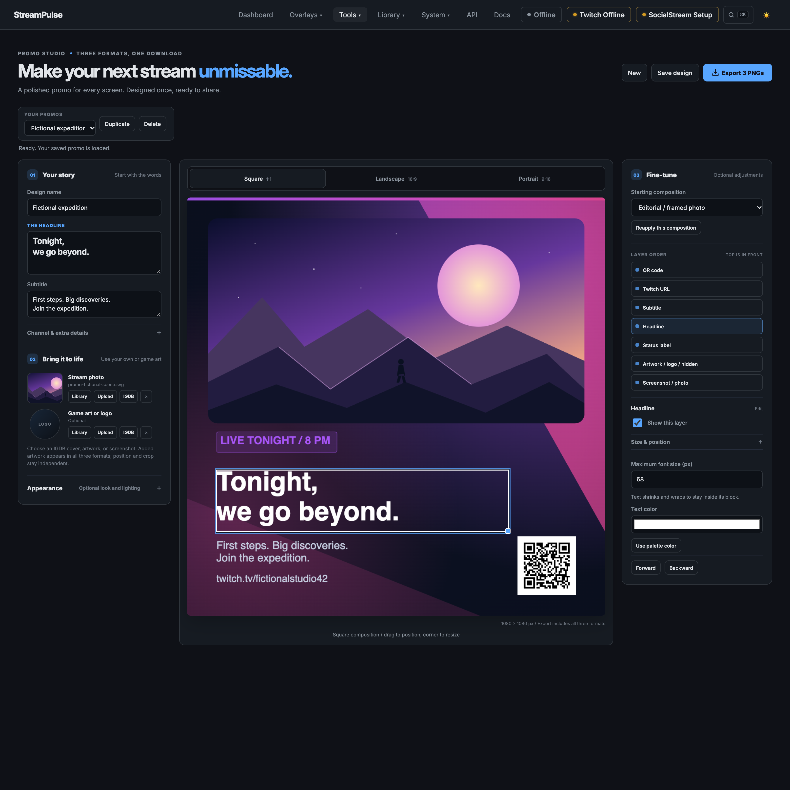

# Promo Creator

Create a polished stream announcement, download all three PNGs in one ZIP, and share them yourself. Promo Creator is a **separate design studio**, not an OBS overlay or a social-posting tool. There are no social logins, publishing integrations, or background capture jobs.

Open **Tools > Promo Creator**.

## Make a promo

1. Choose **New promo** and give the design a reusable name.
2. Write a headline, optional subtitle, and status label such as “LIVE NOW.” Enter your Twitch channel name or channel URL.
3. Add a screenshot/photo and optional artwork/logo. Use **Library** for an existing uploaded image, **Upload** for a new one, **IGDB** to browse game covers/artwork/screenshots, or paste an image outside a text field. An OBS screenshot is simply an image you supply; StreamPulse does not connect to OBS or capture your screen.
4. Use the **Square / Landscape / Portrait** tabs above the preview to refine each arrangement. Open **Appearance** only if you want a theme, custom colors, or a different background.
5. Drag blocks to position them, drag a selected block's corner to resize, or enter percentage coordinates. Use the Composition list to select overlapping blocks, hide unnecessary blocks, or change their front/back order. Arrow keys nudge; Shift moves faster.
6. **Save design** to reuse it, then **Export PNGs** to download one ZIP containing all three full-resolution images, each using its own arrangement. You do not need to switch formats and export separately.

Review screenshots before uploading: make sure chat, private notes, desktop notifications, and other personal information are not visible.

## Three formats, one design

| Format | PNG dimensions |
| --- | --- |
| Square / 1:1 | 1080 × 1080 |
| Landscape / 16:9 | 1920 × 1080 |
| Portrait / 9:16 | 1080 × 1920 |

Each format has **its own arrangement**, background, visibility, crop, type sizing, and block order. The tabs remember your last selected format across reloads; arrow keys, Home, and End work when a tab is focused. Switching formats preserves your adjustments. Auto-layout changes only the current format's blocks, never the background or the other two formats.

Headline, subtitle, status text, images, Twitch URL, palette, and typeface are shared across the three formats. Adding game artwork enables its separate, contain-fit layer in all three formats; position, scale, and crop remain independent. **Save design** stores all three compositions together. The button changes to **Save changes** when anything needs saving, and switching designs or starting again prompts before discarding edits.

## Appearance and custom themes

Themes are optional starting points in the compact **Appearance > Theme** picker, not a separate gallery. Built-in choices include **Purple Chaos**, **Vibrant Rainbow**, **Cyberpunk Neon**, **Royal Gold & Navy**, **Fire & Magma**, **Midnight Nebula**, and **Hacker Terminal**, plus Studio light and Ember.

Choosing a theme applies its palette and font across the promo, and its background to the **current format only**. It preserves your text, images in blocks, geometry, and other formats' background settings. Hacker Terminal suggests monospace typography; Royal Gold & Navy suggests serif type.

To make your own, change the palette, font, and background, then choose **Save custom theme...** and enter a name. The saved theme is available under **Your themes** in every promo. That dialog also lets you select an existing theme to update or delete. A theme contains appearance only, not your headline, block images, or arrangement.

Applying a saved theme copies its settings into the promo; later updates/deletion of the theme do not change existing designs. **Save design** separately to retain your promo edits.

### Backgrounds

Background controls affect only the selected ratio:

| Style | Controls |
| --- | --- |
| Theme artwork | Built-in composed background, including its decorative accents |
| Solid color | One flat color, with no decorative theme artwork |
| Gradient | Start/end colors and direction angle |
| Transparent | No background; the preview checkerboard is not exported |
| Image | Upload or Library, fill/crop or contain, crop focus, and darkening |
| Pattern | Grid, geometry, orbits, hexagons, dots, diagonal lines, or checkerboard with palette accents |
| Edge vignette | Adjustable 0–70% soft darkening; starts at a subtle 18% on new promos and is skipped for transparent backgrounds |

Patterns, vignette strength, image crop, and canvas corner radius save independently per format. New promos start with a subtle edge vignette; existing designs keep their previous appearance. An image background is separate from the photo and artwork blocks. A saved custom theme can include its library image and vignette; the Asset Library tracks image references too. If an image background is selected without an image, export reports the affected format instead of silently producing an incomplete pack.

The **Font** chooser offers system fonts, Google Fonts, and fonts already uploaded to your Asset Library. System fonts work offline; Google Fonts need internet the first time they load. Preview and export wait for your chosen font; a failed web-font request produces an error rather than silently exporting with a substitute. Font selection applies to all three formats. Applying a theme resets its suggested font, so choose your custom font afterward.

- **Editorial** frames the photo beside or above a clear text panel.
- **Spotlight** uses a full-bleed photo with a directional shade for readable text.
- **Type first** starts with the photo hidden for a minimal typography-led design.
- Choosing a **Starting layout** applies it immediately to this format. If you have modified its arrangement, confirmation protects your edits. **Rearrange this format** reapplies the current layout; neither action changes your other formats or content.
- Starting layouts keep the headline and supporting copy in dedicated areas with a separate artwork position. Add artwork once to enable its reserved slot in all formats, then adjust each format as needed.
- Text wraps and shrinks inside its block. Very small blocks truncate overflow; give important headlines enough space.
- Images can fill/crop or contain without cropping. Crop focus controls choose which part of the image stays visible.
- Select a photo/artwork block and choose **Rounded corners**, **Rectangle**, or **Circle crop / logo** in the inspector. Rounded corners have a pixel-radius control; circular crops stay perfectly round even inside a rectangular block. Shape, radius, fit, and crop focus are saved independently per format.
- To round the entire promo rather than just its images, open **Appearance > Canvas corner radius**. This affects only the current format and leaves transparent PNG corners; `0` keeps a full rectangular canvas.

### Game artwork from IGDB

Both image slots have an **IGDB** picker. Search by game title, choose the exact game, then select a cover, promotional artwork, or screenshot. Availability varies by game. The picker uses the Twitch client credentials configured in Settings; it reports an authentication error if those credentials are unavailable.

StreamPulse imports a full-resolution image into the local Asset Library (up to 20 MB). The actual JPEG, PNG, WebP, GIF, or AVIF format is detected from the response, even when IGDB's URL ends in `.jpg`. Saved designs and PNG exports use that local copy rather than depending on IGDB's image server or cross-origin canvas access. You can reuse it in other promos or overlays through the Library. Importing art does not change your Game Plan or Twitch category.

Artwork remains the property of its respective rights holders; follow the game's media guidelines when sharing.

The QR code always points to your Twitch URL. It stays square inside its block, with a white quiet zone and dark modules. Keep it large enough to scan after resizing or social-site compression. Enter a URL before exporting, or hide the QR block if you do not want one.

## Saved designs and exports

Saved promos live in `data/promos.json`, reusable custom themes in `data/promo-themes.json`, and uploaded images in the existing Asset Library. Full data backups include these files and assets. Asset usage lists include saved promos and themes, protect referenced images from accidental deletion, and update background/image references when you rename an asset.

PNG generation happens in your browser using the same renderer as the preview. **Export PNGs** always includes square, landscape, and portrait PNG files in one ZIP. It uses the latest unsaved edits too, but does not save the design automatically. If any format fails, no partial ZIP is downloaded.

Exports contain no editor handles or sample-image labels. A missing image, font, or QR response produces an error instead of silently exporting an incomplete image. Animated images produce a static browser-decoded frame, not an animation. Use an uploaded still image when the exact frame matters.

This is intentionally focused: named headline, subtitle, status, photo, artwork, URL, and QR blocks—not arbitrary overlay layers, animations, or live variables. Export does not require a running Twitch broadcast.
