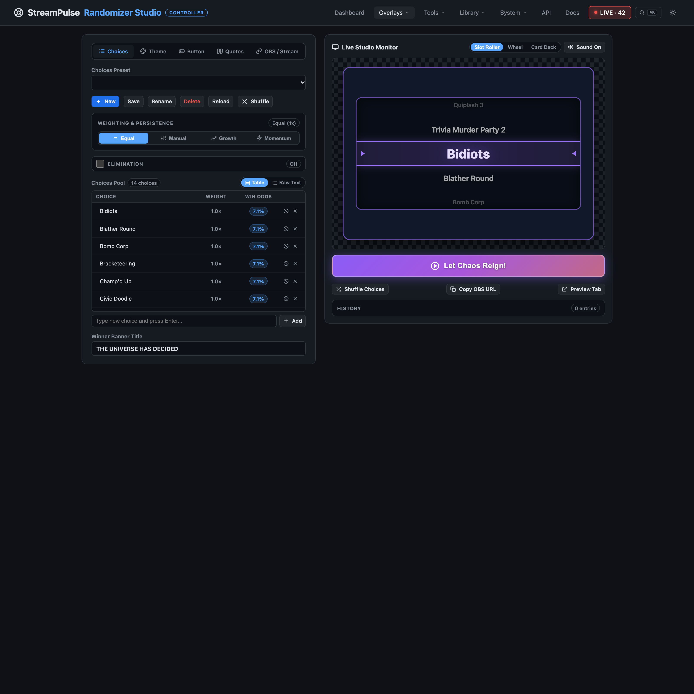

# Let chat help choose what happens next

Choice Randomizer gives audience decisions a little ceremony. Turn a list of games, challenges, or other options into a wheel, a rolling reveal, or a card draw, then share the result on stream.

Prepare a choice pool for the moment, adjust the odds when some outcomes should be more likely, or remove selected options as the session goes on. Presets make recurring segments easy to bring back, while a winner reveal and celebration give the result its own on-screen payoff.

Use the Studio to run a draw, or connect a supported Stream Deck action when you want the reveal at your fingertips. The broadcast overlay keeps the audience focused on the choice rather than the controls behind it.

Pair it with a community poll when you want viewers to decide directly, or use Game Plan to turn the winning choice into the next part of your show.

Explore [StreamPulse features](features.md) or [get started](quickstart.md). Already installed? **Docs** and **API Reference** are available from the app navigation.
