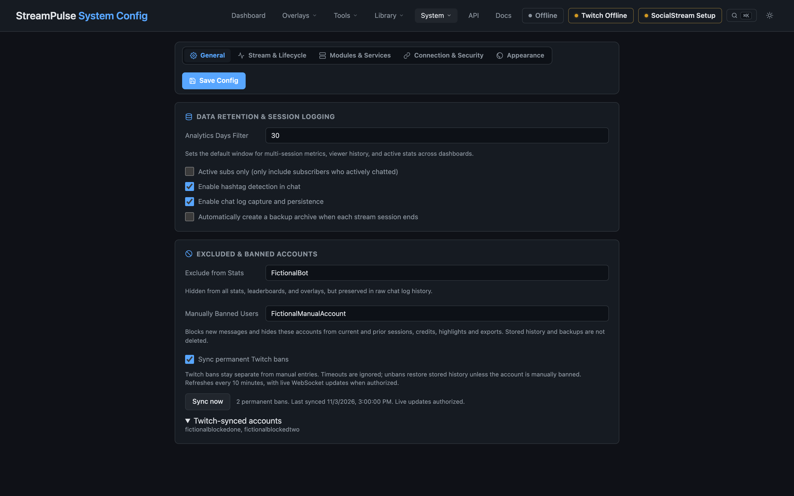

# Server Management (Shell Script Reference)

## Start & Stop with PID File

```bash
# Start
node server.js & echo $! > .server.pid

# Stop
kill $(cat .server.pid) && rm .server.pid
```

## Start & Stop with Inline PID

```bash
node server.js &
PID=$!

# later...
kill $PID
```

## Find & Kill by Port

```bash
# Find what's running on port 8080
lsof -ti:8080

# Kill it
lsof -ti:8080 | xargs kill
```

## Companion-Style Script Example

```bash
#!/bin/bash
cd /path/to/streampulse

case "$1" in
  start)
    node server.js & echo $! > .server.pid
    echo "Server started (PID: $(cat .server.pid))"
    ;;
  stop)
    if [ -f .server.pid ]; then
      kill $(cat .server.pid) && rm .server.pid
      echo "Server stopped"
    else
      echo "No PID file found, trying port lookup..."
      lsof -ti:8080 | xargs kill 2>/dev/null && echo "Killed" || echo "Nothing running"
    fi
    ;;
  restart)
    $0 stop
    sleep 1
    $0 start
    ;;
  *)
    echo "Usage: $0 {start|stop|restart}"
    ;;
esac
```

Usage:
```bash
./manage.sh start
./manage.sh stop
./manage.sh restart
```

The source-installation updater does not require this shell script. It is cross-platform and can restart the Node server after an update when StreamPulse was launched with `npm start`; Node.js/npm must be installed and the installation must be writable. Git checkouts support stable and nightly updates; downloaded source folders support stable updates only. Windows uses `npm.cmd` automatically. Packaged desktop apps check stable releases but must be upgraded with a desktop installer, not a source archive; their Update page hides Nightly and in-place installation controls. See [desktop update instructions](desktop-app.md#updating-an-installed-desktop-app). For unattended process supervision, use a platform service or process manager so the server is relaunched if it exits unexpectedly.

Use the **Restart StreamPulse** button on the dashboard when restarting after an outage or configuration issue. It saves the active session, waits for a new process instance, and confirms that the restarted process resumes it; use **End Session** when you intentionally want to archive and start a new session. The **Update** page uses the same verification before reporting that an update completed.

## Banned Accounts & Twitch Sync

In **System Config → General → Excluded & Banned Accounts**, enable **Sync permanent Twitch bans**, save, and use **Sync now**. Twitch-synced accounts remain separate from **Manually Banned Users**. Syncing is opt-in and refreshes at startup and every 10 minutes. Twitch EventSub WebSocket ban/unban notifications also update the list when authorized; reconnect Twitch once for the `channel:moderate` permission. Listing bans requires `moderation:read` (or `moderator:manage:banned_users`). Timeouts are ignored.

The combined ban list blocks new chat ingestion and filters current and archived session views, chat search, timelines, credits data, highlights, community lists and their exports. This is **not deletion**: stored sessions, raw logs, private notes and backup ZIPs retain history. Unbanning on Twitch restores previously stored output unless the account remains manually banned. Turning sync off stops applying Twitch-synced bans but keeps manual bans. Lists are scoped to the connected broadcaster; failed or incomplete syncs retain the last successful list.

Existing aggregate totals without per-user attribution (such as emote/hashtag counts and historical growth snapshots) are not rebuilt. Refresh an already-open history page or credits browser source to reload filtered data; an already-running credits roll is not rewritten. Permanent history cleanup is not part of automatic sync.



### Message deletion sync

**Sync message deletions** is on by default, independently of permanent-ban syncing. Restart StreamPulse after updating, then reconnect Twitch to grant `user:read:chat`. The status line shows whether Twitch deletion subscriptions are connected. SocialStream needs its WebSocket data feed enabled and must actually forward the source's `{delete: ...}` signal; removing a message only inside the SSN dock may not forward a deletion.

Delivered individual-message deletions, per-user chat clears (including timeouts), and channel/source clears hide identifiable messages from chat history, search, timelines, highlights and exports. Open Sessions and Highlights pages refresh automatically. A clear applies only to already-received messages in the active session/source, not future messages, other platforms or older sessions. A native message UUID can hide its exact archived message too. Deletions persist separately in `data/message-deletions.json`; unbanning a user or disabling incoming deletion sync does not restore deleted-message output. Full backups include the ledger and retain the original history.

New chat entries retain SSN/source IDs and session identity. When Twitch UUIDs are absent from SSN captures, StreamPulse can bridge a unique, exact login/text match within 30 seconds of both captures; it retains up to 5,000 native observations for 30 minutes in the current process. Repeated/ambiguous captures are left untouched. Native UUID deletions remain durable; delayed captures can resolve a pending deletion within 30 seconds. Reused SSN IDs are scoped to the current session and resolved message rather than becoming global bans. Older logs without message identity cannot be reliably matched to individual upstream deletions.

There is no replay of deletion events missed while disconnected. Existing aggregate stats already counted (messages, emotes, hashtags and leaderboards) are not rebuilt; the optional Community insights index is rebuilt to exclude identifiable deletions. Refresh credits or other already-prefetched overlays to reload filtered highlights; an active credits roll or already-fired alert is not rewritten. Automatic sync does not physically erase raw logs or backups.

## Backup & Restore

Use the **Backup & Restore** studio to download a full ZIP (`GET /api/backup`), restore one (`POST /api/restore`), or download a saved automatic backup from `/api/backups`. A `HEAD /api/backup` request builds the same archive and returns its download headers without sending its contents.

Full backups contain `config.json` and all StreamPulse state, asset, and history files across `data/`:
- **Sessions & Chat**: Live chat snapshot (`data/chat.json`), raw chat log (`data/chat-log.jsonl`), lifetime statistics (`data/stats.json`), and archived sessions (`data/sessions/`).
- **Overlays & Assets**: Custom overlays (`data/custom-overlays.json`), overlay presets (`data/overlay-presets.json`), asset tags/captions (`data/asset-tags.json`, `data/asset-captions.json`), uploaded assets (`data/custom-overlay-assets/`), revision histories (`data/custom-overlay-history/`), and preview thumbnails (`data/custom-overlay-thumbnails/`).
- **Interactive Competitions**: Live polls, presets, bracket tournaments, and checkpoints (`data/polls.json`), alongside versus matchup cards, competitor stats, queues, and clocks (`data/matchup.json`).
- **Automation & Chatbot**: Chatbot command configurations and triggers (`data/chatbot.json`), per-user usage and cooldown tracking (`data/chatbot-usage.json`), quotes (`data/quotes.json`), timers (`data/timers.json`), and custom counters/variables (`data/variables.json`).
- **Community & CRM**: Chatter notes and tags (`data/chatter-notes.json`), opt-in derived insights and a minimal event journal (`data/community-insights.json`, `data/community-insights-events.jsonl`), cached Twitch VIPs (`data/vips.json`), cached moderators (`data/moderators.json`), follower trends (`data/follower-history.json`), and subscriber trends (`data/sub-history.json`).
- **Alerts & Randomizer**: Alert engine rules (`data/alerts.json`), recent alert queue event logs (`data/alert-events.json`), randomizer wheels (`data/randomizer-presets.json`), randomizer button presets (`data/randomizer-button-presets.json`), and winner quote presets (`data/randomizer-quote-presets.json`).
- **Media & Planning**: Game plans (`data/game-plan.json`), IGDB game artwork cache (`data/game-info-cache.json`), promo designs and custom themes (`data/promos.json`, `data/promo-themes.json`), and uploaded music artwork (`data/music-artwork.png`, `data/music-fallback.png`).

Backups also dynamically include user-created state files in `data/`. Missing optional files are skipped cleanly. Backups **never** export sensitive Twitch credentials (`.twitch-token.json`, `twitch-tokens.json`), system clutter (`.DS_Store`, `.gitkeep`), internal rotation snapshots (`.stats-backup-*`), temporary files, or the `backups/` directory itself. Configuration and chat data can still contain sensitive information; keep backup ZIPs private.

Upon restoring a backup archive, StreamPulse automatically reloads all in-memory services (`matchupService`, `pollService`, `chatbot`, `variablesStore`, `alertEngine`, `crmService`, `gamePlanService`, `overlayService`, timers, goals, and statistics) and broadcasts live state updates to connected overlay instances. Startup and connection settings (such as port or Twitch credentials) still prompt for a server restart.

To move just one design between installations, use **Share individual items** to export a promo scene with its referenced images and fonts, then import that ZIP on the destination. Imports can keep both scenes, replace a matching ID, or skip it; full backups remain the option for restoring all promo scenes and reusable themes together.

When `auto_backup_on_session_end` is enabled, **End Session** archives and backs up the finished session **before** resetting live data. The ten newest `backup-*.zip` files are retained in the configured data directory's `backups/` folder; other ZIP filenames are not pruned. Repeated backups within the same minute replace that minute's backup, matching the existing naming convention. Updates await a forced backup before replacing application files. A failed backup is reported as an error rather than silently allowing the reset or update to proceed. Shutdown and embedded desktop restart wait for outstanding backup operations before changing session files.

### Background processing and limits

- Full ZIP creation, compression, archive parsing, CRC checks, and restore decompression run in a short-lived Node worker thread, not the server/Electron main event loop. Manual downloads stream the completed ZIP from disk. Restore uploads stream to disk rather than being concatenated into a large main-thread buffer.
- Manual backups, automatic backups, and full restores share **one active operation and at most two waiting operations**. Excess requests receive HTTP **503**; retry once current work finishes. Slow uploads/downloads also occupy that operation slot. There is no persistent idle worker.
- Each operation uses a private `.backup-work-*` directory inside `data/backups/` (or the configured data directory). Normal completion, handled failures, cancellation, worker errors, and timeouts remove it. Force-killing the application or a power loss can leave one behind; stop StreamPulse before removing an abandoned directory. Completed automatic ZIPs are published before retention removes older backups.
- Full restore preserves the existing **600 MiB compressed upload limit**. There are no newly imposed entry-count, expanded-size, worker heap, or default worker runtime caps. A service caller can explicitly opt into a worker timeout; normal HTTP/automatic operations do not. Selective share-package APIs keep their existing behavior; they are not moved to this worker pipeline.
- Bounded concurrency prevents multiple simultaneous ZIP heaps but does not reduce the work of one archive: `adm-zip` still holds file/ZIP buffers in memory, and compression consumes CPU, disk space, and I/O. Large media libraries can need substantial RAM and free disk space. Runtime and available memory/filesystem capacity still constrain accepted archives; this is not a total memory/CPU limit or a promise of lower overall resource usage.

Restore requires `data/stats.json` (or the legacy `stats.json` marker), restores `config.json` and eligible `data/` entries, and ignores unrelated or traversal paths. Archive-controlled destinations cannot pass through symbolic links. Selected entries are completely staged and checked before live files are touched, then published using asynchronous, per-file atomic replacements. The existing reload callback runs before the success response; restored connection/startup settings are returned in `restartFields` with `restartRequired: true`.

This is **not** a transactional, point-in-time snapshot or an all-files atomic restore. Live events may change files while a backup reads them. A failure during final restore publication or reload can leave some files restored; inspect the error and restore again if needed. Restore while off-air, keep an independent known-good backup, and restart when prompted. Configuration/data reload parsing still occurs on the main thread; moving archive work does not make every disk or JSON operation asynchronous.

Events arriving while **End Session** waits for compression remain in the ending session. Before resetting, StreamPulse synchronously flushes chat, statistics, and the chat log again and refreshes that session archive; the ZIP may predate these last arrivals, but the local archive and lifetime statistics retain them. A backup failure leaves live data intact for retry, and the same session archive is updated rather than creating another session. Disconnecting a restore client cancels upload/decompression before publication; once publication starts, it completes file replacement and reload even if the client has gone away.

The isolated regression is `node --test scripts/test-backup-worker.cjs`. It uses fictional project-local fixtures, verifies ZIP contents, restore/reload behavior, retention, failures, cancellation, bounded queuing, backup-before-reset, shutdown/restart waiting, and checks timer/local HTTP responsiveness while archiving and restoring 16 MiB of random media. Printed timings are measurements of that bounded fixture on the test machine, not production CPU/RAM savings or performance guarantees.
