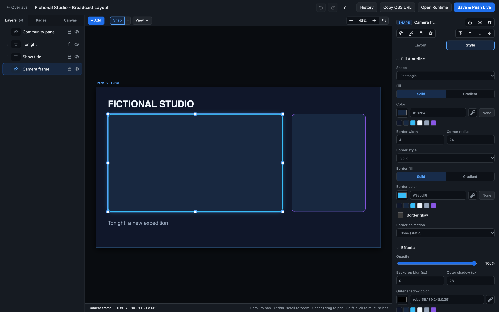
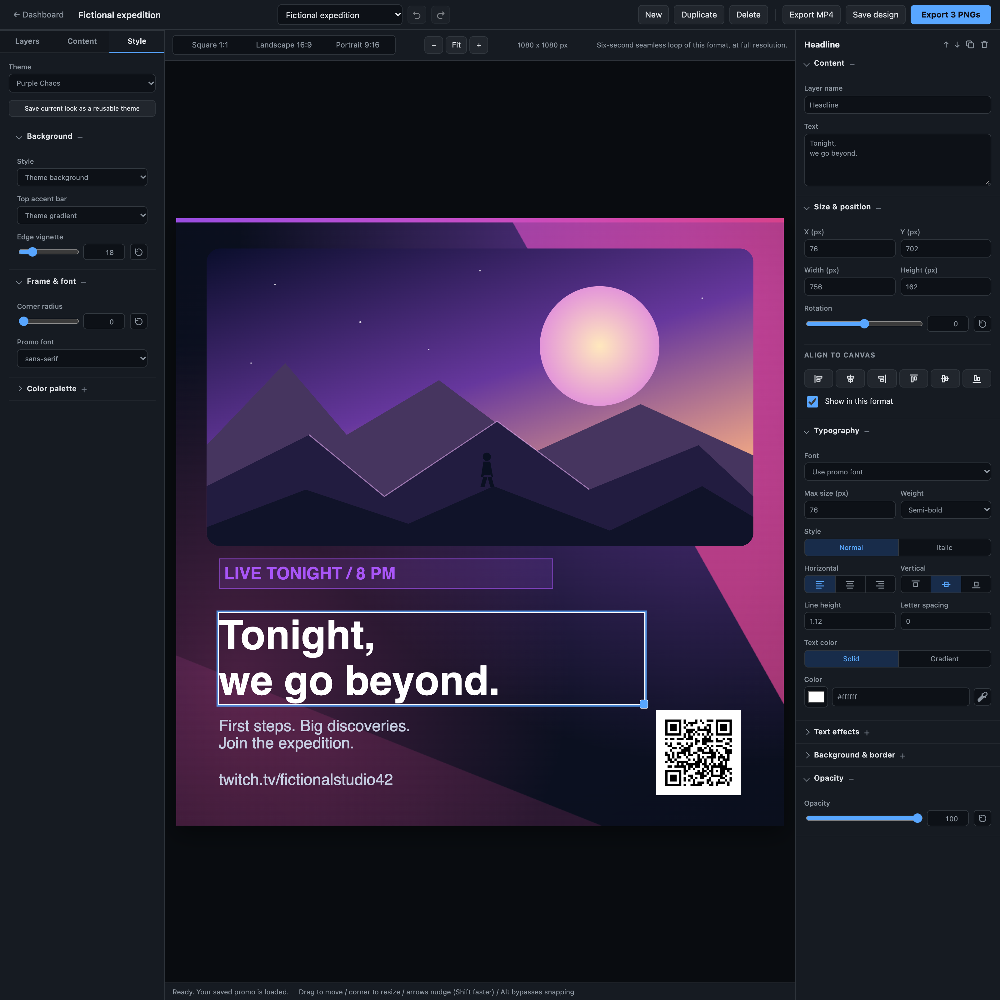
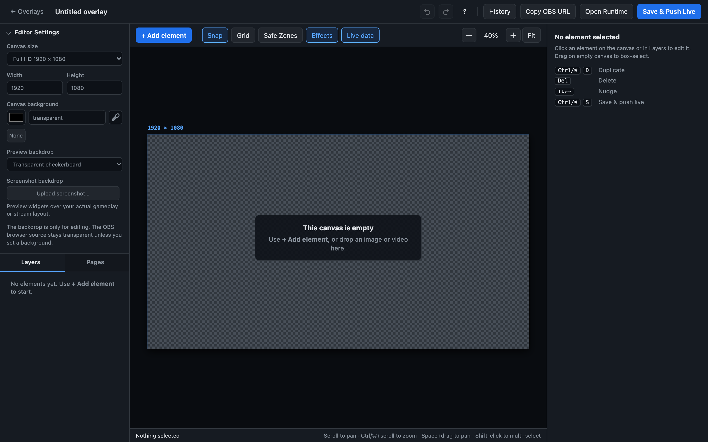
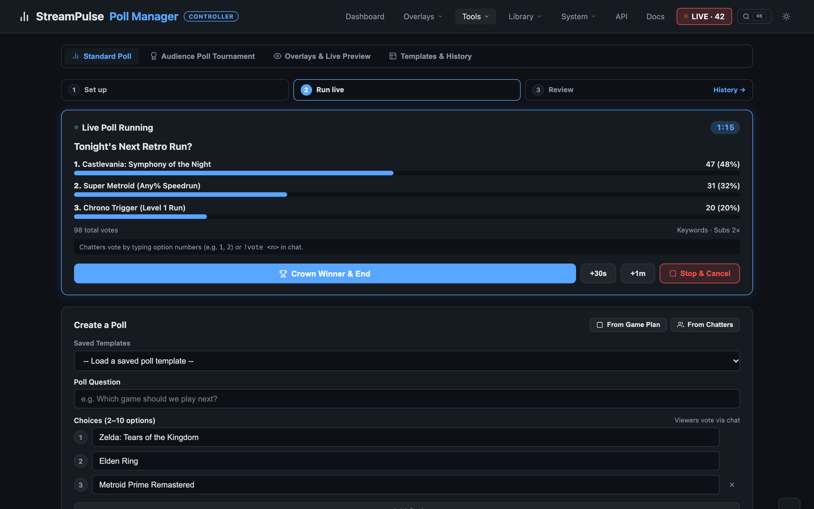
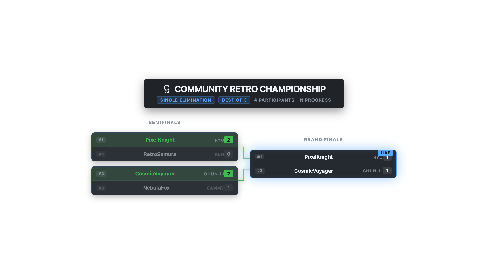
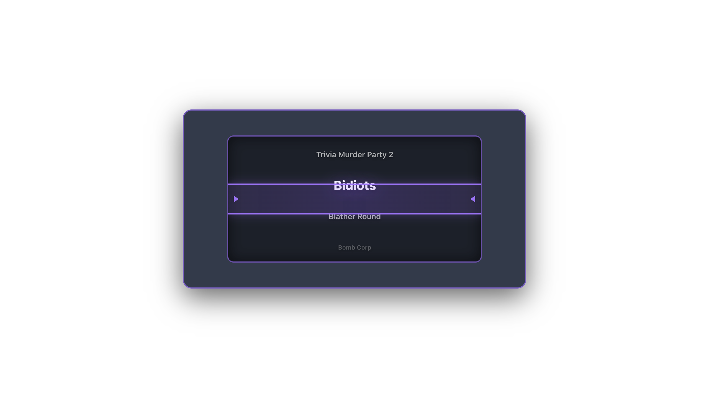
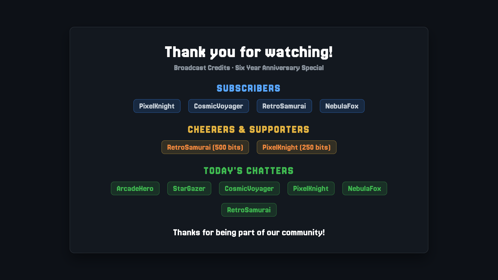

# See what your show could look like

A starting screen that feels like your channel. A game-night bracket your chat can follow. An outro that gives people a reason to stay.

These examples use **fictional names and sample data**. Use them for inspiration, then make the look your own.

## A scene with your personality

Arrange artwork, text, video, and live information in Custom Overlay Studio. Build a full layout or just the pieces your current scene is missing.

[Meet Custom Overlay Studio](custom-overlays.md).

## Announce the night before it starts

Create a reusable promo with your headline, artwork, and channel link. Adapt the design for square, landscape, and portrait posts.

[Explore Promo Creator](promo-creator.md).

## Make the lineup part of the show

Let viewers see tonight's games and what's next. Use cards, a schedule, or a ticker to fit the information into your scene.

[Explore Game Plan](game-plan-guide.md).

## Give chat a decision worth watching

Show the choices, watch votes come in, and give the winner a moment. Tournament brackets turn a series of decisions into a whole event.

[Explore polls and tournaments](polls-guide.md).

## Reveal the unexpected

Let a wheel, roller, or card reveal choose the next game or challenge from your prepared list.

[Meet Choice Randomizer](randomizer-guide.md).

## Close with a proper thank-you

Bring supporters, chat activity, and your own messages together in an end-credits roll.

[Explore Credits Studio](credits-guide.md).

  <a class="docs-button" href="#/quickstart">Make it your show</a>
  <a class="docs-button" href="#/features">See all features</a>

