# See what your show could look like

A starting screen that feels like your channel. A game-night bracket your chat can follow. A live control board at your fingertips. An outro that gives people a reason to stay.

These examples use **fictional names and sample data**. Use them for inspiration, then make the look your own.

## Live Control & OBS Docks

Run your show from a multi-column control board or pin just what you need into a compact OBS Studio Custom Browser Dock.

  <figure>
    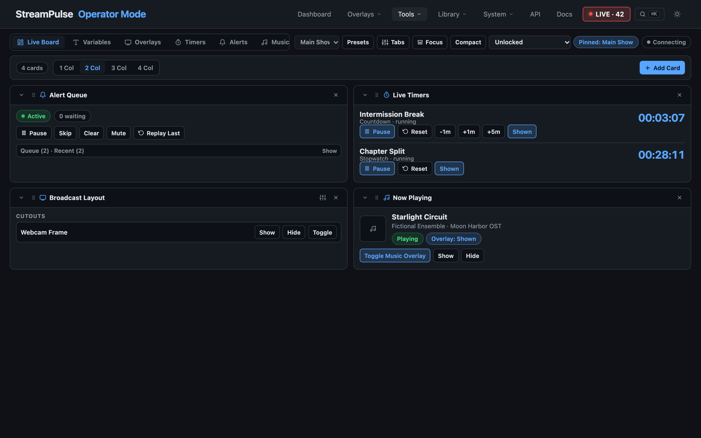
    <figcaption><strong>Operator Mode Live Board</strong>[Explore Operator Mode](operator-guide.md)</figcaption>
  </figure>
  <figure class="is-portrait">
    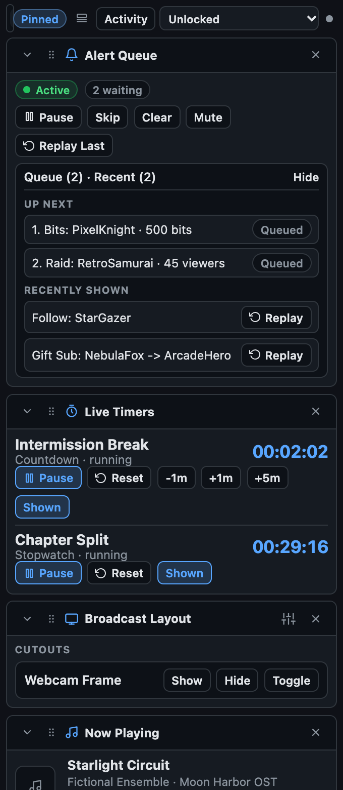
    <figcaption><strong>OBS Custom Browser Dock</strong>Built for narrow sidebars alongside your scenes.</figcaption>
  </figure>

## Scenes & Broadcast Branding

Arrange artwork, text, video, and live information in Custom Overlay Studio, or design reusable announcements in Promo Creator.

  <figure>
    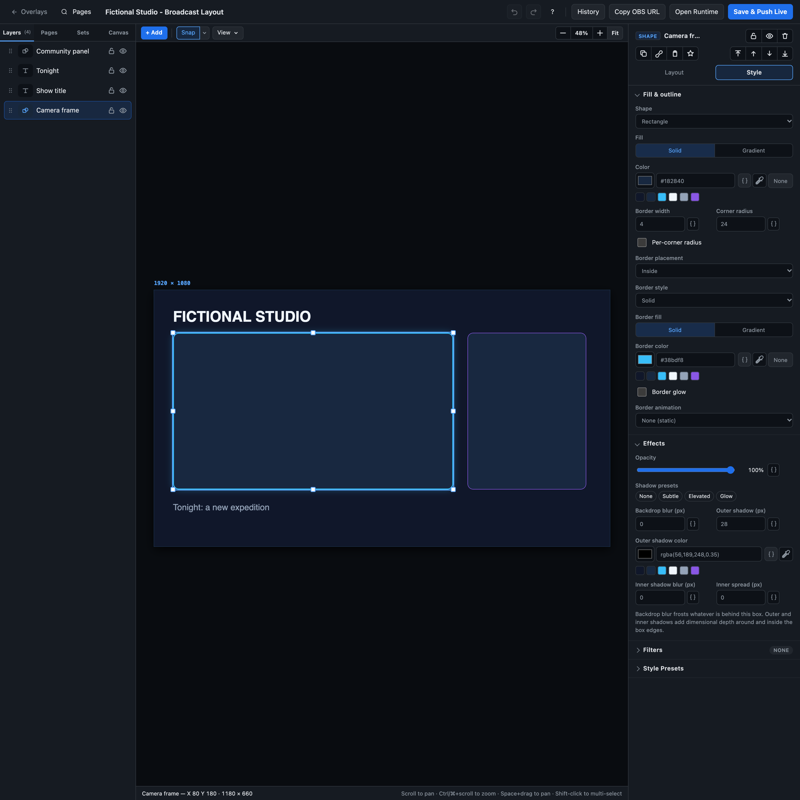
    <figcaption><strong>Custom Overlay Studio</strong>[Meet Custom Overlay Studio](custom-overlays.md)</figcaption>
  </figure>
  <figure>
    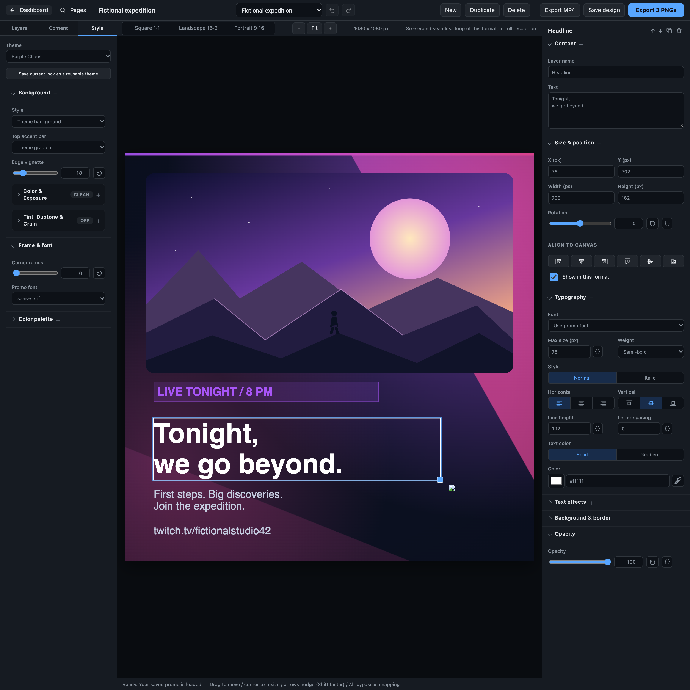
    <figcaption><strong>Promo Creator</strong>[Explore Promo Creator](promo-creator.md)</figcaption>
  </figure>

## Make the lineup part of the show

Let viewers see tonight's games and what's next across schedules, cards, checklists, or lower-third tickers.

  <figure>
    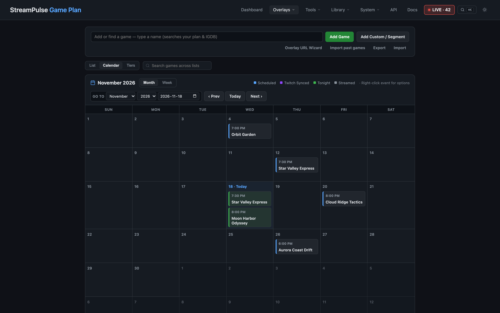
    <figcaption><strong>Game Plan Calendar</strong>[Explore Game Plan](game-plan-guide.md)</figcaption>
  </figure>
  <figure>
    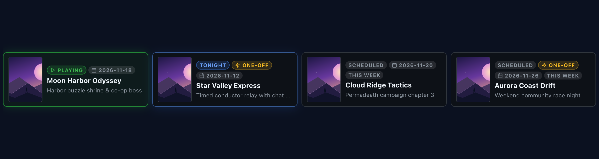
    <figcaption><strong>Schedule Cards Overlay</strong>Share upcoming stream nights automatically.</figcaption>
  </figure>
  <figure>
    
    <figcaption><strong>Lower-Third Ticker</strong>Highlight Playing Now &amp; Up Next cleanly.</figcaption>
  </figure>
  <figure>
    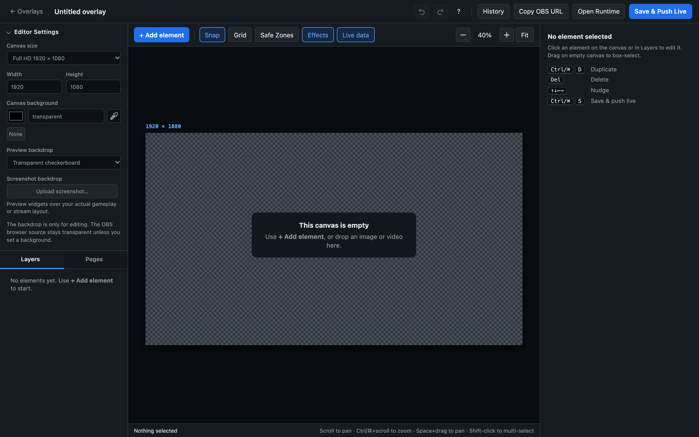
    <figcaption><strong>Featured Game Widget</strong>Embed game lineups straight inside custom scenes.</figcaption>
  </figure>

## Chat Voting, Tier Lists & Tournaments

Involve your audience with live chat polls, collaborative Tier List consensus voting, tournament brackets, and head-to-head scoreboards.

  <figure>
    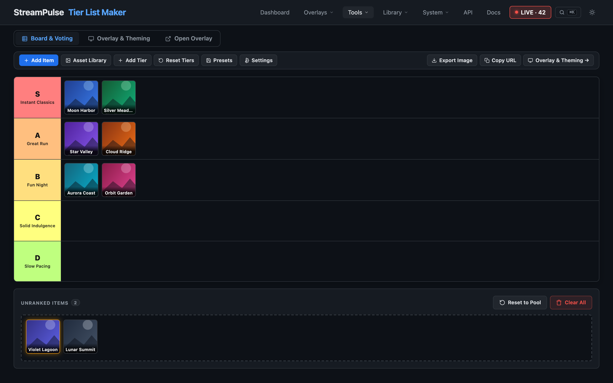
    <figcaption><strong>Tier List Maker</strong>[Explore Tier Lists](tier-list-guide.md)</figcaption>
  </figure>
  <figure>
    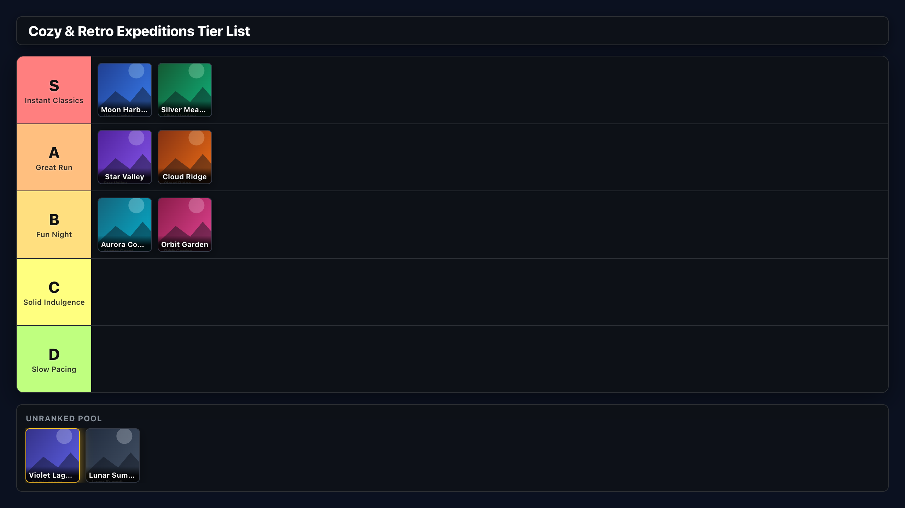
    <figcaption><strong>Tier List Broadcast Overlay</strong>Smooth card placements driven by chat consensus.</figcaption>
  </figure>
  <figure>
    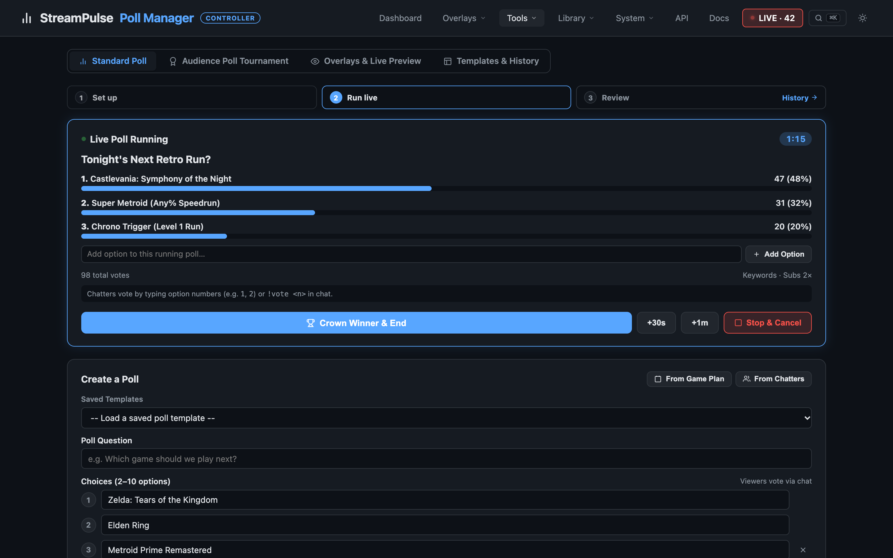
    <figcaption><strong>Poll Studio</strong>[Explore Polls &amp; Brackets](polls-guide.md)</figcaption>
  </figure>
  <figure>
    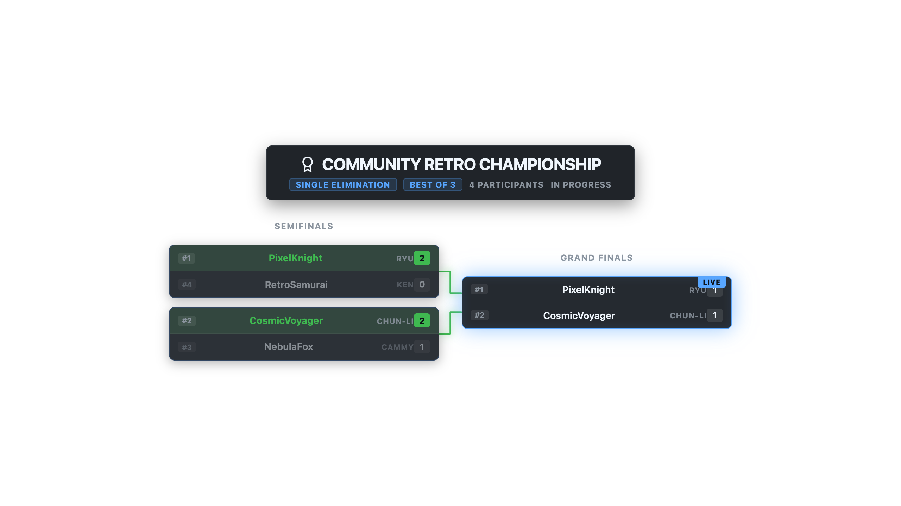
    <figcaption><strong>Tournament Overlay</strong>Live brackets and grand final reveals.</figcaption>
  </figure>

## Celebrations, Reveals & Outro Credits

Celebrate stream moments with custom alerts, spin the wheel with Choice Randomizer, and wrap the night with closing credits.

  <figure>
    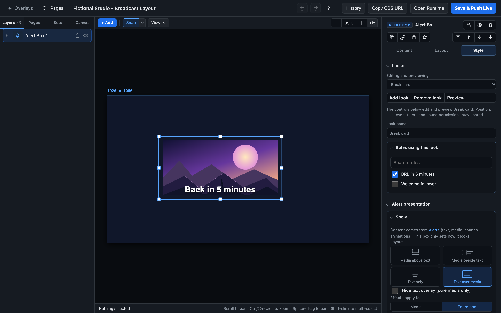
    <figcaption><strong>Custom Alert Looks</strong>[Explore Alerts](alerts-guide.md)</figcaption>
  </figure>
  <figure>
    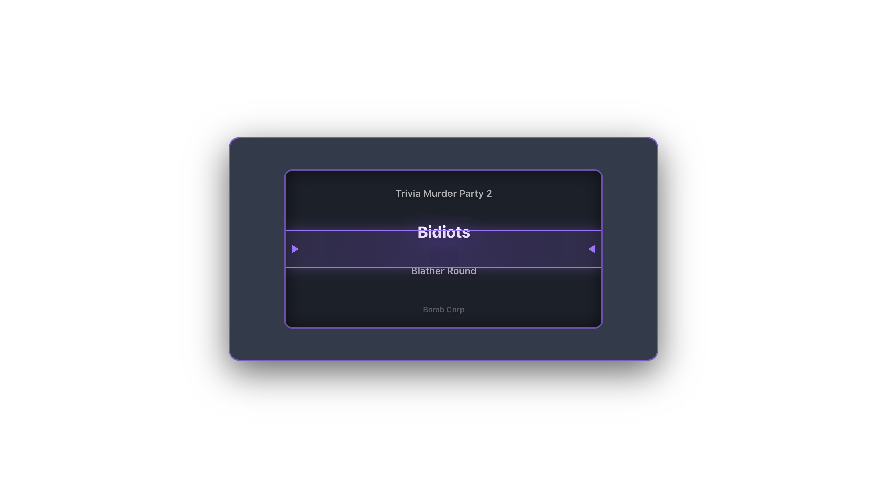
    <figcaption><strong>Choice Randomizer</strong>[Meet Choice Randomizer](randomizer-guide.md)</figcaption>
  </figure>
  <figure>
    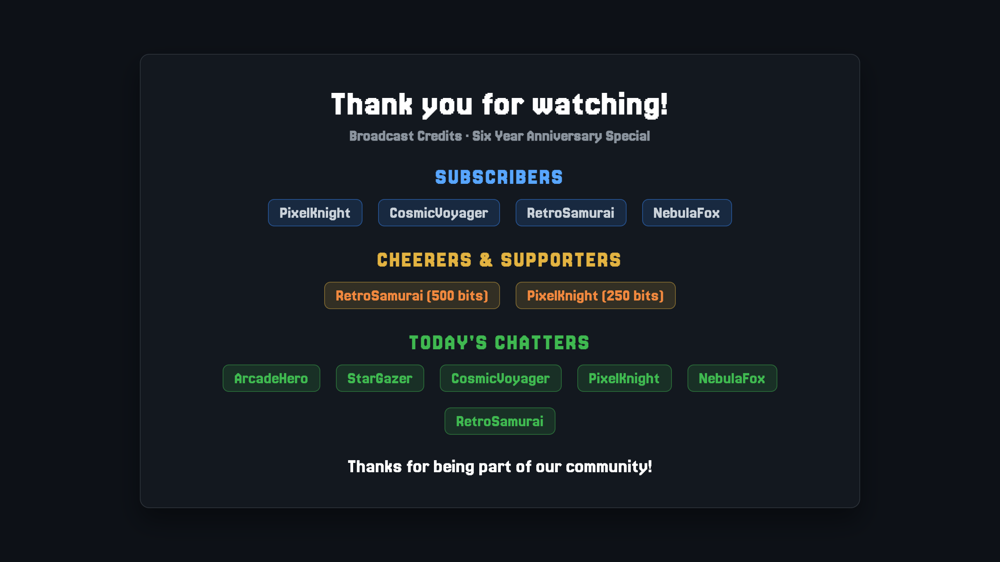
    <figcaption><strong>Closing Credits Roll</strong>[Explore Credits Studio](credits-guide.md)</figcaption>
  </figure>

  <a class="docs-button" href="#/quickstart">Make it your show</a>
  <a class="docs-button" href="#/features">See all features</a>

