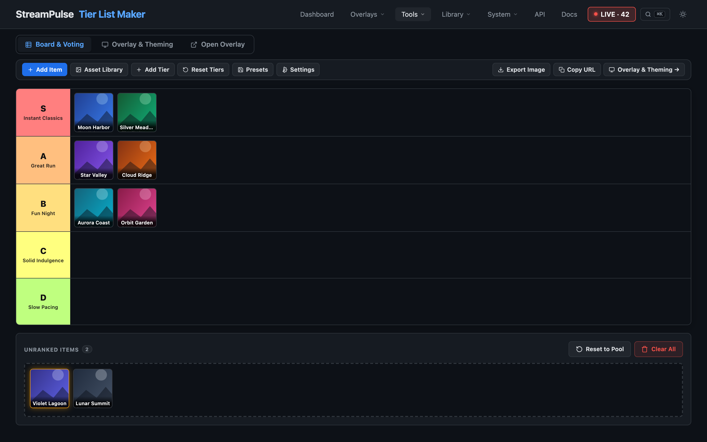
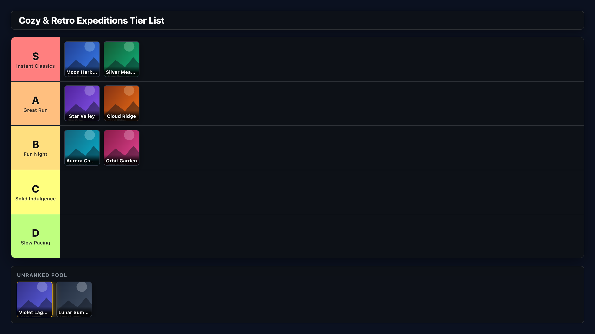

# Tier Lists & Live Chat Voting

StreamPulse includes a standalone Tier List Maker and live animated OBS broadcast overlay with audience chat voting and real-time consensus.

  <figure>
    
    <figcaption><strong>Tier List Maker</strong>Drag artwork cards between tiers, upload custom images, or launch live chat votes.</figcaption>
  </figure>
  <figure>
    
    <figcaption><strong>OBS Broadcast Overlay</strong>Full-screen or sidebar layout with smooth animations and live chat voting stats.</figcaption>
  </figure>

---

## 1. Overview & Key Capabilities

- **Customizable Tiers**: Add, edit, recolor, and reorder any number of tiers (e.g. S+, S, A, B, C, D, F, Trash, DNF).
- **Interactive Drag & Drop**: Drag cards seamlessly between the unranked pool and ranked tiers.
- **Asset Library Integration**: Batch import images directly from your StreamPulse Asset Library with captions pre-filled.
- **Quick Paste & Drag-Drop**: Paste copied screenshots or images with `Ctrl+V` / `⌘V`, or drop image files directly from your computer into the unranked pool tray.
- **Audience Chat Voting**: Let viewers vote on where unranked items belong using chat commands (`!tier S`, `!rank 1`).
- **Flexible Consensus Modes**: Choose **Weighted Mean** ($A + C = B$), **Median**, or **Plurality** voting rules.
- **Presets & PNG Snapshot Export**: Save reusable tier setups, load built-in templates, and export a high-resolution PNG of your finished board.

---

## 2. Using the Tier List Maker

Open the maker at `http://localhost:3000/tools/tier-list.html` or navigate to **Tools &rarr; Tier List Maker** in the dashboard.

### Adding Items
1. **Manual Add**: Click **Add Item** to paste an image URL, upload a file, enter a caption, and add review notes.
2. **Asset Library**: Click **Asset Library** to browse your existing graphics and artworks. Multi-select multiple files to bulk-add them to the unranked tray in one click. Items already present on your active board display a visual **In List** badge. Assets used by the Tier Maker are automatically linked in the Asset Library with `Tier List: <Item>` usage badges and protected from accidental deletion.
3. **Clipboard Copy & Paste (Ctrl+V / ⌘V)**: Copy any image file, screenshot, browser image, or direct image URL to your clipboard and paste it directly onto the maker. The image is instantly uploaded to the Asset Library, tracked as in-use, and placed into the unranked pool.
4. **Desktop Drag & Drop**: Drag one or more PNG/JPG/WebP/GIF files directly into the dashed Unranked Items pool to upload to the Asset Library and add them to the board.

### Customizing Tiers & Banners
- Click any tier header (e.g. "S" or "A") to customize its label, color, description, and optional **Placement Sound Trigger** (upload an audio clip or pick one from the Asset Library so placing an item into S Tier plays your custom sound on stream).
- Use **Add Tier** and **Reset Tiers** above the board to add new tier rows or restore the default S–F tiers at any time (even if presets have been deleted).
- Use the &uarr; and &darr; arrows to reorder tiers.
- Click **Presets** to load templates (*Standard S-F*, *Extended Gaming S+-Trash*, *Movie Reviews*, *Food & Snacks*), save your current setup (including your custom banner and overlay theming) as a new preset, or restore defaults at any time.

### Styling the Broadcast Overlay (Live Sync to OBS)
Open the **Overlay & Theming** tab to customize how your Tier List looks on stream while previewing changes live at 1080p, 720p, Sidebar (440&times;1080), or Vertical (9:16):

- **Shared Theme Presets & Saved Custom Themes**: Pick any of StreamPulse's built-in themes from the pinned **Theme Preset** selector (`Dark Card`, `Transparent / Clean`, `Clean Light Contrast`, `Frosted Glass`, `Opaque Solid`, `OLED Deep Black`, `EVO Championship`, `Championship Gold`, `Cyberpunk Neon`, `Neon Glow`, `Retro Arcade`, `Ember Flame`, `Aurora Borealis`, `Deep Ocean`, `Neon Sunset`, `Ultra Violet`, `Emerald Forest`, `Border Framing`, `Pill Capsule`). Click **Save Theme** to save your current fonts, framing, and colors into your shared custom themes library (usable across Polls, Versus, and Brackets as well), or **Manage** to apply and delete saved themes.
- **Layout & Banner Tab**:
  - **Header & Custom Top Banner**: Upload an image, choose one from the **Asset Library**, or paste an image URL to display a banner across the top of your tier list. Choose **Replace Title Bar** for a clean graphic header or **Behind Title Text** to keep your list title overlaid with a contrast gradient. Adjust **Banner Fit** (`Cover` or `Contain`) and **Banner Height** (`48px`–`240px`) with the slider.
  - **Auto-Fit Board to Screen**: Automatically scales cards and row heights so every tier and item fits inside your broadcast frame with no scrollbars or clipping.
  - **Hide Unranked Pool**: Keeps the bottom unranked tray hidden on stream so viewers only see ranked tiers.
  - **Cards & Item Text**: Pick card scale, aspect ratio (`1:1`, `3:4`, `16:9`), and artwork fit. Toggle **Show Item Text** off for pure art cards, turn on **Always Fit Item Text** to wrap and shrink long titles so every name stays readable without ellipses (`...`), enable **Focus & Enlarge Selected / Voting Art** to spotlight centered enlarged artwork when an item is focused or voted on, or enable **Zoom & Follow Item to Tier** to smoothly zoom the overlay camera into the target tier when an item is placed.
  - **Voting Hint & Audio**: Control whether the idle voting instruction bar stays visible when no vote is running (when a vote is active, the single Vote Spotlight Card displays the countdown timer and valid `!tier` choices cleanly without duplicating banners) and toggle synthesized sound chimes (automatically hidden when Chat Voting is disabled, and synced with Settings audio controls).
- **Fonts & Framing Tab**:
  - **Heading & Content Custom Fonts**: Choose separate fonts for **Heading & Tier Labels** and **Content & Captions**. Type any Google Font name, pick from suggested system/Google fonts, or click **Fonts** to browse uploaded `.ttf`, `.otf`, `.woff`, or `.woff2` files from your Asset Library.
  - **Typography & Surface Framing**: Adjust font weight (300–900), font scale (`0.75x`–`1.5x`), text transform (`uppercase`, `capitalize`, `lowercase`, `none`), text shadow/outline, corner roundness (`0px`–`24px`), and backdrop blur (`0`–`24px`).
- **Colors Tab**:
  - Override any color in the active theme using synchronized color pickers, quick accent swatches, or text inputs (`#hex`, `#RRGGBBAA`, `rgba()`, `linear-gradient()`, or `transparent`): **Accent & Spotlight**, **Board & Header Background** (with opacity slider), **Tier Row Items Surface** (with opacity slider), **Border Color**, **Primary Text**, and **Muted Label Text**. Click **Clear Colors** anytime to return to the active theme preset's palette, or **Reset** in the header to restore default theming.
- **Sample Data Toggle**: Enable **Sample Data: On** in the preview bar to test dense boards, banners, themes, and long captions without modifying your real items.

Every setting saves automatically to StreamPulse and updates your live overlay immediately:
1. Copy the permanent **OBS Browser Source URL** (`http://localhost:3000/overlays/tier-list.html`) once and paste it into OBS.
2. Adjust banners, text options, themes, or layout anytime — your OBS scene updates live without re-pasting the URL.
3. Need a second OBS scene with different settings (such as a compact **Sidebar** alongside your main full-screen scene)? Expand **Scene-Specific URL Overrides (Optional)** to copy a parameterized URL that overrides your saved defaults for that scene alone.

The embedded live preview applies every appearance, banner, sample-data, and viewport change in real time without reloading.

---

## 3. Audience Chat Voting

StreamPulse allows chatters to collaboratively decide where items belong on your tier list — or you can turn off chat voting completely for manual streamer-only rankings.

### Enabling or Disabling Chat Voting
Open **Settings &rarr; Enable Chat Voting**:
- When **enabled** *(default)*, **Vote** buttons appear on item cards, `!tier` and `!rank` commands are accepted during active votes, and the Live Voting HUD / OBS hint bar display during votes.
- When **disabled**, any running vote is cancelled cleanly, all dependent chat voting options (consensus math, subscriber weight, duration, auto lock-in, chatbot announcements, SFX, and voting hint bar) are hidden in Settings and the Overlay & Theming inspector, **Vote** buttons are removed from board cards, and both the board and OBS overlay ignore chat voting commands and hide voting prompts.

### Focusing Items Without Voting
Click **Focus** on any item card in the Tier List Maker (available even when Chat Voting is turned off) to spotlight that item on the broadcast overlay—and when **Focus & Enlarge Selected / Voting Art** is enabled under **Overlay & Theming**, the overlay showcases a large, centered artwork preview with the item name and note while you discuss it.

### Starting a Vote
1. Click **Vote** on any unranked or ranked item card.
2. The Live Voting HUD will expand at the top of the screen and activate the spotlight on the OBS overlay.
3. If enabled, the StreamPulse Chat Bot announces the vote in chat with available tier choices and time remaining.

### Voting Commands
Viewers vote in chat with commands like `!tier S`, `!tier S!`, `!tier A tier`, `!tier Trash`, or `!rank 1`.
*(Case-insensitive; supports tier labels, numeric positions, prefix shortcuts, and natural punctuation like exclamation marks or trailing words).*

### Vote Updating
By default, chatters can change their vote as many times as they want while voting is open. Only their most recent vote is counted toward the final consensus.

### Consensus Mathematical Models
In **Settings &rarr; Vote Consensus Method**, choose how chat votes are aggregated:

1. **Weighted Mean ($A + C = B$)** *(Default)*:
   - Each tier is mapped to a numeric index $i \in [0, N-1]$.
   - Continuous average index: $\bar{i} = \frac{\sum (i \cdot \text{weight})}{\sum \text{weight}}$.
   - Rounds to the nearest integer index. For example, 1 vote for A (index 1) and 1 vote for C (index 3) averages to index 2 (**Tier B**).
2. **Median (50th Percentile)**:
   - Sorts all voter selections by tier rank and takes the middle voter.
   - Resistant to extreme troll votes or split extremes.
3. **Plurality (Mode)**:
   - Simple highest vote count wins.

### Finalizing Votes & Auto Lock-In
In **Settings &rarr; Auto Lock-In Item when Timer Expires**, choose how vote conclusions are handled:
- **Auto Lock-In Enabled** *(Default)*: When the countdown timer reaches zero, the vote closes automatically, the item is moved into the winning consensus tier with a celebration fanfare, and the chatbot announces the final ranking in chat.
- **Auto Lock-In Disabled**: When the timer expires, the vote transitions to a **LOCKED** state. Voting is closed and chat votes are frozen, but the item remains in the voting spotlight with a pulsing **Lock & Place** button and a "Voting Closed &middot; Ready to Lock In" indicator. This gives the streamer full control to discuss chat's decision on stream before clicking **Lock & Place** (or triggering it via Stream Deck) to apply the placement.
- **Manual Early Lock-In**: Streamers can click **Lock & Place** at any time during an active or locked vote to conclude voting early, or **Cancel** to abort without moving the item.

### Chat Bot Announcements & Settings
Customize automated chat announcements in **Chat Bot &rarr; Settings** (`/chatbot.html#settings`):
- **Enable Tier List Announcements**: Master toggle to enable or disable tier vote chat notifications.
- **Vote Start Announcement**: Automatically broadcast when voting opens with duration and choices.
- **Vote Consensus Announcement**: Post the final winning tier with total votes, percentages, and agreement.
- **Customizable Message Templates**: Personalize start and result templates using `{item}`, `{tier}`, `{tiers}`, `{commands}`, `{duration}`, `{votes}`, `{percent}`, `{tiervotes}`, `{tierpercent}`, `{subVotes}`, `{prefix}`, and `{tag}`.
- **Send Test Announcement**: Test bot formatting and chat delivery directly with a single click.

### Consensus Agreement & Voter Spotlight
The live voting HUD on both the Maker tool and the broadcast overlay provides real-time community engagement metrics:
- **Agreement Percent**: Displays the percentage of audience voters who agreed with the winning tier (e.g., `83% agree`).
- **Subscriber Multiplier & Bonus**: Highlights subscriber vote weighting (e.g., `Subs 2x`).
- **Recent Voter Spotlight**: Displays a ticker of the latest chatters to cast votes, complete with subscriber badges and colored tier chips.

---

## 4. High-Resolution PNG Image Export

When your tier list ranking is complete, export a crisp, publication-ready snapshot:
1. Click **Export Image** in the Maker toolbar.
2. StreamPulse renders a dedicated 1920px Canvas layout matching your active theme preset, custom heading and content fonts, background/row/border/text/accent colors, top banner, card aspect ratio & artwork fit, caption visibility / wrapped auto-fit text, distinct colored tier headers, and StreamPulse watermark badge.
3. Automatically triggers a client-side download named `<title>-tier-list.png`.

---

## 5. Audio Sound Effects (SFX)

Both the Tier List Maker and OBS broadcast overlay include an internal Web Audio API synthesizer for zero-latency audio cues without external file dependencies:
- **Vote Start Chime**: 3-note ascending arpeggio (C5 &rarr; E5 &rarr; G5) announcing the start of audience voting.
- **5-Second Countdown Ticks**: Crisp ticks during the final 5 seconds of voting, shifting to a higher frequency warning triangle wave during the final 3 seconds.
- **Lock & Placement Fanfare**: 4-note celebration chord (C5 &rarr; E5 &rarr; G5 &rarr; C6) with exponential decay when an item is placed.

### Sound Controls
- In **Settings**, toggle sound effects on/off and adjust the master volume slider (0–100%).
- On the OBS broadcast overlay, sound effects can be explicitly enabled or muted with URL parameters: `?sfx=1` (enabled) or `?sfx=0` (muted).

---

## 6. OBS Broadcast Overlay

Open the **Overlay & Theming** tab inside Tier List Maker to configure your custom top banner, **Auto-Fit** scaling, item caption toggles, layout (`board` or `sidebar`), card aspect ratio, background style, sound chimes, and voting hint bar.

- **Single Permanent OBS URL**: Point your OBS Browser Source at `/overlays/tier-list.html` (1920&times;1080 for Board, or 440&times;1080 for Sidebar). Saved settings sync automatically over WebSocket without requiring URL changes in OBS.
- **Per-Scene URL Overrides**: Expand **Scene-Specific URL Overrides (Optional)** in the studio (or append query params such as `?layout=sidebar&theme=transparent&autoFit=1&captions=0&fitCaptions=1`) whenever a secondary scene needs its own fixed presentation.

Need Stream Deck buttons or HTTP endpoints to automate Tier List votes? See the **[API Reference](api-reference.md)** and **[Bitfocus Companion Guide](companion.md)** under **The Project → Technical**.
