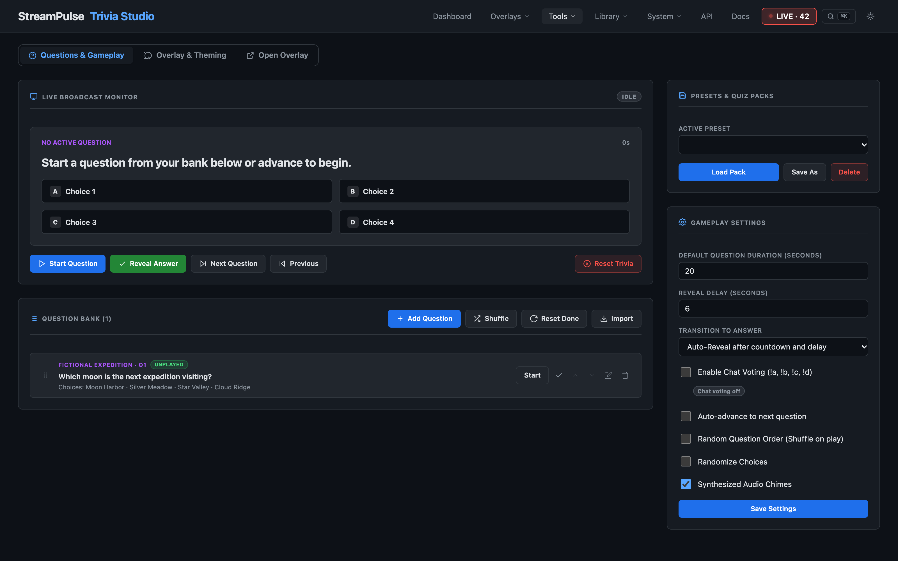

# Live Chat Trivia & Broadcast Overlays

StreamPulse includes an interactive Live Trivia Studio and broadcast OBS overlay featuring audience chat voting, true/false and multi-choice question formats, visual theme presets (including pure floating broadcast text), customizable typography, and Bitfocus Companion integration.

---

## 1. Overview & Key Capabilities

- **2 to 6 Choices & True/False Support**: Run standard 4-choice questions, rapid True/False binary votes, or nuanced 5–6 choice challenges.
- **Drag-and-Drop Question Reordering**: Rearrange questions seamlessly in the studio using native drag-and-drop handles or instant Up/Down shift buttons.
- **Played & Done Question Tracking**: Starting a question marks it Done. Played and manually completed marks survive restart and are skipped during randomized play. **Reset Unplayed** or **Reset Session** clears all marks.
- **Transition Control**: Automatically reveal after the countdown and a configurable delay, or use **Manual Transition** to reveal on cue. Auto-advance has its own answer display delay.
- **Distinct Visual Themes**:
  - **Modern**: Glassmorphism with rounded cards, neon cyan/purple accents, and subtle glowing borders.
  - **Pure Floating Text (Broadcast Style)**: Transparent floating typography with massive drop shadows, zero card boxes, staggered text entrances, and automatic collapse of incorrect answers on reveal.
  - **Arcade (8-Bit Retro)**: Sharp 0px corners, high-contrast black backgrounds, solid neon yellow borders, and chunky retro styling.
  - **Esports**: Angular polygon clip paths, carbon brushed backgrounds, and electric telemetry meters.
  - **Minimal**: Clean, low-distraction lower-third slate cards for casual talk shows and desktop streams.
- **Toggleable Overlay Elements**: Hide or show individual visual components (Category badge, Question Number, Countdown Timer bar, Choice Letter badges, Vote counts, Choice percentages, Chat hint bar, and Fun fact callout).
- **Audience Chat Voting**: Stream viewers vote in real time with `!a`, `!b`, `!c`, `!d`, `!e`, `!f`, `!true`, or `!false`. Each viewer has one changeable vote, tallied with percentage bars.
- **Chatbot Announcements**: Automatically post question openings and answer reveals with statistics to Twitch chat using customizable template tokens.
- **Preset Packs**: Save, load, and delete custom trivia question banks, or choose from built-in packs (*Video Game Classics*, *Pop Culture & Sci-Fi*, *Streaming Lore*).
- **Bitfocus Companion Integration**: Control question flow, reveals, done toggles, and preset selection directly from a Stream Deck.

---

## 2. Using the Trivia Studio

Open the studio at `http://localhost:3000/tools/trivia.html` or navigate to **Tools &rarr; Trivia Studio** in the StreamPulse navigation.

Gameplay controls apply with **Save Settings**. Disable **Enable Chat Voting** for presentation-only quizzes: incoming votes, automatic question/answer announcements, vote totals, and choice percentages disappear. The host can still start and reveal questions. Live vote updates do not overwrite unsaved settings or theme edits. **Synthesized Audio Chimes** controls overlay audio unless a `sound=0|1` URL override is supplied; a saved `soundVolume` of zero also mutes it.



### Managing Questions
1. **Add Question**: Click **Add Question** in the toolbar. Enter a category, question prompt, between 2 and 6 choices, designate the correct choice, and provide an optional fun fact or trivia explanation.
2. **True / False Questions**: For True/False questions, click the True/False toggle to populate two choices ("True" and "False"). The overlay and chatbot will accept both `!true`/`!false` and `!t`/`!f` votes.
3. **Reordering Questions**: Drag any question card by its drag handle to reorder the lineup, or click the **&uarr;** and **&darr;** buttons on each row.
4. **Done Status**: Click the **Done** badge or checkmark icon on any question to toggle its played state. Questions marked as Done are skipped when using **Random Order** or auto-advance. Click **Reset Unplayed** to clear all played marks.
5. **Bulk Import & Export (CSV & JSON)**: Click **Export CSV** or **Export JSON** to download your question bank for spreadsheet editing (Excel / Google Sheets) or full JSON backup. Click **Import** to upload or paste either CSV rows (with an optional downloadable **CSV Template**) or JSON arrays. CSV columns are `Category, Question, ChoiceA..ChoiceF, CorrectAnswer` (letter `A`–`F` or matching answer text), `FunFact, Duration, Points` — leave `ChoiceC`–`ChoiceF` blank for True/False rows.

### Controlling Gameplay
- **Start Question**: Click the play icon on any question row, or click **Start Question** on the active question card.
- **Reveal Delay**: Seconds to wait after the countdown reaches zero before **Auto-Reveal** shows the answer. Zero reveals immediately. Voting closes at zero, including during the delay.
- **Default Question Duration**: Applies to every question in the bank, regardless of durations embedded in imported or preset questions. An explicit API/Companion start duration can still override it.
- **Randomize Choices**: Shuffle answers each time a question starts, keeping the correct answer attached to its original choice. The saved bank remains unchanged. Turn this off to use the stored choice order.
- **Reveal Answer**: Click **Reveal Answer** to reveal immediately, bypassing any pending delay. **Manual Transition** never reveals automatically.
- **Auto-Advance Delay**: When Auto-advance is enabled, keep the revealed answer on screen for this separate duration before advancing. Existing saved answer-hold durations are retained in this setting.
- **Next / Previous**: Navigate questions sequentially or allow the studio to randomly select from unplayed questions.
- **Reset**: Click **Reset Session** to return the overlay to an idle state.
- **Clear Question**: In Manual Transition mode, hide the current question and stop pending transitions without resetting the bank or played marks. This is separate from Reset.

---

## 3. Overlay Theming & Interactive Live Preview

The Trivia Studio includes a dedicated **Theming & Preview** tab with an interactive, floating sticky preview column and zero-delay synchronization:
- **Floating Sticky Preview**: The live overlay canvas floats pinned to the top of the viewport on desktop screens so streamers can view real-time changes as they scroll down through color pickers, font options, and element visibility toggles.
- **Interactive Live Preview**: Custom colors, fonts, header sizes, and element visibility toggles update smoothly in real time without sluggish iframe reloads. Streamers can switch sample modes (Question vs Answer Reveal) and toggle simulated checkerboard or camera backdrops.
- **Broadcast Colors & Hex Opacity**: All color fields support native color pickers alongside paired hex inputs with 8-digit `#RRGGBBAA` transparency support (e.g. `#00000000` for pure invisible glass backplates).
- **Countdown Colors**: Customize the normal timer bar, warning color below 50%, and critical color below 25%. Save Theme applies them to live overlays.
- **Responsive Card Width**: Cards & Boxes supports **Card Max Width**, including `1400px`, `1600px`, `85vw`, or `100%`. Cards remain bounded by their viewport; narrow cards stack answer choices. Width and color preview edits do not reload the iframe.

The broadcast overlay is located at:
```text
http://localhost:3000/overlays/trivia.html
```

Add this URL as a Browser Source in OBS Studio at `1920x1080` (or `3840x2160`).

### Visual Styles & Typography Customization
- **Card Boxes vs Floating Text**: In the **Appearance & Themes** panel, switch the **Card Container Style** between:
  - `Cards & Boxes`: Standard framed card containers with backgrounds and borders.
  - `Pure Floating Text`: Eliminates all bounding boxes and background panels, rendering floating text directly over your camera or game capture with deep drop shadows.
  - Explicit `style=cards` always keeps boxes, including with the Floating Text theme. Existing OBS URLs containing `style=text` keep requesting text: replace it with `style=cards`, or copy the regenerated studio link.
- **Collapse Incorrect Choices**: When enabled in reveal mode, incorrect choices smoothly collapse and fade out, spotlighting the winning answer and fun fact.
- **Header Labels & Phase Titles**:
  - **Question & Answer Phase Titles**: Fully customizable phase titles (`?qlabel=Round 1`, `?alabel=Reveal`) displayed clean and unbordered at the top center of the card.
  - **Question Counter Formats**: Select between Full (`Question 1 of 5`), Compact (`1 of 5`), Slash (`1 / 5`), or Number Only (`Q1`).
  - **Phase Text Casing**: Configure UPPERCASE, Title Case (Capitalize), or As-Typed (None).
  - **Header Font Size**: Select from compact sizes (0.75rem / 12px) all the way up through Stadium scale (4.5rem / 72px), or enter any custom CSS size.
  - **Phase Title Typography & Colors**: Set independent font families and colors for Question (`?qcolor=...`) and Answer (`?acolor=...`) phases.
- **Visibility & Parameter Controls**: Configure parameters in the studio or pass them directly in the overlay URL:
  - `?theme=arcade`: Selects visual preset (`modern`, `broadcast-text`, `arcade`, `esports`, `minimal`, `neon`, `retro`).
  - `?style=text`: Forces pure floating text broadcast mode.
  - `?scale=1.2`: Scales overlay typography and elements.
  - `?qlabel=Question` & `?alabel=Answer`: Custom phase indicator labels.
  - `?cformat=full`: Question counter format (`full`, `compact`, `slash`, `number`).
  - `?ptransform=uppercase`: Phase text casing (`uppercase`, `capitalize`, `none`).
  - `?hsize=1.45rem`: Header font size (supports presets and custom CSS sizes like `2.5rem`, `48px`).
  - `?pfont=Rajdhani`: Custom font family for phase titles.
  - `?qcolor=#38bdf8` & `?acolor=#22c55e`: Phase title colors for question and reveal states.
  - `?cardbg=#1a202c`: Custom glass panel background color (supports `#RRGGBBAA`).
  - `?cardborder=#38bdf8`: Custom glass panel border color.
  - `?choicebg=#161b22`: Custom choice card background color.
  - `?cardwidth=1600px` or `?cardwidth=100%`: Cards & Boxes maximum width, bounded by the viewport.
  - `?timercolor=%2338bdf8`, `?timerwarningcolor=%23f59e0b`, `?timercriticalcolor=%23ef4444`: Countdown colors; override saved theme colors.
  - `?blur=16`: Custom backdrop blur radius (in px).
  - `?hintcolor=#f6e05e`: Custom color for chat voting instructions and keycap badges.
  - `?catcolor=#a855f7`: Custom category pill color.
  - `?qfont=Oswald` & `?qweight=800`: Question font family and weight (400–900).
  - `?cfont=Inter` & `?cweight=600`: Choice font family and weight (400–800).
  - `?hfont=Rajdhani` & `?hweight=700`: Header / category font family and weight.
  - `?ffont=Oswald` & `?fweight=700`: Did You Know? Fun fact font family and weight.
  - `?voting=0` / `?voting=1`: Controls chat voting mode. When the Chat Bot is turned off or chat voting is disabled, the overlay automatically conceals the voting badge, chat voting helper footer, and vote counter to keep the broadcast graphics clean.
  - `?phase=0` / `?phase=1`: Toggles the top phase indicator title.
  - `?category=0` / `?category=1`: Toggles the category pill.
  - `?counter=0` / `?counter=1`: Toggles the question counter.
  - `?timer=0` / `?timer=1`: Toggles the countdown progress bar.
  - `?letters=0` / `?letters=1`: Toggles the choice letter badges (A–F).
  - `?votes=0` / `?votes=1`: Toggles numerical vote totals.
  - `?percentages=0` / `?percentages=1`: Toggles percentage displays on choices.
  - `?hint=0` / `?hint=1`: Toggles the "!a / !b in chat" helper bar.
    Hints never appear when voting is disabled. An enabled hint remains visible during the question at zero, using **Answer choices** once voting has closed; it disappears on reveal.
  - `?funfact=0` / `?funfact=1`: Toggles fun fact callouts on answer reveal.
  - `?collapse=0` / `?collapse=1`: Toggles collapsing of incorrect choices on reveal.

---

## 4. Chatbot Announcements

StreamPulse can automatically announce trivia questions and answers in chat. Configure announcements under **Tools &rarr; Chat Bot &rarr; Settings &rarr; Trivia Announcements**:

Automatic announcements require active Trivia chat voting as well as the Chat Bot announcement controls. Turning off Chat Voting and saving settings also silences reveal announcements for a question already on screen. The Chat Bot's explicit test-announcement button remains a manual test.

### Available Tokens
- **Question Start Announcement**:
  - `{category}`: Category of the question (e.g. "Gaming").
  - `{question}`: Question text.
  - `{choices}`: Formatted list of choices (e.g. "A: Luigi | B: Wario").
  - `{commands}`: Valid vote commands (e.g. "!a, !b" or "!true, !false").
  - `{duration}`: Seconds remaining to vote.
- **Answer Reveal Announcement**:
  - `{question}`: Question text.
  - `{letter}`: Correct choice letter (e.g. "A").
  - `{answer}`: Correct answer text.
  - `{percent}`: Percentage of chat votes for the correct answer.
  - `{votes}`: Total votes cast.
  - `{correctVotes}`: Votes cast for the winning answer.
  - `{funfact}`: Fun fact explanation (if provided).

---

## 5. Bitfocus Companion Integration

The official [companion-module-streampulse](https://github.com/jarbochov/companion-module-streampulse) includes dedicated Trivia actions, feedbacks, and dynamic variables:

### Actions
- `trivia_start`: Start question by index (0-based) or active question with optional custom duration.
- `trivia_reveal`: Reveal the correct answer.
- `trivia_clear`: Clear the current question without resetting played marks.
- `trivia_next`: Advance to the next question (or pick a random unplayed question).
- `trivia_prev`: Go back to the previous question.
- `trivia_reset`: Reset active trivia session to idle.
- `trivia_toggle_done`: Toggle played/done state on the active question or a specific question ID.
- `trivia_reset_done`: Mark all questions as unplayed/not done.
- `trivia_load_preset`: Load a saved question preset pack.

### Dynamic Variables
- `$(streampulse:trivia_status)`: Active status (`idle`, `question`, `reveal`).
- `$(streampulse:trivia_active_question)`: Active question prompt text.
- `$(streampulse:trivia_active_category)`: Active question category.
- `$(streampulse:trivia_total_votes)`: Total chat votes cast on active question.
- `$(streampulse:trivia_remaining_seconds)`: Remaining countdown seconds.
- `$(streampulse:trivia_unplayed_count)`: Number of questions not yet played.
- `$(streampulse:trivia_total_questions)`: Total questions in bank.
- `$(streampulse:trivia_active_index)`: 1-based index of active question.

---

## 6. HTTP API Reference

All trivia endpoints support both standard REST methods and Companion-friendly `GET` triggers:

| Endpoint | Method | Description |
| :--- | :--- | :--- |
| `/api/trivia` | `GET` | Returns full trivia state. Pass `?includeAnswers=true` for admin view. |
| `/api/trivia/status` | `GET` | Lightweight status summary for Companion polling. |
| `/api/trivia` | `PUT` | Update runtime settings and/or theme properties. |
| `/api/trivia/question/start` | `POST`, `GET` | Start question. Parameters: `index`, `id`, `duration`, `manualTransition`, `autoReveal`. |
| `/api/trivia/question/reveal` | `POST`, `GET` | Reveal the correct answer and trigger fanfare. |
| `/api/trivia/question/clear` | `POST`, `GET` | Clear the overlay and pending timers without resetting played marks. |
| `/api/trivia/question/next` | `POST`, `GET` | Advance to next or random unplayed question. |
| `/api/trivia/question/previous` | `POST`, `GET` | Step back to previous question. |
| `/api/trivia/reset` | `POST`, `GET` | Clear active question and return overlay to idle. |
| `/api/trivia/question/toggle-done` | `POST`, `GET` | Toggle done/unplayed state on a question (`?id=...` or active). |
| `/api/trivia/question/done` | `POST` | Explicitly set done state (`{ id, done: true|false }`). |
| `/api/trivia/questions/reset-done` | `POST`, `GET` | Mark all questions as unplayed/done=false (alias: `/api/trivia/reset-done`). |
| `/api/trivia/questions` | `POST` | Add a new question to the bank. |
| `/api/trivia/questions/reorder` | `POST`, `PUT` | Save a new ordered array of question IDs. |
| `/api/trivia/questions/move` | `POST`, `GET` | Move a question up or down (`?id=...&direction=up\|down`). |
| `/api/trivia/questions/shuffle` | `POST`, `GET` | Randomly shuffle questions in the active bank (alias: `/api/trivia/shuffle`). |
| `/api/trivia/export` | `GET` | Export the question bank as JSON (`?format=json`) or CSV (`?format=csv`; alias: `/api/trivia/questions/export`). |
| `/api/trivia/import` | `POST` | Import questions from CSV spreadsheet text (`{ csv, replace }` or `text/csv`) or JSON (`{ questions, replace }`; alias: `/api/trivia/questions/import`). |
| `/api/trivia/leaderboard` | `GET` | Return ranked trivia standings (`?scope=season|session&sort=points|correct|accuracy&limit=10`). |
| `/api/trivia/leaderboard/player` | `GET` | Look up season & session stats for a player (`?user=name`). |
| `/api/trivia/leaderboard/reset` | `POST`, `GET` | Clear `session`, `season`, or `both` leaderboard stats (`?scope=session|season|both`). |
| `/api/trivia/leaderboard/export` | `GET` | Download leaderboard stats as JSON or CSV (`?scope=season|session&format=json|csv`). |
| `/api/trivia/leaderboard/import` | `POST` | Import leaderboard player records (`{ players, scope, replace }`). |
| `/api/trivia/leaderboard/theme` | `PUT`, `POST` | Save leaderboard overlay customization or pass `{ reset: true }` to restore defaults. |
| `/api/trivia/presets` | `GET`, `POST` | List presets or save active bank as a new preset. |
| `/api/trivia/presets/:id` | `GET`, `DELETE` | Load or delete a saved preset pack. |
| `/api/trivia/preset/load` | `POST`, `GET` | Load preset via query param (`?id=pop-culture` or `?id=gaming-classics`). |

---

## 7. Trivia Leaderboard & Player Stats

The **Leaderboard & Stats** tab in Trivia Studio tracks points, correct answers, accuracy percentages, and answer streaks across both **Season / All-Time** (persisted to `data/trivia-leaderboard.json`) and **Current Session** (in-memory) scopes.

- **Overlay URL**: `http://localhost:3000/overlays/trivia-leaderboard.html` (supports `?scope=season|session`, `?sort=points|correct|accuracy`, `?layout=full|sidebar|compact`, `?theme=modern|arcade|esports|minimal|broadcast-text`, `?limit=10`, `?title=...`, and column toggles `points`, `correct`, `accuracy`, `streak`, `header`).
- **Scoring & Speed Bonus**: Players are scored automatically once when an answer is revealed; optional **Speed Bonus** grants up to `+50%` extra points for faster correct answers.
- **Built-in Chat Commands**: Chatters can query stats anytime (including between questions) using `!triviastats` / `!tstats [@player]` and `!triviatop` / `!trivialeaderboard` `[session]`.
- **Placeholders**: `{{trivia.leader.name}}`, `{{trivia.leader.points}}`, `{{trivia.leader.correct}}`, `{{trivia.leader.accuracy}}`, and `{{trivia.leader.top3}}`.
