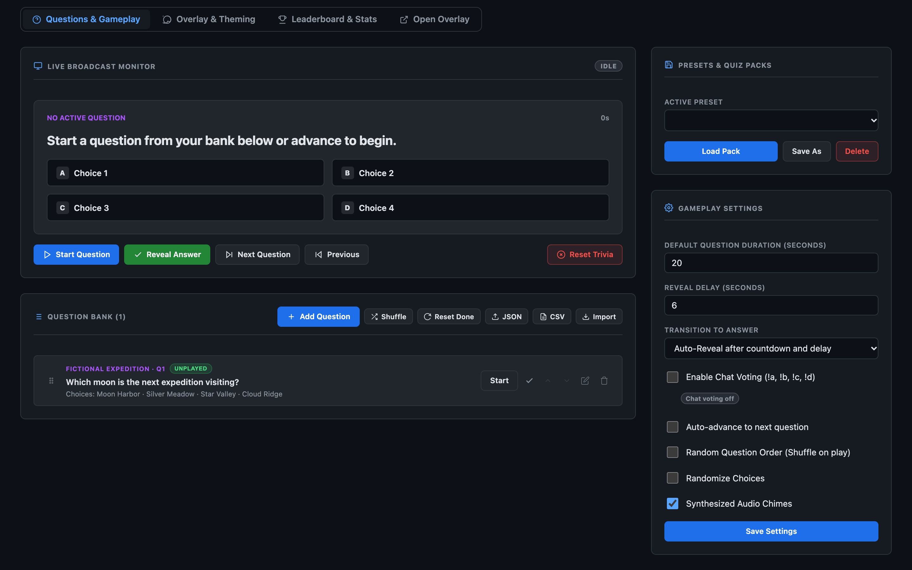

# Live Chat Trivia & Broadcast Overlays

StreamPulse includes an interactive Live Trivia Studio and broadcast OBS overlay featuring audience chat voting, true/false and multi-choice question formats, visual theme presets (including pure floating broadcast text), customizable typography, and Bitfocus Companion integration.

---

## 1. Overview & Key Capabilities

- **2 to 6 Choices & True/False Support**: Run standard 4-choice questions, rapid True/False binary votes, or nuanced 5–6 choice challenges.
- **Drag-and-Drop Question Reordering**: Rearrange questions seamlessly in the studio using native drag-and-drop handles or instant Up/Down shift buttons.
- **Played & Done Question Tracking**: Starting a question marks it Done. Played and manually completed marks survive restart and are skipped during randomized play. **Reset Unplayed** or **Reset Session** clears all marks.
- **Transition Control**: Automatically reveal after the countdown and a configurable delay, or use **Manual Transition** to reveal on cue. Auto-advance has its own answer display delay.
- **Distinct Visual Themes**:
  - **Modern**: Glassmorphism with rounded cards, neon cyan/purple accents, and subtle glowing borders.
  - **Pure Floating Text (Broadcast Style)**: Transparent floating typography with massive drop shadows, zero card boxes, staggered text entrances, and automatic collapse of incorrect answers on reveal.
  - **Arcade (8-Bit Retro)**: Sharp 0px corners, high-contrast black backgrounds, solid neon yellow borders, and chunky retro styling.
  - **Esports**: Angular polygon clip paths, carbon brushed backgrounds, and electric telemetry meters.
  - **Minimal**: Clean, low-distraction lower-third slate cards for casual talk shows and desktop streams.
- **Toggleable Overlay Elements**: Hide or show individual visual components (Category badge, Question Number, Countdown Timer bar, Choice Letter badges, Vote counts, Choice percentages, Chat hint bar, and Fun fact callout).
- **Audience Chat Voting**: Stream viewers vote in real time with `!a`, `!b`, `!c`, `!d`, `!e`, `!f`, `!true`, or `!false`. Each viewer has one changeable vote, tallied with percentage bars.
- **Chatbot Announcements**: Automatically post question openings and answer reveals with statistics to Twitch chat using customizable template tokens.
- **Preset Packs**: Save, load, and delete custom trivia question banks, or choose from built-in packs (*Video Game Classics*, *Pop Culture & Sci-Fi*, *Streaming Lore*).
- **Bitfocus Companion Integration**: Control question flow, reveals, done toggles, and preset selection directly from a Stream Deck.

---

## 2. Using the Trivia Studio

Open the studio at `http://localhost:3000/tools/trivia.html` or navigate to **Tools &rarr; Trivia Studio** in the StreamPulse navigation.

Gameplay controls apply with **Save Settings**. Disable **Enable Chat Voting** for presentation-only quizzes: incoming votes, automatic question/answer announcements, vote totals, and choice percentages disappear. The host can still start and reveal questions. Live vote updates do not overwrite unsaved settings or theme edits. **Synthesized Audio Chimes** controls overlay audio unless a `sound=0|1` URL override is supplied; a saved `soundVolume` of zero also mutes it.

### Managing Questions
1. **Add Question**: Click **Add Question** in the toolbar. Enter a category, question prompt, between 2 and 6 choices, designate the correct choice, and provide an optional fun fact or trivia explanation.
2. **True / False Questions**: For True/False questions, click the True/False toggle to populate two choices ("True" and "False"). The overlay and chatbot will accept both `!true`/`!false` and `!t`/`!f` votes.
3. **Reordering Questions**: Drag any question card by its drag handle to reorder the lineup, or click the **&uarr;** and **&darr;** buttons on each row.
4. **Done Status**: Click the **Done** badge or checkmark icon on any question to toggle its played state. Questions marked as Done are skipped when using **Random Order** or auto-advance. Click **Reset Unplayed** to clear all played marks.
5. **Bulk Import & Export (CSV & JSON)**: Click **Export CSV** or **Export JSON** to download your question bank for spreadsheet editing (Excel / Google Sheets) or full JSON backup. Click **Import** to upload or paste either CSV rows (with an optional downloadable **CSV Template**) or JSON arrays. CSV columns are `Category, Question, ChoiceA..ChoiceF, CorrectAnswer` (letter `A`–`F` or matching answer text), `FunFact, Duration, Points` — leave `ChoiceC`–`ChoiceF` blank for True/False rows.

### Controlling Gameplay
- **Start Question**: Click the play icon on any question row, or click **Start Question** on the active question card.
- **Reveal Delay**: Seconds to wait after the countdown reaches zero before **Auto-Reveal** shows the answer. Zero reveals immediately. Voting closes at zero, including during the delay.
- **Default Question Duration**: Applies to every question in the bank, regardless of durations embedded in imported or preset questions. An explicit API/Companion start duration can still override it.
- **Randomize Choices**: Shuffle answers each time a question starts, keeping the correct answer attached to its original choice. The saved bank remains unchanged. Turn this off to use the stored choice order.
- **Reveal Answer**: Click **Reveal Answer** to reveal immediately, bypassing any pending delay. **Manual Transition** never reveals automatically.
- **Auto-Advance Delay**: When Auto-advance is enabled, keep the revealed answer on screen for this separate duration before advancing. Existing saved answer-hold durations are retained in this setting.
- **Next / Previous**: Navigate questions sequentially or allow the studio to randomly select from unplayed questions.
- **Reset**: Click **Reset Session** to return the overlay to an idle state.
- **Clear Question**: In Manual Transition mode, hide the current question and stop pending transitions without resetting the bank or played marks. This is separate from Reset.

---

## 3. Overlay Theming & Interactive Live Preview

The Trivia Studio includes a dedicated **Theming & Preview** tab with an interactive, floating sticky preview column and zero-delay synchronization:
- **Floating Sticky Preview**: The live overlay canvas floats pinned to the top of the viewport on desktop screens so streamers can view real-time changes as they scroll down through color pickers, font options, and element visibility toggles.
- **Interactive Live Preview**: Custom colors, fonts, header sizes, and element visibility toggles update smoothly in real time without sluggish iframe reloads. Streamers can switch sample modes (Question vs Answer Reveal) and toggle simulated checkerboard or camera backdrops.
- **Broadcast Colors & Hex Opacity**: All color fields support native color pickers alongside paired hex inputs with 8-digit `#RRGGBBAA` transparency support (e.g. `#00000000` for pure invisible glass backplates).
- **Countdown Colors**: Customize the normal timer bar, warning color below 50%, and critical color below 25%. Save Theme applies them to live overlays.
- **Responsive Card Width**: Cards & Boxes supports **Card Max Width**, including `1400px`, `1600px`, `85vw`, or `100%`. Cards remain bounded by their viewport; narrow cards stack answer choices. Width and color preview edits do not reload the iframe.

Add the broadcast overlay (`http://localhost:3000/overlays/trivia.html`) as a Browser Source in OBS Studio at `1920x1080` (or `3840x2160`).

### Visual Styles & Typography Customization
- **Card Boxes vs Floating Text**: In the **Appearance & Themes** panel, switch the **Card Container Style** between:
  - `Cards & Boxes`: Standard framed card containers with backgrounds and borders.
  - `Pure Floating Text`: Eliminates all bounding boxes and background panels, rendering floating text directly over your camera or game capture with deep drop shadows.
  - Explicit `style=cards` always keeps boxes, including with the Floating Text theme. Existing OBS URLs containing `style=text` keep requesting text: replace it with `style=cards`, or copy the regenerated studio link.
- **Collapse Incorrect Choices**: When enabled in reveal mode, incorrect choices smoothly collapse and fade out, spotlighting the winning answer and fun fact.
- **Header Labels & Phase Titles**: Customize phase titles (`Question` / `Answer`), counter formats (`Question 1 of 5`, `1 of 5`, `1 / 5`, `Q1`), uppercase or Title Case styling, custom fonts, and phase colors directly from the Studio's **Appearance & Themes** panel — or click **Copy URL** to get an OBS Browser Source link with your exact toggles (theme, scaling, element visibility, countdown colors, and fonts) baked in. *(See the [API Reference](api-reference.md) for every URL query option.)*

---

## 4. Chatbot Announcements

StreamPulse can automatically announce trivia questions and answers in chat. Configure announcements under **Tools &rarr; Chat Bot &rarr; Settings &rarr; Trivia Announcements**:

Automatic announcements require active Trivia chat voting as well as the Chat Bot announcement controls. Turning off Chat Voting and saving settings also silences reveal announcements for a question already on screen. The Chat Bot's explicit test-announcement button remains a manual test.

### Available Tokens
- **Question Start Announcement**:
  - `{category}`: Category of the question (e.g. "Gaming").
  - `{question}`: Question text.
  - `{choices}`: Formatted list of choices (e.g. "A: Luigi | B: Wario").
  - `{commands}`: Valid vote commands (e.g. "!a, !b" or "!true, !false").
  - `{duration}`: Seconds remaining to vote.
- **Answer Reveal Announcement**:
  - `{question}`: Question text.
  - `{letter}`: Correct choice letter (e.g. "A").
  - `{answer}`: Correct answer text.
  - `{percent}`: Percentage of chat votes for the correct answer.
  - `{votes}`: Total votes cast.
  - `{correctVotes}`: Votes cast for the winning answer.
  - `{funfact}`: Fun fact explanation (if provided).

---

## 5. Bitfocus Companion & Technical API

The official [companion-module-streampulse](https://github.com/jarbochov/companion-module-streampulse) includes dedicated Trivia actions, feedbacks, and dynamic variables (`Start`, `Reveal`, `Clear`, `Next`, `Previous`, `Reset`, `Toggle Done`, `Load Preset`).

For Companion button setup or full HTTP endpoints, see **[Bitfocus Companion](companion.md)** or open **API Reference** from the StreamPulse app navigation.

---

## 6. Trivia Leaderboard & Player Stats

The **Leaderboard & Stats** tab in Trivia Studio tracks points, correct answers, accuracy percentages, and answer streaks across both **Season / All-Time** and **Current Session** scopes:

- **Leaderboard Overlay**: Customize layout, visual theme, colors, scale, and visible columns under **Overlay & Theming → Leaderboard Overlay** and copy the generated OBS link.
- **Scoring & Speed Bonus**: Players are scored automatically once when an answer is revealed; optional **Speed Bonus** grants up to `+50%` extra points for faster correct answers.
- **Built-in Chat Commands**: Chatters can query stats anytime using `!triviastats` / `!tstats [@player]` and `!triviatop` / `!trivialeaderboard` `[session]`.
