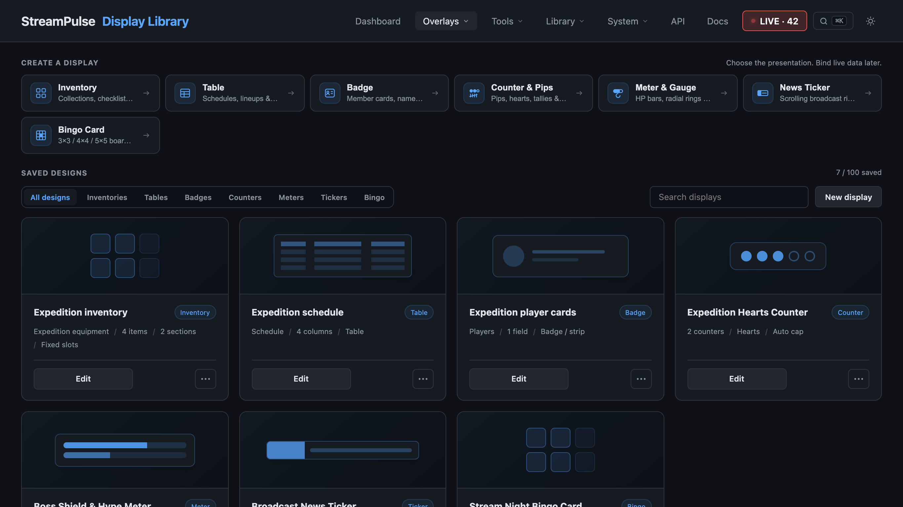
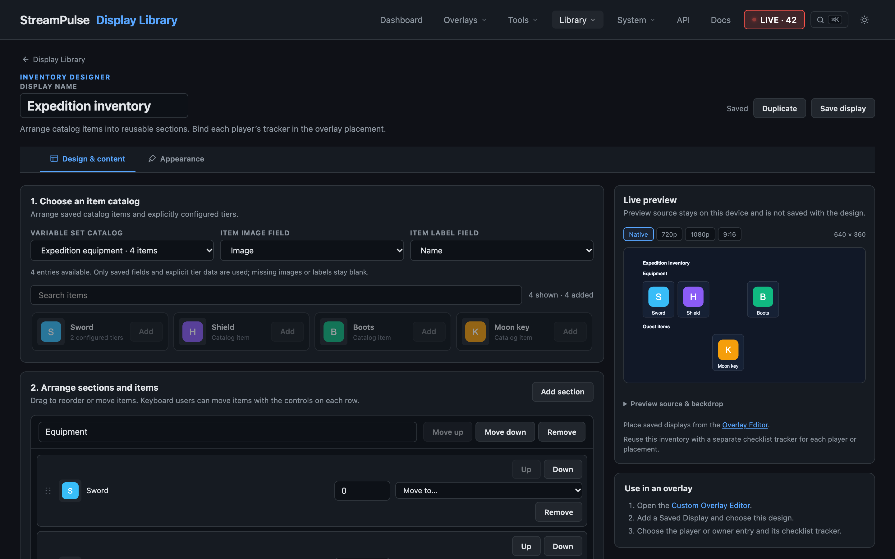
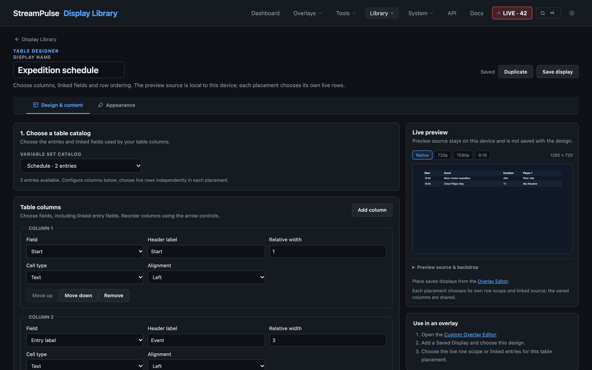
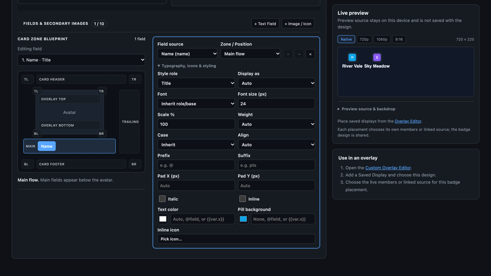

# Reusable inventories, tables, badges, counters, meters, tickers and bingo

Build a display once in **Overlays → Display Library**, then place it in any Custom Overlay. Choose **Inventory**, **Table**, **Badge**, **Counter & Pips**, **Meter & Gauge**, **News Ticker**, or **Bingo Card**. Each placement can follow different live data while sharing the same arrangement and appearance.

  <figure>
    
    <figcaption><strong>Display Library</strong>Create shared Inventory, Table, and Badge layouts to reuse across scenes.</figcaption>
  </figure>
  <figure>
    
    <figcaption><strong>Inventory Builder</strong>Arrange items, sections, and upgrade tiers for live co-op or RPG overlays.</figcaption>
  </figure>
  <figure>
    
    <figcaption><strong>Table Builder</strong>Turn a Variable Set into a structured schedule, scoreboard, or leaderboard grid.</figcaption>
  </figure>
  <figure>
    
    <figcaption><strong>Badge &amp; Strip Builder</strong>Design member nameplates and call-in strips linked to live speakers or rosters.</figcaption>
  </figure>

**Variable Sets own the data.** Your equipment catalog contains reusable item names, images and optional upgrade levels. Each person's Tracker contains only that person's progress.

**The display owns the design.** Choose catalog items, put them in order, and organize them into named sections. Auto Grid packs items in that order. Fixed Slots keeps intentional gaps, so a missing item never moves another item into its place. Appearance controls are specific to those items, table cells or member badges.

**The overlay owns the placement.** Choose the saved design and whose tracker to follow, then position and resize it. Use the Custom Overlay Editor for overall opacity, outer borders, shadows and other placement effects, not the library. Text, borders and images scale together. Saving a shared design updates every placement; it does not reset anyone's progress.

## Two players, one design

1. In **Variables Studio → Sets**, create an Equipment catalog with Name and Image fields. Add your items and optional explicit upgrade labels/images.
2. Create People with an Equipment **Tracker** targeting that catalog. Add your players. Their progress maps are independent.
3. Optionally create Schedule with Player 1 and Player 2 **Linked entry** fields targeting People. Assign the players to an event and select that event in Schedule's first slot.
4. Open **Display Library**, create an Inventory design, choose Equipment, and add items. Reorder them, create sections, or choose Fixed Slots. Set columns, spacing and appearance; save.
5. In **Custom Overlay Editor → + Add → Saved Display**, choose your design. For the source, choose Schedule, Active entry, Player 1, and the Equipment tracker. Duplicate the element and choose Player 2 on the duplicate. Alternatively follow a fixed Person or occupied People slot directly.
6. Save the overlay and add its browser-source URL to OBS. Change progress in **Variable Set Operator → Tracker**, or use Companion's existing Tracker set/step/toggle/reset actions. Reassigning a Schedule role changes the displayed owner without changing People's live slots.

An unassigned role, missing catalog/design, incompatible tracker, or disabled Variable Sets module hides the production display instead of showing the wrong inventory. Whole catalog mode has no owner and shows the arranged items without progress filtering.

Show all items with unearned ones dimmed, or show earned items only. Auto Grid closes gaps in earned-only mode; Fixed Slots preserves the original cell positions. Fixed cells are zero-based, row-major within each section: cell 0 is the first position, cell 5 the sixth. Changing columns wraps those cell numbers onto the new grid without changing item order.

Preview owner and backdrop choices are local preferences, not shared design settings. Previewing a different player does not change anyone's progress or live selection.

## Tables for schedules and structured data

Create a **Table**, choose a Variable Set, then select and reorder its columns. A schedule might show Start, Event, Duration and Player 1's name. Linked Person fields read shared definitions directly: reassigning the role updates the row without copying a person's details into the schedule.

Choose column labels, proportions, alignment and presentation for text, images, colors or toggles. Arrange rows manually or sort by a field. In the overlay, choose all enabled entries, the active entry, occupied slots, grouped entries or explicitly ordered rows. A linked-entry list can supply a curated lineup. These are row selections, not inventory Trackers.

## Badge design belongs in the library

Choose **Badge** for reusable member cards and strips. Badge fields, images, zones, presets, typography and visual styling live in Display Library rather than an overlay dialog. Place a Saved Display and choose its live source in the overlay inspector; use **Edit display** to return to the designer.

The **Card Zone Blueprint** follows the selected badge layout and avatar visibility. Choose an editing field or click its pill, then click a zone to move it. On laptop screens the blueprint and live preview have wider columns around a compact field inspector, so the map does not consume the field editor's height. Narrower screens stack the panels. **Strip** arranges multiple badges; **Appearance** styles the member cards, avatars and field defaults.

Existing badge/strip layers are migrated to reusable designs while their placement-specific sources and geometry remain with the overlay. Sharing one design between scenes no longer requires separately maintaining every copy's field layout.

There is no separate Group Strip creation or editing workflow in Custom Overlay Editor. **Badge** designs cover both single cards and multi-member strips. Existing source settings are converted to the same source controls used by new Saved Displays, not kept in a hidden alternate configuration.

### Understand the live source

The source panel shows a readable path, for example **Schedule → Active entry → Player 1 → Equipment**, the resolved owner and the number of enabled items. Empty selections explain what to assign or enable in Variable Set Operator. These diagnostics appear only in editors, never on a production overlay.

For Table and Badge, choose a source set and **Linked members** to select one or several single-entry/list fields targeting the design catalog. Linked lists retain their explicit order, repeated entries appear once, and links never change the target set's live slots. Alternatively choose All enabled entries, Active entry, Live slots, In Group entries, or In Group live slots. Tables also support Saved row order only. A single linked-role path resolves one member. Badges can follow a compatible Progress tracker, with dimmed inactive or active-only items.

**Enabled** has the same meaning for Inventory, Table and Badge: disabled entries are excluded. It is separate from **In Group** (membership selection), live slots (on-air selection), and tracker levels (per-owner progress). Fixed inventory slots retain intentional gaps when an entry is disabled.

### Remove a design safely

Deleting a display first checks saved overlays and presets and names the placements using it. Remove or replace those placements before deleting the design.

## Backups and sharing

Saved displays, placements, and uploaded artwork are all included together when you create a **full backup** in **System → Backups**. (Standalone overlay export bundles cannot include external Saved Display references; use a full backup when transferring linked displays between setups.)

For developer details and dependency-check contracts, see [Variable Operations](variable-operations.md) or open **API Reference** in the StreamPulse app navigation.

## Counter & Pips displays

Use **Counter & Pips** to visualize live **Counter** / **Number** variables or numeric fields in a **Variable Set** as:

- **Markers**: Pips, **Hearts** (solid filled + crisp outlined empty hearts), Stars, Diamonds, Squares, or Bars.
- **Tally Marks**: Classic 5-count tallies (`||||` with a diagonal slash through every 5th mark) in clean vector (`tally`) or organic chalk (`tally-chalk`) styles.
- **Numeric Readout**: Optional fraction (`2 / 3`), value (`7`), or text (`2 of 3`) readout alongside or instead of markers.

### Caps & dynamic growth

- **Auto**: Uses the counter variable's (or Variable Set numeric field's) configured `max` cap when set (rendering empty outlined slots up to the cap); uncapped variables grow dynamically as counts increase. You can configure `Min`, `Cap / Max`, and `Step` directly on Variable Set `counter` and `number` fields in **Placeholders & Variables → Sets**.
- **Custom cap**: Forces a fixed slot cap (`1`–`100`) with configurable overflow behavior (`+N` badge, extra overflow-colored markers, or clamped at cap).
- **Uncapped**: Always grows dynamically, wrapping cleanly at your configured markers-per-row limit.

### Broadcast themes

Switch to the **Appearance** tab to pick from 7 built-in broadcast themes (**Modern Glass**, **Esports Broadcast**, **Broadcast Sports**, **Retro Arcade**, **Minimal HUD**, **RPG Hearts**, and **Chalkboard**), then customize any color, marker size, stroke width, padding, or animation.

### Operating live counters

Pin any saved Counter & Pips display directly onto an **Operator Mode** Live Board using the **Counter & Pips Display** card type for one-click `-1` / `+1` / `Reset` controls with a live mini pip/heart/tally preview (supporting both standalone variables and Variable Set roster fields), or drive them from Bitfocus Companion and Chat Bot commands.

## Meter & Gauge displays

Use **Meter & Gauge** to turn live `counter` / `number` variables or Variable Set numeric fields into animated broadcast meters:

- **Styles**: **HP / Progress Bar** (with optional delayed white/tinted damage-drain trail when values drop), **Segmented Bar** (discrete ticks), **Radial Ring Gauge**, or **Vertical Bar**.
- **Readouts & Thresholds**: Display fractions (`75 / 100`), percentages (`75%`), both, raw values, or clean label-only bars. Enable **Color Thresholds** to automatically shift fill colors across healthy, mid-warning, and low-danger zones.
- **Themes & Uniform Layout**: Pick from 6 built-in themes (**Modern Glass**, **Esports Broadcast**, **Broadcast Sports**, **Retro Arcade**, **Minimal HUD**, and **Cozy**) with non-clipping CSS Grid layouts, per-player `@color` bindings, and live **Meter & Gauge Controls** cards in **Operator Mode**.

## News Ticker displays

Use **News Ticker** to create GPU-composited, infinitely scrolling broadcast ribbons powered by either a **List** variable or any **Variable Set** roster:

- **Live Sources**: Stream headline items from a `list` variable or from Variable Set entries (all enabled, active entry, live slots, or In Group entries), with optional primary label, subtitle field, and thumbnail/icon field.
- **Styling & Themes**: Choose from 5 built-in themes (**Esports Broadcast**, **Broadcast Sports**, **Modern Glass**, **Retro Arcade**, and **Minimal HUD**), configurable scroll speed, item separators (`dot`, `diamond`, `slash`, `bar`, or `none`), and an optional pinned headline badge.
- **Operator Control**: Pin a **News Ticker Feed** card in **Operator Mode** to review or edit live headlines mid-stream without opening the Display Library.

## Bingo Card displays

Use **Bingo Card** to build interactive **3×3**, **4×4**, or **5×5** Stream Bingo boards that can be placed straight into any Custom Overlay:

- **Prompt Sources**: Enter custom prompts line-by-line, bind to a **List** variable, or draw from a **Variable Set** (with optional item artwork on each square).
- **Gameplay & Stamp Styling**: Configure the optional center **Free Space** label, top header text, **BINGO!** win banner, 5 stamp styles (`dauber`, `check`, `x`, `star`, `fill`), and 7 themes (**Modern**, **Esports**, **Sports**, **Arcade**, **Minimal**, **Cozy**, **Chalkboard**). Completed rows, columns, and diagonals highlight automatically.
- **Live Stamping & Companion**: Stamp squares, shuffle prompts, or reset the card from a **Bingo Stamp Card** widget in **Operator Mode** or via Bitfocus Companion (`/api/variable-displays/:id/bingo/toggle`, `/shuffle`, `/reset`). For multi-player co-op or Lockout bingo races over your local network, see [Multiplayer Bingo (LAN)](multiplayer-bingo.md).
