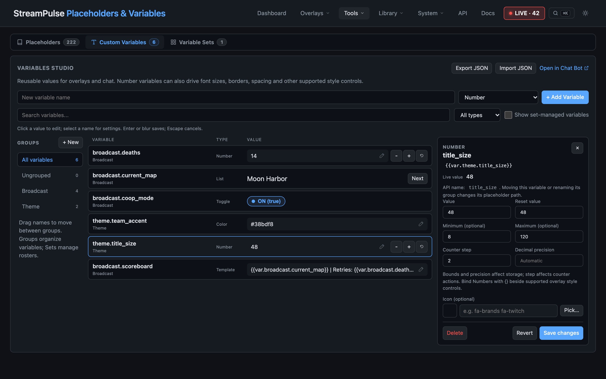
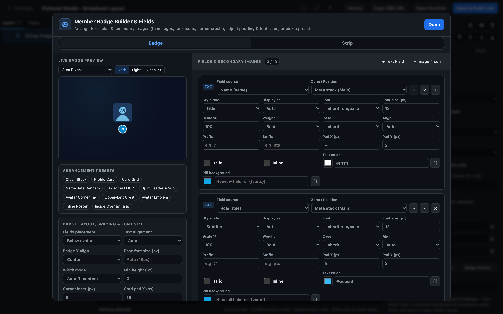
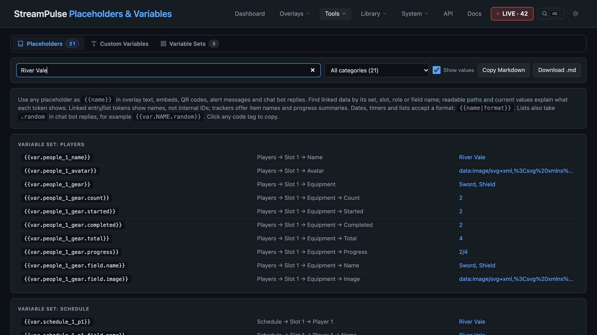

# Custom Variables & Variable Sets

Custom Variables let you create live, shared broadcast tokens (`{{var.name}}`) that update instantaneously across **Custom Overlays**, **Alert Studio**, **Promos**, and **Bitfocus Companion** without editing overlay layouts mid-stream.

**Variable Sets** extend this with structured multi-field rosters, reusable linked entries, per-owner progress, live per-slot tokens and dynamic group strings. Build reusable inventories, tables and member cards/strips in **Display Library**, then place them in Custom Overlays using **Saved Display**.



---

## 1. Global Custom Variables

Manage global variables in **Admin -> Variables** (or open the Variables drawer inside the **Custom Overlay Editor**).

### Variable Types

| Type | Behavior | Common Uses |
| :--- | :--- | :--- |
| **counter** | Integer with optional `min`, `max`, `step`, and `resetValue` | Death counters, win streaks, round trackers |
| **number** | Numeric value supporting decimals (`precision`) and bounds | Scores, speedrun splits, K/D ratios |
| **text** | Free-form single-line or short string | Current game, stream topic, guest name |
| **list** | Ordered array of choices that can be cycled or rolled | Map pool, challenge wheel, trivia topics |
| **image** | Image URL or uploaded asset path | Sponsor logo, team crest, active emote |
| **toggle** | Boolean (`true` / `false`) that flips via API or Companion | Co-op mode, mic status, sub-only flag |
| **color** | Hex / Hex-Alpha color (`#RRGGBB` or `#RRGGBBAA`) | Team color, theme accent, alert border tint |
| **template** | Composite text formula referencing other `{{var.*}}` tokens | Scoreboards (`{{var.home}} - {{var.away}}`) |
| **font** | Font family name for dynamic typography | Per-segment theme font switching |
| **date** | Local calendar date, with a date picker | Broadcast date or deadline |
| **time** | Local time of day, with a time picker | Doors open or show start |
| **datetime** | Local date and time, with a combined picker | Scheduled event start |
| **duration** | Fixed duration text such as `45m` or `1:30:00` | Estimated run time or segment length |

These temporal types are available both here and in Variable Sets. Create one from **Add Variable**, edit its value inline, or select its name to open the inspector. The type filter includes each type. Values stay as entered (no automatic timezone conversion or countdown); `{{var.show_date}}` or `{{var.run_duration}}` can be inserted through the usual placeholder picker. Links and trackers belong to Variable Sets, not standalone Variables.

### Using Variables in Overlays & Alerts

#### Group-qualified paths

Ordinary grouped variables use `{{var.<group_namespace>.<name>}}`. For example, `accent` in **Theme** becomes `{{var.theme.accent}}`; **Broadcast Theme** becomes `broadcast_theme`. Namespaces lowercase the group name, remove common accent marks, replace runs of spaces/punctuation with underscores, trim edge underscores and limit the result to 60 characters. Group namespaces must contain ASCII letters/numbers/underscores, cannot be empty or duplicate another group's namespace, and cannot shadow an ungrouped or set-generated variable root. Variable names remain globally unique.

The Variables list, inspector, reference and all typed placeholder pickers show the qualified path and search its group/name. Image, Color and Font bindings use that same token; Number bindings store `theme.size` without `var.`. List random and icon suffixes follow the path: `{{var.theme.topic.random}}`, `{{var.theme.accent.icon}}`. Templates can reference grouped paths.

**Breaking change:** grouped variables no longer expose `{{var.accent}}`. Moving a variable or renaming its group changes its path immediately, with no aliases, automatic reference rewrites or migration. Update saved overlay text, image/color/font tokens, templates, chat messages and Number bindings yourself. Existing values are not changed. Ungrouped `{{var.name}}` and Variable Set tokens are unchanged.

API records expose `name` (unchanged storage/control identity) and `key` (derived placeholder path). For example:

```json
{ "name": "accent", "key": "theme.accent", "group": "Theme", "type": "color", "value": "#38bdf8" }
```

1. Create **Theme** through **New Group**, then create a Color variable with API name `accent` in that group.
2. Select it in an overlay's color placeholder picker to insert `{{var.theme.accent}}`; use the image/font/Number pickers for their respective types. OBS overlay URLs do not change.
3. Use `PUT` or `POST /api/variables/accent` with JSON `{"value":"#a78bfa"}` (or `GET /api/variables/accent?plain=1` to read it). Never put the group prefix in this API name.
4. Manage group membership/renaming with `POST /api/variables/groups/manage`, e.g. `{"name":"Theme","variables":["accent"],"createOnly":true}` for creation or `{"name":"New Theme","originalName":"Theme","variables":["accent"]}` for rename. GET is not a group-mutation trigger. Success returns `{group,variables,groups}`; invalid names, namespace collisions or members return HTTP 400 `{error}` without a partial group edit.
5. In Companion, select the variable whose label shows `theme.accent`; its module ID remains `$(streampulse:var_accent)` and actions take `accent`. Generic placeholder lookup uses `var.theme.accent`. After a move/rename, manually update any StreamPulse placeholder references.

Insert any variable into a **Text** element, **Image** URL, or **Color** field using double curly braces:

```text
{{var.deaths}}
{{var.score}}
{{var.guest_name}}
```

#### Fallback Values

Provide a default fallback with `|` in case a variable is empty or not yet initialized:

```text
{{var.guest_name|Solo Stream}}
{{var.sponsor_tagline|Support the channel!}}
```

#### Dynamic Actions

Counter, number, list, and toggle variables support instant live mutations from the Admin UI, Companion buttons, or HTTP endpoints:

- **Increment / Decrement**: Adds or subtracts `step` (respecting `min` / `max` bounds).
- **Reset**: Restores `resetValue` (or `initial`).
- **Roll**: Picks a random item from a `list` variable.
- **Toggle**: Flips a `toggle` variable between `true` and `false`.

---

## 2. Multi-Field Variable Sets

When tracking people, teams, or sponsors with multiple attributes (name, avatar, role, social handle, accent color, badge icon), use a **Variable Set** instead of juggling dozens of separate global variables.

Enable the module in **Settings -> Feature Modules** (`variable_sets_enabled`), then open **Admin -> Variables -> Variable Sets**.


### Defining Schema Fields

Each Variable Set defines its own custom fields:

| Field Type | Description |
| :--- | :--- |
| **text** | Display name, handle, role, or short bio |
| **number** | Numeric value (score, rank, seed, or rating) |
| **counter** | Live integer counter with inline `-1` / `+1` steppers |
| **image** | Avatar portrait, emblem, or secondary badge icon |
| **icon** | Font Awesome icon class (`fa-solid`, `fa-brands`, etc.) |
| **color** | Per-member accent or badge color (`#RRGGBB` / `#RRGGBBAA`) |
| **toggle** | Boolean flag (e.g., `verified`, `captain`, `muted`) |
| **font** | Per-member font family override |
| **list** | Multi-line item list (one entry per line) |
| **template** | Dynamic text composed from other fields via `@fieldKey` (e.g., `@name (@role)`) |
| **date / time / datetime** | Calendar date, local time, or local date and time |
| **duration** | Duration such as `45m` or `1:30:00` |
| **Linked entry (`ref`)** | Choose one reusable entry from a linked set (`targetSet`); stores its entry ID |
| **Linked entries (`ref_list`)** | Search and select several reusable entries; stores an array of entry IDs |
| **Tracker (`checklist`)** | Each owner keeps a current level map `{ "item_id": 2 }` for items in a linked set. Zero is not owned / not completed; no history is stored |

You can import and export Variable Set entries via **CSV** directly from the Variable Sets panel (`GET /api/variables/sets/:setId/export` and `POST /api/variables/sets/:setId/import`).

### Variable Set Operator Console (`/operator.html`)

For fast live-show updates, open **Operator Grid** on any Variable Set (or navigate to `/operator.html#<setId>` — or the unified **Variables** tab in [Operator Mode](operator-guide.md)) to edit all entries and fields in a dense, spreadsheet-style console with live WebSocket sync:

- **Inline Field Editing**: Edit values directly, including native date/time controls, a Linked entry dropdown, and a searchable checkbox picker for Linked entries.
- **Tracker**: Select the tracker field to see reusable items as rows and their owners as columns. Click / Enter cycles `0 -> 1 -> ... -> maximum -> 0`; right-click or Shift+Enter decrements. Each item's explicit upgrade levels determine its maximum; **Default levels** applies to items without custom levels. **Reset** clears one owner's selected tracker, while **Reset everyone** clears it for all owners, including hidden owners, after confirmation. Other trackers and item definitions are untouched.
- **Column Chooser & Reordering**: Click **Columns** to show/hide specific schema fields or built-in columns (Entry, Slots, Group, Enabled) and move columns up or down.
- **Sorting**: Click any sortable column header to cycle ascending/descending order across entry names, slot assignments, numeric counters, booleans, and text fields.
- **Saved Layouts**: Save named column visibility, column order, and sort configurations per Variable Set (`localStorage`) and switch between operator presets in one click.

### Slots, Queues & Shorthand Tokens

A Variable Set supports **0 or more active slots** (`slotCount`):

- **1+ Slots** (e.g., Spotlight / Host & Guest): Assign entries to numbered slots (`Slot 1`, `Slot 2`, ...) or give slots custom names (e.g., `Host`, `Guest`).
- **0 Slots (Group Roster Only)**: Skip numbered slot assignment and use **In Group** membership or explicit linked members as the source for a saved display.

For a set with ID `squad` and fields `name`, `avatar`, `role`, and `accent`, StreamPulse automatically materializes the following live tokens:

- **Numbered Slot Tokens**: `{{var.squad_1_name}}`, `{{var.squad_1_avatar}}`, `{{var.squad_1_slot_name}}`, `{{var.squad_1_active}}`
- **Slot 1 Shorthand**: `{{var.squad_name}}`, `{{var.squad_avatar}}` (mirrors Slot 1 for quick single-spotlight overlays)
- **Named Slot Aliases**: If Slot 2 is named `Guest`, you can reference `{{var.squad_guest_name}}` and `{{var.squad_guest_avatar}}`
- **Linked fields**: Use the placeholder picker for readable paths such as **Squad → Guest → Partner → Name**. `{{var.squad_2_partner.field.name}}` reads the linked Name field; repeat `.field.<key>` for nested links, up to four reference hops. Linked target edits refresh the result without changing linked sets' slots.
- **Group Summary Tokens**:
  - `{{var.squad_group}}`: Formatted text list of all entries marked **In Group**
  - `{{var.squad_group_count}}`: Total count of active **In Group** entries
  - `{{var.squad_group_members}}`: Comma-separated list of active member names
  - `{{var.squad_group_<field>}}` / `{{var.squad_joined_<field>}}`: Delimited list of a single field across all group members

### Rotation & Studio Sets Follow

Variable Sets include a built-in **Timed Rotation** controller (`intervalSeconds`, `mode`, `transition`, `durationMs`) to cycle through queued or enabled entries automatically:

- **Rotation Modes**: Cycle `enabled` entries or work through the dedicated **Queue** (`queue/add`, `queue/remove`, `queue/clear`).
- **Shift / Advance**: Call `advance?mode=shift` or `rewind?mode=shift` to cascade slots (e.g., moving Slot 2 into Slot 1 while pulling the next queued entry into Slot 2).
- **Studio Sets Follow**: In **Custom Overlay Editor**, enable follow toggles so spotlight elements automatically track the currently rotating or active slot.

---

## 3. Saved Badges, Strips & Linked Sources

Create a **Badge** in **Library → Display Library**, choose its Variable Set, and design the member cards/strip there. Add a **Saved Display** in Custom Overlay Editor and select that design plus its live source. Existing Image Group layers migrate to saved designs; badge design is no longer an overlay dialog.



### Linked sources & trackers

In the Saved Display's Content panel, choose the source for your saved Badge:

- **Members**: Choose All enabled entries, Active entry, Live slots, In Group entries or In Group live slots. **Enabled** controls eligibility for every display type; **In Group** and live slots are independent selections.
- **Linked members**: Choose a source set and its active entry, named/numbered slot or fixed entry. Check one or more single-entry/list fields targeting the design catalog. Lists retain their explicit order; repeated members appear once, including entries not marked In Group. Optional **Linked role** controls follow up to four single-entry links before choosing members or a tracker.
- **Progress tracker**: Choose an owner's source and a compatible tracker. **Untracked items** can be dimmed or shown only when active. Item upgrade definitions supply current labels/images with base-value fallbacks; no special field-name conventions are needed.

The source summary shows a readable path, resolved owner and enabled item/member count. An empty selection explains what to assign in Operator. This guidance is editor-only; production overlays remain clean. Group Strip is no longer a separate element or inspector workflow.

An empty or deleted source entry shows no linked entries, rather than falling back to the full catalog. Editing a shared person's avatar or an item's level definition updates every consumer; assignments and per-owner progress remain separate.

#### Example: schedule roles or production assignments

1. Create a **People** set (`people`) with Name and Avatar fields and add your reusable people.
2. Create a **Schedule** set (`schedule`) with Date, Time, Duration, Game, Image and Linked entry fields `player_1`, `player_2`, `host`, each pointing to People. Add Linked entries `guests` if needed. Assign people in the entry editor or Operator table.
3. Give Schedule one live slot and activate an event. Create a Badge using People in Display Library, choose its Name / Avatar fields, and save.
4. Add a Saved Display in Custom Overlay Editor. Select that Badge, follow Schedule's active entry, and select Player 1 / Player 2 (or Host in a separate placement). Save and add the overlay's browser URL to OBS. Activating another event updates its people without touching People's slots.
5. For a single Text element, open its placeholder picker and search Schedule, Player 1, Name or the currently assigned person's name. Select **Schedule → Slot 1 → Player 1 → Name** to insert `{{var.schedule_1_player_1.field.name}}`. For an Image source use `{{var.schedule_1_host.field.avatar}}`. Slot names appear in readable labels; the picker advertises one numeric-slot token instead of repeating every alias.

The same model works for a production rundown's presenters, a team's roster, or a project's assigned equipment.

#### Example: reusable equipment, achievements or badges

1. Create an **Equipment** set with Name and Image. Add Sword, Shield and Badge entries. In Sword's entry editor, add Wood / Steel / Legendary upgrade levels with their own images.
2. Add a **Tracker** field `gear` to People, linked to Equipment. Default levels `1` makes ordinary items on/off; Sword uses its three custom levels.
3. Open People's **Tracker** view. Click Alex's Sword cell to advance its level; Sam's Sword remains independent.
4. Create an Inventory in Display Library using Equipment. Arrange items into sections or fixed cells and save. Add it as a Saved Display, follow People, a fixed person (or active entry), and Gear. Choose dimmed inactive items for an equipment board, or earned-only items for unlocked rewards.
5. Use the per-person Reset before a new run, or Reset everyone. There is deliberately no historical/run record.

### Linked data & Companion API

Create/update a set with `PUT` or `POST /api/variables/sets/:setId` (JSON); `GET` returns the complete set and `DELETE` removes it. Field definitions use `{ "key": "host", "label": "Host", "type": "ref", "targetSet": "people" }`, `type: "ref_list"` for several links, or `{ "key": "gear", "label": "Gear", "type": "checklist", "targetSet": "equipment", "maxTier": 1 }`.

Entry values are `{ "host": "alex", "guests": ["sam"], "gear": { "sword": 2 } }`. Item definitions optionally include `tiers: [{ "level": 1, "label": "Wood", "image": "/assets/wood.png", "description": "Starter" }]`; levels are saved consecutively from 1. `maxTier` is the fallback item maximum (1–100); explicit item definitions support up to 20 levels.

Tracker endpoints support **POST JSON and GET query parameters**, with the same names:

| Endpoint suffix after `/api/variables/sets/:setId` | Parameters | Behavior |
| --- | --- | --- |
| `/checklist/set` | `field`, `target`, `value`, `entry` or `slot` | Set a level, clamped to 0–item maximum |
| `/checklist/step` | `field`, `target`, optional `delta`, `entry` or `slot` | Without delta, cycle and wrap; explicit delta adds/subtracts and clamps |
| `/checklist/toggle` | Same as step | Same cycling behavior |
| `/checklist/reset` | `field`, `entry` or `slot`; or `field`, `all=true` | Clear the selected tracker for one owner or every owner |

`field` may be omitted only when there is exactly one tracker. `target` must be an existing entry ID (or label) in the linked catalog. `entry` accepts the owner ID or label; otherwise `slot` defaults to 1, or the active entry for a slotless set. Empty selections, missing items and invalid values return HTTP 400 `{ "error": "..." }`. Success returns the full updated set object directly: `{ "id": "people", "fields": [...], "roster": [{ "id": "alex", "values": { "gear": { "sword": 2 } } }], "slots": [...], ... }`; zero-level items are omitted from the map. A `variables-update` WebSocket message refreshes operators and overlays.

For Companion, use discovered **Tracker** actions or an HTTP GET trigger:
`/api/variables/sets/people/checklist/step?entry=alex&field=gear&target=sword`.
For an explicit level, POST `/api/variables/sets/people/checklist/set` with `{ "entry": "alex", "field": "gear", "target": "sword", "value": 2 }`.
Reset everyone with `/api/variables/sets/people/checklist/reset?field=gear&all=true`.

Saved Display layers use `type: "data-display"` and a placement-level `display` binding. For a schedule's people, use `{ "displayId": "people-badges", "setId": "schedule", "selector": "active", "fields": ["player_1", "player_2"] }`. An inventory can use `{ "displayId": "equipment-grid", "setId": "people", "selector": "entry:alex", "tracker": "gear", "showMode": "dim" }`. Selectors are `active` (Slot 1 for slotted sets), `slot:N`, or `entry:ID`; `path` follows single linked-entry fields before reading the tracker. `showMode: "active"` hides level zero, while `"dim"` keeps unearned items visible. Badge appearance belongs to the saved definition, not the placement.

Choose an active-entry or occupied-slots source to restrict the displayed roster. Overlays wait for hydrated `variableSets` status before rendering filtered strips, preventing unselected entries from flashing on initial load.

### Formatting Group Text & Empty Wrappers

Configure how `{{var.<id>_group}}` renders using `separator`, `lastSeparator`, and an `itemTemplate` (for example, `{{name}} ({{role}})`). Empty wrapper tokens such as `()`, `[]`, or trailing punctuation around blank optional fields are stripped automatically so missing handles or roles never leave stray brackets on screen.

### Member Badge Builder & Secondary Images

Open the saved **Badge** in **Display Library** to edit its member fields and appearance. The overlay placement's **Edit display** link returns here:

- **Live Preview**: Inspect layout, padding, corner icons, and typography against selectable backdrops at real-time scale.
- **Field & Layout Controls**:
  - **Placement Zones**: Use `main`, `header`, `footer`, `trailing`, `avatar-top`, `avatar-bottom`, the four `avatar-tl/tr/bl/br` corners, or the four `corner-tl/tr/bl/br` card corners. Main fields follow the selected text placement relative to the avatar. Without an avatar, its top/bottom zones fall back to the card header/footer and its corners to the corresponding card corners.
  - **Secondary Image / Icon Fields**: Click **+ Image / Icon** to attach platform badges, rank emblems, or static assets (`kind`: Variable Set image field vs static asset from the **Asset Picker**), with dedicated `imgSize`, `imgFit`, `imgShape`, and `imgBorderW` controls.
  - **Card & Field Spacing**: Adjust `cardPaddingX` / `cardPaddingY`, `cornerInset` for corner badges, per-field `padX` / `padY`, and explicit `fontSize` (px) and `fontFamily`.
  - **11 Built-in Presets**: Start from curated badge templates (Compact Pill, Esports Card, Corner Crest, Minimal Tag, Podcast Nameplate, and more) and fine-tune from there.

### Find linked values without memorizing tokens

In a Custom Overlay Text element, place the cursor and open **Insert placeholder**. Search by set name, custom slot name, linked role, field label or current value. The chooser shows readable breadcrumbs, current previews and unassigned/missing-link states. Selecting a result inserts its token at the cursor. The Placeholders directory and inline text autocomplete use the same discovery labels.



For People slot 2 with an Items field:

| Placeholder | Text output |
| --- | --- |
| `{{var.people_2_items}}` | Readable linked item names, not internal IDs or JSON |
| `{{var.people_2_items.field.name}}` | The linked Name values |
| `{{var.people_2_items.count}}` | Number of resolved list entries |
| `{{var.people_2_items|lines}}` | One linked item name per line |
| `{{var.people_2_items|sep:\s/\s}}` | Names joined with ` / ` |
| `{{var.people_2_items.started}}` | Tracker items with a positive level |
| `{{var.people_2_items.completed}}` | Tracker items at their maximum level |
| `{{var.people_2_items.total}}` | Enabled items in the tracker's catalog |
| `{{var.people_2_items.progress}}` | Tracker summary such as `2/8` |

`.count` counts resolved linked entries; `.started`, `.completed`, `.total` and `.progress` apply to Trackers. Completion uses each item's maximum tier, or the tracker's maximum when no item tiers exist. A single Linked entry resolves one name; follow its fields using `.field.<key>`. For example `{{var.schedule_1_player_1.field.team.field.name}}` follows Player 1 and then Team. Linked-list order is preserved. Missing, disabled or unassigned entries resolve empty rather than showing IDs or another entry's data. An assigned empty list has count `0`. Existing shorthand/named-slot aliases continue resolving but are not duplicated in the chooser.

Use the list/name output for lightweight text. Use a saved **Table**, **Inventory** or **Badge** when you need rows, artwork or independently styled fields. Stored link IDs and tracker maps remain API data, not the default broadcast text.

### Safe operations and deletion

Variable Set Operator edits individual cells and flags rather than replacing an entire roster. Concurrent changes to different cells survive. A same-cell conflict remains visibly unsaved and requires explicit review/retry; it is never silently called saved. Linked-entry pickers let you search, add/remove and move selected entries Up/Down without losing list order. Search, filters and saved views are remembered.

Deletion checks list affected linked fields, trackers, designs and saved placements. Remove or replace those references first. Server-side checks also protect roster replacement, CSV import and schema removal/retargeting. See [Variable operations](variable-operations.md) for precise API contracts and examples.

---

## 4. Variable Colors & Color Placeholder Picker

Any color property in the **Custom Overlay Editor** inspector (text color, background fill, border color, accent tint, or Member Badge field colors) supports live variable tokens:

- **Global Color Variables**: `{{var.team_color}}`
- **Per-member badge colors in Display Library**: `@accent` resolves each member's own color field.

Instead of cluttering color inputs with full variable lists, click the **`{}`** button next to any color picker to open the **Color-Only Placeholder Picker**, which filters down exclusively to `color` global variables and `@fieldKey` member color fields.

---

## 5. Variable & Field Icons (Inline Text & Badge Builder)

Attach a Font Awesome icon (such as `fa-brands fa-twitch` or `fa-brands fa-youtube`) to any **Global Variable** (in the Variable Inspector) or any **Variable Set Field** (in the Set Schema modal):

- **Keep plain values safe**: `{{var.twitch}}` and `{{var.squad_1_twitch}}` continue to resolve as plain text so URLs, QR codes, and links like `https://twitch.tv/{{var.twitch}}` never break.
- **Inline in Text & Markdown elements**:
  - `{{var.twitch.icon}}` — renders the variable's icon inline in Text / Random Text / Markdown elements (or resolves to the Font Awesome class name inside an **Icon** element).
  - `{{var.twitch|withIcon}}` — renders the icon followed by the value, and outputs nothing if the handle is empty.
  - `{{icon:fa-brands fa-twitch}}` — inserts any Font Awesome icon directly inline with text (use **Insert icon…** in the Text inspector).
- **Member Badge Builder**: Text fields in the Badge Builder automatically inherit the Variable Set field's icon (`Auto`), or you can override/hide it per field with **Inline icon**.

---

## 6. Bitfocus Companion & HTTP Automation

Every Variable and Variable Set action exposes Companion-friendly `GET` and `POST` endpoints:

- Read any variable as plain text for Companion dynamic labels:
  `GET /api/variables/deaths?plain=1`
- Trigger live updates from a Stream Deck button:
  `GET /api/variables/deaths/increment`
  `GET /api/variables/squad/assign?slot=1&entry=alex-rivera`
  `GET /api/variables/squad/rotation/next`
  `GET /api/variables/squad/entry/group-toggle?entry=jordan-kim&inGroup=1`
  `GET /api/variables/sets/players/checklist/step?slot=1&field=items&target=hookshot` (also `POST .../checklist/set` and `.../checklist/toggle`)

See the [API Reference](api-reference.md#variables-amp-variable-sets-api) for the complete endpoint list and payload schemas.
