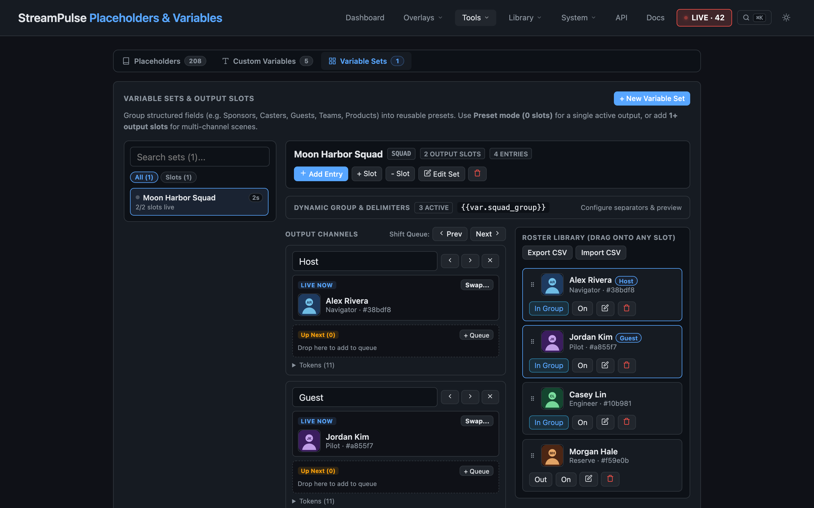

# Custom Variables & Variable Sets

Custom Variables let you create live, shared broadcast tokens (`{{var.name}}`) that update instantaneously across **Custom Overlays**, **Alert Studio**, **Promos**, and **Bitfocus Companion** without editing overlay layouts mid-stream.

**Variable Sets** extend this with structured multi-field rosters (such as a podcast panel, co-op squad, tournament players, or rotating sponsors) that generate live per-slot tokens, dynamic group strings, and **Group Image Strips** with customizable **Member Badges**.


---

## 1. Global Custom Variables

Manage global variables in **Admin -> Variables** (or open the Variables drawer inside the **Custom Overlay Editor**).

### Variable Types

| Type | Behavior | Common Uses |
| :--- | :--- | :--- |
| **counter** | Integer with optional `min`, `max`, `step`, and `defaultValue` | Death counters, win streaks, round trackers |
| **number** | Numeric value supporting decimals (`precision`) and bounds | Scores, speedrun splits, K/D ratios |
| **text** | Free-form single-line or short string | Current game, stream topic, guest name |
| **list** | Ordered array of choices that can be cycled or rolled | Map pool, challenge wheel, trivia topics |
| **image** | Image URL or uploaded asset path | Sponsor logo, team crest, active emote |
| **toggle** | Boolean (`true` / `false`) that flips via API or Companion | Co-op mode, mic status, sub-only flag |
| **color** | Hex / Hex-Alpha color (`#RRGGBB` or `#RRGGBBAA`) | Team color, theme accent, alert border tint |
| **template** | Composite text formula referencing other `{{var.*}}` tokens | Scoreboards (`{{var.home}} - {{var.away}}`) |
| **font** | Font family name for dynamic typography | Per-segment theme font switching |

### Using Variables in Overlays & Alerts

Insert any variable into a **Text** element, **Image** URL, or **Color** field using double curly braces:

```text
{{var.deaths}}
{{var.score}}
{{var.guest_name}}
```

#### Fallback Values

Provide a default fallback with `|` in case a variable is empty or not yet initialized:

```text
{{var.guest_name|Solo Stream}}
{{var.sponsor_tagline|Support the channel!}}
```

#### Dynamic Actions

Counter, number, list, and toggle variables support instant live mutations from the Admin UI, Companion buttons, or HTTP endpoints:

- **Increment / Decrement**: Adds or subtracts `step` (respecting `min` / `max` bounds).
- **Reset**: Restores `defaultValue`.
- **Roll**: Picks a random item from a `list` variable (or random integer within `min`..`max` for `counter`/`number`).
- **Toggle**: Flips a `toggle` variable between `true` and `false`.

---

## 2. Multi-Field Variable Sets

When tracking people, teams, or sponsors with multiple attributes (name, avatar, role, social handle, accent color, badge icon), use a **Variable Set** instead of juggling dozens of separate global variables.

Enable the module in **Settings -> Feature Modules** (`variable_sets_enabled`), then open **Admin -> Variables -> Variable Sets**.



### Defining Schema Fields

Each Variable Set defines its own custom fields:

| Field Type | Description |
| :--- | :--- |
| **text** | Display name, handle, role, or short bio |
| **image** | Avatar portrait, emblem, or secondary badge icon |
| **color** | Per-member accent or badge color (`#RRGGBB` / `#RRGGBBAA`) |
| **toggle** | Boolean flag (e.g., `verified`, `captain`, `muted`) |

You can import and export Variable Set entries via **CSV** directly from the Variable Sets panel (`GET /api/variables/sets/:setId/export` and `POST /api/variables/sets/:setId/import`).

### Slots, Queues & Shorthand Tokens

A Variable Set supports **0 or more active slots** (`slotCount`):

- **1+ Slots** (e.g., Spotlight / Host & Guest): Assign entries to numbered slots (`Slot 1`, `Slot 2`, ...) or give slots custom names (e.g., `Host`, `Guest`).
- **0 Slots (Group Roster Only)**: Skip slot assignment entirely and drive everything through the **In Group** checkbox (`inGroup`) and **Group Image Strips**.

For a set with ID `squad` and fields `name`, `avatar`, `role`, and `accent`, StreamPulse automatically materializes the following live tokens:

- **Numbered Slot Tokens**: `{{var.squad_1_name}}`, `{{var.squad_1_avatar}}`, `{{var.squad_1_slot_name}}`, `{{var.squad_1_active}}`
- **Slot 1 Shorthand**: `{{var.squad_name}}`, `{{var.squad_avatar}}` (mirrors Slot 1 for quick single-spotlight overlays)
- **Named Slot Aliases**: If Slot 2 is named `Guest`, you can reference `{{var.squad_guest_name}}` and `{{var.squad_guest_avatar}}`
- **Group Summary Tokens**:
  - `{{var.squad_group}}`: Formatted text list of all entries marked **In Group**
  - `{{var.squad_group_count}}`: Total count of active **In Group** entries
  - `{{var.squad_group_members}}`: Comma-separated list of active member names
  - `{{var.squad_group_<field>}}` / `{{var.squad_joined_<field>}}`: Delimited list of a single field across all group members

### Rotation & Studio Sets Follow

Variable Sets include a built-in **Timed Rotation** controller (`intervalSeconds`, `mode`, `transition`, `durationMs`) to cycle through queued or enabled entries automatically:

- **Rotation Modes**: Cycle `enabled` entries or work through the dedicated **Queue** (`queue/add`, `queue/remove`, `queue/clear`).
- **Shift / Advance**: Call `advance?mode=shift` or `rewind?mode=shift` to cascade slots (e.g., moving Slot 2 into Slot 1 while pulling the next queued entry into Slot 2).
- **Studio Sets Follow**: In **Custom Overlay Editor**, enable follow toggles so spotlight elements automatically track the currently rotating or active slot.

---

## 3. Group Roster Mode & Member Badge Builder

Add an **Image Group** element in **Custom Overlay Editor** and bind it to a Variable Set to render a live horizontal or vertical strip of member cards (`Group Strip`).


### Filtering to the Selected Roster

Enable **Only Selected Roster (`inGroup`)** in the Image Group properties when you only want members toggled **In Group** to appear on stream. Overlays wait for hydrated `variableSets` status before rendering filtered strips, preventing unselected entries from flashing on initial load.

### Formatting Group Text & Empty Wrappers

Configure how `{{var.<id>_group}}` renders using `separator`, `lastSeparator`, and an `itemTemplate` (for example, `{{name}} ({{role}})`). Empty wrapper tokens such as `()`, `[]`, or trailing punctuation around blank optional fields are stripped automatically so missing handles or roles never leave stray brackets on screen.

### Member Badge Builder & Secondary Images

Click **Edit Member Badges & Fields** on an Image Group element to open the **2-column Member Badge Builder**:

- **Live Preview Canvas (Left)**: Inspect layout, padding, corner icons, and typography against Dark, Light, or Checkerboard backdrops at real-time scale.
- **Field & Layout Inspector (Right)**:
  - **12 Placement Zones**: Place text fields or secondary images in `top`, `bottom`, `overlay`, `badge`, `avatar-tl`, `avatar-tr`, `avatar-bl`, `avatar-br`, `corner-tl`, `corner-tr`, `corner-bl`, or `corner-br`.
  - **Secondary Image / Icon Fields**: Click **+ Image / Icon** to attach platform badges, rank emblems, or static assets (`kind`: Variable Set image field vs static asset from the **Asset Picker**), with dedicated `imgSize`, `imgFit`, `imgShape`, and `imgBorderW` controls.
  - **Card & Field Spacing**: Adjust `cardPaddingX` / `cardPaddingY`, `cornerInset` for corner badges, per-field `padX` / `padY`, and explicit `fontSize` (px) and `fontFamily`.
  - **11 Built-in Presets**: Start from curated badge templates (Compact Pill, Esports Card, Corner Crest, Minimal Tag, Podcast Nameplate, and more) and fine-tune from there.

---

## 4. Variable Colors & Color Placeholder Picker

Any color property in the **Custom Overlay Editor** inspector (text color, background fill, border color, accent tint, or Member Badge field colors) supports live variable tokens:

- **Global Color Variables**: `{{var.team_color}}`
- **Per-Member Group Badge Colors**: `@accent` (resolves each member's own `color` field inside a Group Strip or Member Badge)

Instead of cluttering color inputs with full variable lists, click the **`{}`** button next to any color picker to open the **Color-Only Placeholder Picker**, which filters down exclusively to `color` global variables and `@fieldKey` member color fields.

---

## 5. Bitfocus Companion & HTTP Automation

Every Variable and Variable Set action exposes Companion-friendly `GET` and `POST` endpoints:

- Read any variable as plain text for Companion dynamic labels:
  `GET /api/variables/deaths?plain=1`
- Trigger live updates from a Stream Deck button:
  `GET /api/variables/deaths/increment`
  `GET /api/variables/squad/assign?slot=1&entry=alex-rivera`
  `GET /api/variables/squad/rotation/next`
  `GET /api/variables/squad/entry/group-toggle?entry=jordan-kim&inGroup=1`

See the [API Reference](api-reference.md#variables-amp-variable-sets-api) for the complete endpoint list and payload schemas.
